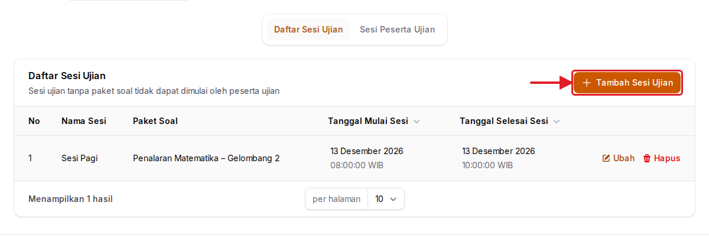
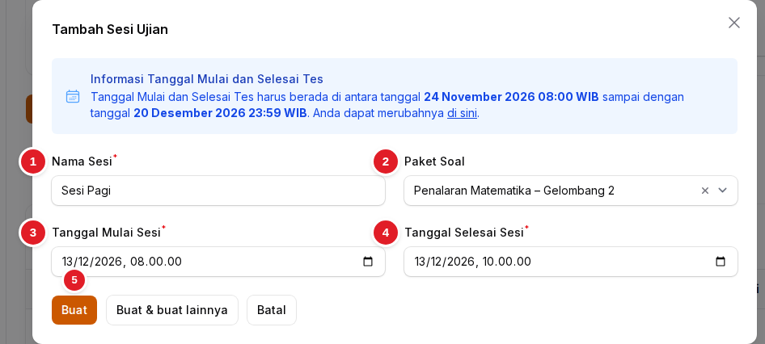

# Standar penulisan dokumentasi CBT Indolat

File ini adalah standar wajib untuk setiap perubahan di repo ini: menambah, mengubah, menghapus, atau menerjemahkan
halaman. Ikuti standar ini walaupun permintaannya singkat ("tambahkan satu poin", "rapikan kalimat ini"). Contoh acuan
terbaik: `data-ujian/membuat-sesi-ujian.mdx` (panduan), `cbt/dasbor-cbt.mdx` (panduan pendek),
`konsep/metode-penilaian.mdx` (konsep), `api/ujian.mdx` (API), dan pasangan `en/` masing-masing.

Struktur folder dan pratinjau lokal ada di `README.md`.

## Prinsip utama

1. **Akurat terhadap aplikasi.** Nama menu, tombol, kolom, pesan, angka batas, dan perilaku sistem harus persis seperti
   di aplikasi. Jangan mengarang label, batas, atau perilaku. Jika sumbernya tidak ada (kode, screenshot, atau penjelasan
   dari tim), tanyakan dulu. Jangan menebak.
2. **Konsisten di seluruh situs.** Satu fakta bisa muncul di banyak halaman (panduan, konsep, FAQ, glosarium, API).
   Saat fakta berubah, cari semua kemunculannya (`grep -rn "kata kunci" --include='*.mdx' .`) lalu perbarui semuanya,
   termasuk versi `en/`.
3. **ID dan EN selalu berpasangan.** Setiap perubahan halaman ID wajib diikuti perubahan setara di `en/<path yang sama>`
   pada perubahan yang sama. Halaman baru wajib ada di kedua bahasa dan di navigasi kedua bahasa pada `docs.json`.
4. **Ringkas dan faktual.** Jelaskan apa yang dilakukan pengguna dan apa yang dilakukan sistem. Tanpa bahasa promosi
   (kecuali `index.mdx`), tanpa emoji, tanpa basa-basi.

## Alur kerja setiap perubahan

1. Baca halaman yang akan diubah sampai habis, beserta pasangan `en/`-nya.
2. Cari halaman lain yang menyebut topik yang sama dan ikut perbarui jika terdampak.
3. Tulis perubahan ID, lalu perubahan EN yang setara.
4. Halaman baru: daftarkan di `docs.json` pada grup yang sesuai untuk `id` dan `en`, dengan urutan yang sama.
5. Jalankan pemeriksaan di bagian [Pemeriksaan sebelum selesai](#pemeriksaan-sebelum-selesai).
6. Laporkan screenshot yang perlu diambil atau diganti (lihat [Screenshot](#screenshot)).

## Struktur halaman

### Frontmatter

```yaml
---
title: "Membuat Sesi Ujian"
description: "Cara membuat sesi ujian, memasangkan peserta ke sesi ..., serta memindahkan peserta ke sesi lain."
---
```

- `title`: Huruf Kapital di Setiap Kata Utama, tanpa titik. Halaman tugas memakai kata kerja (**Membuat ...**,
  **Menambahkan ...**); halaman fitur memakai nama menu (**Dasbor CBT**, **Leaderboard**).
- `description`: satu kalimat lengkap diakhiri titik, merangkum isi halaman. Sering dibuka dengan "Cara ...".
- `sidebarTitle` hanya dipakai di halaman API.

### Halaman panduan (folder modul)

1. **Paragraf pembuka**: apa fungsi menu/fitur ini dan apa yang dijelaskan halaman. Dibuka dengan nama fitur, misalnya
   "Menu **Monitoring Ujian** menampilkan ..." atau "**Sesi ujian** menentukan ...".
2. **Blok lokasi menu** tepat setelah pembuka:

   ```mdx
   <Info>
     **Lokasi menu:** **Portal** → **Platform Ujian (CBT)** → **Manajemen Ujian** → **Data Ujian**. Kalimat konteks bila perlu.
   </Info>
   ```

   Pakai **Lokasi pengaturan:** jika yang ditunjuk adalah pengaturan, bukan menu. Jika lokasinya lebih dari satu, tulis
   sebagai daftar di dalam `<Info>`.
3. Bila membantu, ringkasan konsep singkat atau contoh skenario sebelum langkah.
4. **Bagian `##` per tugas**, berisi `<Steps>`. Tugas lanjutan (mengubah, menghapus, memindahkan) di bagian `##` atau
   `###` tersendiri.
5. Akhiri dengan penanganan kasus khusus ("## Jika ..."), tombol lain di halaman, atau tautan ke langkah berikutnya.

Halaman konsep (`konsep/`), glosarium, FAQ, dan `index.mdx` tidak wajib memakai blok lokasi menu.

### Judul bagian

- `##` dan `###` memakai huruf kapital hanya di awal kalimat, kecuali nama menu/fitur: "## Membuat sesi ujian",
  "## Grafik Jumlah Pendaftar", "## Jika Dasbor kosong".
- Judul tugas memakai kata kerja ber-awalan me-: **Membuat**, **Mengubah**, **Memasangkan**, **Memindahkan**.
- Tahapan berurutan yang panjang boleh bernomor: "## 1. Mengatur akses API".
- Jangan mengubah judul yang sudah ada tanpa alasan, karena anchor (`#memberi-skor-manual-untuk-tes-esai`) dipakai
  halaman lain. Jika terpaksa diubah, perbarui semua tautan ke anchor tersebut.

### Langkah (`<Steps>`)

```mdx
<Steps>
  <Step title="Klik Tambah Sesi Ujian">
    Gulir ke bagian **Daftar Sesi Ujian**, lalu klik **Tambah Sesi Ujian**.

    <Frame>
      
    </Frame>
  </Step>
  <Step title="Isi informasi sesi">
    <Frame>
      
    </Frame>

    1. **Nama Sesi**: nama yang mudah dikenali. Contoh: **Sesi Pagi**.
    2. **Paket Soal**: paket soal yang dikerjakan pada sesi ini.
    3. Klik **Buat**.
  </Step>
</Steps>
```

- `title` langkah: kalimat perintah pendek, tanpa format tebal ("Buka detail tes ujian", "Pilih sesi dan status").
- Satu langkah = satu tindakan utama, ditulis dengan pola "Klik **X**, lalu pilih **Y**."
- Formulir dengan banyak kolom: gambar dulu, lalu daftar bernomor `1. **Nama Kolom**: penjelasan. Contoh: ...`.
  Nomor di daftar harus sama dengan lingkaran bernomor pada gambar. Item terakhir biasanya tombol simpan.
- Sebutkan hasil yang terlihat setelah tindakan: "Sistem menampilkan notifikasi **Sesi Ujian Berhasil Diperbarui**."
- Beberapa cara untuk satu tugas dipisah dengan `<AccordionGroup>`/`<Accordion title="Satu per satu">`, masing-masing
  berisi `<Steps>` sendiri.

### Callout

| Komponen | Dipakai untuk |
| --- | --- |
| `<Info>` | Lokasi menu/pengaturan, atau konteks penting tentang cara kerja sistem. |
| `<Note>` | Syarat, batasan, dan pengecualian. Beberapa poin ditulis sebagai daftar `-`. |
| `<Tip>` | Saran opsional yang memudahkan pekerjaan. |
| `<Warning>` | Tindakan yang tidak bisa dibatalkan, risiko kehilangan data, atau kondisi yang langsung membuat peserta tidak bisa ujian/nilai salah. Jangan dipakai untuk hal biasa. |
| `<Check>` | Pemeriksaan hasil di akhir tugas ("Pastikan tidak ada lagi peserta berketerangan ..."). |

Isi callout diberi indentasi dua spasi. Jangan menumpuk lebih dari dua callout berturut-turut.

### Halaman konsep

Penjelasan, tabel ringkasan, rumus di blok ` ```text `, dan **Contoh** dengan angka nyata yang bisa dihitung ulang.
Pola: subjudul "**Rumus**", blok rumus, lalu "**Contoh**" dengan tabel atau perhitungan. Tautkan ke halaman panduan
yang berisi langkahnya.

### Halaman API (`api/`)

- Pembuka: "Seluruh request pada halaman ini membutuhkan [Bearer API Key](/api/autentikasi)."
- Tabel field: `| Field | Keterangan |`, nama field dalam `kode`, keterangan berupa kalimat diakhiri titik.
- Setiap endpoint dalam `<Accordion title="GET /exams/{exam} — Detail ujian">` (em dash `—` di antara path dan judul),
  berisi `### Parameter` (tabel `Nama | Lokasi | Wajib | Tipe | Keterangan`), `### Contoh request` (curl dengan
  `<API_KEY>`), dan `### Contoh response` (JSON).
- Base URL `https://app.indolat.com/api/v1`. Istilah teknis (request, response, endpoint, field, payload, header)
  ditulis biasa tanpa miring.
- Contoh JSON harus konsisten dengan tabel field dan nilai enum di halaman lain.

### FAQ dan glosarium

- FAQ: `<AccordionGroup>` per kategori `##`; judul accordion berupa pertanyaan pengguna; jawaban dibuka dengan jawaban
  langsung ("Bisa, dengan dua cara:", "Tidak."), lalu ditutup dengan "Lihat [Halaman](/path#anchor)."
- Glosarium: `### Istilah`, lalu `**Artinya:**` dan `**Contoh penggunaan:**<br />`, antar-istilah dipisah `---`.
  Istilah baru yang muncul di aplikasi ditambahkan ke glosarium kedua bahasa.

## Gaya bahasa Indonesia

- Bahasa Indonesia baku (EYD V, KBBI), sapaan **Anda** (huruf A kapital), kalimat aktif, kala kini.
- Tulis dari sudut pandang admin yang memakai aplikasi. Subjek tindakan sistem adalah "sistem": "Sistem membagi rata
  ...", "Sistem otomatis menyelesaikan ...".
- Kalimat pendek dan langsung. Satu paragraf = satu gagasan.
- Kata hubung yang lazim dipakai: "lalu", "sehingga", "misalnya", "Contoh:", "Sebagai contoh,".
- Daftar tiga hal atau lebih memakai koma sebelum "dan"/"atau": "nama, paket soal, atau jadwal".
- Istilah asing di halaman panduan dimiringkan pada pemakaian umum (*proctoring*, *online*). Nama fitur/menu dari
  aplikasi tidak dimiringkan, tetapi ditebalkan.

### Istilah baku

| Pakai | Hindari (di halaman panduan) |
| --- | --- |
| projek (sesuai aplikasi) | proyek |
| paket soal, ujian, tes, sesi, peserta | bank soal, exam, test, kandidat |
| klik, pilih, centang, gulir | tekan, ketuk (kecuali konteks ponsel) |
| tautan | link (boleh di halaman API dan nama field) |
| unggah, unduh | upload, download (kecuali nama tombol di aplikasi) |
| kata sandi | password |
| kolom | field (boleh di halaman API) |
| jendela | modal, popup |
| halaman login, masuk | log in |

Jika aplikasi memakai label berbahasa Inggris (mis. **Leaderboard**, **Pending**, **Generate Kode Bidang**), tulis
persis seperti di aplikasi.

### Format teks

- **Tebal**: semua nama menu, tombol, kolom, tab, pilihan, status, dan pesan sistem, persis seperti di aplikasi,
  termasuk huruf kapital dan tanda bacanya: **Simpan**, **Sesi Ujian Berhasil Diperbarui**.
- Jalur menu ditulis lengkap, setiap bagian ditebalkan, dipisah ` → `: **Portal** → **Platform Ujian (CBT)** → **Dasbor**.
- `kode` untuk nilai yang diketik pengguna atau dibaca mesin: alamat (`prestasi.indolat.web.id`), nilai isian (`-1`),
  nama field API, kode projek.
- Tautan internal memakai path absolut tanpa ekstensi: `[Membuat Tes Ujian](/data-ujian/membuat-tes-ujian#metode-penilaian)`.
  Teks tautan = judul halaman tujuan atau judul bagian tujuan.

### Angka, tanggal, mata uang (ID)

- Tanggal: `13 Desember 2026`. Rentang: `24 November–20 Desember 2026` (en dash `–`, tanpa spasi).
- Jam: `pukul 08.00` atau `08.00–10.00 WIB`.
- Rupiah: `Rp200.000` (tanpa spasi, titik ribuan). Desimal memakai koma: `56,33`, `0,667`.
- Jumlah kecil dalam kalimat biasa boleh ditulis huruf ("tiga kartu", "tujuh hari"); jumlah dengan satuan dan angka
  di contoh perhitungan memakai digit ("20 soal", "60 menit").
- Pemisah dalam nama contoh memakai en dash berspasi: **Tryout Akbar SNBT 2027 – Gelombang 2**.

## Data contoh

Pakai data fiktif yang sudah dipakai di halaman lain agar contoh antarhalaman saling menyambung:

- Lembaga: **Bimbel Prestasi Nusantara** (kode projek `prestasi`, alamat `prestasi.indolat.web.id`), **SMA Harapan Bangsa**.
- Ujian: **Tryout Akbar SNBT 2027** (– Gelombang 1/2), **Tryout Mingguan Penalaran – Pekan 3**.
- Tes: **Penalaran Matematika**, **Literasi Bahasa Indonesia**, **Pengetahuan Kuantitatif**.
- Sesi: **Sesi Pagi** (08.00–10.00 WIB), **Sesi Siang** (13.00–15.00 WIB).
- Peserta: nama Indonesia, misalnya **Aditya Pratama**, **Fitri Handayani**, **Galih Ramadhan**, **Dewi Lestari**.
- Email: `nama.belakang@contoh.id`. Jangan memakai data pelanggan, orang sungguhan, atau domain nyata milik pihak lain.
- Tanggal contoh di sekitar periode ujian contoh (November–Desember 2026).

## Halaman bahasa Inggris (`en/`)

- Path dan nama file sama dengan halaman ID, di bawah `en/`. Gambar memakai path `/images/...` yang sama (tidak
  diduplikasi).
- Struktur, urutan bagian, komponen, dan gambar sama persis dengan halaman ID. Hanya teksnya yang diterjemahkan.
- **Data contoh tidak diterjemahkan.** Nama orang, lembaga, ujian, tes, sesi, dan email `@contoh.id` ditulis sama persis
  dengan halaman ID, karena data yang sama tampil di screenshot yang dipakai kedua bahasa. Jangan menggantinya dengan
  `@example.com` atau nama berbahasa Inggris. Terjemahan dalam kurung boleh ditambahkan pada penyebutan pertama, misalnya
  **Sesi Siang** (Afternoon Session).
- Ejaan British English (*summarise*, *colour*, *organise*). Judul bagian sentence case.
- `title` halaman diterjemahkan ("Create Exam Sessions"); teks tautan memakai judul halaman EN tujuan:
  `[Create a Test](/en/data-ujian/membuat-tes-ujian#exam-type)`.
- Semua tautan internal memakai awalan `/en/`. Anchor mengikuti judul bagian versi EN, bukan ID.
- **Label UI tetap dalam bahasa Indonesia** dan ditebalkan, karena aplikasinya berbahasa Indonesia. Pada penyebutan
  pertama yang maknanya tidak jelas, tambahkan terjemahan dalam kurung: **Total Pendapatan** (total revenue),
  **Terapkan** (Apply). Jalur menu tetap berbahasa Indonesia.
- Blok lokasi: `**Menu location:**` atau `**Settings location:**`.
- Padanan istilah: ujian = exam, tes = test, sesi = session, paket soal = question package, peserta = participant,
  projek = project, ujian berjenjang = multi-level exam, kode bidang = field code, kredit = credit, *proctoring* = proctoring.
- Format EN: jam `08:00`, rupiah di kalimat `Rp200,000`. Teks yang dikutip langsung dari aplikasi tetap seperti
  tampilannya (`Naik Rp200.000 dalam 1 hari terakhir`).

## Screenshot

- Path: `images/<folder>/<halaman>/NN-deskripsi-singkat.png`. `NN` dua digit sesuai urutan tampil di halaman,
  deskripsi kebab-case bahasa Indonesia (`03-daftar-sesi-ujian.png`).
- Setiap gambar dibungkus `<Frame>` dan memiliki teks alt deskriptif tentang isi gambar ("Tombol Tambah Sesi Ujian pada
  bagian Daftar Sesi Ujian"), bukan "gambar 1". Teks alt EN diterjemahkan, nama UI tetap bahasa Indonesia.
- Ketentuan pengambilan (lebar 1440 px, penanda merah `#E11D27`, data fiktif) ada di `README.md`.
- **Claude tidak dapat mengambil screenshot.** Jangan menulis tautan ke gambar yang belum ada. Jika perubahan butuh gambar
  baru atau gambar lama sudah tidak sesuai, tulis teksnya dulu, lalu di akhir jawaban cantumkan daftar screenshot yang
  perlu diambil: path yang diusulkan, area yang dipotong, dan penanda yang perlu ditambahkan.
- Saat gambar diganti atau dihapus, hapus file yang tidak dirujuk lagi dan geser penomoran bila perlu.

## Pemeriksaan sebelum selesai

```bash
mint broken-links

# Halaman ID tanpa pasangan EN
for f in $(git ls-files '*.mdx' | grep -v '^en/'); do [ -f "en/$f" ] || echo "Tanpa EN: $f"; done

# Gambar yang dirujuk tetapi tidak ada
grep -rhoE '\(/images/[^)]+\)' --include='*.mdx' . | tr -d '()' | sort -u | while read p; do [ -f ".$p" ] || echo "Hilang: $p"; done

# Gambar yang tidak dirujuk lagi
git ls-files images | while read p; do grep -rqF "/$p" --include='*.mdx' . || echo "Tidak dipakai: $p"; done
```

Periksa juga secara manual: tidak ada emoji, semua label UI ditebalkan, jalur menu lengkap, dan tautan EN memakai `/en/`.

## Commit

Pesan commit dalam bahasa Inggris, huruf kecil, kalimat perintah, format `docs: ...` atau `docs(<area>): ...`, misalnya
`docs(api): document return_url on exam access links`. Satu commit mencakup perubahan ID dan EN sekaligus.
