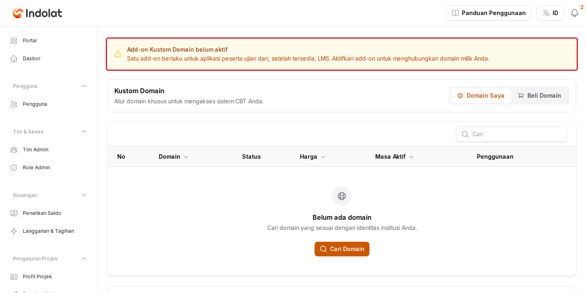
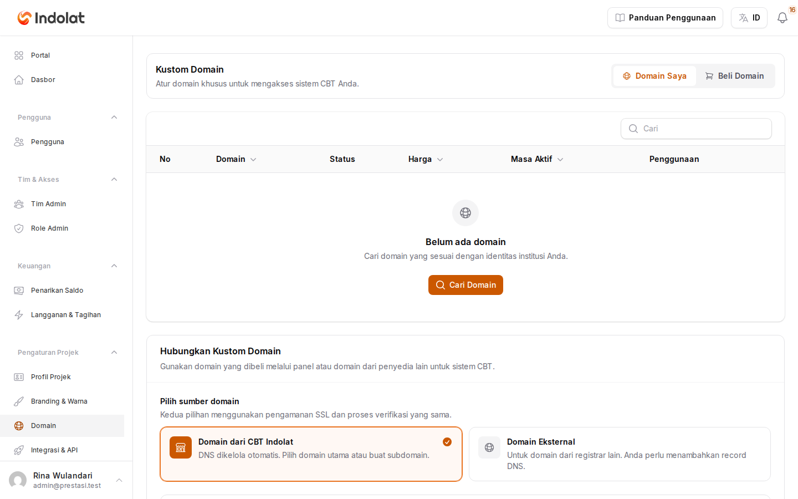
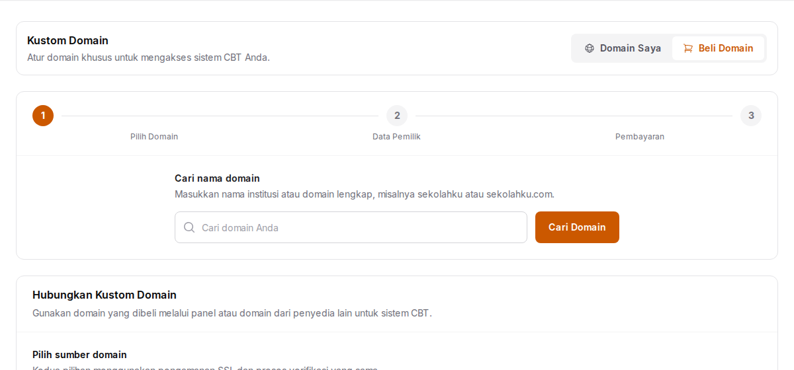
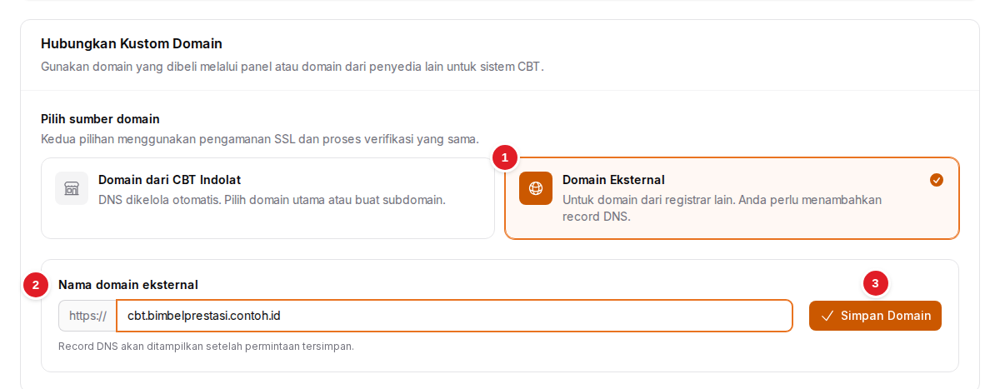

Setiap projek otomatis memiliki alamat bawaan yang dibentuk dari **Kode Projek**. Jika ingin peserta membuka aplikasi ujian melalui alamat milik lembaga, misalnya `cbt.bimbelprestasi.sch.id`, hubungkan kustom domain melalui menu **Domain**.

<Info>
  **Lokasi menu:** **Portal** → **Administrasi Aplikasi** → **Pengaturan Projek** → **Domain**.

  **Peran yang dibutuhkan:** pemilik projek, atau anggota tim yang role-nya mencakup modul **Domain**.
</Info>

## Alamat bawaan

Tanpa kustom domain, projek dapat diakses melalui:

| Layanan | Alamat bawaan | Contoh untuk kode `prestasi` |
| --- | --- | --- |
| Aplikasi peserta ujian (CBT) | `https://<kode-projek>.indolat.web.id` | `https://prestasi.indolat.web.id/auth/login` |
| LMS | `https://lms.indolat.com/<kode-projek>` | `https://lms.indolat.com/prestasi` |

Alamat ini selalu aktif, termasuk setelah kustom domain dihubungkan atau dilepas. Untuk mengubahnya, ganti **Kode Projek** di [Profil Projek](/administrasi/profil-projek).

## Add-on Kustom Domain

Menghubungkan kustom domain memerlukan add-on **Kustom Domain** (Rp100.000/tahun, atau bonus pada paket tahunan). Satu add-on berlaku untuk aplikasi peserta ujian dan, setelah tersedia, LMS. Selama add-on belum aktif, halaman **Domain** menampilkan peringatan **Add-on Kustom Domain belum aktif** dan tombol **Aktifkan Add-on** pada bagian **Hubungkan Kustom Domain**.

<Frame>
  
</Frame>

<Note>
  Kustom domain untuk LMS belum tersedia; LMS tetap diakses melalui alamat bawaannya. Domain untuk website dari **Pembuat Website** dihubungkan dari halaman website tersebut, bukan dari menu ini.
</Note>

## Tampilan halaman Domain

<Frame>
  
</Frame>

- **Kustom Domain**: daftar domain yang dibeli melalui panel (**Domain Saya**) dan tempat membeli domain baru (**Beli Domain**). Kolom tabel: **Domain**, **Status**, **Harga**, **Masa Aktif**, dan **Penggunaan**. Aksi yang tersedia bergantung pada status domain, antara lain **Lanjutkan Pembayaran**, **Perpanjang**, **Beli Lagi**, dan **Gunakan untuk CBT**.
- **Hubungkan Kustom Domain**: tempat menghubungkan domain ke aplikasi peserta ujian.

## 1. Membeli domain melalui panel (opsional)

Jika lembaga belum memiliki domain, Anda dapat membelinya langsung. DNS domain yang dibeli melalui panel dikelola otomatis.

<Frame>
  
</Frame>

<Steps>
  <Step title="Pilih Domain">
    Klik **Beli Domain** (atau **Cari Domain**), ketik nama institusi atau domain lengkap, misalnya `bimbelprestasi` atau `bimbelprestasi.com`, lalu klik **Cari Domain**. Hasil pencarian menampilkan domain yang tersedia beserta harga tahun pertama dan harga perpanjangannya. Klik **Pilih** pada domain yang diinginkan.
  </Step>
  <Step title="Data Pemilik">
    Isi **Data Pemilik Domain** yang dibutuhkan registrar, seperti nama lengkap, alamat email, nomor telepon, dan alamat. Informasi WHOIS memakai perlindungan privasi bila didukung. Beberapa ekstensi domain meminta **Data Tambahan Registry**.
  </Step>
  <Step title="Pembayaran">
    Pilih **Metode Pembayaran**, periksa **Ringkasan Pembayaran**, lalu bayar. Jika add-on **Kustom Domain** belum aktif, add-on tersebut ditambahkan otomatis ke pesanan. Domain aktif selama 1 tahun, dan registrasi dimulai setelah pembayaran terverifikasi.
  </Step>
</Steps>

<Note>
  Jika registrar menolak pendaftaran atau perpanjangan domain, dana pembelian dikembalikan ke **Saldo Dapat Ditarik** projek. Lihat [Transaksi & Penarikan Saldo](/lainnya/transaksi-dan-penarikan-saldo).
</Note>

## 2. Menghubungkan kustom domain

Pada **Pilih sumber domain**, pilih salah satu sumber. Keduanya memakai pengamanan SSL dan proses verifikasi yang sama.

### Domain dari CBT Indolat

Untuk domain yang dibeli melalui panel:

1. Klik **Domain dari CBT Indolat**.
2. Pilih domain pada **Domain yang akan digunakan**.
3. Pilih **Jenis alamat**:
   - **Domain Utama**, misalnya `bimbelprestasi.com`. Domain utama hanya dapat dipakai oleh satu CBT atau satu website.
   - **Subdomain**, lalu isi **Nama subdomain**, misalnya `cbt` untuk `cbt.bimbelprestasi.com`. Gunakan huruf kecil, angka, atau tanda hubung tanpa titik. Satu domain dapat memiliki banyak subdomain.
4. Klik **Gunakan Domain**, lalu **Ya, Gunakan Domain**. Record DNS dibuat dan diperbarui otomatis.

### Domain Eksternal

Untuk domain yang dibeli dari registrar lain:

<Frame>
  
</Frame>

1. Klik **Domain Eksternal**.
2. Isi **Nama domain eksternal** tanpa `https://`, misalnya `cbt.bimbelprestasi.contoh.id`.
3. Klik **Simpan Domain**, lalu **Ya, Simpan Domain** pada jendela konfirmasi.

Setelah tersimpan, bagian **Record DNS Domain Eksternal** menampilkan record yang harus ditambahkan pada pengelola DNS domain Anda. Tambahkan seluruh record tersebut dan nonaktifkan proxy untuk record CNAME selama verifikasi. Jika record belum muncul, muat ulang halaman beberapa menit kemudian.

## 3. Memantau status dan melepas domain

Domain yang terhubung tampil di bagian atas **Hubungkan Kustom Domain** dengan salah satu status berikut:

| Status | Arti |
| --- | --- |
| **Menunggu Verifikasi** | Domain sedang diverifikasi. Proses ini biasanya selesai dalam beberapa menit setelah DNS benar. |
| **Aktif** | Domain siap digunakan. Klik **Buka kustom domain** untuk mencobanya. |
| **Perlu Tindakan** | Verifikasi gagal. Periksa pengaturan DNS sesuai keterangan yang tampil, lalu kirim ulang permintaan. |
| **Verifikasi Dibatalkan** | Permintaan verifikasi dibatalkan. Hubungkan ulang domain bila masih ingin dipakai. |

Untuk berhenti memakai kustom domain, klik **Lepas Domain**, lalu **Ya, Lepas Domain**. Peserta tetap dapat mengakses aplikasi melalui alamat bawaan.

<Warning>
  Setelah kustom domain aktif, bagikan alamat baru kepada peserta. Perubahan domain dibatasi sementara; jika Anda terlalu sering mengganti domain, sistem meminta Anda mencoba lagi beberapa saat kemudian.
</Warning>
