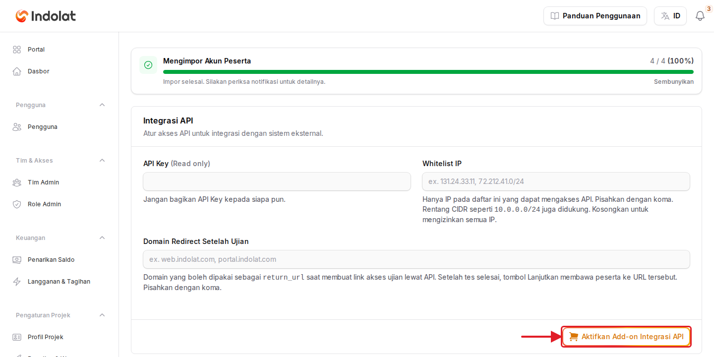
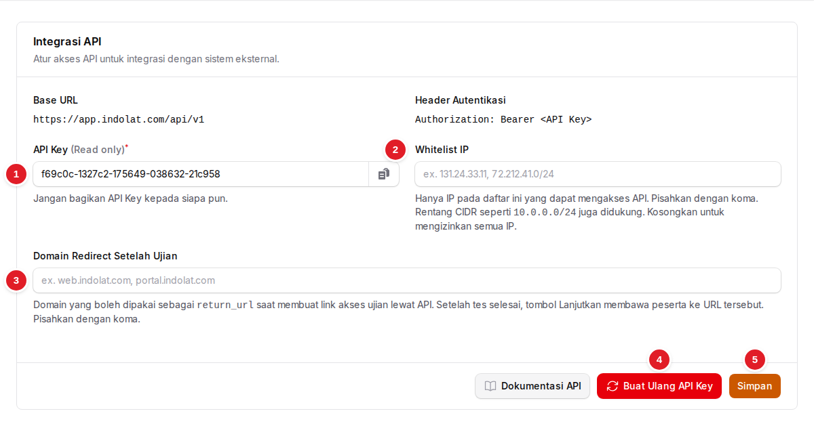
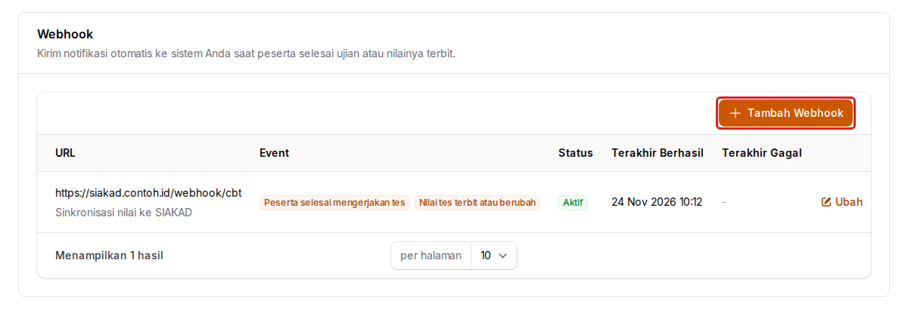
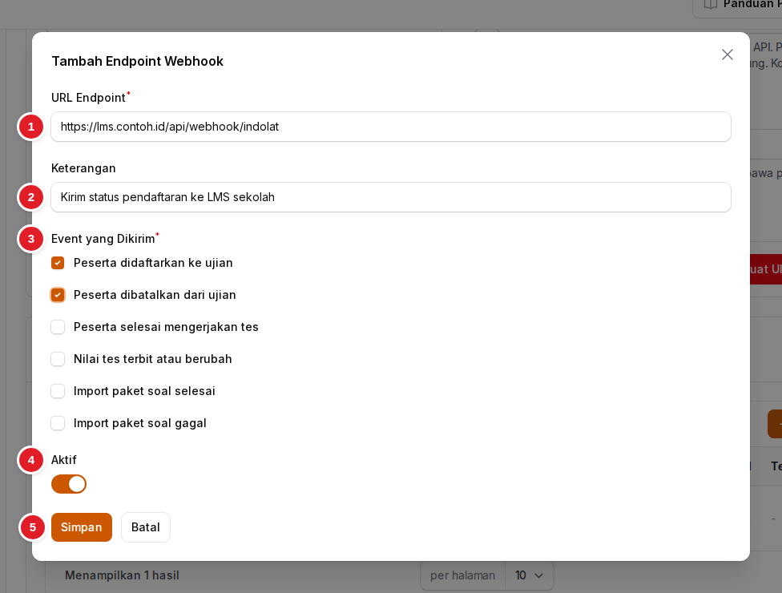

Menu **Integrasi & API** menghubungkan projek dengan sistem lain milik lembaga, misalnya SIAKAD atau LMS sekolah. Melalui REST API, sistem Anda dapat mengelola peserta, mendaftarkannya ke ujian, membuat link ujian, dan menarik hasil ujian. Webhook mengirim notifikasi otomatis ke sistem Anda saat terjadi peristiwa tertentu, misalnya peserta selesai mengerjakan tes.

<Info>
  **Lokasi menu:** **Portal** → **Administrasi Aplikasi** → **Pengaturan Projek** → **Integrasi & API**.

  **Peran yang dibutuhkan:** pemilik projek, atau anggota tim yang role-nya mencakup modul **Integrasi & API**.
</Info>

Panduan teknis setiap endpoint tersedia di tab **Dokumentasi API**, dimulai dari [Autentikasi API](/api/autentikasi) dan [API Webhook](/api/webhook).

## Add-on Integrasi API

API dan webhook hanya dapat dipakai bila add-on **Integrasi API** (Rp200.000/tahun) aktif. Selama add-on belum aktif, kolom pada bagian **Integrasi API** tidak dapat diisi, **API Key** tidak ditampilkan, dan bagian **Webhook** tersembunyi. Klik **Aktifkan Add-on Integrasi API** untuk langsung membuka halaman pembelian add-on.

<Frame>
  
</Frame>

## 1. Mengatur akses API

Setelah add-on aktif, bagian **Integrasi API** menampilkan data koneksi:

- **Base URL**: alamat dasar API, yaitu `https://app.indolat.com/api/v1`.
- **Header Autentikasi**: setiap request mengirim header `Authorization: Bearer <API Key>`.

<Frame>
  
</Frame>

1. **API Key (Read only)**: kunci rahasia projek. Klik ikon salin di ujung kolom untuk menyalinnya. Satu API Key berlaku untuk seluruh API projek.
2. **Whitelist IP** (opsional): alamat IP server yang boleh memanggil API, dipisahkan koma, misalnya `131.24.33.11, 72.212.41.0/24`. Rentang CIDR didukung. Kosongkan untuk mengizinkan semua IP.
3. **Domain Redirect Setelah Ujian** (opsional): domain yang boleh dipakai sebagai `return_url` saat membuat link akses ujian melalui API, dipisahkan koma, misalnya `siakad.bimbelprestasi.sch.id`. Setelah tes selesai, tombol **Lanjutkan** membawa peserta ke URL tersebut.
4. **Buat Ulang API Key**: membuat API Key baru.
5. **Simpan**: menyimpan **Whitelist IP** dan **Domain Redirect Setelah Ujian**.

Tombol **Dokumentasi API** membuka dokumentasi API di tab baru.

<Warning>
  Setelah **Buat Ulang API Key** dikonfirmasi, API Key lama langsung berhenti berfungsi. Perbarui seluruh integrasi yang masih memakai kunci lama. Jangan bagikan API Key kepada siapa pun.
</Warning>

<Note>
  Alamat IP atau rentang CIDR yang tidak valid ditolak saat menyimpan, misalnya dengan pesan *Alamat IP "..." tidak valid.*
</Note>

## 2. Menambahkan webhook

Bagian **Webhook** menampilkan endpoint yang terdaftar beserta event yang dikirim, status, serta waktu pengiriman **Terakhir Berhasil** dan **Terakhir Gagal**.

<Frame>
  
</Frame>

<Steps>
  <Step title="Klik Tambah Webhook">
    Pada bagian **Webhook**, klik **Tambah Webhook**.
  </Step>
  <Step title="Isi data endpoint">
    <Frame>
      
    </Frame>

    1. **URL Endpoint**: alamat `https://` lengkap di server publik yang akan menerima notifikasi, misalnya `https://lms.contoh.id/api/webhook/indolat`.
    2. **Keterangan** (opsional): penanda endpoint, misalnya `Kirim status pendaftaran ke LMS sekolah`.
    3. **Event yang Dikirim**: centang minimal satu event:
       - **Peserta didaftarkan ke ujian**
       - **Peserta dibatalkan dari ujian**
       - **Peserta selesai mengerjakan tes**
       - **Nilai tes terbit atau berubah**
       - **Import paket soal selesai**
       - **Import paket soal gagal**
    4. **Aktif**: biarkan menyala agar endpoint langsung menerima notifikasi.
    5. Klik **Simpan**.
  </Step>
  <Step title="Simpan signing secret">
    Notifikasi **Webhook Berhasil Ditambahkan** menampilkan *signing secret* endpoint. Salin dan simpan secret tersebut di sistem Anda untuk memverifikasi signature setiap notifikasi; nilainya tidak dapat dilihat kembali.
  </Step>
</Steps>

<Note>
  Satu projek dapat memiliki maksimal 5 endpoint webhook. Webhook hanya dikirim selama add-on **Integrasi API** aktif dan endpoint berstatus **Aktif**. Cara memverifikasi signature dijelaskan di [API Webhook](/api/webhook).
</Note>

## 3. Mengelola webhook

Setiap baris endpoint memiliki aksi berikut (geser tabel ke kanan bila tidak terlihat):

- **Ubah**: mengganti URL, keterangan, event, atau status aktif.
- **Ganti Secret**: membuat signing secret baru. Secret lama langsung berhenti berlaku, jadi perbarui verifikasi signature di sistem Anda.
- **Kirim Uji Coba**: mengirim notifikasi percobaan ke endpoint aktif. Hasilnya dapat dilihat beberapa saat kemudian di **Riwayat**.
- **Riwayat**: menampilkan **Riwayat Pengiriman** notifikasi ke endpoint tersebut.
- **Hapus**: menghapus endpoint.

Kolom **Status** menampilkan **Aktif**, **Nonaktif**, atau **Dinonaktifkan Sistem**. Endpoint dinonaktifkan sistem setelah 10 kali gagal berturut-turut; perbaiki server penerima, lalu aktifkan kembali melalui **Ubah**.
