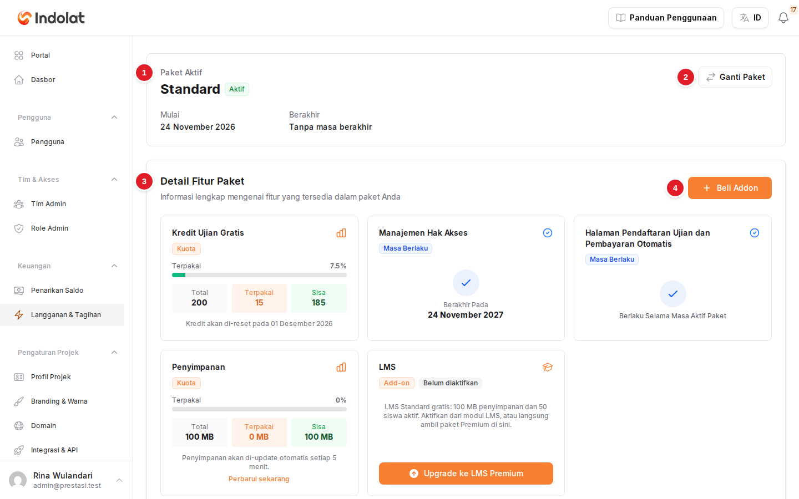
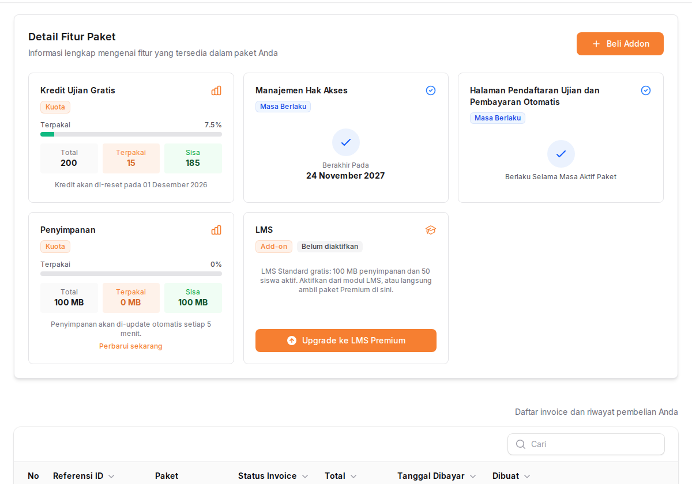
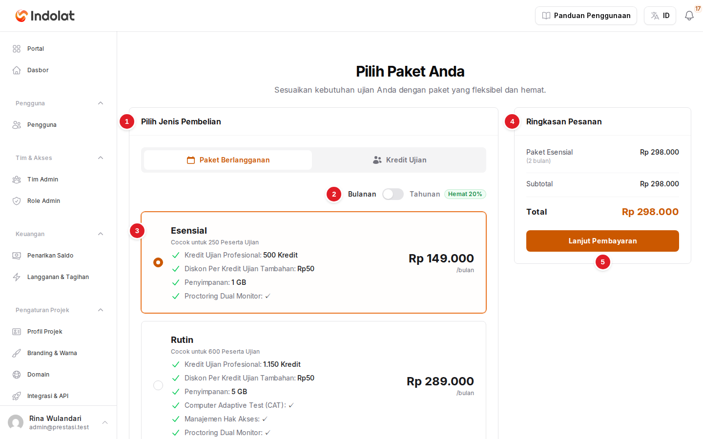
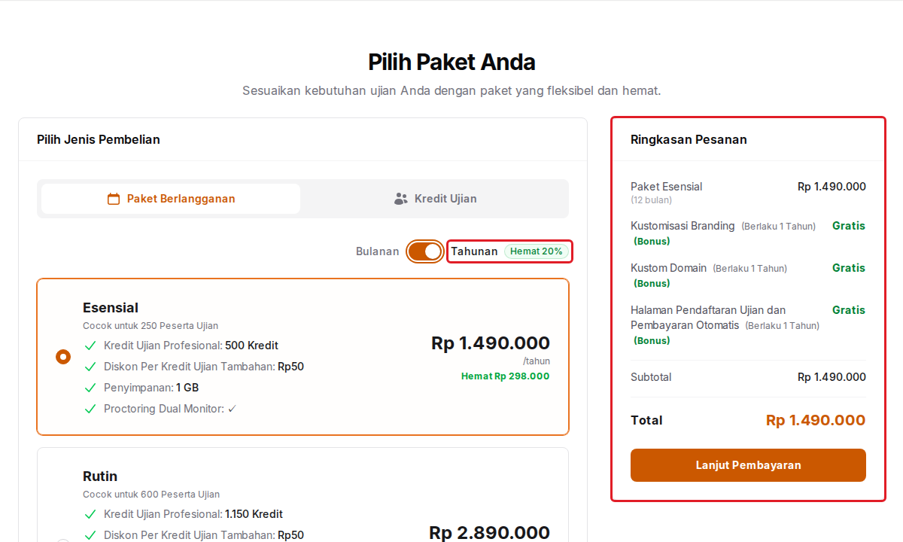
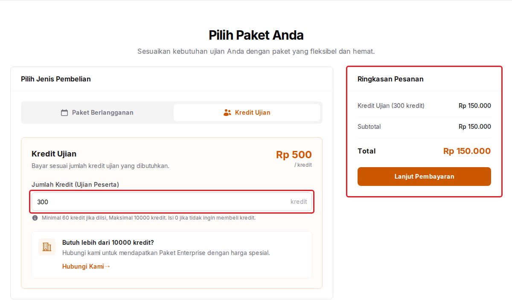
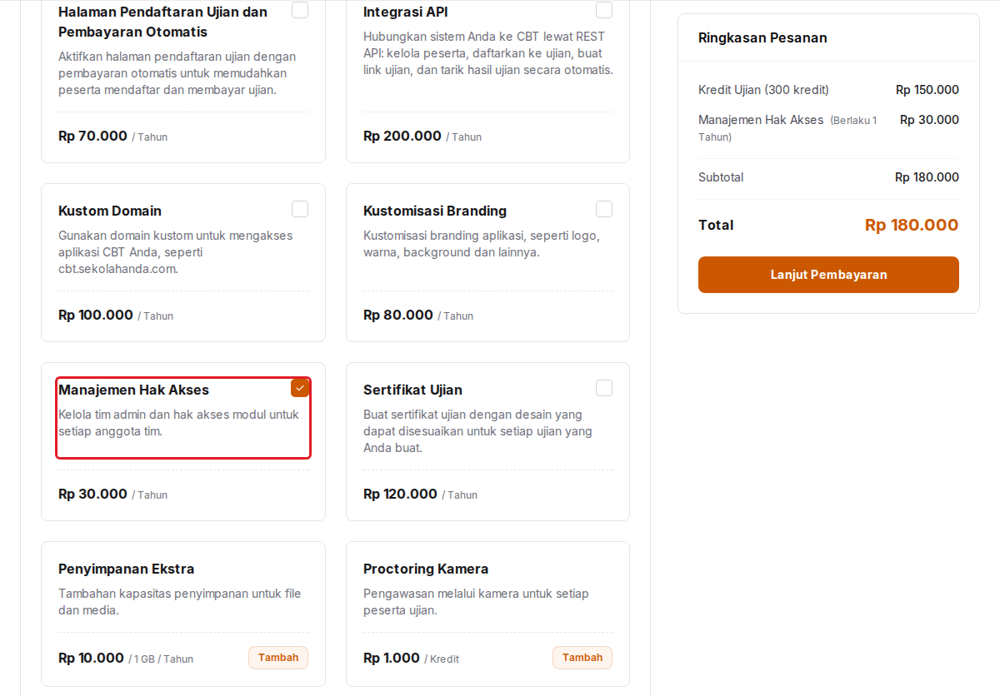
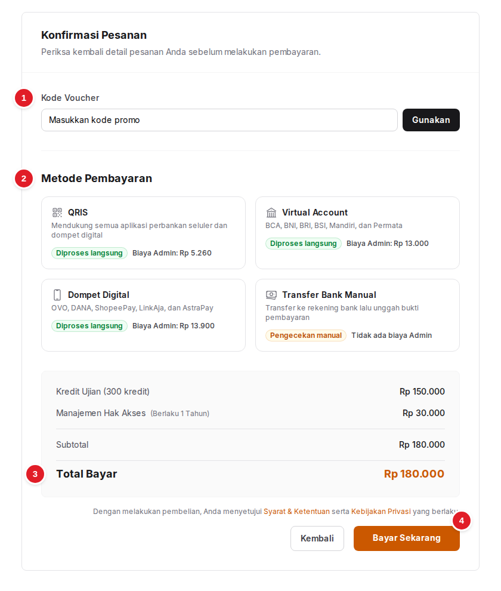
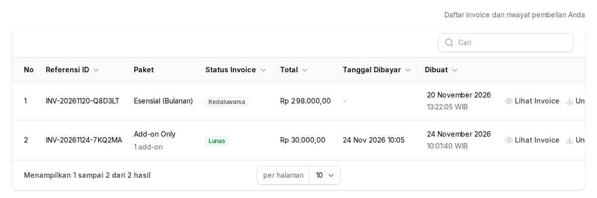

Menu **Langganan & Tagihan** menampilkan paket yang sedang aktif, sisa kuota setiap fitur, dan riwayat invoice. Dari halaman ini pula Anda membeli paket berlangganan, kredit ujian tambahan, atau add-on.

<Info>
  **Lokasi menu:** **Portal** → **Administrasi Aplikasi** → **Keuangan** → **Langganan & Tagihan**.

  **Peran yang dibutuhkan:** pemilik projek, atau anggota tim yang role-nya mencakup modul **Langganan & Tagihan**.
</Info>

## Pilihan paket

Setiap projek baru memakai paket **Standard** yang gratis tanpa masa berakhir: **200 kredit ujian gratis** per bulan dan penyimpanan **100 MB**. Satu kredit terpakai setiap kali seorang peserta memulai satu tes ujian. Jika kebutuhan Anda lebih besar, ada tiga cara menambah kapasitas:

| Pilihan | Cocok untuk | Harga |
| --- | --- | --- |
| **Paket Berlangganan** | Lembaga yang rutin mengadakan ujian setiap bulan | Esensial, Rutin, atau Intensif, dibayar bulanan atau tahunan |
| **Kredit Ujian** | Ujian sesekali tanpa komitmen langganan | **Rp500 per kredit**, minimal 60 dan maksimal 10.000 kredit per pembelian |
| **Add-on** | Menambah fitur tertentu ke paket mana pun | Harga per add-on, berlaku 1 tahun atau per pemakaian |

Paket berlangganan yang tersedia:

| Paket | Cocok untuk | Kredit Ujian Profesional | Penyimpanan | Fitur tambahan | Bulanan | Tahunan |
| --- | --- | --- | --- | --- | --- | --- |
| **Esensial** | 250 peserta ujian | 500 kredit | 1 GB | Proctoring Dual Monitor | Rp149.000 | Rp1.490.000 |
| **Rutin** | 600 peserta ujian | 1.150 kredit | 5 GB | Proctoring Dual Monitor, Computer Adaptive Test (CAT), Manajemen Hak Akses | Rp289.000 | Rp2.890.000 |
| **Intensif** | 1.400 peserta ujian | 2.800 kredit | 20 GB | Proctoring Dual Monitor, Computer Adaptive Test (CAT), Manajemen Hak Akses | Rp699.000 | Rp6.990.000 |

Semua paket berlangganan juga memberi **Diskon Per Kredit Ujian Tambahan** sebesar **Rp50**, sehingga kredit tambahan dibeli seharga Rp450 per kredit selama langganan aktif.

<Note>
  Untuk kebutuhan lebih dari 10.000 kredit, gunakan tautan **Hubungi Kami** pada pilihan **Kredit Ujian** untuk mendapatkan Paket Enterprise dengan harga khusus.
</Note>

## 1. Melihat paket aktif dan kuota

Buka **Administrasi Aplikasi** → **Keuangan** → **Langganan & Tagihan**.

<Frame>
  
</Frame>

1. **Paket Aktif**: nama paket, status, tanggal **Mulai**, dan tanggal **Berakhir**. Paket **Standard** tertulis *Tanpa masa berakhir*.
2. **Ganti Paket**: membuka halaman pembelian untuk memilih atau meningkatkan paket.
3. **Detail Fitur Paket**: rincian fitur dan kuota yang aktif pada projek.
4. **Beli Addon**: membuka halaman pembelian khusus add-on dan kredit, tanpa memilih paket.

Kartu pada **Detail Fitur Paket** terbagi menjadi dua jenis:

<Frame>
  
</Frame>

- Kartu berlabel **Kuota**, misalnya **Kredit Ujian Gratis** dan **Penyimpanan**, menampilkan **Total**, **Terpakai**, dan **Sisa** beserta persentase pemakaian. **Kredit Ujian Gratis** diisi ulang setiap awal bulan; tanggal pengisian berikutnya tertulis di bawah kartu. Pemakaian penyimpanan diperbarui otomatis setiap 5 menit; klik **Perbarui sekarang** untuk menghitung ulang saat itu juga.
- Kartu berlabel **Masa Berlaku**, misalnya add-on **Manajemen Hak Akses**, menampilkan tanggal **Berakhir Pada**, atau *Berlaku Selama Masa Aktif Paket* bila fitur mengikuti paket.

Kartu **LMS** menunjukkan status paket LMS projek. Paket LMS Standard gratis (100 MB penyimpanan dan 50 siswa aktif) diaktifkan dari modul LMS; klik **Upgrade ke LMS Premium** untuk membeli paket Premium.

## 2. Membeli atau meningkatkan paket

<Steps>
  <Step title="Klik Ganti Paket">
    Pada kartu **Paket Aktif**, klik **Ganti Paket**. Halaman **Pilih Paket Anda** terbuka.

    <Frame>
      
    </Frame>

    1. **Pilih Jenis Pembelian**: **Paket Berlangganan** atau **Kredit Ujian**.
    2. Sakelar **Bulanan**/**Tahunan**: periode pembayaran paket.
    3. Kartu paket: klik **Esensial**, **Rutin**, atau **Intensif**.
    4. **Ringkasan Pesanan**: rincian dan total yang harus dibayar, diperbarui setiap kali Anda mengubah pilihan.
    5. **Lanjut Pembayaran**: melanjutkan ke konfirmasi pesanan.
  </Step>
  <Step title="Pilih periode Bulanan atau Tahunan">
    - **Bulanan**: pembelian pertama minimal **2 bulan**, lalu perpanjangan per bulan. Jika projek sudah memiliki langganan berbayar yang aktif, pembelian minimal 1 bulan.
    - **Tahunan**: harga untuk 12 bulan dengan hemat sekitar 20%. Add-on **Kustomisasi Branding**, **Kustom Domain**, dan **Halaman Pendaftaran Ujian dan Pembayaran Otomatis** otomatis ditambahkan sebagai **Bonus Tahunan** tanpa biaya.

    <Frame>
      
    </Frame>
  </Step>
  <Step title="Lanjutkan ke pembayaran">
    Klik **Lanjut Pembayaran**, lalu ikuti bagian [Menyelesaikan pembayaran](#4-menyelesaikan-pembayaran).
  </Step>
</Steps>

## 3. Membeli kredit ujian dan add-on

<Steps>
  <Step title="Isi jumlah kredit">
    Pada halaman **Pilih Paket Anda**, klik **Kredit Ujian**, lalu isi **Jumlah Kredit (Ujian Peserta)**, misalnya `300`. **Ringkasan Pesanan** menghitung totalnya, yaitu 300 × Rp500 = **Rp150.000**.

    <Frame>
      
    </Frame>

    Isi `0` jika Anda hanya ingin membeli add-on. Jika diisi, jumlah kredit minimal 60 dan maksimal 10.000.
  </Step>
  <Step title="Pilih add-on (opsional)">
    Gulir ke **Add-on Tambahan**, lalu centang add-on yang dibutuhkan. Pada contoh, **Manajemen Hak Akses** ditambahkan sehingga total menjadi **Rp180.000**.

    <Frame>
      
    </Frame>

    | Add-on | Harga | Keterangan |
    | --- | --- | --- |
    | **LMS Premium** | Rp150.000/bulan (12 bulan Rp1.500.000) | Penyimpanan 5 GB dan hingga 250 siswa aktif di LMS. Pilih durasi 1, 3, 6, atau 12 bulan. |
    | **Halaman Pendaftaran Ujian dan Pembayaran Otomatis** | Rp70.000/tahun | Halaman pendaftaran ujian dengan pembayaran otomatis. |
    | **Integrasi API** | Rp200.000/tahun | Akses REST API dan webhook. Lihat [Integrasi & API](/administrasi/integrasi-dan-api). |
    | **Kustom Domain** | Rp100.000/tahun | Domain sendiri untuk aplikasi peserta. Lihat [Domain](/administrasi/domain). |
    | **Kustomisasi Branding** | Rp80.000/tahun | Logo, warna, dan latar aplikasi peserta. |
    | **Manajemen Hak Akses** | Rp30.000/tahun | Tim Admin dan Role Admin. Lihat [Manajemen Akses Admin](/lainnya/manajemen-akses-admin). |
    | **Sertifikat Ujian** | Rp120.000/tahun | Sertifikat dengan desain sendiri untuk setiap ujian. |
    | **Penyimpanan Ekstra** | Rp10.000 per 1 GB/tahun | Klik **Tambah** dan tentukan jumlahnya. |
    | **Proctoring Kamera** | Rp1.000 per kredit | Pengawasan peserta melalui kamera. |
    | **Proctoring Layar** | Rp1.000 per kredit | Pengawasan peserta melalui layar. |
    | **Jasper AI** | Rp10.000 per 300 soal | Pembuatan soal otomatis dengan AI. |

    Klik **Beli Addon** pada halaman **Langganan & Tagihan** jika Anda hanya ingin membeli add-on atau kredit tanpa memilih paket.
  </Step>
  <Step title="Lanjutkan ke pembayaran">
    Klik **Lanjut Pembayaran**. Jika belum ada kredit maupun add-on yang dipilih, tombol tidak dapat diklik dan ringkasan menampilkan **Pesanan Kosong**.
  </Step>
</Steps>

## 4. Menyelesaikan pembayaran

Setelah **Lanjut Pembayaran**, halaman **Konfirmasi Pesanan** menampilkan rincian pesanan.

<Frame>
  
</Frame>

1. **Kode Voucher**: masukkan kode promo bila ada, lalu klik **Gunakan**.
2. **Metode Pembayaran**: pilih salah satu.
   - **QRIS**, **Virtual Account** (BCA, BNI, BRI, BSI, Mandiri, dan Permata), atau **Dompet Digital** (OVO, DANA, ShopeePay, LinkAja, dan AstraPay): diproses langsung, dengan biaya admin yang tertera pada setiap pilihan.
   - **Transfer Bank Manual**: tanpa biaya admin. Setelah memilih, informasi rekening tujuan tampil; transfer sesuai total, lalu unggah bukti pembayaran (JPG, PNG, atau PDF, maksimal 5 MB). Pembayaran diverifikasi maksimal 1 hari kerja.
3. **Total Bayar**: total yang harus dibayar, termasuk biaya admin metode pembayaran.
4. **Bayar Sekarang**: membuat invoice dan membuka halaman pembayaran. Klik **Kembali** untuk mengubah pesanan.

<Warning>
  Mengklik **Bayar Sekarang** membuat invoice baru. Selama masih ada invoice yang belum dibayar, Anda tidak dapat membuat pembayaran baru; selesaikan atau batalkan invoice tersebut terlebih dahulu.
</Warning>

Paket, kredit, atau add-on aktif setelah pembayaran terverifikasi.

## 5. Mengelola invoice

Riwayat pembelian tampil di bagian bawah halaman **Langganan & Tagihan**.

<Frame>
  
</Frame>

- **Referensi ID**: nomor invoice, misalnya `INV-20261124-7KQ2MA`.
- **Paket**: nama paket dan periodenya, misalnya **Esensial (Bulanan)**, atau **Add-on Only** dengan jumlah add-on di bawahnya.
- **Status Invoice**: **Pending**, **Lunas**, atau **Kedaluwarsa**.
- **Bayar Sekarang**: tampil pada invoice **Pending** untuk membuka kembali halaman pembayaran.
- **Lihat Invoice** dan **Unduh PDF**: membuka atau mengunduh invoice dalam format PDF.
