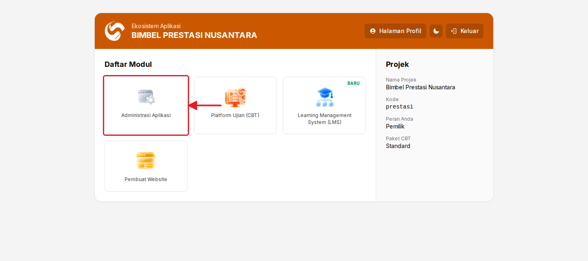
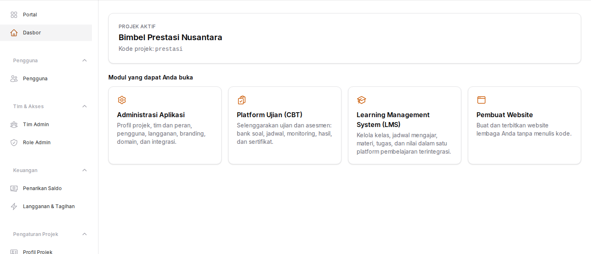
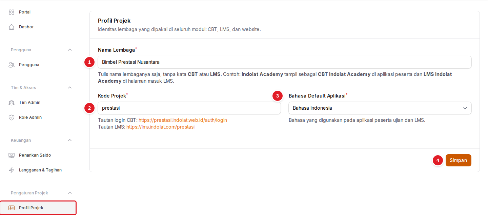

Modul **Administrasi Aplikasi** berisi pengaturan yang berlaku untuk seluruh projek, bukan hanya untuk satu produk. Halaman ini menjelaskan dasbor modul tersebut dan menu **Profil Projek**, tempat Anda mengatur identitas lembaga yang dipakai di CBT, LMS, dan website.

<Info>
  **Lokasi menu:** **Portal** → **Administrasi Aplikasi** → **Pengaturan Projek** → **Profil Projek**.

  **Peran yang dibutuhkan:** pemilik projek, atau anggota tim yang role-nya mencakup modul **Profil Projek**.
</Info>

## Membuka Administrasi Aplikasi

Pada **Portal**, klik ubin **Administrasi Aplikasi** di **Daftar Modul**.

<Frame>
  
</Frame>

Anda masuk ke **Dasbor Administrasi**. Dasbor ini menampilkan projek yang sedang aktif beserta kodenya, dan kartu **Modul yang dapat Anda buka** sebagai pintasan ke setiap modul.

<Frame>
  
</Frame>

Sidebar **Administrasi Aplikasi** dikelompokkan sebagai berikut:

| Grup | Menu | Panduan |
| --- | --- | --- |
| **Pengguna** | **Pengguna** | Akun peserta milik projek |
| **Tim & Akses** | **Tim Admin**, **Role Admin** | [Manajemen Akses Admin](/lainnya/manajemen-akses-admin) |
| **Keuangan** | **Penarikan Saldo** | [Transaksi & Penarikan Saldo](/lainnya/transaksi-dan-penarikan-saldo) |
| | **Langganan & Tagihan** | [Langganan & Tagihan](/administrasi/langganan-dan-tagihan) |
| **Pengaturan Projek** | **Profil Projek** | Halaman ini |
| | **Branding & Warna** | [Kustomisasi Tampilan Website](/lainnya/kustomisasi-tampilan-website) |
| | **Domain** | [Domain](/administrasi/domain) |
| | **Integrasi & API** | [Integrasi & API](/administrasi/integrasi-dan-api) |

Menu **Portal** di bagian atas sidebar membawa Anda kembali ke Portal untuk berpindah modul.

## Mengubah Profil Projek

<Steps>
  <Step title="Buka Profil Projek">
    Klik **Pengaturan Projek** → **Profil Projek** pada sidebar.
  </Step>
  <Step title="Ubah data projek">
    <Frame>
      
    </Frame>

    1. **Nama Lembaga**: nama lembaga saja, tanpa kata *CBT* atau *LMS*, 3–43 karakter, dan tidak boleh mengandung karakter `<` atau `>`. Sistem menambahkan awalan sendiri: nama **Bimbel Prestasi Nusantara** tampil sebagai **CBT Bimbel Prestasi Nusantara** di aplikasi peserta dan **LMS Bimbel Prestasi Nusantara** di halaman masuk LMS.
    2. **Kode Projek**: kode unik projek, minimal 4 karakter, hanya huruf kecil, angka, dan tanda hubung. Kode ini membentuk alamat bawaan yang tampil di bawah kolom:
       - **Tautan login CBT**, misalnya `https://prestasi.indolat.web.id/auth/login`;
       - **Tautan LMS**, misalnya `https://lms.indolat.com/prestasi`.

       Tautan di bawah kolom langsung berubah saat Anda mengetik, sehingga Anda dapat memeriksa alamat baru sebelum menyimpan.
    3. **Bahasa Default Aplikasi**: **Bahasa Indonesia** atau **English**. Bahasa ini dipakai pada aplikasi peserta ujian dan LMS.
    4. Klik **Simpan**.
  </Step>
</Steps>

<Warning>
  Mengubah **Kode Projek** langsung mengubah alamat login peserta, alamat LMS, dan tautan pendaftaran ujian. Tautan lama yang sudah Anda bagikan tidak berlaku lagi, jadi umumkan alamat baru kepada peserta. Kode yang sudah dipakai projek atau website lain ditolak dengan pesan *Kode projek sudah digunakan.*
</Warning>

<Note>
  Di modul **Platform Ujian (CBT)**, menu **Lainnya** → **Pengaturan Aplikasi** menampilkan nama lembaga dan kode projek sebagai informasi saja, dengan tautan **Ubah di Profil Projek** yang membuka halaman ini. Pengaturan login peserta dijelaskan di [Login Peserta](/lainnya/login-peserta).
</Note>
