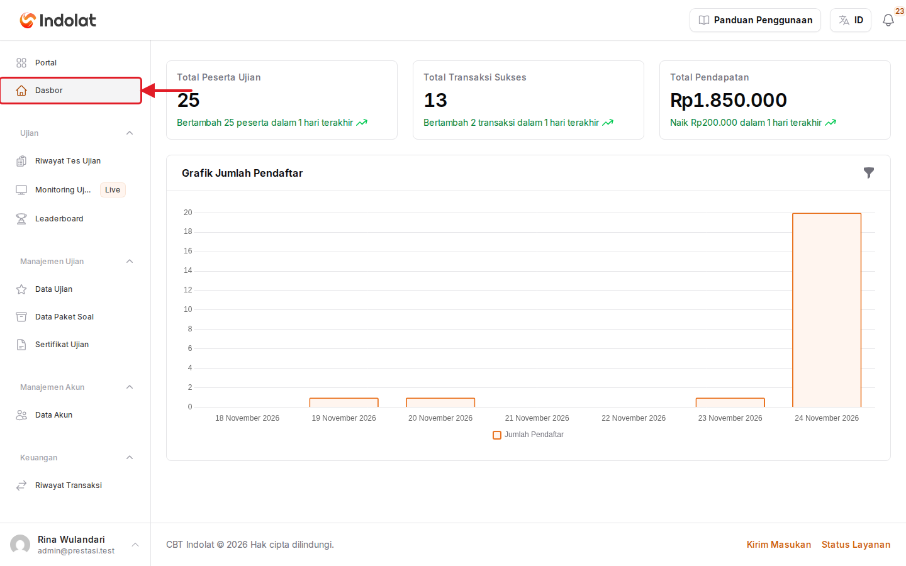
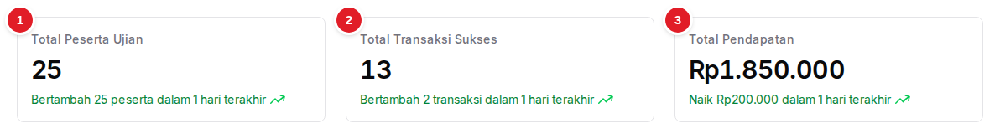
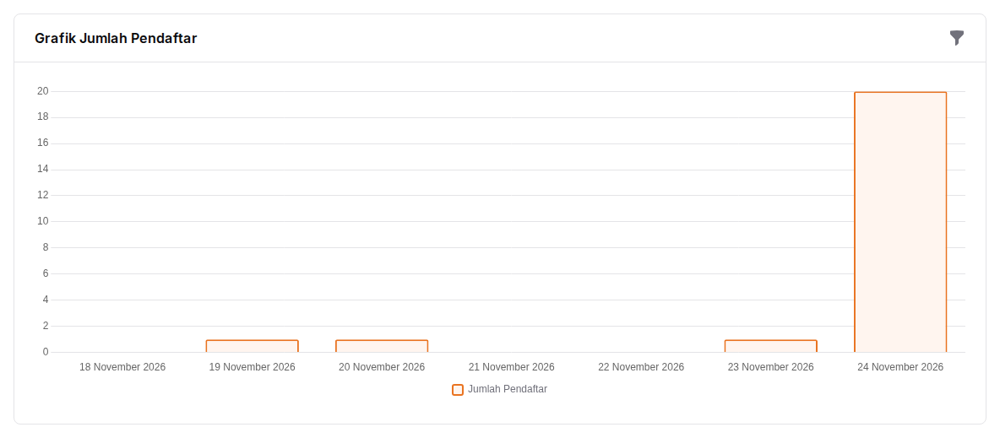
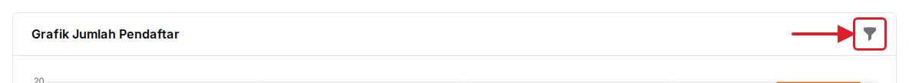
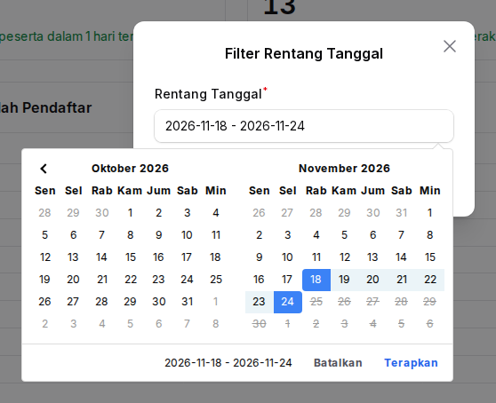
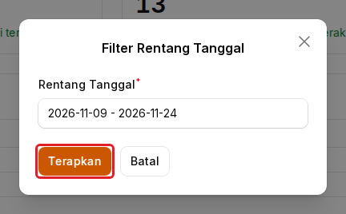
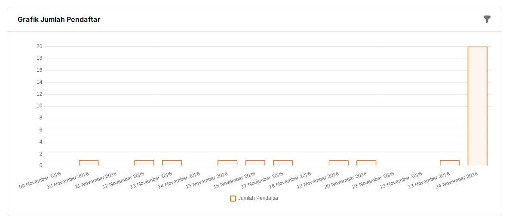

Halaman **Dasbor** adalah halaman pertama yang tampil saat Anda membuka modul **Platform Ujian (CBT)**. Halaman ini merangkum aktivitas projek dalam tiga kartu statistik dan satu grafik jumlah pendaftar, sehingga Anda dapat memantau perkembangan ujian tanpa membuka menu lain.

<Info>
  **Lokasi menu:** **Portal** → **Platform Ujian (CBT)** → **Dasbor**. Halaman ini tampil bagi admin yang memiliki akses ke Dasbor CBT. Cara membuka modul dari Portal dijelaskan di [Mengenal Portal dan Modul](/memulai/mengenal-portal-dan-modul).
</Info>

## Membuka Dasbor

Klik ubin **Platform Ujian (CBT)** di Portal. Anda langsung diarahkan ke **Dasbor**. Dari menu lain di modul CBT, klik **Dasbor** pada sidebar untuk kembali ke halaman ini.

<Frame>
  
</Frame>

## Kartu statistik

Bagian atas Dasbor berisi tiga kartu.

<Frame>
  
</Frame>

1. **Total Peserta Ujian**: jumlah akun peserta yang terdaftar pada ujian, dihitung satu kali per akun walaupun akun tersebut mengikuti beberapa ujian. Pendaftaran yang masih menunggu verifikasi atau ditangguhkan tidak dihitung.
2. **Total Transaksi Sukses**: jumlah transaksi pembayaran ujian yang berstatus berhasil.
3. **Total Pendapatan**: jumlah nominal dari semua transaksi yang berhasil, dalam rupiah.

Teks di bawah angka menunjukkan perubahan pada hari ini, misalnya **Bertambah 2 transaksi dalam 1 hari terakhir** atau **Naik Rp200.000 dalam 1 hari terakhir**. Jika belum ada perubahan, teks yang tampil adalah **Tidak ada perubahan**.

<Note>
  Ujian yang sudah diarsipkan atau dihapus tidak dihitung pada kartu statistik. Rincian setiap transaksi dapat dilihat di menu **Riwayat Transaksi**, lihat [Transaksi dan Penarikan Saldo](/lainnya/transaksi-dan-penarikan-saldo).
</Note>

## Grafik Jumlah Pendaftar

**Grafik Jumlah Pendaftar** menampilkan jumlah akun peserta baru per hari. Secara bawaan, grafik menampilkan tujuh hari terakhir, termasuk hari ini.

<Frame>
  
</Frame>

Yang dihitung adalah akun peserta yang dibuat pada tanggal tersebut, baik melalui pendaftaran mandiri maupun ditambahkan oleh admin satu per satu. Akun yang diimpor dari file Excel tidak dihitung. Jika tidak ada pendaftar pada rentang tanggal yang dipilih, grafik menampilkan pesan **Belum ada pendaftar**.

### Mengubah rentang tanggal grafik

<Steps>
  <Step title="Klik ikon filter">
    Klik ikon corong (**Filter rentang tanggal**) di kanan atas grafik.

    <Frame>
      
    </Frame>
  </Step>
  <Step title="Pilih rentang tanggal">
    Pada jendela **Filter Rentang Tanggal**, klik kolom **Rentang Tanggal**. Pada kalender, klik tanggal awal, lalu klik tanggal akhir. Tanggal setelah hari ini tidak dapat dipilih. Klik **Terapkan** pada kalender.

    <Frame>
      
    </Frame>
  </Step>
  <Step title="Terapkan filter">
    Klik **Terapkan** pada jendela **Filter Rentang Tanggal**.

    <Frame>
      
    </Frame>

    Grafik diperbarui sesuai rentang tanggal yang dipilih.

    <Frame>
      
    </Frame>
  </Step>
</Steps>

<Tip>
  Rentang tanggal hanya berlaku selama halaman terbuka. Saat Dasbor dibuka kembali, grafik kembali menampilkan tujuh hari terakhir.
</Tip>

## Jika Dasbor kosong

Admin yang belum diberi akses ke menu lain di projek akan melihat pesan **Belum ada modul yang bisa diakses** di Dasbor. Hubungi pemilik projek untuk membuka akses yang dibutuhkan. Pengaturan akses admin dijelaskan di [Manajemen Akses Admin](/lainnya/manajemen-akses-admin).
