Menu **Leaderboard** digunakan untuk membuat papan peringkat peserta berdasarkan hasil ujian. Leaderboard yang aktif tampil otomatis di aplikasi CBT peserta (menu **Peringkat**) dan di LMS selama masa tayangnya.

<Info>
  **Lokasi menu:** **Portal** → **Platform Ujian (CBT)** → **Ujian** → **Leaderboard**.
</Info>

Contoh pada halaman ini memakai leaderboard **Peringkat Tryout Mingguan Penalaran – Pekan 3** untuk ujian **Tryout Mingguan Penalaran – Pekan 3**, yang memiliki dua subtes: **Penalaran Umum** dan **Esai Penalaran**.

<Note>
  Peringkat tidak diperbarui secara realtime. Peringkat disusun saat leaderboard di-*generate*, lalu disimpan. Hasil ujian yang masuk setelahnya baru tampil setelah Anda melakukan **Generate Ulang**.
</Note>

## Membuat leaderboard

<Steps>
  <Step title="Klik Buat Leaderboard">
    Buka menu **Leaderboard**, lalu klik **Buat Leaderboard**.

    <Frame>
      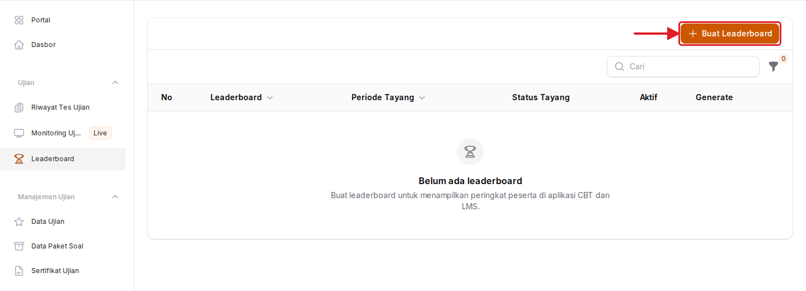
    </Frame>
  </Step>
  <Step title="Isi Informasi Leaderboard">
    <Frame>
      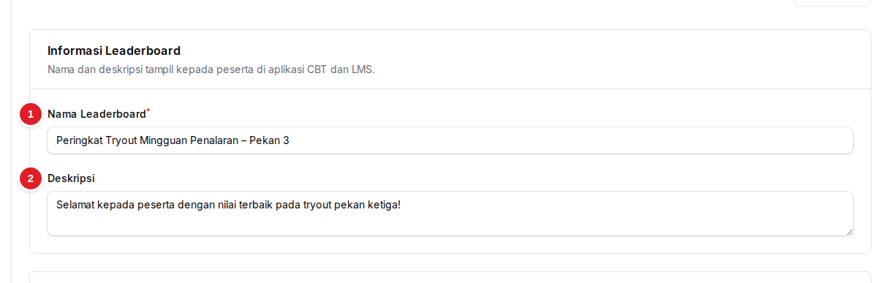
    </Frame>

    1. **Nama Leaderboard**: nama yang tampil kepada peserta. Contoh: **Peringkat Tryout Mingguan Penalaran – Pekan 3**.
    2. **Deskripsi** (opsional): pesan singkat yang tampil di bawah nama leaderboard pada aplikasi peserta.
  </Step>
  <Step title="Atur Sumber Nilai">
    <Frame>
      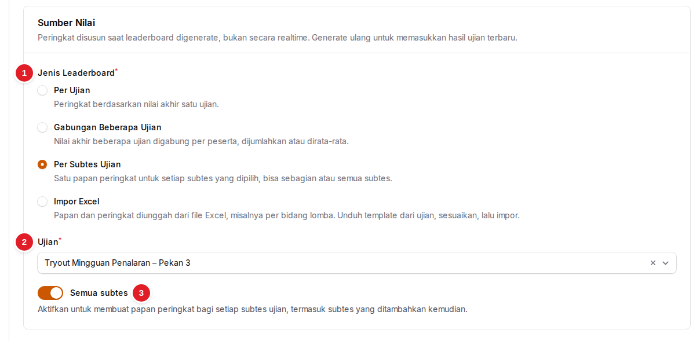
    </Frame>

    1. **Jenis Leaderboard**: pilih sumber nilai peringkat.
       - **Per Ujian**: peringkat berdasarkan nilai akhir satu ujian.
       - **Gabungan Beberapa Ujian**: nilai akhir beberapa ujian digabung per peserta. Pilih minimal dua ujian pada kolom **Ujian**, lalu tentukan **Cara Menggabungkan Nilai**: **Jumlah Nilai Akhir** atau **Rata-Rata Nilai Akhir**. Peserta dikenali dari akun yang sama di setiap ujian.
       - **Per Subtes Ujian**: satu papan peringkat untuk setiap subtes (tes ujian) yang dipilih.
       - **Impor Excel**: papan dan peringkat diunggah dari file Excel, misalnya untuk peringkat per bidang lomba. Lihat [Leaderboard dari file Excel](#leaderboard-dari-file-excel).
    2. **Ujian**: pilih ujian sumber nilai. Contoh: **Tryout Mingguan Penalaran – Pekan 3**.
    3. Pengaturan tambahan sesuai jenis:
       - **Semua subtes** (jenis **Per Subtes Ujian**): aktifkan untuk membuat papan bagi setiap subtes, termasuk subtes yang ditambahkan kemudian.
       - **Hanya peserta yang menyelesaikan seluruh tes** (jenis **Per Ujian** dan **Gabungan Beberapa Ujian**): jika aktif, peserta yang belum menyelesaikan semua subtes tidak masuk peringkat.

    Jika **Semua subtes** dinonaktifkan, pilih subtes yang akan diberi papan peringkat pada daftar **Subtes**. Klik **Pilih semua** untuk mencentang semuanya. Subtes dengan metode penilaian Psikotes tidak ditampilkan karena tidak menghasilkan nilai.

    <Frame>
      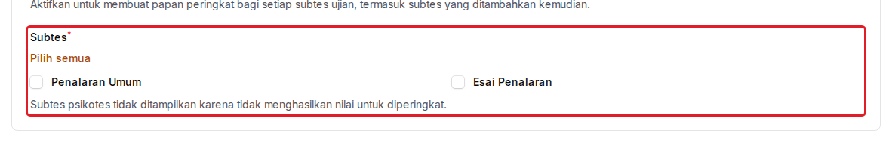
    </Frame>
  </Step>
  <Step title="Atur Penayangan">
    <Frame>
      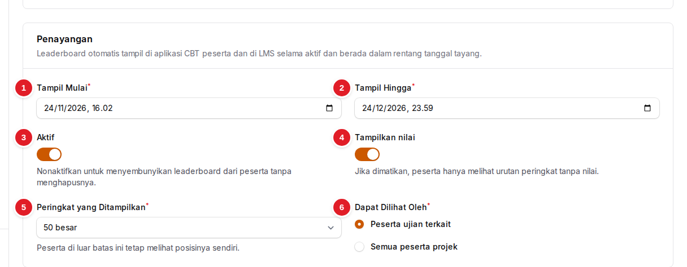
    </Frame>

    1. **Tampil Mulai**: waktu leaderboard mulai tampil kepada peserta. Bawaannya adalah waktu saat ini.
    2. **Tampil Hingga**: waktu leaderboard berhenti tampil. Harus setelah **Tampil Mulai**. Bawaannya 30 hari dari sekarang.
    3. **Aktif**: nonaktifkan untuk menyembunyikan leaderboard dari peserta tanpa menghapusnya.
    4. **Tampilkan nilai**: jika dimatikan, peserta hanya melihat urutan peringkat tanpa nilai.
    5. **Peringkat yang Ditampilkan**: jumlah peringkat teratas yang tampil, yaitu **10 besar**, **20 besar**, **50 besar**, **100 besar**, atau **Semua peringkat**. Peserta di luar batas ini tetap melihat posisinya sendiri.
    6. **Dapat Dilihat Oleh**: **Peserta ujian terkait** (hanya peserta ujian sumber nilai) atau **Semua peserta projek**.
  </Step>
  <Step title="Simpan">
    Klik **Buat**. Leaderboard langsung di-*generate*, dan Anda diarahkan ke halaman peringkatnya. Klik **Buat & buat lainnya** jika ingin langsung membuat leaderboard berikutnya.
  </Step>
</Steps>

## Siapa yang masuk peringkat

- Hanya peserta dengan pendaftaran ujian yang sudah terverifikasi dan tidak ditangguhkan.
- Hanya tes yang sudah diselesaikan dan memiliki nilai. Tes esai baru masuk peringkat setelah diberi skor, lihat [Memberi skor manual](/cbt/riwayat-tes-ujian#memberi-skor-manual-untuk-tes-esai).
- Peserta dengan nilai sama mendapat peringkat yang sama dan diurutkan berdasarkan nama. Peringkat berikutnya dilewati, misalnya 1, 2, 3, 3, 5.

## Daftar leaderboard

Halaman **Leaderboard** menampilkan semua leaderboard di projek.

<Frame>
  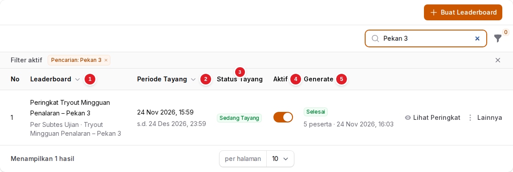
</Frame>

1. **Leaderboard**: nama leaderboard, dengan jenis dan nama ujian di bawahnya.
2. **Periode Tayang**: waktu **Tampil Mulai** dan **Tampil Hingga**.
3. **Status Tayang**:
   - **Sedang Tayang**: aktif, sudah di-*generate*, dan berada dalam periode tayang.
   - **Terjadwal**: periode tayang belum dimulai.
   - **Berakhir**: periode tayang sudah lewat.
   - **Belum Digenerate**: peringkat belum pernah disusun.
   - **Nonaktif**: sakelar **Aktif** dimatikan.
4. **Aktif**: sakelar untuk menampilkan atau menyembunyikan leaderboard langsung dari daftar.
5. **Generate**: status penyusunan peringkat (**Menunggu Antrean**, **Sedang Diproses**, **Selesai**, atau **Gagal**), jumlah peserta, dan waktu terakhir di-*generate*. Selama proses berjalan, daftar diperbarui otomatis.

Gunakan filter **Jenis Leaderboard** dan **Aktif** untuk menyaring daftar.

### Menu Lainnya

Klik **Lainnya** pada baris leaderboard.

<Frame>
  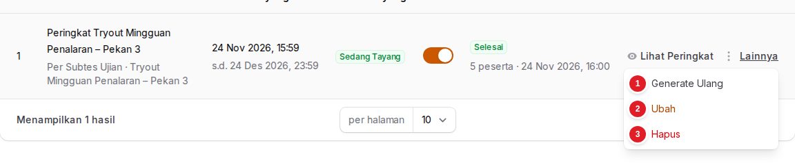
</Frame>

1. **Generate Ulang**: menyusun ulang peringkat dari hasil ujian terbaru.
2. **Ubah**: mengubah pengaturan leaderboard. Jika Anda mengubah sumber nilai (jenis, ujian, atau subtes), peringkat di-*generate* ulang otomatis setelah disimpan.
3. **Hapus**: menghapus leaderboard.

Untuk leaderboard jenis **Impor Excel**, menu ini juga berisi **Impor Ulang Excel**.

### Memperbarui peringkat (Generate Ulang)

Klik **Lainnya** → **Generate Ulang**, lalu klik **Generate**. Peserta melihat peringkat baru setelah proses selesai.

<Frame>
  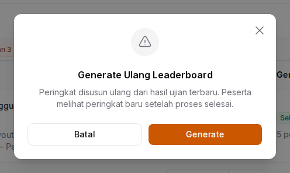
</Frame>

<Tip>
  Lakukan **Generate Ulang** setelah semua peserta selesai mengerjakan, setelah tes esai dinilai, atau setelah Anda mereset tes peserta.
</Tip>

## Melihat peringkat

Klik **Lihat Peringkat** pada baris leaderboard. Bagian **Ringkasan Leaderboard** menampilkan nama, jenis, ujian, status tayang, periode tayang, waktu terakhir di-*generate*, jumlah peserta, status generate, dan siapa yang dapat melihat. Tombol **Generate Ulang** dan **Ubah** juga tersedia di kanan atas.

<Frame>
  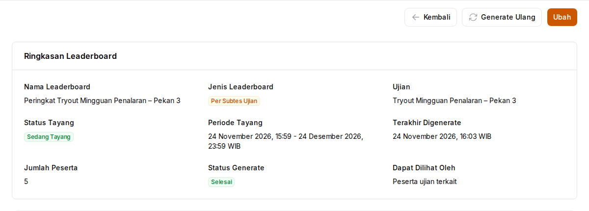
</Frame>

Bagian **Peringkat Peserta** berisi kolom **Peringkat**, **Nama Peserta** (dengan kode peserta), **Nilai**, dan **Selesai Ujian**. Pada contoh, Daffa Alfarizi dan Galih Prasetyo Utomo sama-sama bernilai 15 sehingga keduanya berada di peringkat 3, dan peringkat berikutnya adalah 5.

<Frame>
  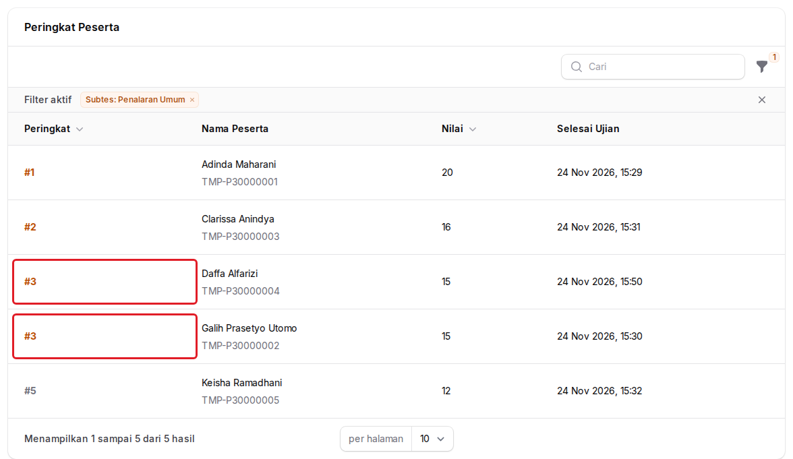
</Frame>

Untuk jenis **Per Subtes Ujian**, gunakan filter **Subtes** untuk berpindah papan.

<Frame>
  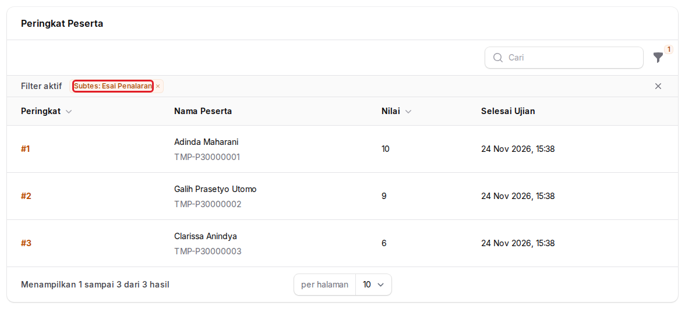
</Frame>

## Leaderboard dari file Excel

Jenis **Impor Excel** cocok jika peringkat disusun sendiri, misalnya per bidang lomba.

1. Unduh template dari halaman detail ujian: **Ekspor Data** → **Template Leaderboard**. Lihat [Hasil dan Ekspor Ujian](/data-ujian/hasil-dan-ekspor-ujian). Template juga dapat diunduh dengan **Unduh Template** pada kolom unggah di formulir leaderboard.
2. Sesuaikan isinya. Kolom file: **Papan**, **Kode Peserta**, **Email**, **Nama**, **Skor**, **Waktu Selesai**, dan **Peringkat** (opsional).
3. Pada formulir leaderboard, pilih **Impor Excel**, pilih **Ujian**, lalu unggah file pada **File Excel Peringkat** (format .xlsx).

Peserta dicocokkan berdasarkan email, lalu berdasarkan kode peserta. Isi **Peringkat** di semua baris sebuah papan untuk memakai peringkat Anda sendiri; jika tidak, peringkat dihitung dari skor, dan skor yang sama diurutkan dari **Waktu Selesai** paling awal. Jika ada baris yang tidak valid, tidak ada data yang diimpor. Untuk mengganti isi peringkat, gunakan **Lainnya** → **Impor Ulang Excel**; seluruh peringkat leaderboard diganti dengan isi file baru.

## Tampilan di aplikasi peserta

Leaderboard yang sedang tayang muncul pada menu **Peringkat** di aplikasi CBT peserta. Kartu leaderboard menampilkan jenis, jumlah peserta, batas tayang, dan **Peringkat Anda**.

<Frame>
  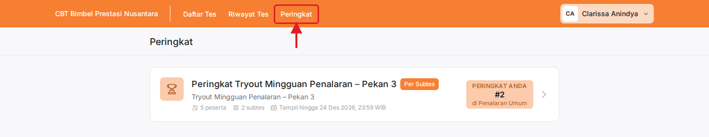
</Frame>

Setelah kartu diklik, peserta melihat posisinya sendiri, podium tiga besar, dan daftar peringkat berikutnya. Untuk jenis **Per Subtes Ujian**, peserta berpindah papan melalui tombol subtes di bagian atas.

<Frame>
  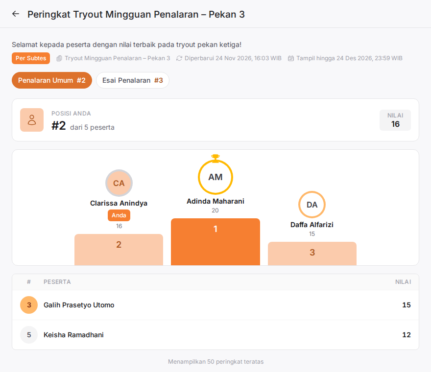
</Frame>
