Menu **Monitoring Ujian** menampilkan peserta ujian yang masih berlangsung secara langsung. Anda dapat melihat siapa yang sedang mengerjakan tes, berapa sisa waktunya, dan apakah ada indikasi kecurangan, lalu mengambil tindakan seperti mengirim pemberitahuan, menangguhkan (suspend), atau menghentikan ujian peserta.

<Info>
  **Lokasi menu:** **Portal** → **Platform Ujian (CBT)** → **Ujian** → **Monitoring Ujian**. Menu ini ditandai label **Live** pada sidebar. Hasil tes yang sudah selesai dapat dilihat di [Riwayat Tes Ujian](/cbt/riwayat-tes-ujian).
</Info>

Contoh pada halaman ini memakai ujian **Tryout Mingguan Penalaran – Pekan 3**. Saat gambar diambil, Rafi Hidayatullah sedang mengerjakan tes **Penalaran Umum**, sedangkan Daffa Alfarizi dan Keisha Ramadhani belum memulai tes **Esai Penalaran**.

## Peserta yang tampil

Setiap baris mewakili satu peserta pada satu ujian. Peserta tampil jika:

- ujiannya belum melewati **Tanggal Selesai** dan tidak diarsipkan, serta
- peserta masih memiliki tes yang belum diselesaikan, baik sedang dikerjakan maupun belum dimulai.

Peserta yang sudah menyelesaikan semua tes pada ujian tersebut tidak tampil lagi. Peserta yang sedang mengerjakan tes tampil paling atas, diurutkan dari waktu mulai yang paling awal. Tabel diperbarui otomatis setiap 10 detik, sehingga Anda tidak perlu memuat ulang halaman.

<Frame>
  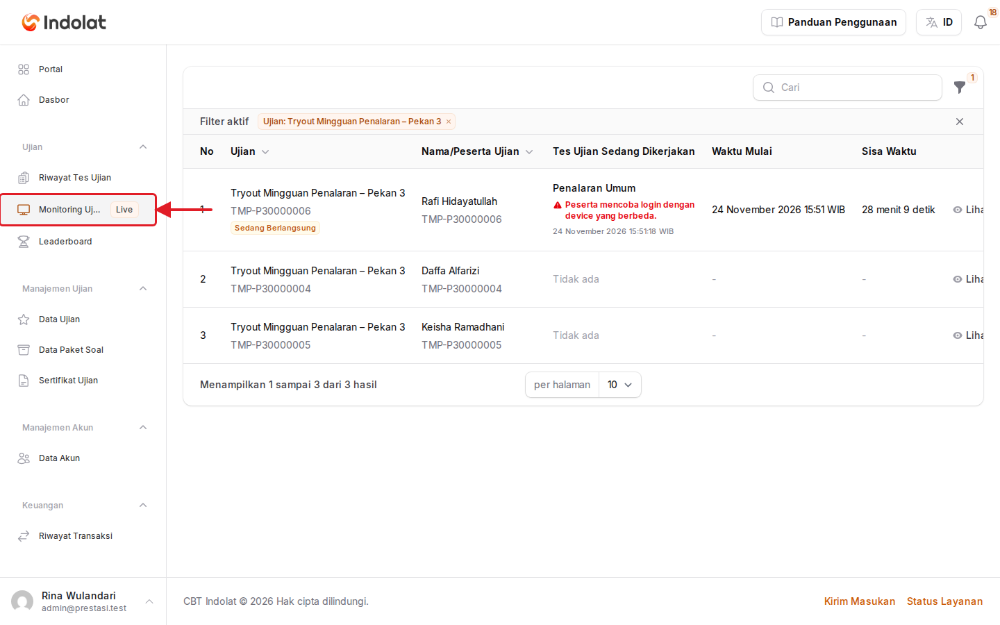
</Frame>

## Arti setiap kolom

<Frame>
  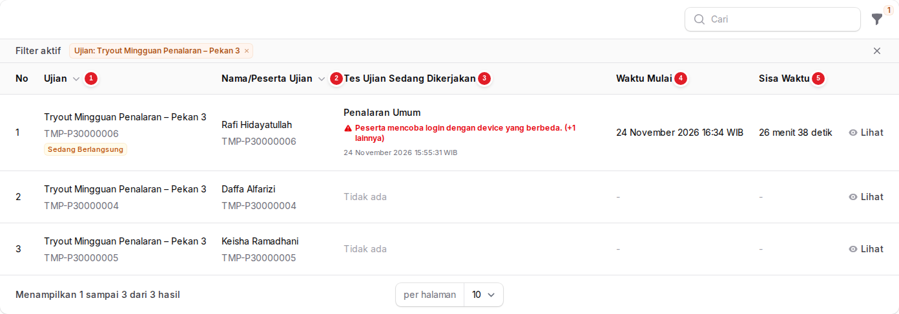
</Frame>

1. **Ujian**: nama ujian dan kode peserta. Di bawahnya tampil label status:
   - **Sedang Berlangsung** (kuning): peserta sedang mengerjakan tes.
   - **Ditangguhkan** (merah): ujian peserta sedang di-suspend oleh admin.
   - Tanpa label: peserta belum memulai tes yang tersisa.
2. **Nama/Peserta Ujian**: nama dan kode peserta.
3. **Tes Ujian Sedang Dikerjakan**: nama tes yang sedang dikerjakan, atau **Tidak ada** jika peserta belum memulai tes. Jika sistem mendeteksi kecurangan, pesan terbaru tampil dengan ikon peringatan merah, misalnya **Peserta mencoba login dengan device yang berbeda.**, disertai waktu kejadian. Jika ada lebih dari satu catatan, jumlah catatan lainnya ditampilkan dalam tanda kurung, misalnya *(+2 lainnya)*.
4. **Waktu Mulai**: waktu peserta mulai mengerjakan tes.
5. **Sisa Waktu**: sisa waktu pengerjaan, yaitu durasi tes dihitung dari waktu mulai, atau sampai sesi ujian berakhir jika sesi berakhir lebih dulu. Pada tes esai, sisa waktu dihitung sampai sesi berakhir. Jika waktu sudah habis, kolom ini menampilkan **Waktu Habis** berwarna merah.

<Note>
  Pesan kecurangan berasal dari pengawasan yang aktif pada tes, misalnya deteksi perangkat lain. Pengaturan pengawasan dijelaskan di [Membuat Tes Ujian](/data-ujian/membuat-tes-ujian#mengatur-pengawasan).
</Note>

## Memfilter peserta

Klik ikon corong di kanan atas tabel untuk membuka panel **Filter**.

<Frame>
  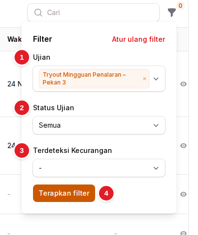
</Frame>

1. **Ujian**: pilih satu atau beberapa ujian yang masih berlangsung.
2. **Status Ujian**: **Sedang Mengerjakan Ujian** untuk peserta yang sedang mengerjakan tes, atau **Tidak Mengerjakan Ujian** untuk peserta yang belum memulai tes yang tersisa.
3. **Terdeteksi Kecurangan**: **Ya** untuk menampilkan peserta yang tes berjalannya memiliki catatan kecurangan saja, **Tidak** untuk sebaliknya.
4. Klik **Terapkan filter**.

Gunakan kolom **Cari** untuk mencari berdasarkan nama ujian atau nama peserta.

## Membuka detail peserta

Klik **Lihat** pada baris peserta. Jika tabel lebih lebar dari layar, geser tabel ke kanan untuk menemukan tombol ini.

<Frame>
  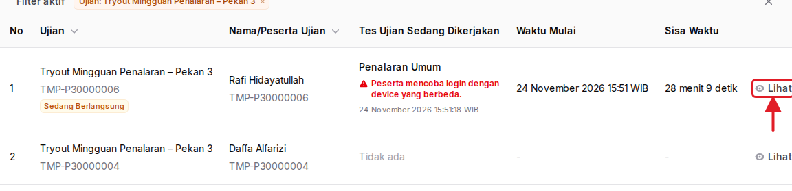
</Frame>

Halaman detail sama dengan halaman detail di Riwayat Tes Ujian: informasi peserta, **Log Peserta & Ujian**, dan **Jawaban Peserta**. Untuk peserta yang sedang mengerjakan tes, bagian informasi juga menampilkan **Sisa Waktu**, dan **Jawaban Peserta** menunjukkan soal yang sudah dijawab sejauh ini (soal yang belum dijawab bertanda **Belum**). Penjelasan bagian-bagian tersebut ada di [Riwayat Tes Ujian](/cbt/riwayat-tes-ujian#melihat-detail-hasil-tes).

## Tindakan admin saat ujian berlangsung

Jika peserta sedang mengerjakan tes CBT atau CAT, kotak **Aksi Admin** tampil di kanan bagian informasi peserta.

<Frame>
  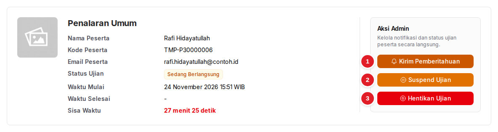
</Frame>

1. **Kirim Pemberitahuan**: mengirim pesan yang langsung muncul di layar ujian peserta.
2. **Suspend Ujian**: menangguhkan ujian peserta untuk sementara.
3. **Hentikan Ujian**: mengakhiri ujian peserta saat itu juga.

<Note>
  Pada tes **Esai / Upload File (Jawaban Manual)**, kotak **Aksi Admin** hanya berisi **Beri Skor Manual**. Lihat [Riwayat Tes Ujian](/cbt/riwayat-tes-ujian#memberi-skor-manual-untuk-tes-esai).
</Note>

### Mengirim pemberitahuan

Klik **Kirim Pemberitahuan**, tulis pesan pada jendela yang muncul, lalu klik **Kirim**. Pesan tampil di layar peserta sebagai pemberitahuan, misalnya untuk mengingatkan sisa waktu.

<Frame>
  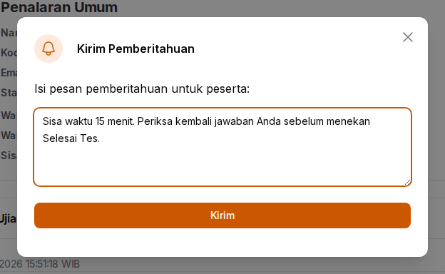
</Frame>

### Menangguhkan ujian (Suspend Ujian)

Gunakan **Suspend Ujian** jika peserta perlu berhenti sejenak, misalnya saat pengawas memeriksa identitas atau ada gangguan di ruang ujian.

<Steps>
  <Step title="Pilih jenis suspend">
    Klik **Suspend Ujian**, lalu pilih salah satu:

    - **Suspend dengan durasi**: peserta otomatis dilanjutkan setelah waktu suspend habis. Pilih durasi pada **Pilih Durasi Cepat** (5, 10, 15, 30, atau 60 menit) atau isi **Durasi Manual (menit)**.
    - **Suspend sampai dibuka lagi**: peserta tetap menunggu sampai admin menekan **Lanjutkan Ujian**.

    <Frame>
      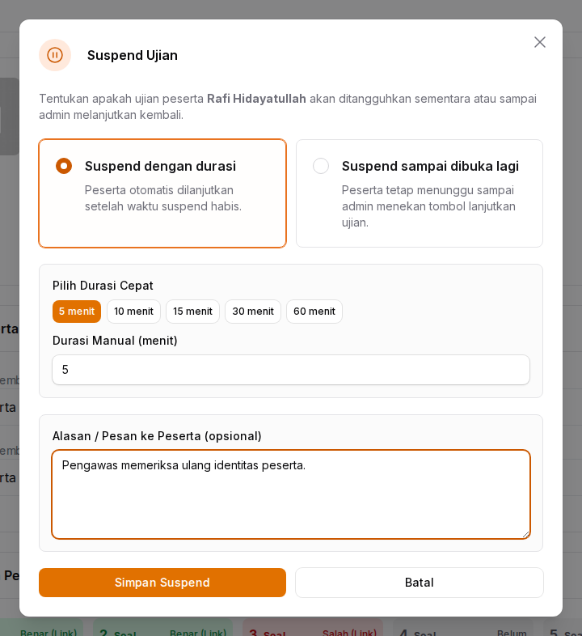
    </Frame>
  </Step>
  <Step title="Isi alasan, lalu simpan">
    Isi **Alasan / Pesan ke Peserta (opsional)**. Alasan ini ditampilkan kepada peserta. Klik **Simpan Suspend**.
  </Step>
</Steps>

Setelah disimpan, **Status Ujian** berubah menjadi **Sedang Ditangguhkan**, dan bagian informasi menampilkan **Suspend Dimulai**, **Suspend Sampai**, serta **Alasan Suspend**. Tombol **Suspend Ujian** berganti menjadi **Lanjutkan Ujian**.

<Frame>
  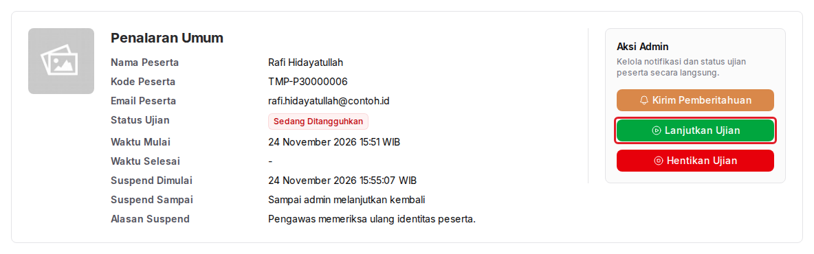
</Frame>

Pada daftar Monitoring Ujian, peserta tersebut diberi label **Ditangguhkan**.

<Frame>
  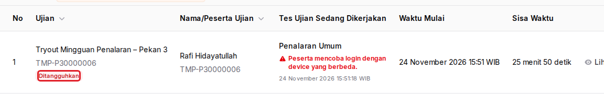
</Frame>

Di layar peserta, jendela **Tes Ditangguhkan** muncul beserta alasan dan batas waktunya, sehingga peserta tidak dapat mengerjakan soal sampai ujian dilanjutkan.

<Frame>
  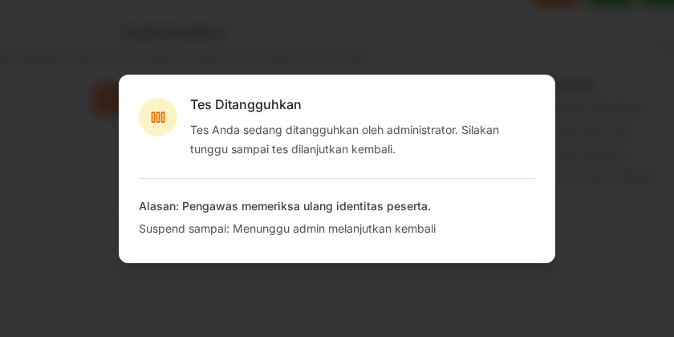
</Frame>

### Melanjutkan ujian

Klik **Lanjutkan Ujian**, lalu klik **Ya, Lanjutkan Ujian**. Peserta dapat langsung mengerjakan soal kembali. Suspend dengan durasi juga berakhir otomatis ketika durasinya habis.

<Frame>
  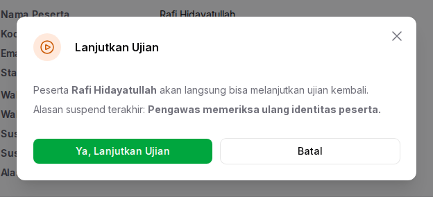
</Frame>

<Note>
  Jika sisa waktu peserta sudah habis, tombol **Lanjutkan Ujian** tidak tersedia dan tampil keterangan **Ujian tidak dapat dilanjutkan karena sisa waktu peserta sudah habis.**
</Note>

Setiap suspend dan pelanjutan dicatat pada **Log Peserta & Ujian** beserta email admin dan alasannya.

### Menghentikan ujian

Klik **Hentikan Ujian**, periksa nama peserta pada jendela konfirmasi, lalu klik **Ya, Hentikan Ujian**.

<Frame>
  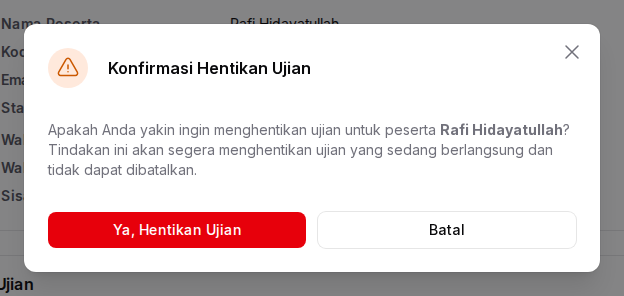
</Frame>

<Warning>
  **Hentikan Ujian** langsung mengakhiri tes peserta dan tidak dapat dibatalkan. Jawaban yang sudah tersimpan dinilai seperti saat peserta menekan **Selesai Tes**, lalu hasilnya pindah ke [Riwayat Tes Ujian](/cbt/riwayat-tes-ujian). Jika peserta perlu mengulang, gunakan **Reset Ujian** di Riwayat Tes Ujian.
</Warning>
