Menu **Riwayat Tes Ujian** berisi semua tes ujian yang sudah diselesaikan peserta di projek Anda, dari semua ujian sekaligus. Dari halaman ini Anda dapat mencari hasil peserta tertentu, membuka detail jawaban dan log pengerjaan, memberi skor untuk tes esai, mengatur ulang tes agar peserta dapat mengerjakan kembali, dan mengekspor riwayat ke Excel.

<Info>
  **Lokasi menu:** **Portal** → **Platform Ujian (CBT)** → **Ujian** → **Riwayat Tes Ujian**. Peserta yang sedang mengerjakan tes belum tampil di sini; pantau mereka melalui [Monitoring Ujian](/cbt/monitoring-ujian). Tindakan per ujian (ekspor hasil seluruh peserta, hitung skor, laporan peserta) dijelaskan di [Hasil dan Ekspor Ujian](/data-ujian/hasil-dan-ekspor-ujian).
</Info>

Contoh pada halaman ini memakai ujian **Tryout Mingguan Penalaran – Pekan 3** (kode **TMP-P3**) dengan dua tes ujian: **Penalaran Umum** (CBT, lima soal pilihan ganda) dan **Esai Penalaran** (Esai / Upload File, satu soal uraian).

## Daftar riwayat tes

Klik **Riwayat Tes Ujian** pada sidebar. Setiap baris mewakili satu tes ujian yang sudah diselesaikan oleh satu peserta. Riwayat terbaru tampil paling atas. Gunakan kolom **Cari** untuk mencari berdasarkan nama peserta atau kode peserta, misalnya **TMP-P3** untuk menampilkan semua peserta ujian contoh.

<Frame>
  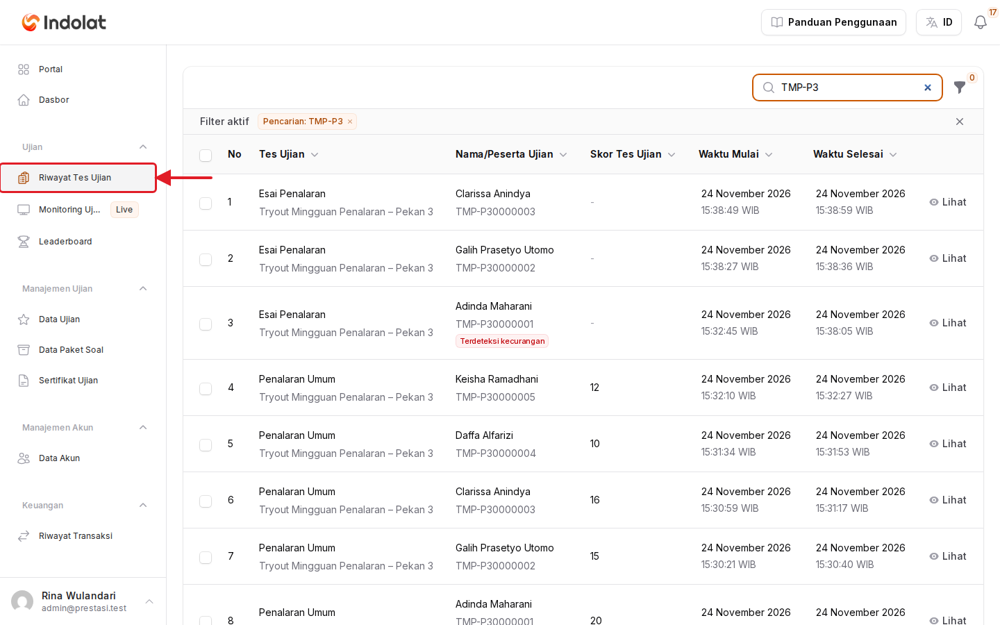
</Frame>

<Frame>
  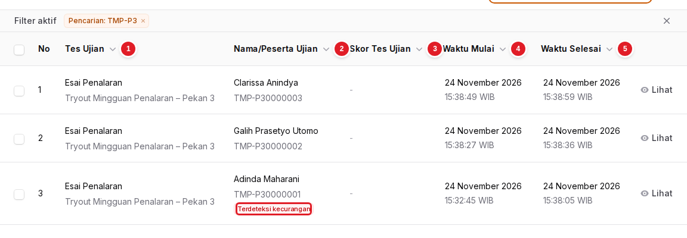
</Frame>

1. **Tes Ujian**: nama tes ujian, dengan nama ujian di bawahnya.
2. **Nama/Peserta Ujian**: nama peserta dan kode peserta. Label merah **Terdeteksi kecurangan** muncul jika sistem mencatat indikasi kecurangan selama tes, misalnya peserta mencoba masuk dari perangkat lain.
3. **Skor Tes Ujian**: skor peserta pada tes tersebut. Tanda **-** tampil jika skor belum diberikan (tes esai yang belum dinilai) atau jika metode penilaiannya **Psikotes (Pengelompokan Jawaban)**, yang tidak menghasilkan skor.
4. **Waktu Mulai**: waktu peserta mulai mengerjakan tes.
5. **Waktu Selesai**: waktu peserta menyelesaikan tes.

<Note>
  Tes dari ujian yang sudah diarsipkan tidak ditampilkan di Riwayat Tes Ujian.
</Note>

### Memfilter riwayat

Klik ikon corong di kanan atas tabel untuk membuka panel **Filter**.

<Frame>
  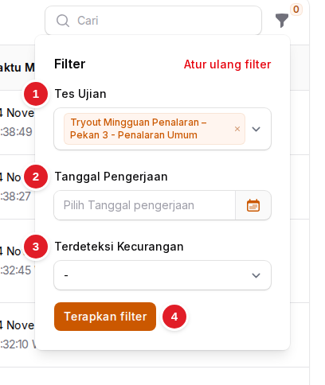
</Frame>

1. **Tes Ujian**: pilih satu atau beberapa tes. Setiap pilihan ditulis dengan format *nama ujian - nama tes*.
2. **Tanggal Pengerjaan**: rentang tanggal mulai mengerjakan.
3. **Terdeteksi Kecurangan**: pilih **Ya** untuk menampilkan tes yang memiliki catatan kecurangan saja, atau **Tidak** untuk menampilkan tes tanpa catatan kecurangan.
4. Klik **Terapkan filter**. Klik **Atur ulang filter** untuk menghapus semua filter.

Filter yang Anda pasang tetap tersimpan selama Anda masih masuk ke aplikasi.

## Melihat detail hasil tes

Klik **Lihat** pada baris peserta.

<Frame>
  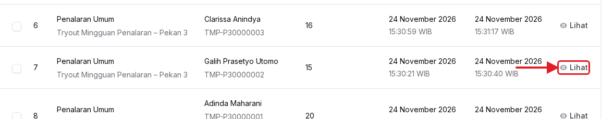
</Frame>

Halaman detail terdiri atas beberapa bagian.

<Frame>
  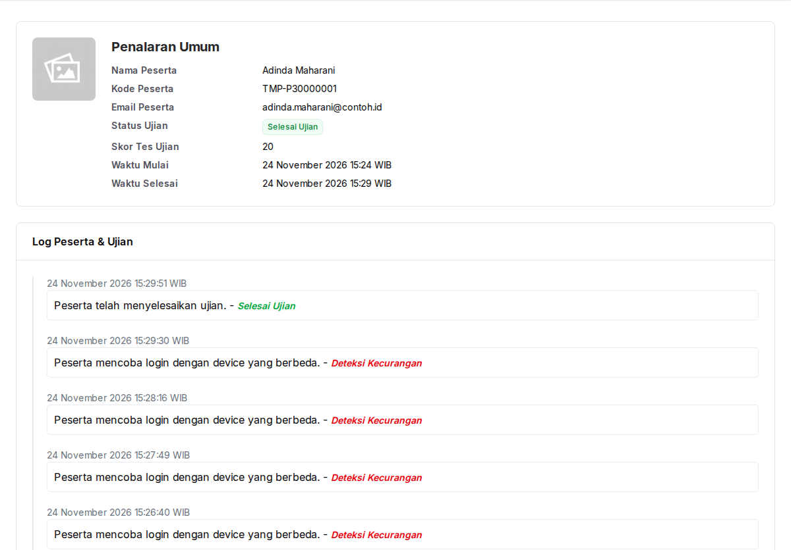
</Frame>

- **Informasi peserta**: nama tes, **Nama Peserta**, **Kode Peserta**, **Email Peserta**, **Status Ujian** (**Belum Ujian**, **Sedang Berlangsung**, **Sedang Ditangguhkan**, atau **Selesai Ujian**), **Skor Tes Ujian**, **Waktu Mulai**, dan **Waktu Selesai**.
- **Log Peserta & Ujian**: catatan kejadian selama tes, dari yang terbaru. Setiap catatan diberi jenis, misalnya **Mulai Ujian**, **Selesai Ujian**, **Kehabisan Waktu**, **Deteksi Kecurangan**, atau **Lainnya** (tindakan admin seperti reset, perubahan skor, dan suspend). Gulir ke bawah di dalam kotak log untuk memuat catatan yang lebih lama.

  <Frame>
    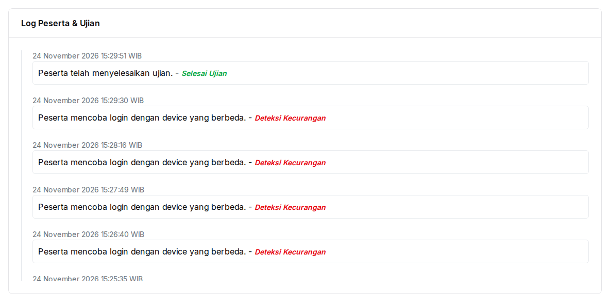
  </Frame>

- **Jawaban Peserta**: hasil setiap soal. Pada tes CBT/CAT, setiap kotak menunjukkan nomor soal dan status **Benar**, **Salah**, atau **Tidak Dijawab**, disertai ringkasan **Total Benar**, **Total Salah**, dan **Tidak Dijawab**. Klik **Soal** untuk membuka soal tersebut di paket soal, atau **Link** untuk membuka pilihan jawaban yang dipilih peserta. Pada tes esai, bagian ini menampilkan teks jawaban dan berkas yang diunggah peserta.

  <Frame>
    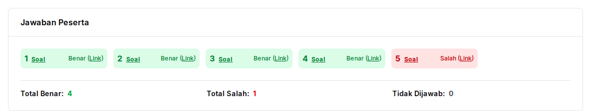
  </Frame>

Bagian lain muncul sesuai pengaturan tes:

- **Log Foto Peserta** dan **Log Screen Peserta** tampil jika proctoring kamera atau layar aktif pada tes. Klik **Unduh Foto Kamera** atau **Unduh Foto Layar** untuk menyiapkan berkas ZIP, lalu klik **Unduh ZIP Kamera** atau **Unduh ZIP Layar** setelah berkas siap. Foto dan tangkapan layar dihapus otomatis setelah ujian berakhir lebih dari tiga bulan.
- **Analisa Kelompok Jawaban**, **Analisa Konsentrasi**, dan **Detail Jawaban Per Pertanyaan** tampil untuk tes dengan metode penilaian **Psikotes (Pengelompokan Jawaban)**. Klik **Unduh Data** pada bagian tersebut untuk mengunduh laporan peserta dalam format PDF.

## Memberi skor manual untuk tes esai

Tes dengan jenis **Esai / Upload File (Jawaban Manual)** tidak dinilai otomatis. Setelah peserta menyelesaikan tes, skornya masih **-** sampai Anda memberikannya.

<Steps>
  <Step title="Buka detail tes esai">
    Pada **Riwayat Tes Ujian**, klik **Lihat** pada baris tes esai peserta. Baca jawaban peserta pada bagian **Jawaban Peserta**.
  </Step>
  <Step title="Klik Beri Skor Manual">
    Pada kotak **Aksi Admin**, klik **Beri Skor Manual**.

    <Frame>
      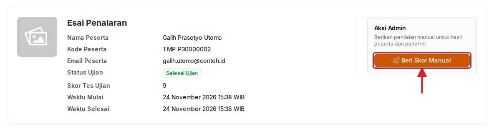
    </Frame>
  </Step>
  <Step title="Isi skor, lalu simpan">
    Pada jendela **Berikan Skor**, masukkan skor, lalu klik **Simpan**.

    <Frame>
      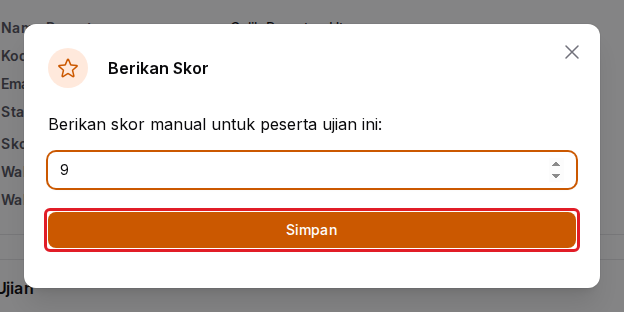
    </Frame>

    Skor langsung tampil pada **Skor Tes Ujian**, dan nilai akhir peserta untuk ujian tersebut dihitung ulang.

    <Frame>
      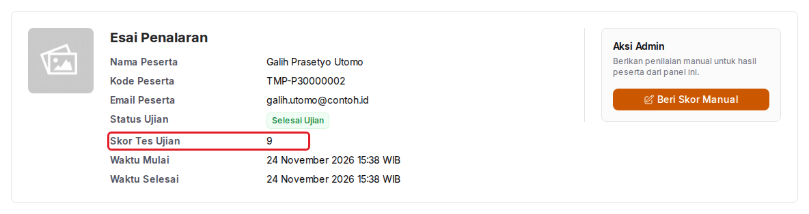
    </Frame>
  </Step>
</Steps>

<Note>
  Setiap perubahan skor dicatat pada **Log Peserta & Ujian** beserta email admin yang mengubahnya. Isian skor tidak boleh kosong.
</Note>

## Tindakan massal

Centang satu atau beberapa baris, atau centang kotak di judul tabel untuk memilih semua baris di halaman tersebut. Tombol **Tindakan** muncul di kiri atas tabel.

<Frame>
  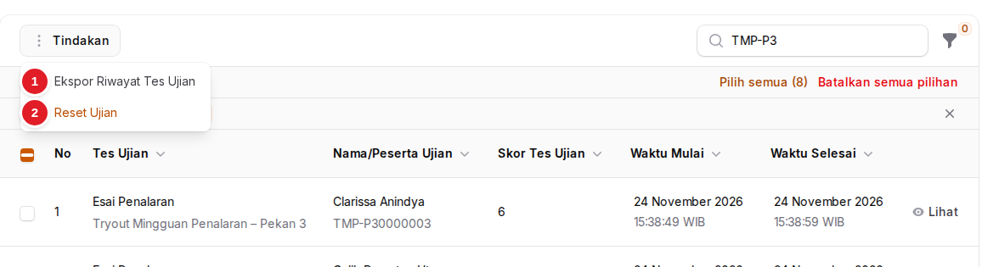
</Frame>

1. **Ekspor Riwayat Tes Ujian**: mengekspor baris yang dipilih ke Excel.
2. **Reset Ujian**: mengatur ulang tes yang dipilih agar peserta dapat mengerjakannya kembali.

### Mengatur ulang tes (Reset Ujian)

Gunakan **Reset Ujian** jika peserta perlu mengulang tes, misalnya karena gangguan teknis saat mengerjakan.

<Steps>
  <Step title="Pilih tes yang akan diatur ulang">
    Centang baris tes peserta, lalu klik **Tindakan** → **Reset Ujian**.
  </Step>
  <Step title="Konfirmasi">
    Klik **Konfirmasi** pada jendela **Reset Ujian**.

    <Frame>
      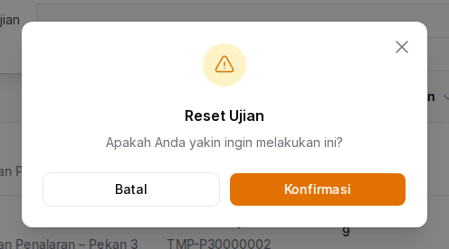
    </Frame>
  </Step>
</Steps>

<Warning>
  Reset Ujian menghapus semua jawaban, skor, serta waktu mulai dan selesai tes tersebut. Tindakan ini tidak dapat dibatalkan. Riwayat log tetap disimpan, dan sistem menambahkan catatan bahwa tes direset oleh admin.
</Warning>

Setelah direset, tes hilang dari **Riwayat Tes Ujian** dan peserta dapat mengerjakannya kembali dari halaman **Daftar Tes** selama sesi ujiannya masih berlangsung. Hasil pengerjaan ulang akan tampil lagi di sini setelah peserta menyelesaikannya.

### Mengekspor riwayat ke Excel

<Steps>
  <Step title="Pilih baris yang akan diekspor">
    Cari atau filter riwayat terlebih dahulu, lalu centang baris yang dibutuhkan. Klik **Tindakan** → **Ekspor Riwayat Tes Ujian**.
  </Step>
  <Step title="Konfirmasi ekspor">
    Klik **Konfirmasi**.

    <Frame>
      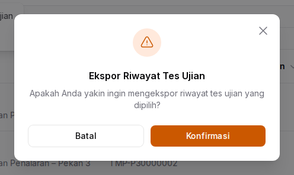
    </Frame>
  </Step>
  <Step title="Unduh file">
    Ekspor diproses di latar belakang. Setelah selesai, notifikasi **Berhasil Ekspor Riwayat Ujian** muncul di ikon lonceng. File bernama `riwayat_ujian_<tanggal dan jam>.xlsx` dapat diunduh di [Unduh Hasil Ekspor](/cbt/unduh-hasil-ekspor).
  </Step>
</Steps>

File Excel berisi kolom **Tes Ujian**, **Kode Peserta**, **Nama Peserta**, **Skor**, **Jumlah Jawaban Benar**, **Jumlah Jawaban Salah**, **Jumlah Jawaban Tidak Dijawab**, **Waktu Pengerjaan**, **Waktu Mulai Ujian**, dan **Waktu Selesai Ujian**.

<Tip>
  Untuk mengekspor hasil seluruh peserta satu ujian lengkap dengan skor akhir, gunakan **Ekspor Data** → **Hasil Tes Ujian** pada halaman detail ujian. Lihat [Hasil dan Ekspor Ujian](/data-ujian/hasil-dan-ekspor-ujian).
</Tip>
