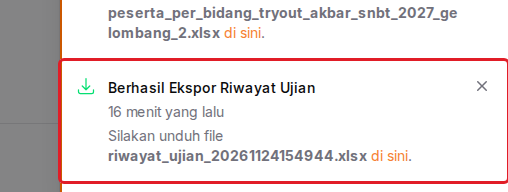
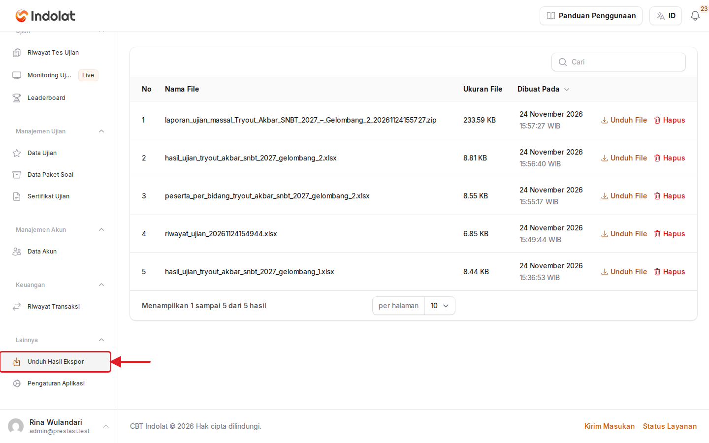
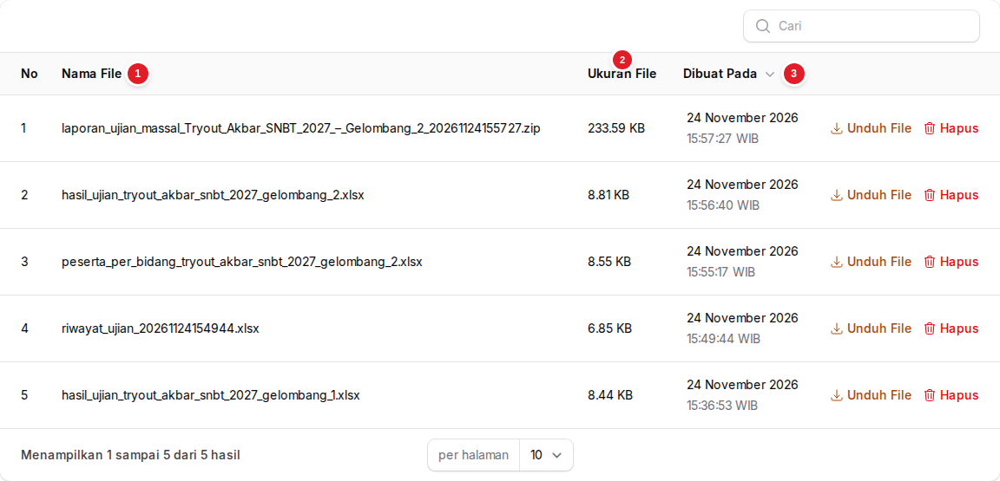
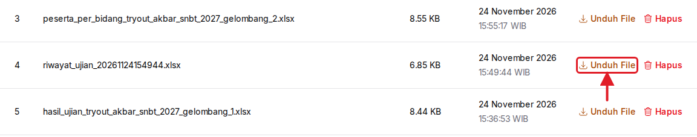
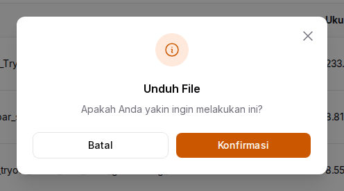
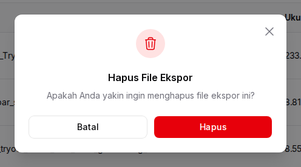

Beberapa ekspor di CBT Indolat diproses di latar belakang agar Anda tidak perlu menunggu di halaman yang sama. Setelah proses selesai, file hasilnya disimpan di menu **Unduh Hasil Ekspor**. Dari menu ini Anda dapat mengunduh file tersebut atau menghapusnya jika sudah tidak dibutuhkan.

<Info>
  **Lokasi menu:** **Portal** → **Platform Ujian (CBT)** → **Lainnya** → **Unduh Hasil Ekspor**.
</Info>

## Ekspor yang masuk ke halaman ini

| Asal ekspor | Lokasi tombol | Contoh nama file |
| --- | --- | --- |
| Ekspor riwayat tes | **Riwayat Tes Ujian** → pilih baris → **Tindakan** → **Ekspor Riwayat Tes Ujian**. Lihat [Riwayat Tes Ujian](/cbt/riwayat-tes-ujian#mengekspor-riwayat-ke-excel). | `riwayat_ujian_20261124154944.xlsx` |
| Hasil ujian, link jawaban esai, analisis butir soal, template leaderboard | Halaman detail ujian → **Ekspor Data**. Lihat [Hasil dan Ekspor Ujian](/data-ujian/hasil-dan-ekspor-ujian). | `hasil_ujian_<nama_ujian>.xlsx` |
| Laporan peserta (ZIP) | Halaman detail ujian → **Daftar Peserta Ujian** → pilih peserta → **Tindakan** → **Unduh Laporan (ZIP)**. | `laporan_ujian_massal_<nama ujian>_<waktu>.zip` |
| Daftar peserta per bidang | Halaman detail ujian → **Kode Peserta** → **Daftar Peserta per Bidang**. Lihat [Kode Peserta](/data-ujian/kode-peserta). | `peserta_per_bidang_<nama_ujian>.xlsx` |
| Paket soal ke PDF | **Data Paket Soal** → ubah paket soal CBT/CAT → **Ekspor ke PDF**. | `paket_soal_<nama paket>_<jenis>_<waktu>.pdf` |

Saat ekspor selesai, notifikasi muncul di ikon lonceng di kanan atas. Klik **di sini** pada notifikasi untuk langsung membuka halaman **Unduh Hasil Ekspor**.

<Frame>
  
</Frame>

## Membuka daftar file

Klik **Unduh Hasil Ekspor** pada sidebar, di grup **Lainnya**. File terbaru tampil paling atas.

<Frame>
  
</Frame>

<Frame>
  
</Frame>

1. **Nama File**: nama file hasil ekspor, termasuk ekstensinya (.xlsx, .pdf, atau .zip).
2. **Ukuran File**: ukuran file dalam KB atau MB.
3. **Dibuat Pada**: tanggal dan jam file selesai dibuat.

Gunakan kolom **Cari** untuk mencari berdasarkan nama file.

<Note>
  Daftar ini berisi file ekspor milik projek, termasuk ekspor yang dibuat oleh admin lain di projek yang sama.
</Note>

## Mengunduh file

<Steps>
  <Step title="Klik Unduh File">
    Klik **Unduh File** pada baris file yang dibutuhkan.

    <Frame>
      
    </Frame>
  </Step>
  <Step title="Konfirmasi">
    Klik **Konfirmasi** pada jendela **Unduh File**. File diunduh ke perangkat Anda.

    <Frame>
      
    </Frame>
  </Step>
</Steps>

## Menghapus file

Klik **Hapus** pada baris file, lalu klik **Hapus** pada jendela **Hapus File Ekspor**.

<Frame>
  
</Frame>

<Warning>
  File yang dihapus tidak dapat dikembalikan. Jika masih dibutuhkan, ulangi ekspor dari halaman asalnya. Menghapus file yang sudah tidak dipakai juga mengosongkan ruang penyimpanan projek.
</Warning>
