Sebelum peserta dapat masuk dan mengikuti ujian, **setiap peserta perlu memiliki akun** di projek Anda. Halaman ini menjelaskan tempat akun peserta dikelola, cara menambahkan akun, serta cara mengelompokkan, mencari, dan merapikan akun dengan label.

<Info>
  **Lokasi menu (daftar induk):** **Portal** → **Administrasi Aplikasi** → **Pengguna** → **Pengguna**

  **Lokasi menu (cermin di CBT):** **Portal** → **Platform Ujian (CBT)** → **Manajemen Akun** → **Data Akun**

  **Peran yang dibutuhkan:** pemilik projek, atau admin dengan peran yang diberi akses ke modul **Pengguna** (Administrasi Aplikasi) atau **Data Akun** (Platform Ujian).
</Info>

Akun peserta dapat ditambahkan melalui tiga cara:

1. **Peserta membuat akun sendiri** melalui tautan **Daftar** pada halaman login peserta.
2. **Admin menambahkan akun satu per satu** melalui tombol **Tambah Akun**.
3. **Admin menambahkan banyak akun sekaligus** melalui tombol **Import Akun** dengan file Excel.

<Tip>
  Pilih cara yang paling sesuai dengan kebutuhan Anda:

  - **Pendaftaran mandiri** cocok jika peserta diperbolehkan membuat akun sendiri, misalnya untuk tryout terbuka.
  - **Tambah Akun** cocok jika Anda hanya perlu menambahkan sedikit akun.
  - **Import Akun** cocok jika data peserta sudah disiapkan oleh sekolah, cabang lembaga, atau penyelenggara.
</Tip>

## Menu Pengguna dan menu Data Akun

Akun peserta dipakai bersama oleh semua produk dalam projek Anda. Karena itu, daftar induknya berada di modul **Administrasi Aplikasi**, pada menu **Pengguna** → **Pengguna**.

<Frame>
  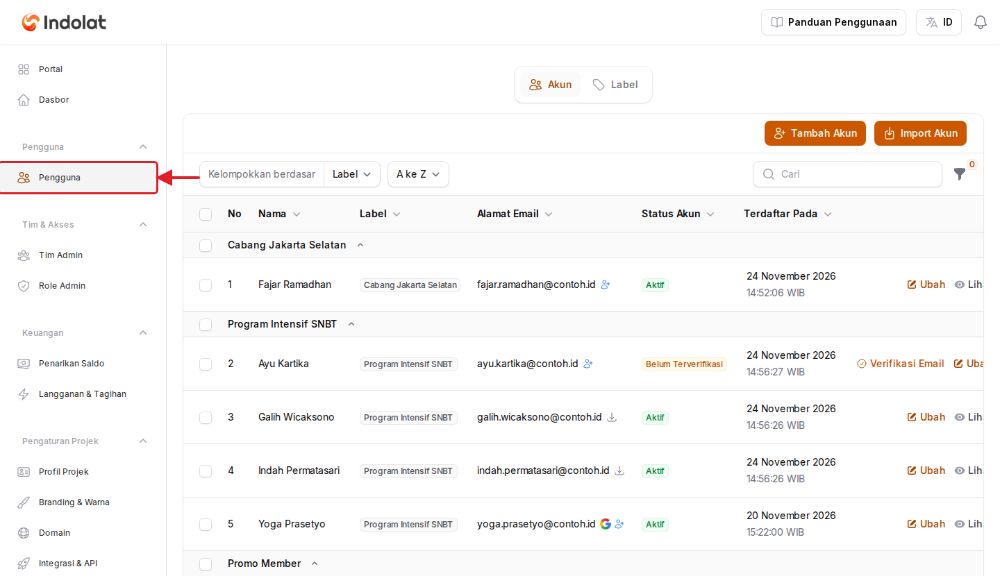
</Frame>

Daftar yang sama juga ditampilkan di modul **Platform Ujian (CBT)**, pada menu **Manajemen Akun** → **Data Akun**, sehingga Anda tidak perlu berpindah modul saat sedang menyiapkan ujian.

<Frame>
  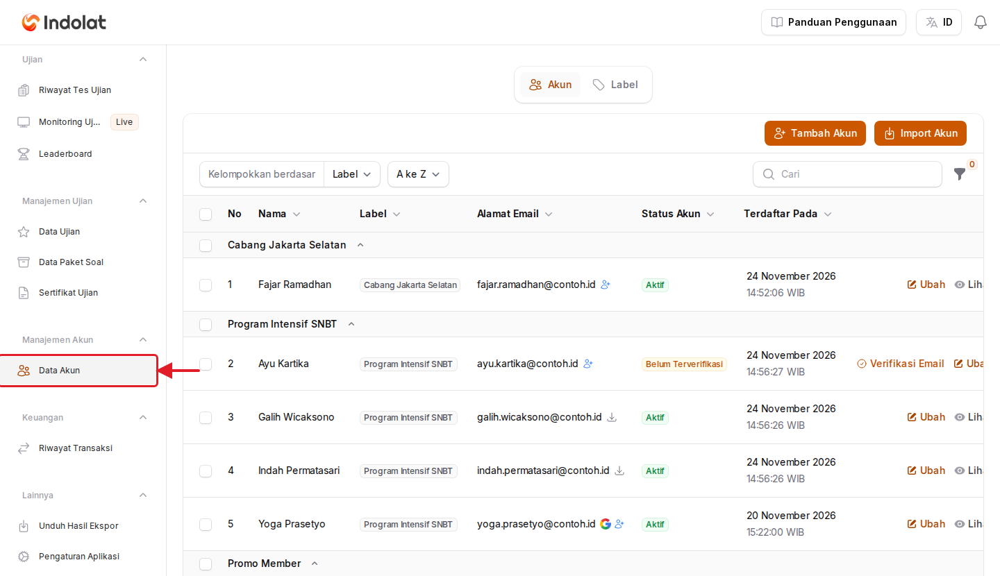
</Frame>

Kedua menu menampilkan **data yang sama** dengan fitur yang sama: tab **Akun** dan **Label**, tombol **Tambah Akun** dan **Import Akun**, pengelompokan, pencarian, filter, serta tindakan pada setiap akun. Akun atau label yang Anda tambahkan, ubah, atau hapus di salah satu menu langsung terlihat di menu lainnya.

| | **Pengguna** (Administrasi Aplikasi) | **Data Akun** (Platform Ujian (CBT)) |
| --- | --- | --- |
| Isi data | Seluruh akun peserta projek | Sama persis |
| Kapan dipakai | Mengelola peserta untuk semua produk (CBT dan LMS) | Mengelola peserta sambil menyiapkan ujian di CBT |
| Hak akses admin | Diatur melalui modul **Pengguna** pada **Role Admin** | Diatur melalui modul **Data Akun** pada **Role Admin** |

<Note>
  Hak akses kedua menu diatur terpisah. Admin yang hanya diberi akses ke **Data Akun** tetap dapat mengelola akun peserta dari modul CBT tanpa melihat menu **Pengguna** di Administrasi Aplikasi. Lihat [Manajemen Akses Admin](/lainnya/manajemen-akses-admin) untuk mengatur peran admin. Daftar yang sama juga tersedia di modul LMS dengan nama **Akun Siswa**.
</Note>

## Mengenal halaman akun peserta

Halaman ini memiliki dua tab: **Akun** berisi daftar akun peserta, dan **Label** untuk mengelola label. Setiap baris pada tab **Akun** mewakili satu akun peserta dengan kolom **No**, **Nama**, **Label**, **Alamat Email**, **Status Akun**, dan **Terdaftar Pada**.

<Frame>
  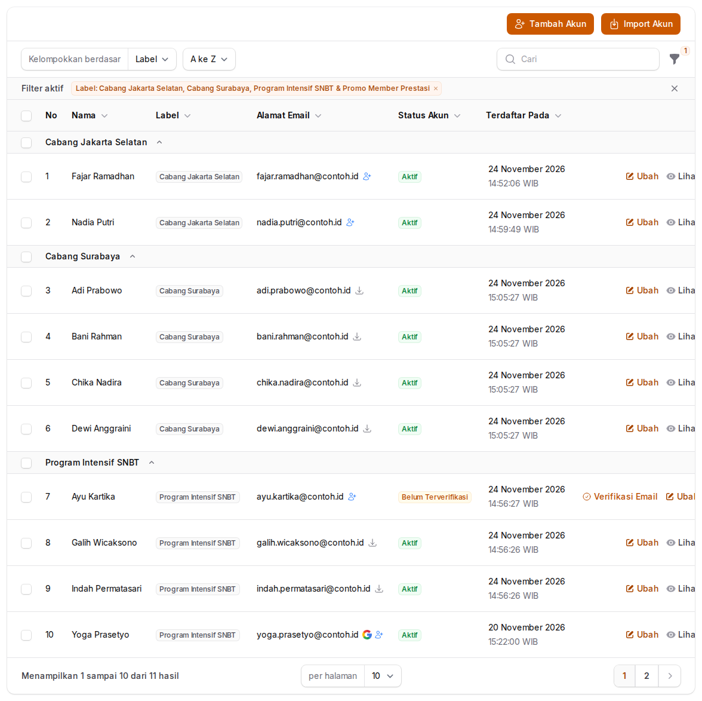
</Frame>

Pada setiap baris tersedia tindakan berikut:

- **Verifikasi Email**: tampil hanya untuk akun yang belum terverifikasi. Lihat [Status akun](#status-akun).
- **Ubah**: membuka formulir untuk mengubah nama, label, kata sandi, atau status akun.
- **Lihat**: tampil untuk akun yang sudah terverifikasi dan membuka halaman **Detail Akun** peserta.
- **Hapus**: menghapus akun peserta setelah konfirmasi.

Jumlah akun per halaman dapat diatur menjadi 10, 25, atau 50 melalui pilihan **per halaman** di bagian bawah tabel.

### Kelompokkan berdasar

Pilihan **Kelompokkan berdasar** mengatur tampilan daftar akun. Secara bawaan, daftar dikelompokkan berdasarkan **Label**, dan akun tanpa label dikumpulkan dalam grup **Tanpa Label**. Pilihan di sebelahnya (**A ke Z** atau **Z ke A**) mengatur urutan grup.

<Frame>
  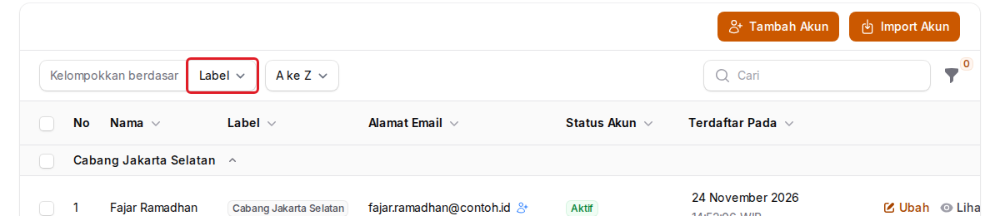
</Frame>

- Pilih **Label** agar peserta dengan label yang sama ditampilkan berdekatan. Setiap grup dapat diciutkan dengan mengeklik panah di samping nama grup.
- Pilih **Tidak Dikelompokkan** agar seluruh akun ditampilkan dalam satu daftar.

<Frame>
  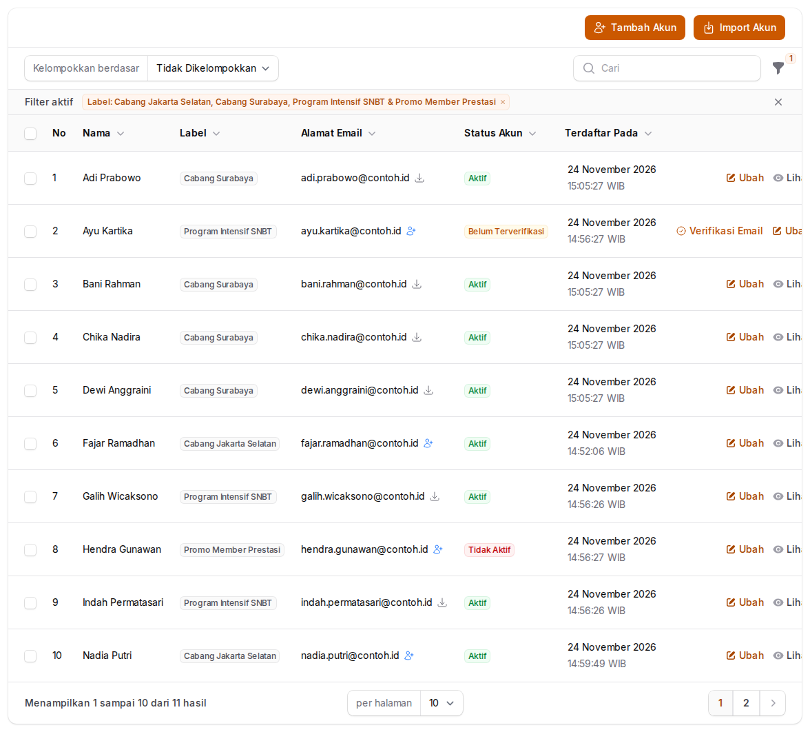
</Frame>

### Cari

Gunakan kolom **Cari** untuk menemukan akun berdasarkan nama, alamat email, atau nama label. Contohnya, ketik **Adi Prabowo** untuk menampilkan akun peserta tersebut. Kata kunci pencarian tampil pada baris **Filter aktif** dan dapat dihapus dengan mengeklik tanda **×**.

<Frame>
  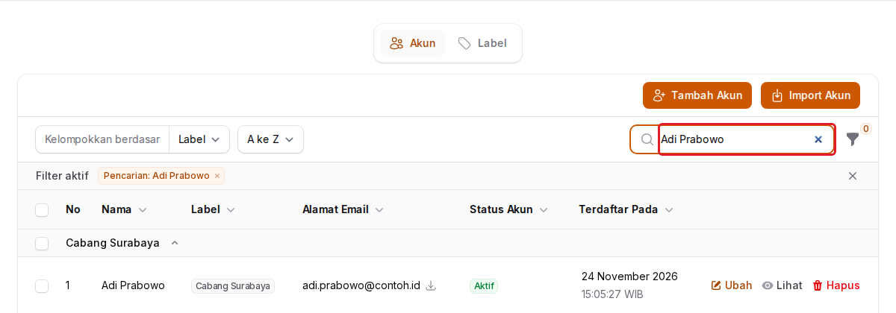
</Frame>

### Filter

Klik ikon **Filter** di sebelah kolom **Cari** untuk menyaring daftar akun. Pilihan yang tersedia:

- **Akun Google**: hanya akun yang dibuat dengan akun Google.
- **Apakah Akun diimport?**: hanya akun yang ditambahkan melalui impor.
- **Label**: satu atau beberapa label, termasuk **Tanpa Label**.
- **Status Akun**: **Aktif**, **Tidak Aktif**, atau **Belum Terverifikasi**.

<Frame>
  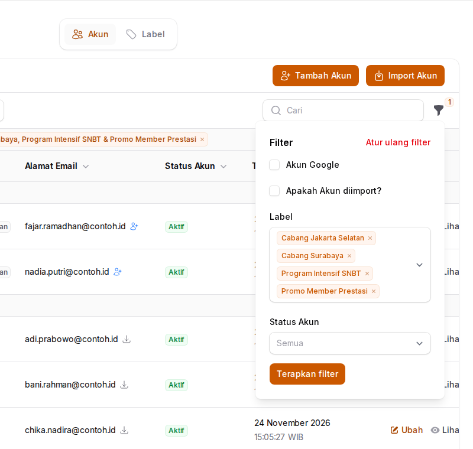
</Frame>

Setelah memilih ketentuan, klik **Terapkan filter**. Filter yang sedang berlaku tampil pada baris **Filter aktif** di atas tabel. Klik **Atur ulang filter** di panel filter, atau tanda **×** pada baris **Filter aktif**, untuk menghapusnya.

<Tip>
  Pada **Status Akun**, pilih satu status saja. Jika beberapa status dipilih sekaligus, hanya satu status yang diterapkan.
</Tip>

### Ikon asal akun

Pada kolom **Alamat Email**, terdapat ikon yang menunjukkan asal akun peserta:

- **Ikon orang dengan tanda tambah (biru)**: akun tidak berasal dari impor, yaitu dibuat sendiri oleh peserta melalui halaman pendaftaran atau ditambahkan admin melalui **Tambah Akun**.
- **Ikon panah ke bawah (abu-abu)**: akun ditambahkan melalui impor, misalnya **Import Akun** di halaman ini, impor peserta pada ujian, atau API.
- **Ikon Google**: akun dibuat dengan akun Google. Ikon ini tampil di samping salah satu ikon di atas.

<Frame>
  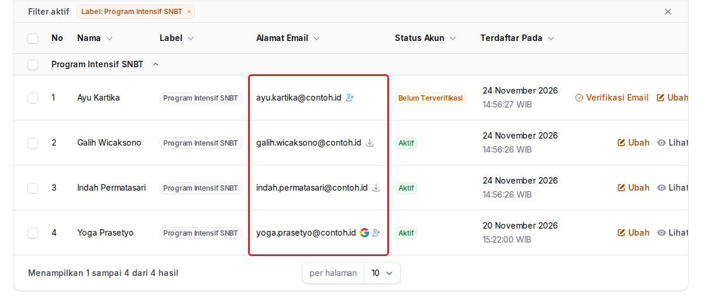
</Frame>

### Status akun

Kolom **Status Akun** menampilkan salah satu status berikut:

- **Aktif** (hijau): akun dapat dipakai untuk masuk.
- **Belum Terverifikasi** (kuning): peserta mendaftar sendiri tetapi belum memasukkan kode verifikasi email.
- **Tidak Aktif** (merah): **Status Aktif** akun dimatikan sehingga peserta tidak dapat masuk.

Jika peserta tidak menerima email verifikasi, Anda dapat memverifikasinya secara manual. Klik **Verifikasi Email** pada baris akun tersebut, lalu konfirmasi. Status akun berubah menjadi **Aktif** untuk projek Anda.

<Frame>
  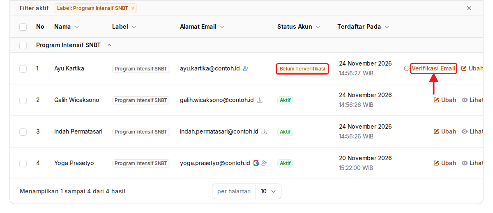
</Frame>

## Mengelola label

Label digunakan untuk mengelompokkan peserta, misalnya per cabang, per kelas, atau per program. Label memudahkan Anda mencari, menyaring, dan memilih banyak peserta sekaligus. Semua label dikelola di tab **Label**, yang menampilkan **Nama Label**, **Jumlah Akun** yang memakai label tersebut, dan waktu **Terakhir Diubah**.

### Tambah label

<Steps>
  <Step title="Buka tab Label">
    <Frame>
      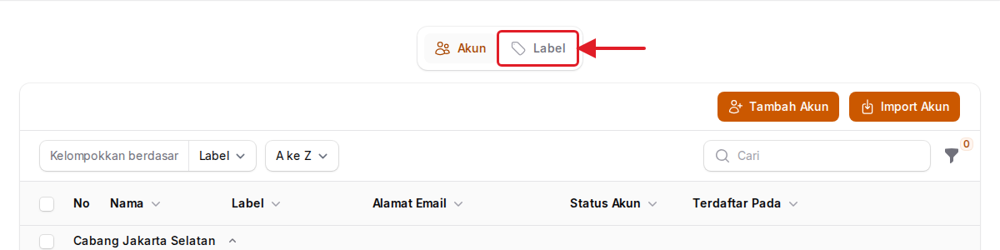
    </Frame>
  </Step>
  <Step title="Klik Tambah Label, isi Nama Label, lalu klik Simpan">
    Contohnya, buat label **Cabang Surabaya** untuk peserta dari cabang Surabaya.

    <Frame>
      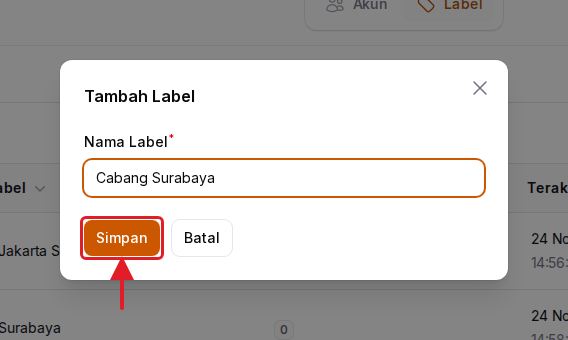
    </Frame>

    <Note>
      Nama label harus berbeda dari label yang sudah ada (huruf besar dan kecil dianggap sama). Jika nama sudah dipakai, muncul pesan bahwa label tersebut sudah tersedia.
    </Note>
  </Step>
</Steps>

### Ubah label

Contohnya, label **Promo Member** diubah menjadi **Promo Member Prestasi** agar penamaannya lebih jelas.

<Steps>
  <Step title="Klik Ubah pada baris label yang ingin diubah">
    <Frame>
      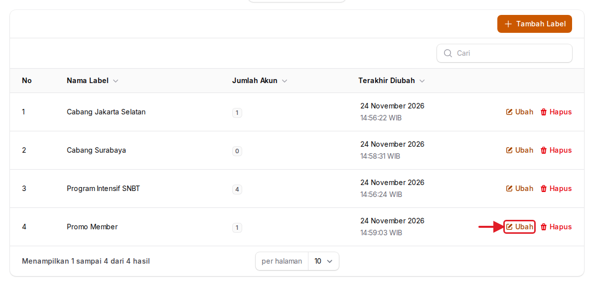
    </Frame>
  </Step>
  <Step title="Isi nama baru pada kolom Nama Label, lalu klik Simpan">
    <Frame>
      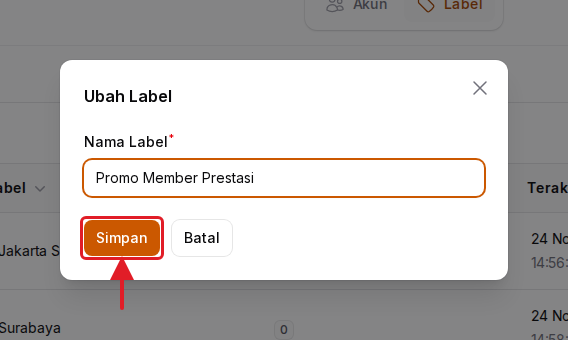
    </Frame>

    Nama label baru langsung berlaku untuk semua akun yang memakai label tersebut.
  </Step>
</Steps>

### Hapus label

Klik **Hapus** pada baris label, lalu klik **Hapus** pada jendela konfirmasi.

<Frame>
  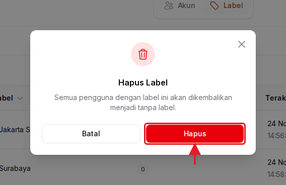
</Frame>

<Note>
  Menghapus label hanya menghapus kelompoknya. Akun peserta **tetap tersimpan** dan menjadi **Tanpa Label**.
</Note>

### Memasang label pada banyak akun sekaligus

<Steps>
  <Step title="Centang akun yang ingin diberi label, lalu klik Tindakan → Ubah Label">
    <Frame>
      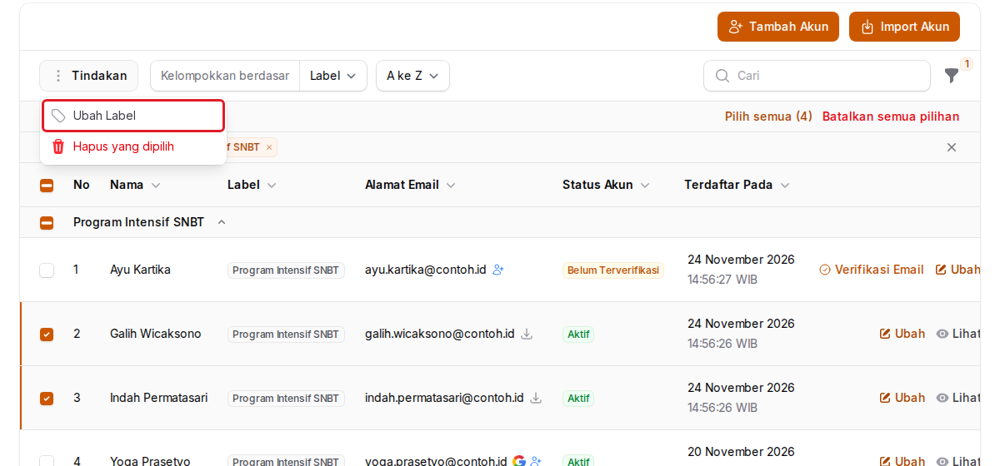
    </Frame>
  </Step>
  <Step title="Pilih label, lalu klik Simpan">
    Pilih **Tanpa Label** jika Anda ingin melepas label dari akun yang dipilih.

    <Frame>
      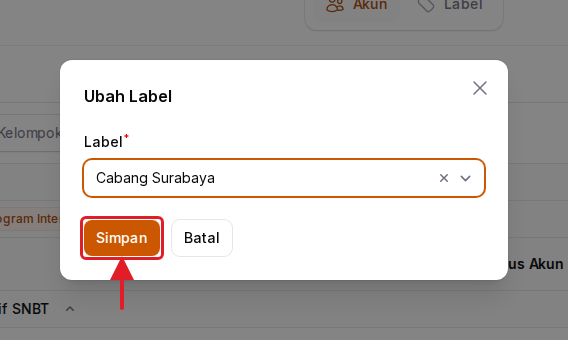
    </Frame>
  </Step>
</Steps>

## Menambahkan akun satu per satu (Tambah Akun)

<Steps>
  <Step title="Pada tab Akun, klik Tambah Akun">
    <Frame>
      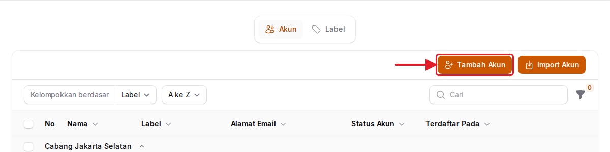
    </Frame>
  </Step>
  <Step title="Isi data akun, lalu klik Buat">
    <Frame>
      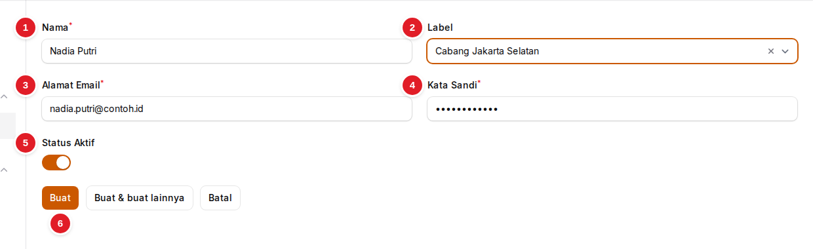
    </Frame>

    1. **Nama**: nama peserta, misalnya **Nadia Putri**.
    2. **Label**: label peserta (boleh dikosongkan sehingga akun menjadi **Tanpa Label**).
    3. **Alamat Email**: alamat email yang dipakai peserta untuk masuk, misalnya `nadia.putri@contoh.id`.
    4. **Kata Sandi**: kata sandi awal peserta.
    5. **Status Aktif**: biarkan menyala agar akun dapat langsung digunakan.
    6. **Buat**: menyimpan akun. Gunakan **Buat & buat lainnya** jika Anda ingin langsung mengisi akun berikutnya.
  </Step>
</Steps>

Akun yang ditambahkan dengan cara ini langsung terverifikasi, sehingga peserta tidak perlu memverifikasi email. Bagikan alamat email dan kata sandi kepada peserta beserta tautan login peserta (lihat [Login Peserta](/lainnya/login-peserta)).

<Note>
  Satu alamat email hanya dapat dipakai untuk satu akun peserta dalam projek yang sama. Jika alamat email sudah terdaftar, muncul pesan **Alamat email sudah terdaftar pada projek ini.**
</Note>

## Mengubah atau menghapus akun

Klik **Ubah** pada baris akun untuk membuka formulir **Ubah Akun**.

<Frame>
  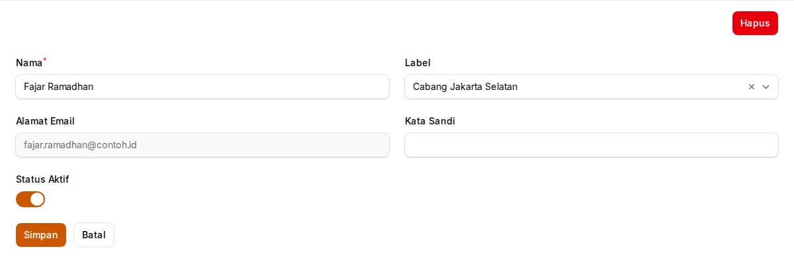
</Frame>

- **Alamat Email** tidak dapat diubah.
- **Kata Sandi** boleh dikosongkan. Isi kolom ini hanya jika Anda ingin mengganti kata sandi peserta.
- Mematikan **Status Aktif** membuat peserta tidak dapat masuk, dan sesi peserta yang sedang berjalan ikut diakhiri.

Untuk menghapus akun, klik **Hapus** pada baris akun atau pada formulir **Ubah Akun**. Untuk menghapus beberapa akun sekaligus, centang akunnya, lalu klik **Tindakan** → **Hapus yang dipilih**.

<Warning>
  Penghapusan akun tidak dapat dibatalkan. Akun yang sudah terdaftar di suatu ujian tidak dapat dihapus; keluarkan peserta dari ujian tersebut terlebih dahulu.
</Warning>

## Menambahkan banyak akun sekaligus (Import Akun)

Gunakan cara ini jika daftar peserta sudah tersedia, tetapi Anda belum menentukan ujian yang akan mereka ikuti. Contohnya, Anda memiliki daftar peserta dari **Cabang Surabaya** yang nantinya dapat mengikuti beberapa ujian berbeda.

<Steps>
  <Step title="Pada tab Akun, klik Import Akun">
    <Frame>
      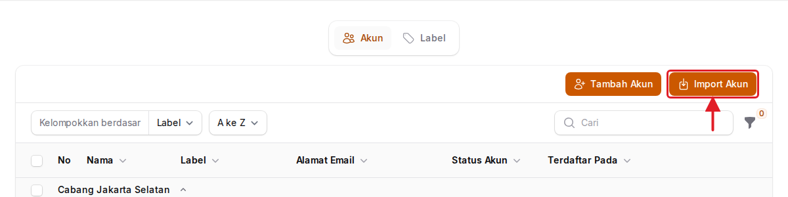
    </Frame>
  </Step>
  <Step title="Klik Unduh Template">
    <Frame>
      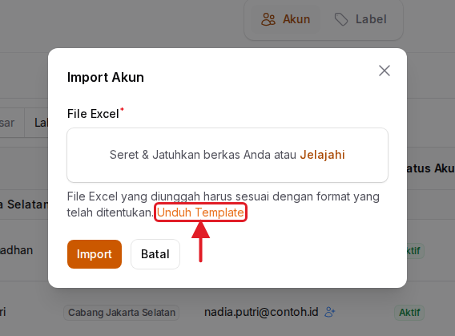
    </Frame>

    File **template-import-akun.xlsx** akan terunduh. Template berisi kolom **Nama**, **Alamat Email**, **Kata Sandi**, dan **Label**, serta beberapa baris contoh.
  </Step>
  <Step title="Isi data peserta pada file Excel">
    Ganti baris contoh dengan data peserta Anda. Jangan mengubah judul kolom pada baris pertama.

    <Frame>
      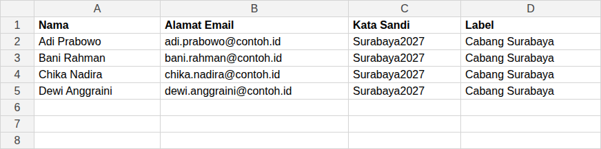
    </Frame>

    1. **Nama**: nama peserta (wajib).
    2. **Alamat Email**: alamat email yang dipakai peserta untuk masuk (wajib).
    3. **Kata Sandi**: kata sandi untuk setiap peserta (wajib).
    4. **Label**: nama label untuk mengelompokkan peserta (boleh dikosongkan). Jika label belum ada, sistem membuatnya secara otomatis.

    <Note>
      Pada proses impor, sistem **tidak memeriksa** apakah alamat email benar-benar aktif; sistem hanya memeriksa format penulisannya. Karena itu, Anda dapat memakai alamat email khusus ujian, misalnya `peserta001@contoh.id`. Pastikan setiap peserta memakai alamat email yang berbeda.
    </Note>

    <Warning>
      Hapus baris contoh dari template sebelum mengunggah. Baris yang tidak dihapus akan ikut diimpor sebagai akun.
    </Warning>
  </Step>
  <Step title="Unggah file, lalu klik Import">
    <Frame>
      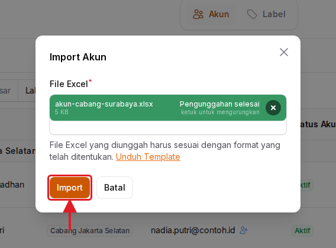
    </Frame>

    Sistem memproses file di latar belakang. Selama proses berjalan, kartu **Mengimpor Akun Peserta** dengan bilah kemajuan tampil di atas daftar akun. Setelah selesai, Anda menerima notifikasi **Berhasil Mengimpor Akun Peserta** beserta jumlah akun yang berhasil diimpor.

    <Frame>
      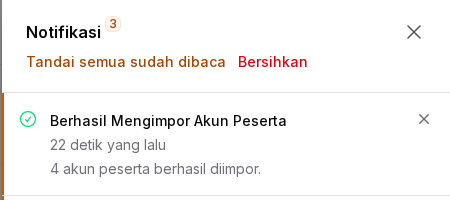
    </Frame>

    Akun hasil impor langsung aktif dan terverifikasi, ditandai dengan ikon panah ke bawah pada kolom **Alamat Email**.
  </Step>
</Steps>

<Note>
  Impor dibatalkan seluruhnya jika ada baris dengan **Nama**, **Alamat Email**, atau **Kata Sandi** yang kosong, atau jika ada alamat email dengan format tidak valid. Perbaiki file sesuai pesan pada notifikasi, lalu impor ulang.

  Jika alamat email di file sudah terdaftar di projek Anda, akun tersebut tidak digandakan. Nama, kata sandi, dan labelnya diperbarui sesuai isi file, dan akun diaktifkan kembali.
</Note>

<Warning>
  Akun yang diimpor belum otomatis masuk ke ujian tertentu. Untuk memasukkannya ke ujian, buka **Data Ujian**, pilih **Daftar Peserta Ujian**, lalu gunakan tombol **Tambah Peserta**. Langkah lengkapnya ada di [Menambahkan Peserta ke Dalam Ujian](/data-ujian/menambahkan-peserta-ujian).
</Warning>

## Peserta membuat akun sendiri

Cara ini hanya tersedia jika pilihan **Izinkan pendaftaran akun mandiri** diaktifkan di **Platform Ujian (CBT)** → **Lainnya** → **Pengaturan Aplikasi**. Lihat [Login Peserta](/lainnya/login-peserta) untuk pengaturannya.

<Steps>
  <Step title="Peserta membuka tautan login, lalu klik Daftar">
    <Frame>
      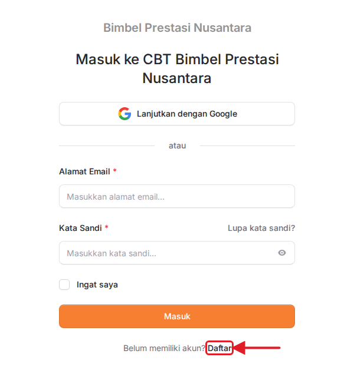
    </Frame>
  </Step>
  <Step title="Peserta mengisi formulir pendaftaran">
    <Frame>
      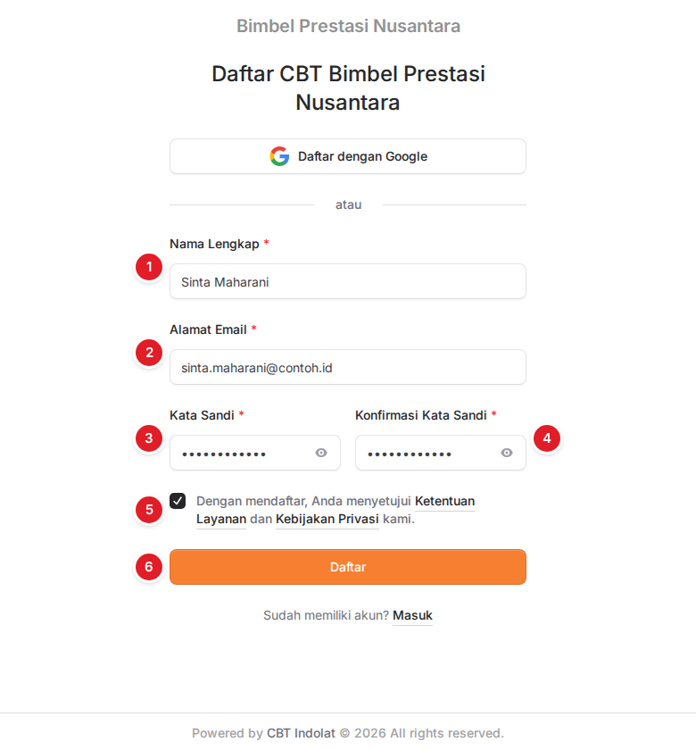
    </Frame>

    Peserta mengisi **Nama Lengkap**, **Alamat Email**, **Kata Sandi** (minimal 8 karakter), dan **Konfirmasi Kata Sandi**, mencentang persetujuan **Ketentuan Layanan** dan **Kebijakan Privasi**, lalu mengeklik **Daftar**. Jika **Autentikasi dengan Google** aktif, peserta juga dapat memilih **Daftar dengan Google**.
  </Step>
  <Step title="Peserta memverifikasi alamat email">
    Sistem mengirimkan kode verifikasi 6 angka ke alamat email peserta. Peserta memasukkan kode tersebut, lalu mengeklik **Verifikasi Akun**.

    <Frame>
      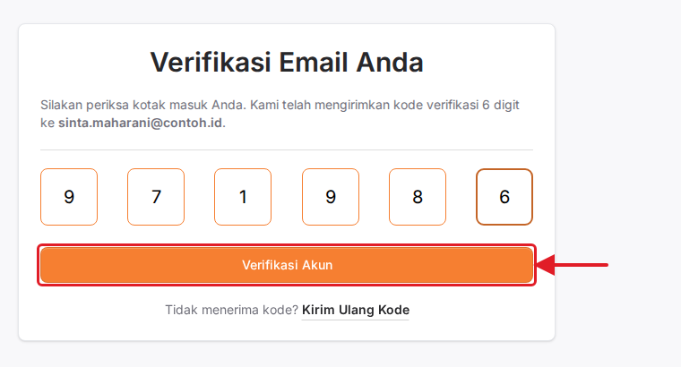
    </Frame>

    Selama kode belum dimasukkan, akun tampil dengan status **Belum Terverifikasi** di daftar akun. Setelah verifikasi berhasil, peserta masuk ke halaman **Daftar Tes** dan status akunnya menjadi **Aktif**.
  </Step>
</Steps>

<Info>
  Verifikasi email hanya diperlukan bagi peserta yang mendaftar sendiri. Akun yang ditambahkan admin melalui **Tambah Akun** atau **Import Akun** langsung terverifikasi. Langkah lengkap pendaftaran dari sisi peserta ada di [Login Peserta](/lainnya/login-peserta#cara-peserta-mendaftar-dan-masuk).
</Info>
