Setelah peserta mengerjakan tes, Anda dapat mengolah hasil ujian langsung dari halaman **Detail Ujian**: mengekspor data ke Excel, menghitung ulang skor, dan mengunduh laporan hasil setiap peserta. Halaman ini hanya membahas tindakan per ujian. Riwayat pengerjaan semua ujian ada di [Riwayat Tes Ujian](/cbt/riwayat-tes-ujian), pemantauan saat ujian berlangsung di [Monitoring Ujian](/cbt/monitoring-ujian), dan papan peringkat di [Leaderboard](/cbt/leaderboard).

<Info>
  **Lokasi menu:** **Portal** → **Platform Ujian (CBT)** → **Manajemen Ujian** → **Data Ujian** → **Detail** pada ujian. Tombol **Ekspor Data** dan **Hitung Skor** ada di kanan atas halaman; laporan peserta ada di bagian **Daftar Peserta Ujian**.
</Info>

Contoh pada halaman ini memakai **Tryout Akbar SNBT 2027 – Gelombang 2**, yang tes Penalaran Matematikanya sudah dikerjakan tiga peserta.

## Mengekspor data ujian

Klik **Ekspor Data** di kanan atas halaman **Detail Ujian**.

<Frame>
  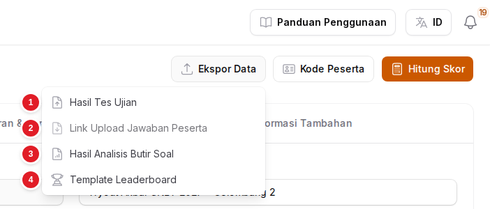
</Frame>

1. **Hasil Tes Ujian**: hasil seluruh peserta dalam satu file Excel dengan dua sheet:
   - **Hasil Ujian**: **Kode Peserta**, **Nama Peserta**, skor setiap tes ujian, **Skor Akhir**, dan **Kode Bidang** jika kode bidang diaktifkan.
   - **Detail Peserta**: waktu mulai dan selesai, lama pengerjaan, total poin, indikasi kecurangan, dan persentase setiap kelompok soal.
2. **Link Upload Jawaban Peserta**: tautan unduhan berkas jawaban peserta pada tes **Esai / Upload File (Jawaban Manual)**, satu kolom untuk setiap soal. Pilihan ini aktif jika ujian memiliki tes esai yang sudah diselesaikan peserta.
3. **Hasil Analisis Butir Soal**: analisis setiap soal tes CBT dan CAT, dengan sheet **Analisis Per Soal** (jumlah benar, salah, tidak dijawab, persentase benar, dan data setiap pilihan jawaban) serta **Ringkasan Per Kelompok**. Pilihan ini aktif jika ujian memiliki tes CBT/CAT yang sudah diselesaikan peserta.
4. **Template Leaderboard**: file berisi satu baris untuk setiap peserta di setiap subtes yang sudah selesai dan memiliki skor, dengan kolom **Papan**, **Kode Peserta**, **Email**, **Nama**, **Skor**, **Waktu Selesai**, dan **Peringkat**. Kolom **Papan** berisi nama sesi (bidang), atau nama subtes jika subtes hanya memiliki satu sesi. Kolom **Kode Peserta** berisi kode bidang jika peserta memilikinya. File ini dipakai untuk mengisi papan peringkat, lihat [Leaderboard](/cbt/leaderboard). Pilihan ini hanya muncul jika Anda memiliki akses ke menu **Leaderboard**.

Pilihan yang belum dapat dipakai tampil berwarna abu-abu.

<Steps>
  <Step title="Konfirmasi ekspor">
    Klik salah satu pilihan, lalu klik **Konfirmasi** (atau **Ekspor** untuk **Template Leaderboard**).

    <Frame>
      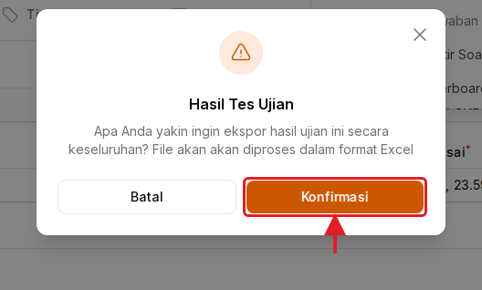
    </Frame>

    <Frame>
      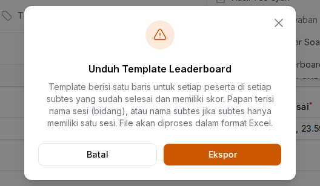
    </Frame>
  </Step>
  <Step title="Unduh file setelah selesai">
    File diproses di latar belakang. Setelah selesai, notifikasi muncul di ikon lonceng. Klik **di sini** pada notifikasi untuk membuka halaman [Unduh Hasil Ekspor](/cbt/unduh-hasil-ekspor), tempat semua file ekspor dapat diunduh.

    <Frame>
      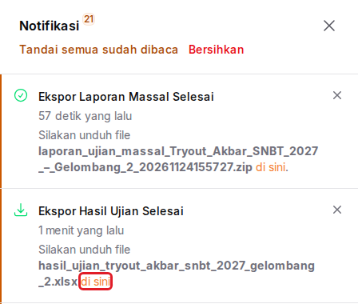
    </Frame>
  </Step>
</Steps>

<Tip>
  Jalankan **Hitung Skor** terlebih dahulu jika Anda baru mengubah kunci jawaban, bobot soal, atau metode penilaian, agar file hasil memakai skor terbaru.
</Tip>

## Menghitung ulang skor

Klik **Hitung Skor** di kanan atas halaman **Detail Ujian**.

<Frame>
  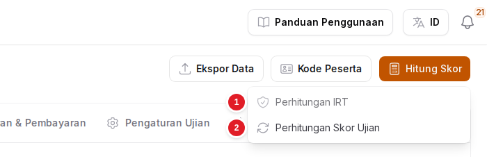
</Frame>

1. **Perhitungan IRT**: menghitung skor tes bermetode IRT untuk semua peserta yang sudah selesai. Skor IRT bergantung pada pola jawaban seluruh peserta, jadi jalankan setelah semua peserta selesai. Pilihan ini aktif jika ujian memiliki tes IRT, sudah ada peserta yang selesai, tidak ada peserta yang sedang mengerjakan, perhitungan IRT sebelumnya sudah selesai, dan ujian bukan ujian multi-level.
2. **Perhitungan Skor Ujian**: menghitung ulang skor tes bermetode **Perhitungan Skor Soal**, **Perhitungan Skor Jawaban**, dan **Psikotes** untuk semua peserta yang sudah selesai. Gunakan setelah Anda memperbaiki kunci jawaban atau skor soal di paket soal.

Klik **Konfirmasi** pada jendela yang muncul.

<Frame>
  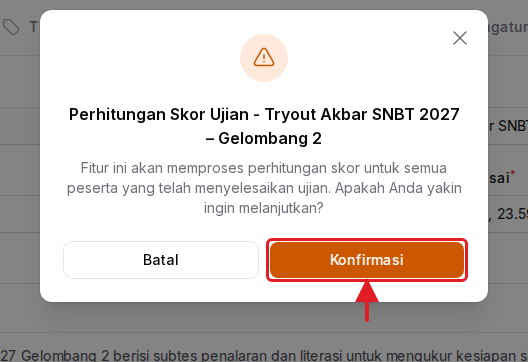
</Frame>

Perhitungan berjalan di latar belakang dan Anda menerima notifikasi setelah selesai. Kedua pilihan tidak tersedia pada ujian yang sudah diarsipkan.

### Menghitung ulang skor satu tes

Untuk menghitung ulang skor satu tes saja, buka detail tes, pilih bagian **Sesi Peserta Ujian**, lalu klik **Hitung Ulang Skor**. Tombol ini muncul pada tes bermetode **Perhitungan Skor Soal** atau **Perhitungan Skor Jawaban** yang sudah memiliki peserta selesai.

<Frame>
  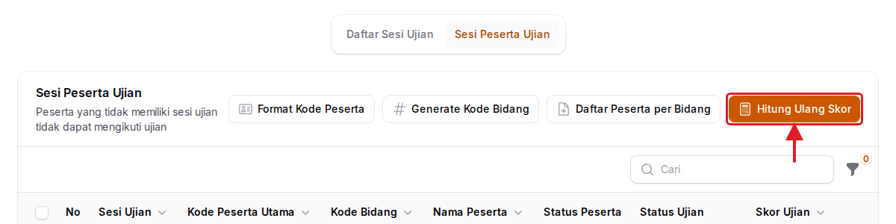
</Frame>

<Frame>
  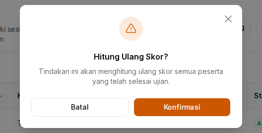
</Frame>

## Mengunduh laporan hasil peserta

Laporan hasil adalah dokumen PDF untuk satu peserta. Isinya antara lain identitas peserta, analisis skor per tes, analisis waktu pengerjaan, dan detail jawaban per pertanyaan.

### Laporan satu peserta

Pada bagian **Daftar Peserta Ujian**, klik **Unduh Laporan** pada baris peserta. Tombol ini muncul setelah peserta menyelesaikan minimal satu tes. File PDF langsung terunduh.

<Frame>
  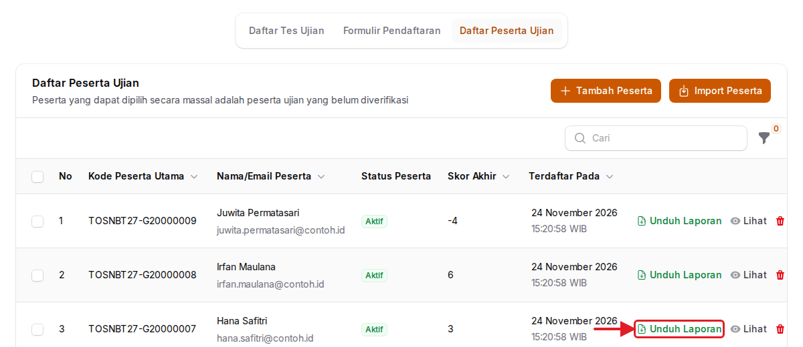
</Frame>

### Laporan beberapa peserta sekaligus (ZIP)

<Steps>
  <Step title="Pilih peserta lalu Unduh Laporan (ZIP)">
    Centang peserta, klik **Tindakan**, lalu pilih **Unduh Laporan (ZIP)**.

    <Frame>
      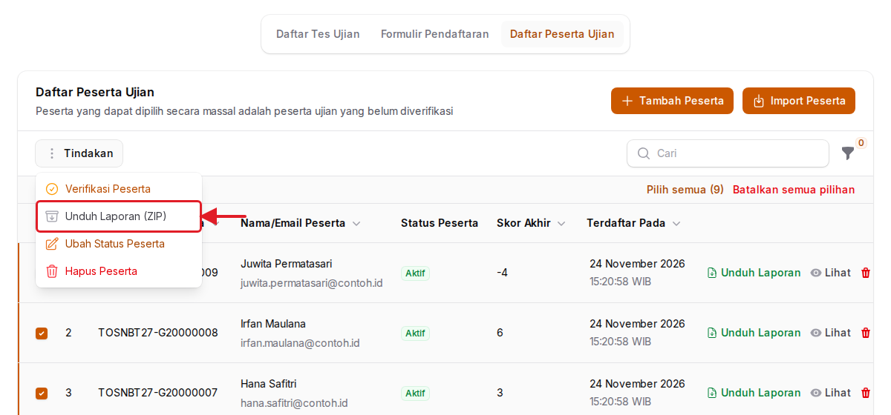
    </Frame>
  </Step>
  <Step title="Konfirmasi">
    Pada jendela **Unduh Laporan Massal**, klik **Konfirmasi**.

    <Frame>
      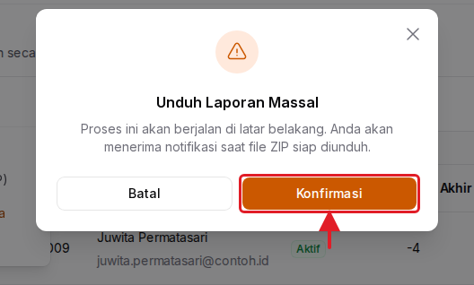
    </Frame>

    Arsip ZIP berisi laporan PDF setiap peserta dibuat di latar belakang. Setelah notifikasi **Ekspor Laporan Massal Selesai** muncul, unduh file melalui tautan **di sini** atau dari halaman [Unduh Hasil Ekspor](/cbt/unduh-hasil-ekspor).
  </Step>
</Steps>
