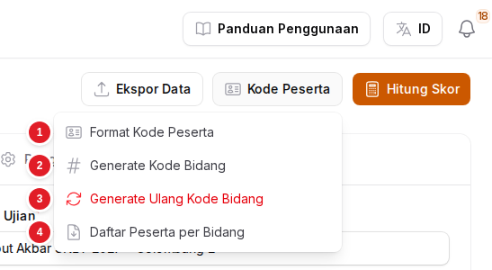
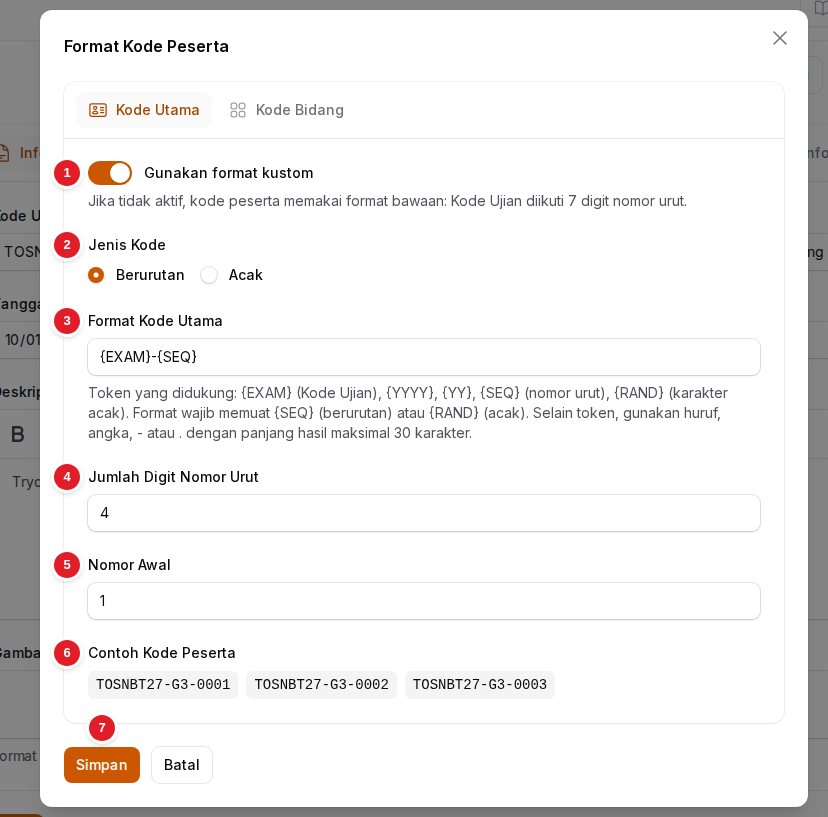
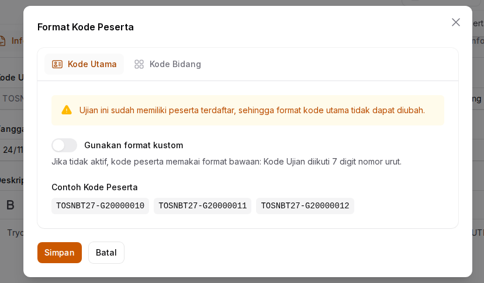
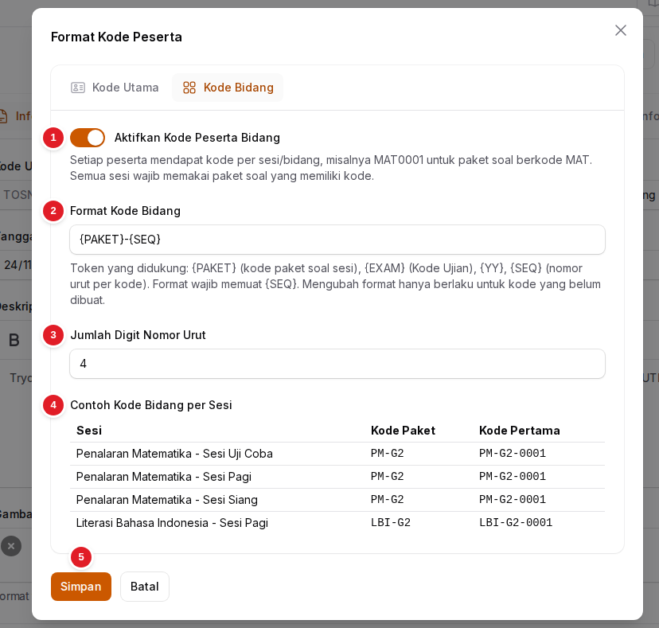
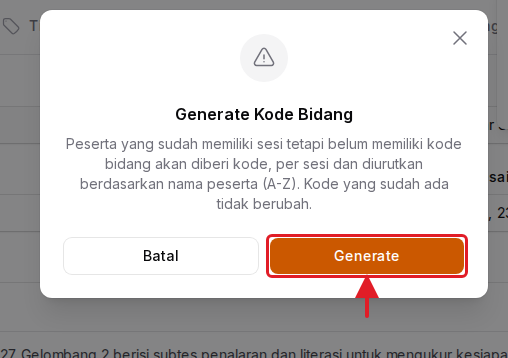
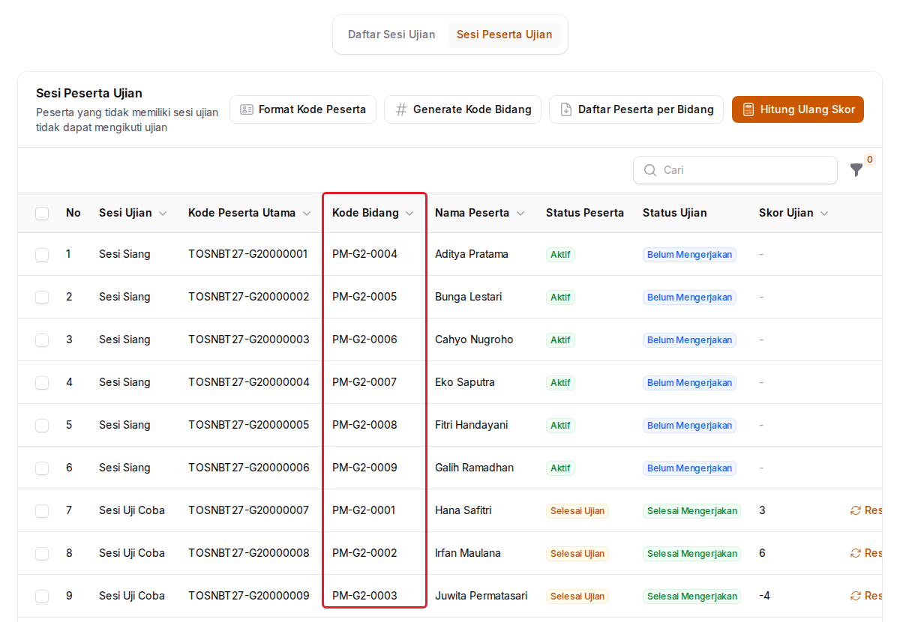
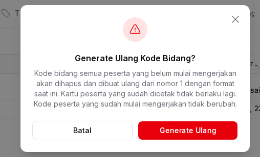
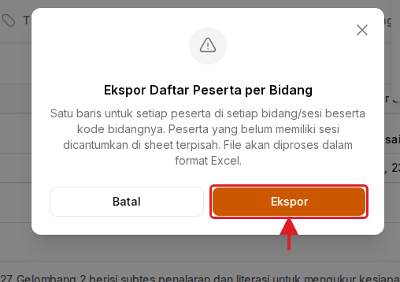
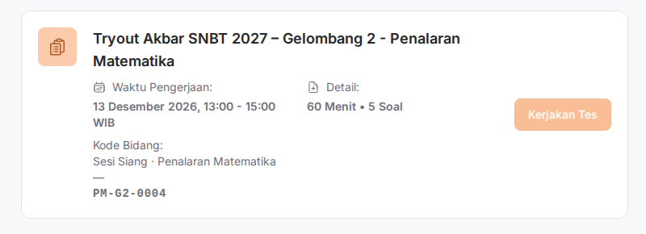
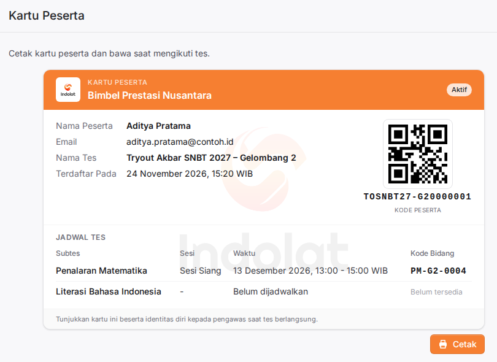

Setiap peserta ujian mendapat **kode peserta**. Kode ini tampil di daftar peserta, di file hasil ujian, dan di **Kartu Peserta** yang dapat dicetak peserta. Halaman ini menjelaskan cara mengatur format kode peserta dan cara memakai **kode bidang**, yaitu kode tambahan per sesi untuk ujian yang pesertanya dibagi ke beberapa bidang atau ruang.

<Info>
  **Lokasi menu:** **Portal** → **Platform Ujian (CBT)** → **Manajemen Ujian** → **Data Ujian** → **Detail** pada ujian → tombol **Kode Peserta** di kanan atas.
</Info>

Ada dua jenis kode:

| Kode | Diberikan | Contoh |
| --- | --- | --- |
| **Kode Peserta Utama** | Satu kode untuk setiap peserta di sebuah ujian, saat peserta terdaftar. | **TOSNBT27-G20000001** |
| **Kode Bidang** | Satu kode untuk setiap peserta di setiap tes, berdasarkan sesi dan paket soal sesi tersebut. Hanya ada jika diaktifkan. | **PM-G2-0001** |

Sebagai contoh, **Tryout Akbar SNBT 2027 – Gelombang 2** memakai kode utama bawaan dan kode bidang berformat `{PAKET}-{SEQ}`, sehingga peserta tes Penalaran Matematika (paket soal berkode **PM-G2**) mendapat kode **PM-G2-0001**, **PM-G2-0002**, dan seterusnya.

## Membuka menu Kode Peserta

Klik **Kode Peserta** di kanan atas halaman **Detail Ujian**. Sebelum kode bidang diaktifkan, menu hanya berisi **Format Kode Peserta**. Setelah kode bidang aktif, menu berisi:

<Frame>
  
</Frame>

1. **Format Kode Peserta**: mengatur format kode utama dan kode bidang.
2. **Generate Kode Bidang**: membuat kode bidang untuk peserta yang belum memilikinya.
3. **Generate Ulang Kode Bidang**: membuat ulang semua kode bidang peserta yang belum mulai mengerjakan.
4. **Daftar Peserta per Bidang**: mengekspor daftar peserta beserta kode bidangnya ke Excel.

**Format Kode Peserta**, **Generate Kode Bidang**, dan **Daftar Peserta per Bidang** juga tersedia di bagian **Sesi Peserta Ujian** pada detail tes.

## Mengatur format kode utama

Tanpa pengaturan, kode utama memakai format bawaan: **Kode Ujian** diikuti 7 digit nomor urut, misalnya **TOSNBT27-G20000001**. Untuk memakai format sendiri, atur sebelum ujian memiliki peserta. Contoh berikut memakai ujian **Tryout Akbar SNBT 2027 – Gelombang 3** yang belum memiliki peserta.

<Steps>
  <Step title="Buka Format Kode Peserta">
    Klik **Kode Peserta** → **Format Kode Peserta**. Jendela terbuka pada tab **Kode Utama**.
  </Step>
  <Step title="Isi format kode utama">
    <Frame>
      
    </Frame>

    1. **Gunakan format kustom**: aktifkan untuk memakai format sendiri. Jika dinonaktifkan, format bawaan dipakai.
    2. **Jenis Kode**: pilih **Berurutan** (nomor urut) atau **Acak** (karakter acak).
    3. **Format Kode Utama**: susunan kode. Token yang didukung:
       - `{EXAM}`: **Kode Ujian**,
       - `{YYYY}` dan `{YY}`: tahun empat atau dua digit,
       - `{SEQ}`: nomor urut, wajib untuk jenis **Berurutan**,
       - `{RAND}`: karakter acak, wajib untuk jenis **Acak**.

       Selain token, Anda hanya boleh memakai huruf, angka, `-`, atau `.`. Panjang kode yang dihasilkan maksimal 30 karakter. Contoh: `{EXAM}-{SEQ}`.
    4. **Jumlah Digit Nomor Urut**: panjang nomor urut, misalnya **4** menghasilkan **0001**. Untuk jenis **Acak**, kolom ini diganti **Jumlah Karakter Acak**; karakter acak tidak memakai 0, O, 1, I, dan L agar tidak tertukar.
    5. **Nomor Awal**: nomor urut pertama, misalnya **1**.
    6. **Contoh Kode Peserta**: pratinjau tiga kode berikutnya. Jika format tidak valid, pesan kesalahan tampil di sini.
    7. Klik **Simpan**.
  </Step>
</Steps>

<Warning>
  Setelah ujian memiliki peserta terdaftar, format kode utama **tidak dapat diubah** karena kode yang sudah dibagikan atau dicetak tidak boleh berubah. Tab **Kode Utama** menampilkan peringatan berikut:

  <Frame>
    
  </Frame>
</Warning>

## Mengaktifkan kode bidang

Kode bidang berguna jika peserta satu tes dibagi ke beberapa sesi atau bidang, misalnya per ruang atau per mata uji, dan setiap peserta perlu nomor di bidang tersebut.

<Note>
  Jika format kode bidang memakai `{PAKET}`, **semua sesi** pada ujian harus memakai paket soal yang memiliki **Kode Paket Soal**. Kode ini diisi di **Data Paket Soal**, lihat [Membuat Paket Soal](/paket-soal/membuat-paket-soal). Jika ada sesi tanpa kode paket, sistem menampilkan daftar sesi tersebut dan pengaturan tidak dapat disimpan.
</Note>

<Steps>
  <Step title="Buka tab Kode Bidang">
    Klik **Kode Peserta** → **Format Kode Peserta**, lalu pilih tab **Kode Bidang**.
  </Step>
  <Step title="Atur kode bidang">
    <Frame>
      
    </Frame>

    1. **Aktifkan Kode Peserta Bidang**: aktifkan agar setiap peserta mendapat kode per sesi.
    2. **Format Kode Bidang**: susunan kode. Token yang didukung: `{PAKET}` (kode paket soal sesi), `{EXAM}` (Kode Ujian), `{YY}`, dan `{SEQ}` (nomor urut per kode, wajib). Bawaan: `{PAKET}{SEQ}`. Contoh: `{PAKET}-{SEQ}`.
    3. **Jumlah Digit Nomor Urut**: panjang nomor urut, bawaan **4**.
    4. **Contoh Kode Bidang per Sesi**: tabel **Sesi**, **Kode Paket**, dan **Kode Pertama** yang akan dibuat untuk setiap sesi.
    5. Klik **Simpan**.

    Nomor urut dihitung per kode yang terbentuk. Pada contoh ini, semua sesi Penalaran Matematika memakai paket **PM-G2**, sehingga nomornya bersambung di antara sesi-sesi tersebut. Mengubah format hanya berlaku untuk kode yang belum dibuat.
  </Step>
</Steps>

Setelah kode bidang aktif, peserta yang dipasangkan atau dipindahkan ke sesi langsung mendapat kode bidang. Peserta yang sudah berada di sesi sebelum kode bidang diaktifkan perlu dibuatkan kodenya dengan **Generate Kode Bidang**.

## Membuat kode bidang

<Steps>
  <Step title="Klik Generate Kode Bidang">
    Klik **Kode Peserta** → **Generate Kode Bidang**, lalu klik **Generate** pada jendela konfirmasi.

    <Frame>
      
    </Frame>

    Sistem memberi kode kepada peserta yang sudah memiliki sesi tetapi belum memiliki kode bidang, per sesi dan diurutkan berdasarkan nama peserta (A–Z). Kode yang sudah ada tidak berubah. Notifikasi menampilkan jumlah kode baru dan peserta yang dilewati karena paket soal sesinya belum memiliki kode.
  </Step>
  <Step title="Periksa kode bidang peserta">
    Buka detail tes, lalu bagian **Sesi Peserta Ujian**. Kolom **Kode Bidang** tampil di samping **Kode Peserta Utama**.

    <Frame>
      
    </Frame>
  </Step>
</Steps>

### Membuat ulang kode bidang

**Generate Ulang Kode Bidang** menghapus kode bidang semua peserta yang belum mulai mengerjakan, lalu membuatnya ulang dari nomor 1 dengan format saat ini. Kode peserta yang sudah mulai mengerjakan tidak berubah.

<Frame>
  
</Frame>

<Warning>
  Setelah kode bidang dibuat ulang, kartu peserta yang sudah dicetak tidak berlaku lagi. Gunakan tindakan ini hanya sebelum kartu peserta dibagikan.
</Warning>

## Mengekspor daftar peserta per bidang

Klik **Kode Peserta** → **Daftar Peserta per Bidang**, lalu klik **Ekspor**.

<Frame>
  
</Frame>

File Excel berisi dua sheet:

- **Peserta per Bidang**: satu baris untuk setiap peserta di setiap sesi, dengan kolom **Kode Bidang**, **Kode Peserta Utama**, **Nama**, **Email**, **Label**, **Subtes**, **Bidang/Sesi**, **Jadwal Mulai**, dan **Jadwal Selesai**.
- **Belum Ada Sesi**: peserta yang belum dipasangkan ke sesi pada suatu subtes.

File diproses di latar belakang. Setelah selesai, Anda menerima notifikasi dan file dapat diunduh di halaman [Unduh Hasil Ekspor](/cbt/unduh-hasil-ekspor).

## Kode peserta di aplikasi peserta

Peserta melihat kode bidangnya pada kartu tes di halaman **Daftar Tes**:

<Frame>
  
</Frame>

Peserta juga dapat membuka **Kartu Peserta** dari menu nama di kanan atas. Kartu ini memuat kode peserta utama (beserta kode QR), jadwal setiap subtes, dan kode bidangnya. Peserta dapat mencetaknya dengan tombol **Cetak**.

<Frame>
  
</Frame>

Kode peserta juga dipakai di file **Hasil Tes Ujian** dan **Template Leaderboard**. Lihat [Hasil dan Ekspor Ujian](/data-ujian/hasil-dan-ekspor-ujian).
