Formulir pendaftaran berisi pertanyaan yang diisi peserta ketika mendaftar ujian secara mandiri di aplikasi peserta. Halaman ini menjelaskan cara membuka pendaftaran, menyusun pertanyaan formulir, menagih biaya pendaftaran, memberikan kode voucher, memverifikasi pendaftar, dan membatasi kuota.

<Info>
  Lokasi menu: **Portal** → **Platform Ujian (CBT)** → **Manajemen Ujian** → **Data Ujian** → **Detail** pada ujian → tab **Formulir Pendaftaran**.

  Fitur ini memerlukan add-on **Halaman Pendaftaran Ujian dan Pembayaran Otomatis**. Jika add-on belum aktif, tab **Formulir Pendaftaran** hanya menampilkan tombol **Aktifkan Add-on Formulir Pendaftaran** yang mengarah ke **Administrasi Aplikasi** → **Keuangan** → **Langganan & Tagihan**.
</Info>

Sebagai contoh, Anda adalah admin **Bimbel Prestasi Nusantara** yang membuka pendaftaran **Tryout Persiapan SNBT 2027 Batch Desember** (kode **TPS-DES27**) dengan biaya Rp50.000. Saat mendaftar, peserta diminta mengisi:

- **Asal Cabang Lembaga** (Surabaya atau Jakarta)
- **Nomor WhatsApp**
- **Asal Sekolah**

Peserta cabang Jakarta membayar biaya pendaftaran, sedangkan peserta cabang Surabaya tidak.

## 1. Membuka pendaftaran dan menentukan biaya

Ujian dan tes ujiannya harus sudah dibuat terlebih dahulu. Jika belum, ikuti panduan [Membuat Ujian](/data-ujian/membuat-ujian).

<Steps>
  <Step title="Buka detail ujian">
    Buka **Data Ujian**, cari ujian, lalu klik **Detail**.

    <Frame>
      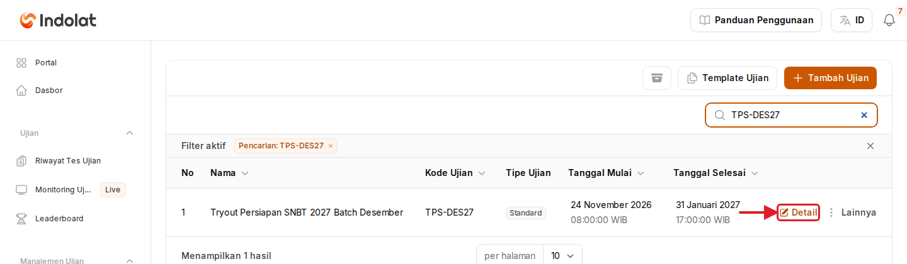
    </Frame>
  </Step>
  <Step title="Atur tab Pendaftaran & Pembayaran">
    <Frame>
      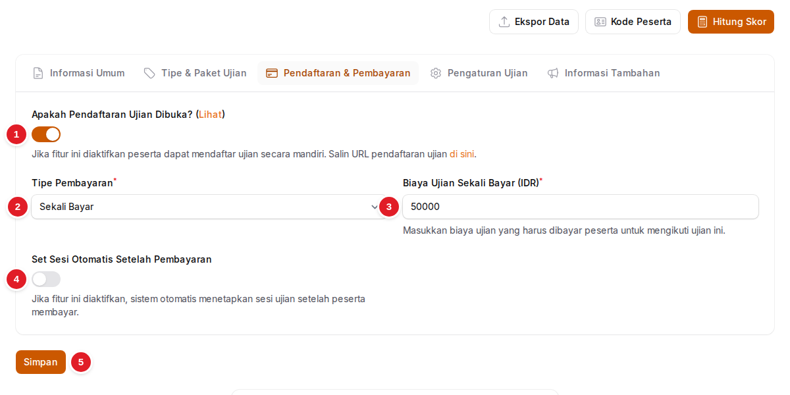
    </Frame>

    1. **Apakah Pendaftaran Ujian Dibuka?**: aktifkan agar ujian tampil di halaman pendaftaran peserta.
    2. **Tipe Pembayaran**: pilih **Sekali Bayar** jika peserta membayar saat mendaftar. Pertanyaan **Metode Pembayaran**, yang memicu pembayaran, hanya tersedia untuk tipe ini. Penjelasan tipe pembayaran lain ada pada [Membuat Ujian Berjenjang](/data-ujian/membuat-ujian-berjenjang).
    3. **Biaya Ujian Sekali Bayar (IDR)**: biaya pendaftaran, minimal Rp5.000. Contoh: **50000**.
    4. **Set Sesi Otomatis Setelah Pembayaran** (opsional): jika aktif, peserta otomatis dimasukkan ke sesi ujian pertama setiap tes setelah pembayaran berhasil. Pengaturan ini baru dapat diaktifkan setelah biaya diisi. Pada ujian **Gratis**, pengaturan ini bernama **Set Sesi Otomatis Setelah Pendaftaran**. Pastikan setiap tes sudah memiliki sesi ujian.
    5. Klik **Simpan**.

    Ujian tampil di halaman pendaftaran peserta selama pendaftaran dibuka dan waktu saat ini berada di antara **Tanggal Mulai** dan **Tanggal Selesai** ujian.

    <Tip>
      Klik tautan **di sini** pada teks bantuan **Apakah Pendaftaran Ujian Dibuka?** untuk menyalin URL pendaftaran ujian. Bagikan URL tersebut kepada peserta; setelah masuk ke akunnya, peserta langsung diarahkan ke formulir pendaftaran ujian ini.
    </Tip>
  </Step>
</Steps>

## 2. Menyusun formulir pendaftaran

Pertanyaan formulir dibuat satu per satu melalui tab **Formulir Pendaftaran** di bagian bawah halaman detail ujian. Tab ini memiliki tiga tombol: ikon roda gigi (pengaturan formulir, lihat bagian 6), **Kode Voucher** (lihat bagian 4), dan **Tambah Formulir Pendaftaran**.

<Frame>
  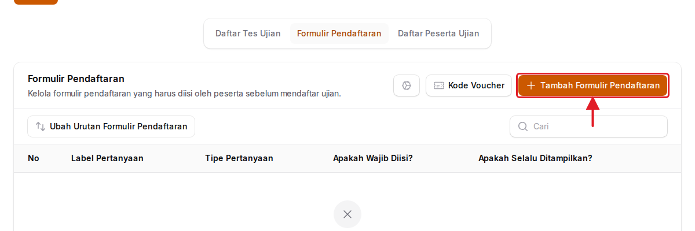
</Frame>

Klik **Tambah Formulir Pendaftaran** untuk membuka jendela pembuatan pertanyaan. Kolom **Template Pertanyaan (Opsional)** berisi template yang sudah disediakan sistem, yaitu **Metode Pembayaran**. Setiap template hanya dapat dipakai satu kali pada satu ujian.

<Frame>
  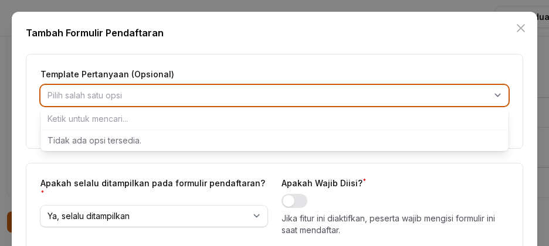
</Frame>

<AccordionGroup>
  <Accordion title="Menambahkan pertanyaan Metode Pembayaran untuk semua peserta">
    Gunakan cara ini jika semua pendaftar harus membayar.

    <Frame>
      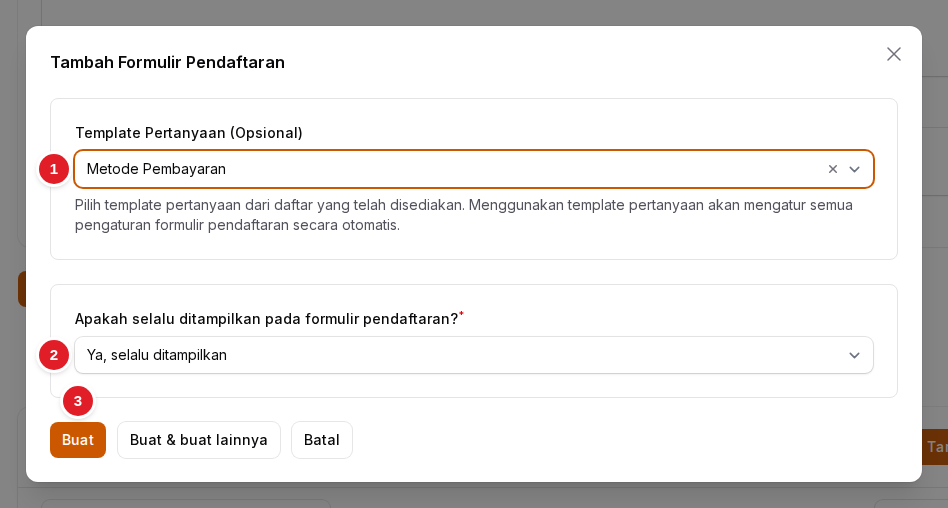
    </Frame>

    1. **Template Pertanyaan (Opsional)**: pilih **Metode Pembayaran**. Label, tipe, pilihan jawaban (**QRIS**), dan petunjuk pengisian terisi otomatis, dan pertanyaan ini selalu wajib diisi.
    2. **Apakah selalu ditampilkan pada formulir pendaftaran?**: pilih **Ya, selalu ditampilkan**.
    3. Klik **Buat**.

    <Note>
      Template **Metode Pembayaran** hanya dapat dipilih jika **Tipe Pembayaran** adalah **Sekali Bayar**. Jika tipe pembayaran kemudian diubah ke tipe lain, pertanyaan **Metode Pembayaran** otomatis dihapus dari formulir.
    </Note>
  </Accordion>

  <Accordion title="Membuat pertanyaan sendiri">
    Contoh: pertanyaan **Asal Cabang Lembaga** dengan pilihan **Surabaya** dan **Jakarta**.

    <Frame>
      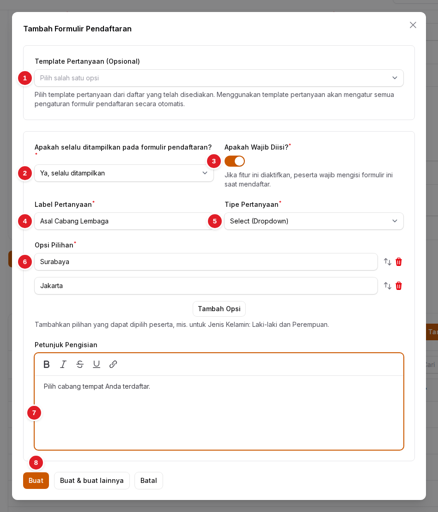
    </Frame>

    1. **Template Pertanyaan (Opsional)**: biarkan kosong.
    2. **Apakah selalu ditampilkan pada formulir pendaftaran?**: pilih **Ya, selalu ditampilkan**.
    3. **Apakah Wajib Diisi?**: aktifkan agar peserta tidak dapat mendaftar sebelum menjawab.
    4. **Label Pertanyaan**: teks pertanyaan yang dilihat peserta. Contoh: **Asal Cabang Lembaga**.
    5. **Tipe Pertanyaan**: cara peserta menjawab. Pilihan yang tersedia:
       - **Text (Input Biasa)**: jawaban singkat, misalnya nomor WhatsApp atau asal sekolah.
       - **Textarea (Paragraf)**: jawaban panjang, misalnya alamat lengkap.
       - **Select (Dropdown)**: satu jawaban dari daftar pilihan yang dibuka seperti menu.
       - **Radio (Pilihan Tunggal)**: satu jawaban, semua pilihan langsung tampil.
       - **Checkbox (Pilihan Ganda)**: boleh memilih lebih dari satu jawaban.
       - **File (Berkas)**: peserta mengunggah berkas JPG, JPEG, PNG, PDF, DOC, atau DOCX berukuran maksimal sekitar 4 MB.
       - **Date (Tanggal)**: tanggal saja, misalnya tanggal lahir.
       - **Datetime (Tanggal & Waktu)**: tanggal sekaligus jam.
    6. **Opsi Pilihan**: muncul untuk tipe Select, Radio, dan Checkbox. Isi setiap pilihan, contoh **Surabaya** dan **Jakarta**, lalu klik **Tambah Opsi** untuk menambah baris. Pilihan tidak boleh sama, dan urutannya dapat diubah dengan ikon panah.
    7. **Petunjuk Pengisian** (opsional): arahan singkat di bawah kolom jawaban, maksimal 1.000 karakter. Contoh: _Pilih cabang tempat Anda terdaftar._
    8. Klik **Buat**, atau **Buat & buat lainnya** untuk langsung membuat pertanyaan berikutnya.

    Dengan cara yang sama, buat pertanyaan **Nomor WhatsApp** dan **Asal Sekolah** bertipe **Text (Input Biasa)** yang wajib diisi.

    <Note>
      Saat pertanyaan diubah, **Template Pertanyaan (Opsional)** dan **Tipe Pertanyaan** tidak dapat diganti. Hapus pertanyaan dan buat ulang jika tipenya perlu diganti.
    </Note>
  </Accordion>

  <Accordion title="Menampilkan pertanyaan berdasarkan kondisi">
    Pertanyaan dapat dibuat agar hanya muncul jika peserta memberi jawaban tertentu pada pertanyaan lain. Pada contoh ini, **Metode Pembayaran** hanya muncul bagi peserta cabang Jakarta, sehingga peserta cabang Surabaya tidak dikenakan biaya pendaftaran.

    <Frame>
      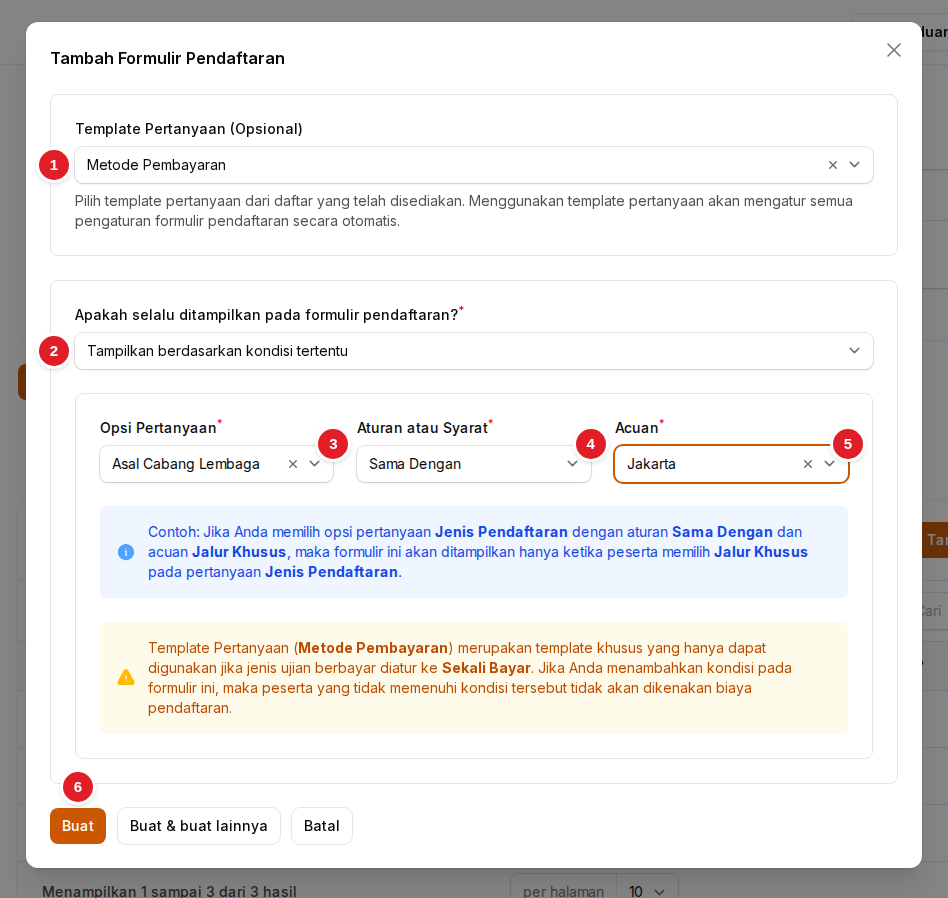
    </Frame>

    1. **Template Pertanyaan (Opsional)**: pilih **Metode Pembayaran** (atau buat pertanyaan sendiri seperti pada cara sebelumnya).
    2. **Apakah selalu ditampilkan pada formulir pendaftaran?**: pilih **Tampilkan berdasarkan kondisi tertentu**.
    3. **Opsi Pertanyaan**: pertanyaan yang menjadi dasar kondisi. Daftar ini berisi pertanyaan lain pada formulir yang sama, kecuali **Metode Pembayaran**.

       <Frame>
         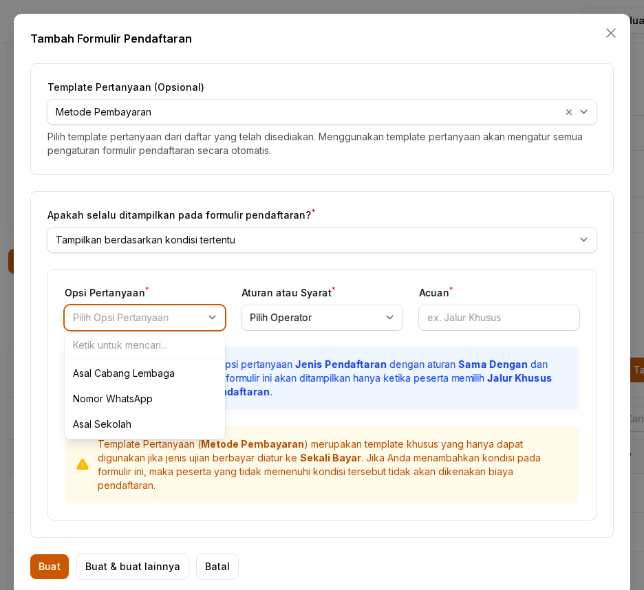
       </Frame>
    4. **Aturan atau Syarat**: cara membandingkan jawaban.
       - **Sama Dengan** dan **Bukan**: jawaban sama atau tidak sama dengan acuan.
       - **Kurang Dari**, **Lebih Dari**, **Kurang Dari Sama Dengan**, dan **Lebih Dari Sama Dengan**: untuk jawaban berupa angka.
       - **Salah Satu dari** dan **Bukan Salah Satu dari**: jawaban termasuk atau tidak termasuk dalam beberapa acuan sekaligus. Acuan untuk aturan ini dipilih dari daftar acuan projek; jika belum ada, buat acuan baru langsung dari kolom tersebut.
    5. **Acuan**: jawaban yang memicu pertanyaan muncul. Jika **Opsi Pertanyaan** bertipe Select atau Radio, acuan dipilih dari pilihan jawabannya. Contoh: **Jakarta**.

       <Frame>
         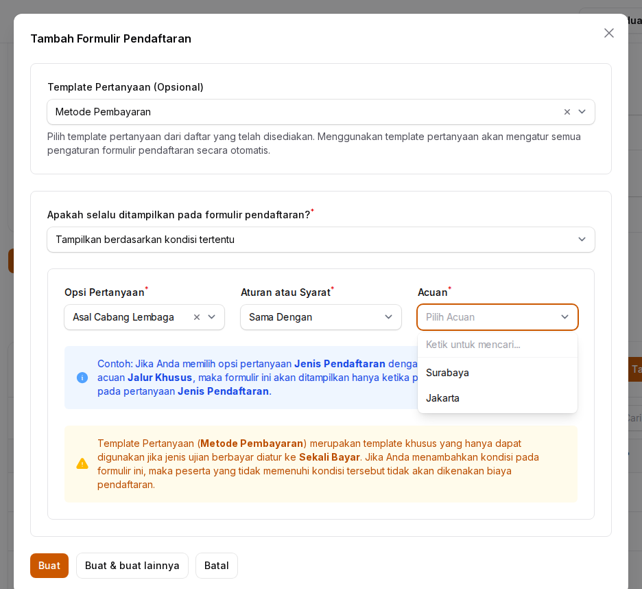
       </Frame>
    6. Klik **Buat**.

    Hasilnya: jika peserta memilih **Asal Cabang Lembaga** = **Jakarta**, pertanyaan **Metode Pembayaran** muncul dan peserta harus membayar. Jika peserta memilih **Surabaya**, pertanyaan tersebut tidak muncul dan peserta mendaftar tanpa biaya.
  </Accordion>
</AccordionGroup>

Semua pertanyaan tampil pada tabel **Formulir Pendaftaran** beserta tipe, status wajib, dan keterangan **Selalu Ditampilkan** atau **Kondisi Tertentu**. Klik **Ubah Urutan Formulir Pendaftaran** untuk mengatur urutan pertanyaan, lalu klik **Selesai Mengurutkan**. Gunakan **Ubah** atau **Hapus** pada setiap baris untuk mengelola pertanyaan.

<Frame>
  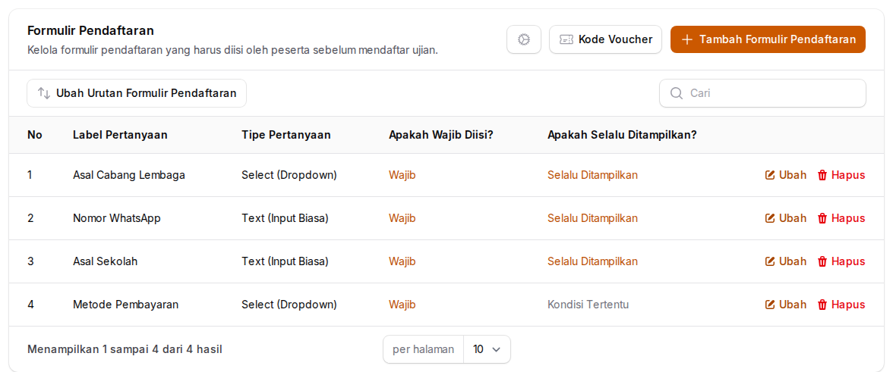
</Frame>

## 3. Pendaftaran dari sisi peserta

Berikut alur yang dilalui peserta di aplikasi peserta, misalnya `https://prestasi.indolat.web.id`.

<Steps>
  <Step title="Peserta masuk ke aplikasi peserta">
    Peserta masuk dengan akunnya. Pengaturan halaman masuk dijelaskan pada [Pengaturan dan Cara Login Peserta](/lainnya/login-peserta).

    <Frame>
      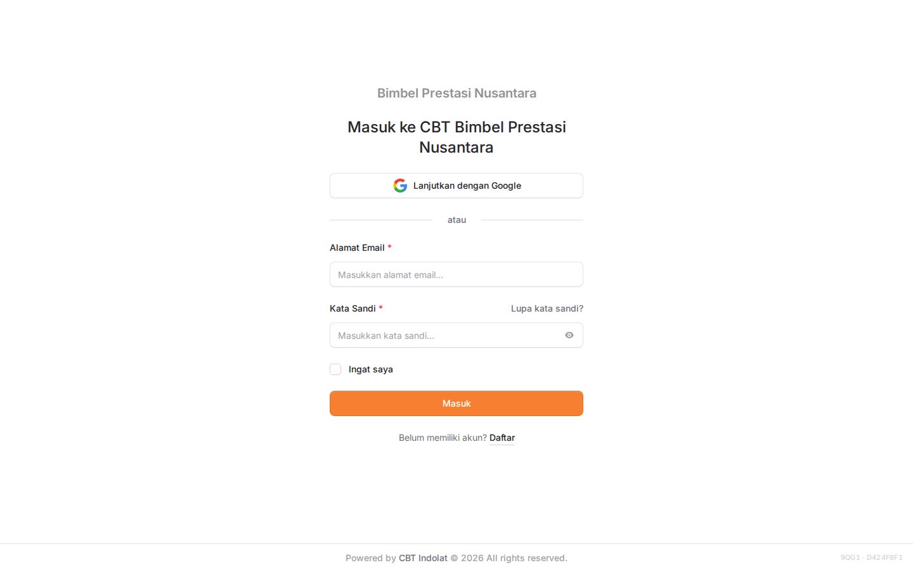
    </Frame>
  </Step>
  <Step title="Peserta klik Pendaftaran Tes Baru">
    Tombol **Pendaftaran Tes Baru** ada di halaman **Daftar Tes**. Jika peserta membuka URL pendaftaran yang Anda bagikan, langkah ini dan langkah berikutnya terlewati.

    <Frame>
      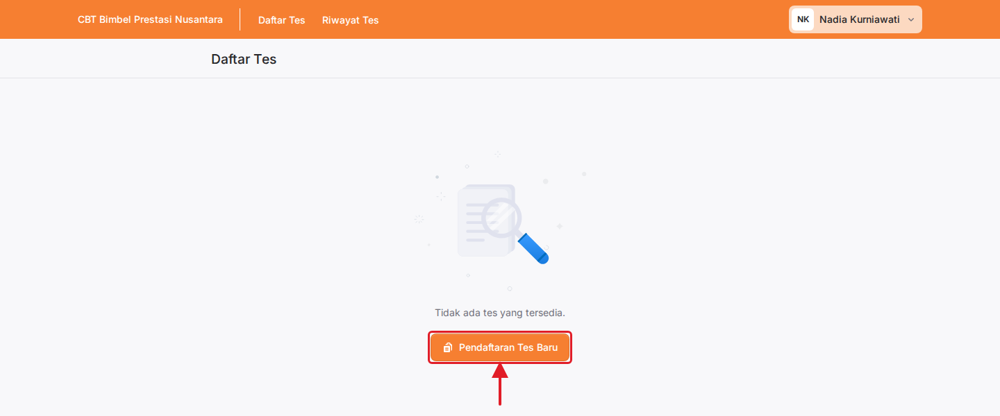
    </Frame>
  </Step>
  <Step title="Peserta memilih ujian">
    <Frame>
      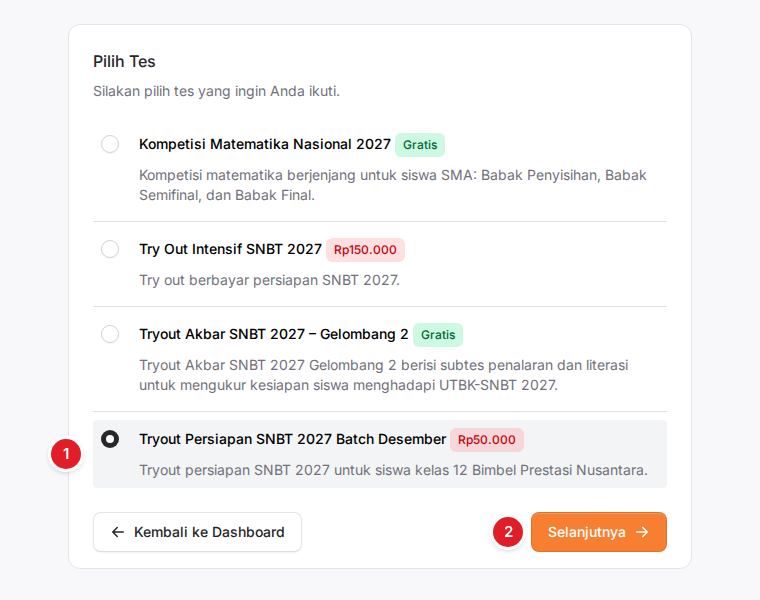
    </Frame>

    1. Peserta memilih ujian. Setiap ujian diberi label **Gratis**, biaya (misalnya **Rp50.000**), atau **Kuota Penuh**. Ujian yang sudah didaftari diberi label **Terdaftar**, **Menunggu Pembayaran**, atau **Sedang Verifikasi**.
    2. Peserta klik **Selanjutnya**.
  </Step>
  <Step title="Peserta mengisi formulir">
    Halaman pendaftaran menampilkan nama ujian dan pertanyaan formulir. Contoh untuk peserta cabang Jakarta:

    <Frame>
      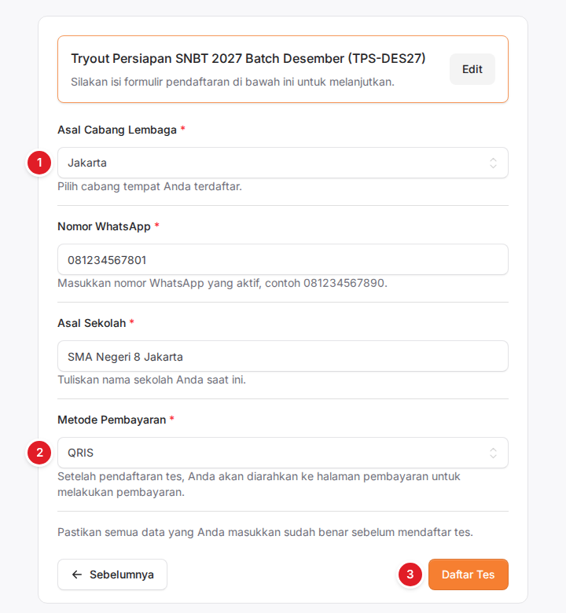
    </Frame>

    1. Peserta memilih **Jakarta** pada **Asal Cabang Lembaga**, lalu mengisi pertanyaan lainnya.
    2. Pertanyaan **Metode Pembayaran** muncul; peserta memilih **QRIS**.
    3. Peserta klik **Daftar Tes**.

    Untuk peserta cabang Surabaya, pertanyaan **Metode Pembayaran** tidak muncul:

    <Frame>
      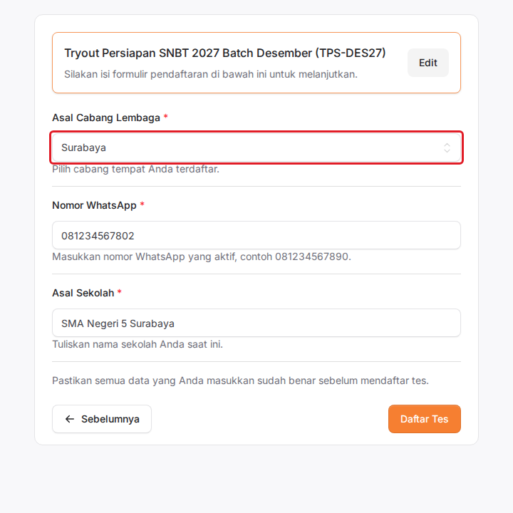
    </Frame>

    Jika ujian tidak memiliki pertanyaan formulir, halaman ini menampilkan keterangan bahwa tidak ada formulir pendaftaran yang diperlukan dan peserta dapat langsung mendaftar.
  </Step>
  <Step title="Peserta mengonfirmasi pendaftaran">
    Peserta memeriksa data, lalu klik **Ya, Daftar** pada jendela **Konfirmasi Pendaftaran**.

    <Frame>
      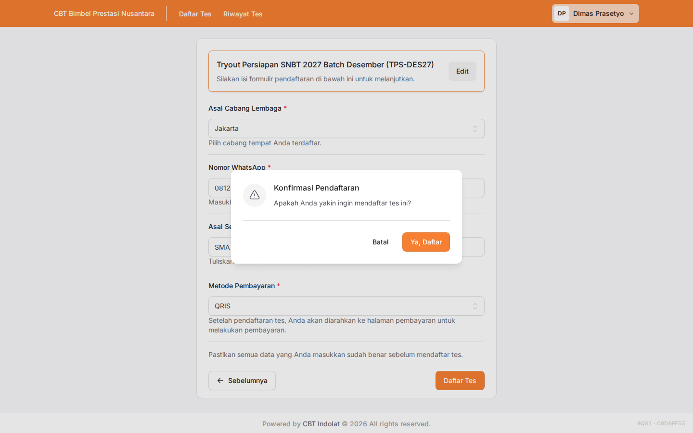
    </Frame>

    Peserta yang tidak perlu membayar diarahkan ke halaman **Daftar Tes**. Peserta yang perlu membayar diarahkan ke halaman **Detail Pembayaran**.
  </Step>
  <Step title="Peserta membayar melalui QRIS">
    <Frame>
      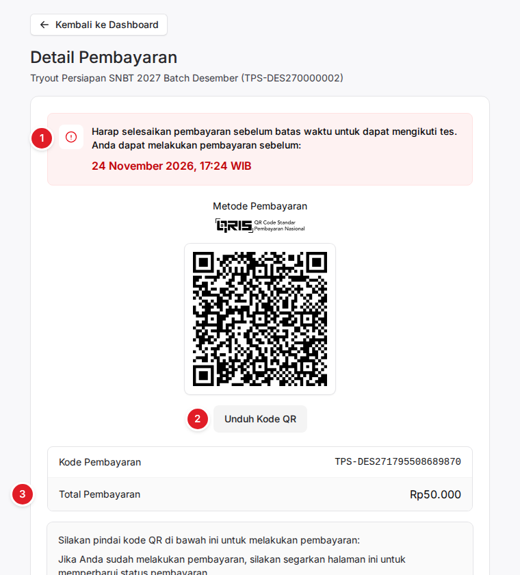
    </Frame>

    1. Batas waktu pembayaran, yaitu 2 jam sejak pendaftaran.
    2. Kode QR yang dipindai dengan aplikasi pembayaran yang mendukung QRIS. Peserta dapat klik **Unduh Kode QR** untuk menyimpannya.
    3. **Kode Pembayaran** dan **Total Pembayaran**.

    <Note>
      Jika pengaturan **Bebankan Biaya Transaksi ke Admin** di **Platform Ujian (CBT)** → **Lainnya** → **Pengaturan Aplikasi** tidak aktif, halaman ini juga menampilkan baris **Biaya Transaksi** dan total yang dibayar peserta sudah termasuk biaya tersebut.
    </Note>

    Setelah membayar, peserta memuat ulang halaman ini. Jika pembayaran berhasil, halaman menampilkan pesan bahwa pembayaran telah diterima dan **Status Pembayaran** **Sudah Dibayar**.

    <Frame>
      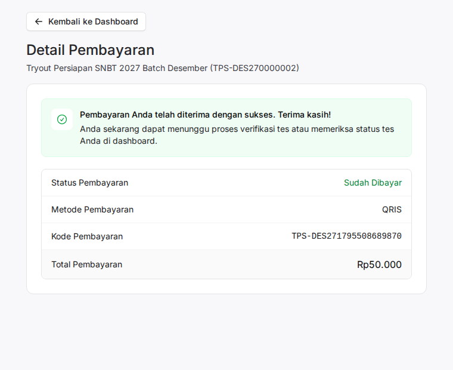
    </Frame>

    Peserta yang belum membayar sampai batas waktu tidak dapat mengikuti ujian. Riwayat pembayaran dapat dipantau pada **Riwayat Transaksi** (lihat [Transaksi dan Penarikan Saldo](/lainnya/transaksi-dan-penarikan-saldo)).
  </Step>
</Steps>

## 4. Membuat kode voucher

Kode voucher memberikan potongan biaya pendaftaran kepada peserta tertentu tanpa mengubah biaya ujian. Contoh: voucher **PROMO-PRESTASI** memberikan potongan 10% bagi 100 peserta pertama.

<Steps>
  <Step title="Klik Kode Voucher">
    Pada tab **Formulir Pendaftaran**, klik **Kode Voucher**.

    <Frame>
      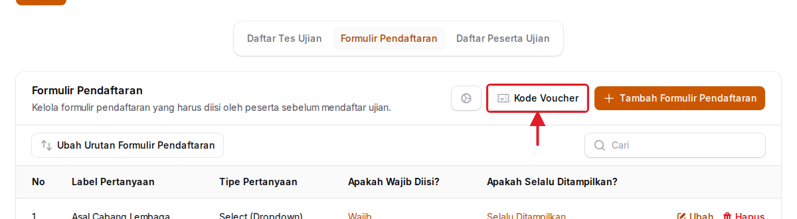
    </Frame>
  </Step>
  <Step title="Klik Tambah Voucher">
    <Frame>
      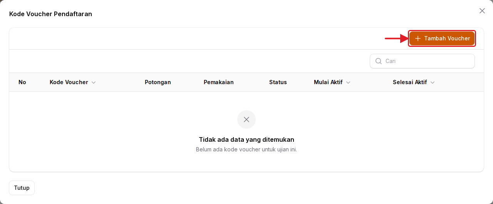
    </Frame>
  </Step>
  <Step title="Isi informasi voucher">
    <Frame>
      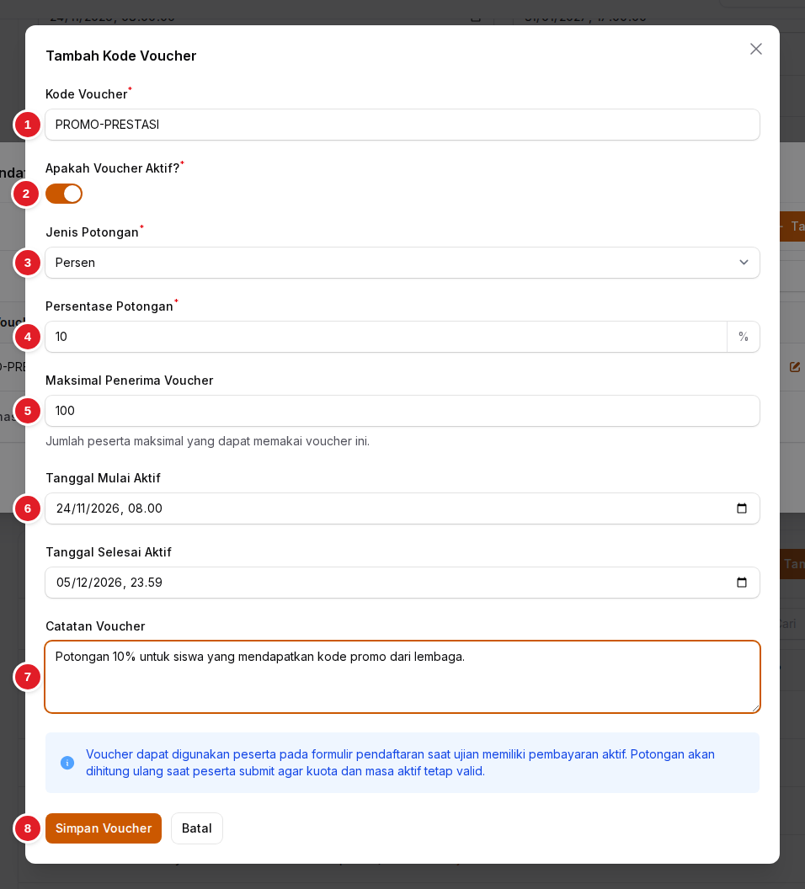
    </Frame>

    1. **Kode Voucher**: kode yang dimasukkan peserta, maksimal 100 karakter dan otomatis diubah menjadi huruf kapital. Kode tidak boleh sama dengan voucher lain pada ujian yang sama. Contoh: **PROMO-PRESTASI**.
    2. **Apakah Voucher Aktif?**: voucher hanya dapat dipakai jika aktif.
    3. **Jenis Potongan**: **Flat / Nominal** (potongan rupiah) atau **Persen**.
    4. **Nominal Potongan** (dalam Rp) untuk **Flat / Nominal**, atau **Persentase Potongan** (1–100%) untuk **Persen**. Contoh: **10**%.
    5. **Maksimal Penerima Voucher** (opsional): jumlah peserta yang dapat memakai voucher. Kosongkan jika tidak dibatasi.
    6. **Tanggal Mulai Aktif** dan **Tanggal Selesai Aktif** (opsional): periode berlakunya voucher.
    7. **Catatan Voucher** (opsional): keterangan untuk admin.
    8. Klik **Simpan Voucher**.
  </Step>
  <Step title="Periksa daftar voucher">
    Voucher tampil beserta potongan, pemakaian (misalnya **0 / 100**), status, dan periode aktifnya. Gunakan **Ubah** atau **Hapus** untuk mengelolanya, lalu klik **Tutup**.

    <Frame>
      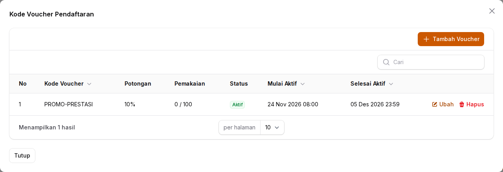
    </Frame>
  </Step>
</Steps>

## 5. Peserta memakai kode voucher

Kolom **Kode Voucher** muncul di formulir peserta jika ujian memiliki setidaknya satu voucher dan pertanyaan **Metode Pembayaran** sedang tampil.

<Steps>
  <Step title="Peserta melihat kolom Kode Voucher">
    <Frame>
      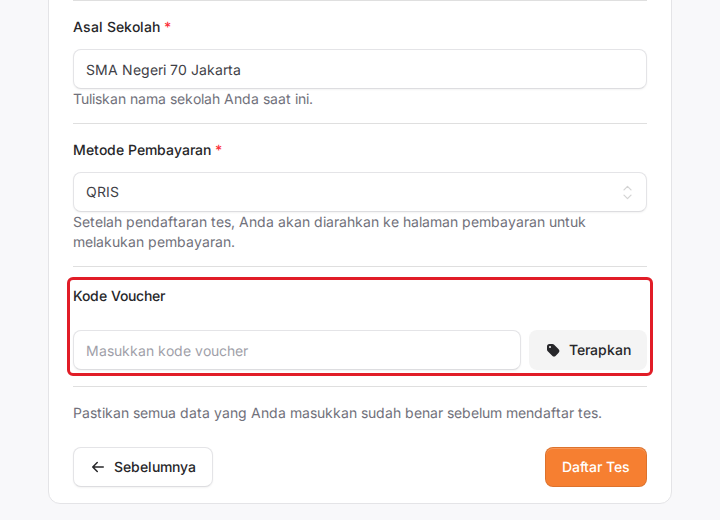
    </Frame>
  </Step>
  <Step title="Peserta memasukkan kode lalu klik Terapkan">
    <Frame>
      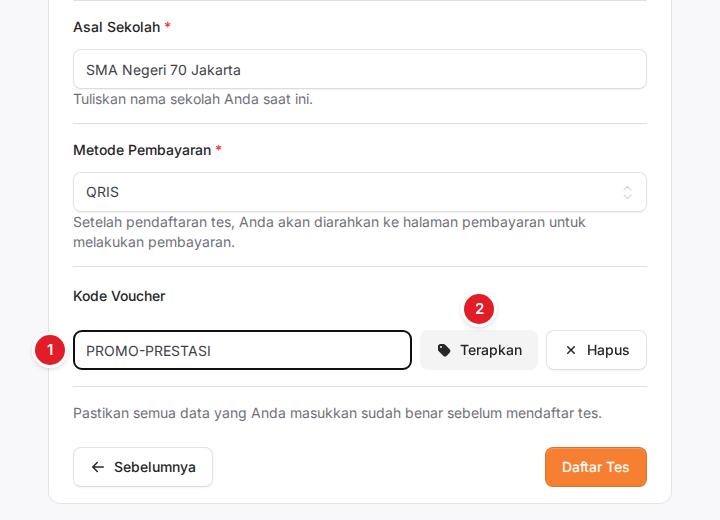
    </Frame>

    1. Peserta mengetik kode voucher.
    2. Peserta klik **Terapkan**. Tombol **Hapus** membatalkan voucher yang sudah diisi.
  </Step>
  <Step title="Sistem menghitung ulang biaya">
    Jika voucher valid, sistem menampilkan **Voucher berhasil diterapkan.** beserta **Biaya ujian**, **Potongan voucher**, dan **Total pembayaran**.

    <Frame>
      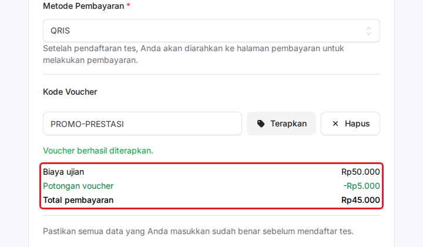
    </Frame>

    Voucher ditolak jika kode tidak valid, tidak aktif, belum mulai atau sudah berakhir, kuotanya habis, atau sudah pernah dipakai oleh akun yang sama. Potongan dihitung ulang saat peserta klik **Daftar Tes**. Jika total pembayaran menjadi Rp0 (misalnya potongan 100%), peserta terdaftar tanpa pembayaran.
  </Step>
</Steps>

## 6. Verifikasi pendaftaran dan kuota

### Membuka pengaturan formulir pendaftaran

Klik ikon roda gigi pada tab **Formulir Pendaftaran** untuk membuka **Pengaturan Formulir Pendaftaran**.

<Frame>
  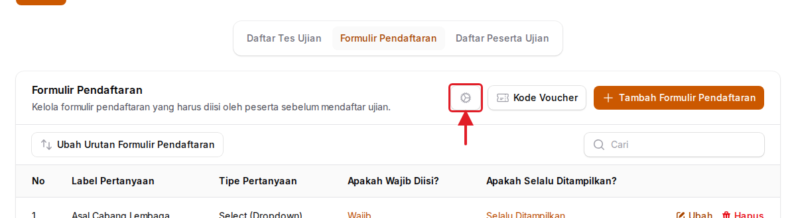
</Frame>

<Frame>
  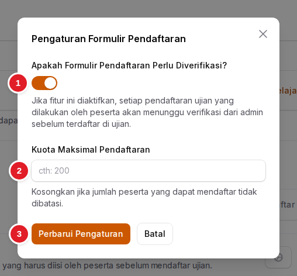
</Frame>

1. **Apakah Formulir Pendaftaran Perlu Diverifikasi?**: jika aktif, setiap pendaftar menunggu verifikasi admin sebelum terdaftar di ujian. Pengaturan ini aktif secara bawaan.
2. **Kuota Maksimal Pendaftaran**: jumlah maksimal peserta ujian. Kosongkan jika tidak dibatasi.
3. Klik **Perbarui Pengaturan** untuk menyimpan.

<Note>
  Verifikasi hanya berlaku bagi peserta yang mengisi formulir pendaftaran. Jika ujian tidak memiliki pertanyaan formulir, peserta langsung aktif setelah mendaftar (dan setelah membayar, untuk ujian berbayar).
</Note>

### Memverifikasi peserta

Selama belum diverifikasi, ujian tampil dengan tombol **Proses Verifikasi** di halaman **Daftar Tes** peserta dan belum dapat dikerjakan.

<Frame>
  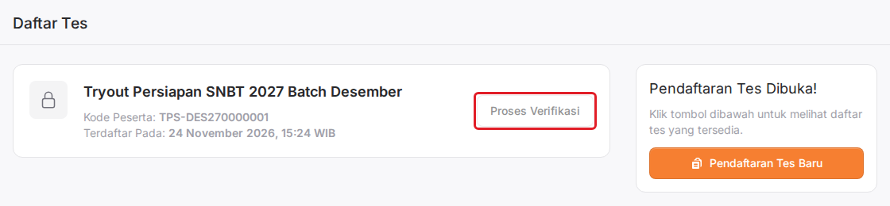
</Frame>

<Steps>
  <Step title="Klik Verifikasi Peserta">
    Buka tab **Daftar Peserta Ujian** pada halaman detail ujian. Peserta yang menunggu berstatus **Menunggu Verifikasi**; klik **Verifikasi Peserta** pada barisnya.

    <Frame>
      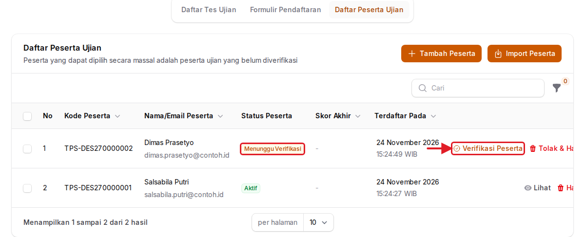
    </Frame>

    Peserta yang belum membayar berstatus **Menunggu Pembayaran** dan belum dapat diverifikasi.
  </Step>
  <Step title="Periksa isian formulir lalu klik Verifikasi">
    Jendela **Verifikasi Peserta** menampilkan jawaban formulir peserta. Klik **Verifikasi** jika data sudah sesuai.

    <Frame>
      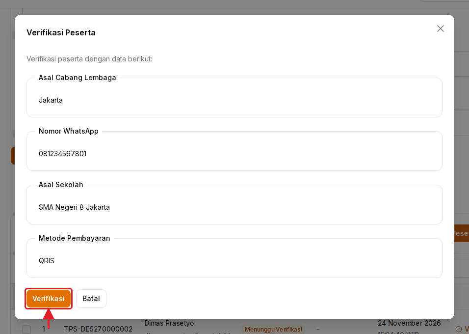
    </Frame>
  </Step>
  <Step title="Peserta menjadi Aktif">
    Sistem menampilkan notifikasi **Berhasil Verifikasi Peserta** dan status peserta berubah menjadi **Aktif**.

    <Frame>
      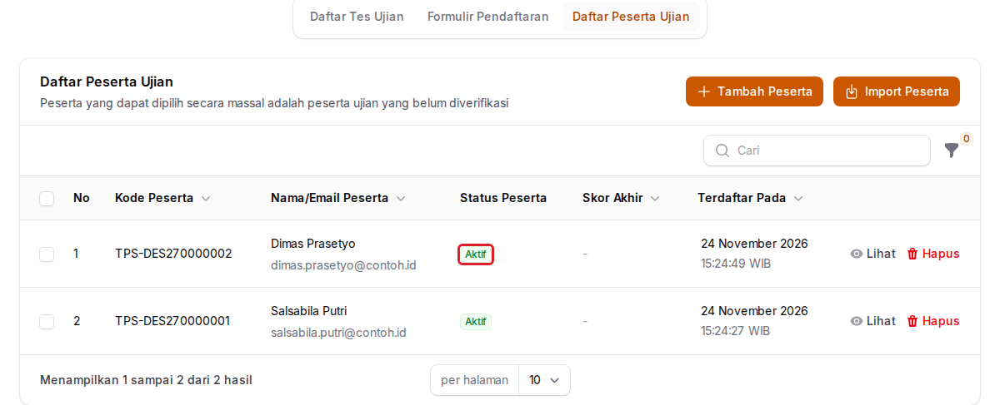
    </Frame>
  </Step>
</Steps>

<Tip>
  Untuk memverifikasi banyak peserta sekaligus, centang peserta pada tabel, lalu pilih **Tindakan** → **Verifikasi Peserta**. Untuk menolak pendaftar, klik **Tolak & Hapus** pada barisnya.
</Tip>

### Melihat isian formulir peserta yang sudah diverifikasi

Klik **Lihat** pada peserta di tab **Daftar Peserta Ujian**.

<Frame>
  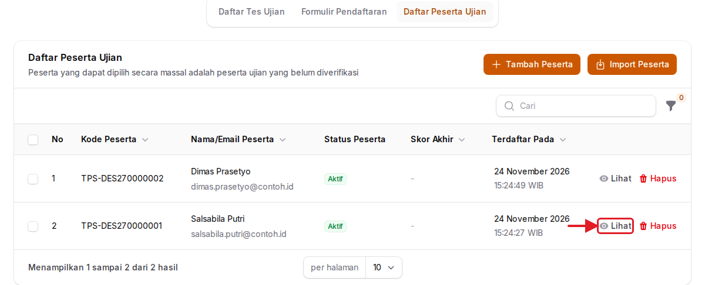
</Frame>

Jawaban formulir tampil pada bagian **Formulir Pendaftaran** di halaman **Detail Peserta**.

<Frame>
  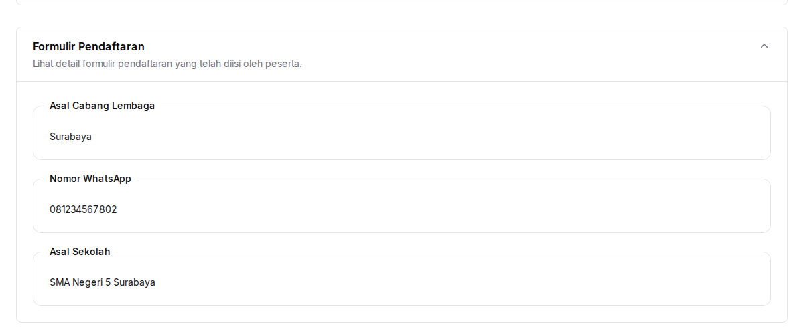
</Frame>

### Menonaktifkan verifikasi

Jika pendaftar tidak perlu diperiksa, buka pengaturan formulir pendaftaran, lalu:

<Frame>
  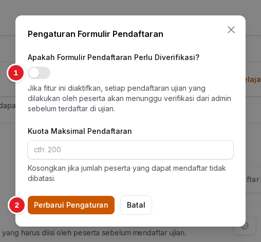
</Frame>

1. Nonaktifkan **Apakah Formulir Pendaftaran Perlu Diverifikasi?**.
2. Klik **Perbarui Pengaturan**.

Pendaftar berikutnya langsung berstatus **Aktif** setelah mendaftar (dan setelah membayar, untuk ujian berbayar). Pendaftar yang sudah berstatus **Menunggu Verifikasi** tetap perlu diverifikasi.

<Frame>
  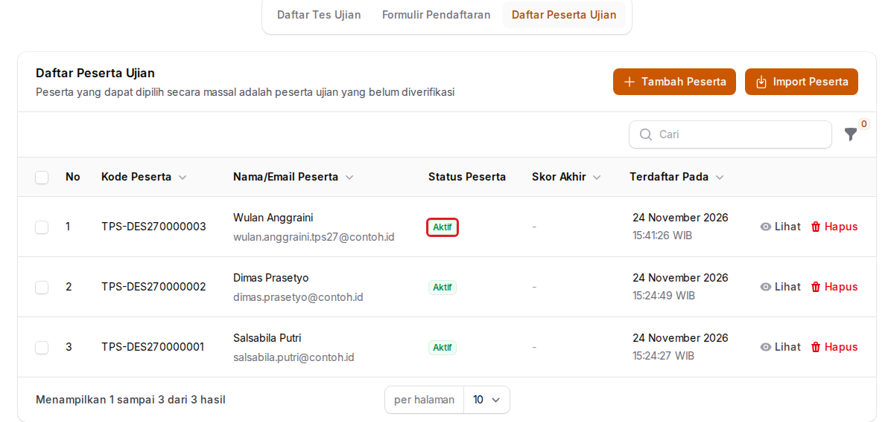
</Frame>

### Membatasi kuota pendaftaran

Contoh: Anda hanya menyediakan 200 tempat.

<Frame>
  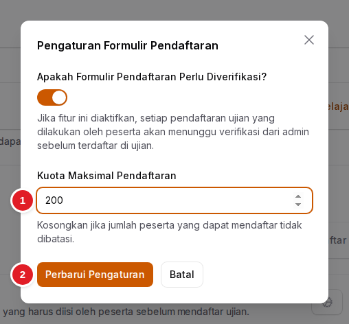
</Frame>

1. Isi **Kuota Maksimal Pendaftaran**, contoh **200**.
2. Klik **Perbarui Pengaturan**.

Kuota dihitung dari seluruh peserta ujian, termasuk peserta yang ditambahkan admin. Setelah kuota tercapai, ujian diberi label **Kuota Penuh** di halaman pendaftaran dan peserta berikutnya tidak dapat mendaftar.
