**Sesi ujian** menentukan **kapan** sebuah tes dapat dikerjakan dan **paket soal** yang dipakai. Setiap peserta juga harus dipasangkan ke salah satu sesi. Halaman ini menjelaskan cara membuat sesi, memasangkan peserta ke sesi, dan memindahkan peserta ke sesi lain.

<Info>
  **Lokasi menu:** **Portal** → **Platform Ujian (CBT)** → **Manajemen Ujian** → **Data Ujian** → **Detail** pada ujian → **Daftar Tes Ujian** → **Ubah** pada tes. Sesi diatur di bagian **Daftar Sesi Ujian**, sedangkan pemasangan peserta di bagian **Sesi Peserta Ujian**.
</Info>

Secara sederhana:

- **Tes ujian** menentukan materi yang dikerjakan peserta.
- **Sesi ujian** menentukan jadwal pelaksanaan dan paket soal yang dipakai.
- **Sesi peserta ujian** menentukan peserta yang mengikuti setiap jadwal.

Sebagai contoh, tes **Penalaran Matematika** pada **Tryout Akbar SNBT 2027 – Gelombang 2** dibagi menjadi dua sesi pada 13 Desember 2026:

- **Sesi Pagi**, pukul 08.00–10.00 WIB
- **Sesi Siang**, pukul 13.00–15.00 WIB

Kedua sesi memakai paket soal **Penalaran Matematika – Gelombang 2**.

<Warning>
  Peserta tidak dapat mulai mengerjakan tes jika tes belum memiliki sesi, sesi belum memiliki paket soal, atau peserta belum dipasangkan ke sesi.
</Warning>

## Membuat sesi ujian

<Steps>
  <Step title="Buka detail tes ujian">
    Pada halaman **Detail Ujian**, buka bagian **Daftar Tes Ujian**, lalu klik **Ubah** pada tes yang berketerangan **Tes belum memiliki sesi ujian**. Langkah ini dijelaskan juga di [Membuat Tes Ujian](/data-ujian/membuat-tes-ujian).
  </Step>
  <Step title="Klik Tambah Sesi Ujian">
    Gulir ke bagian **Daftar Sesi Ujian**, lalu klik **Tambah Sesi Ujian**.

    <Frame>
      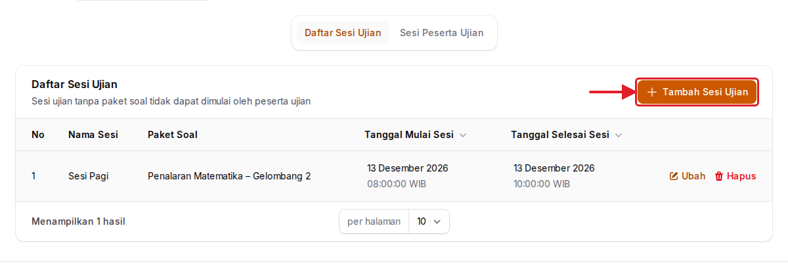
    </Frame>
  </Step>
  <Step title="Isi informasi sesi">
    <Frame>
      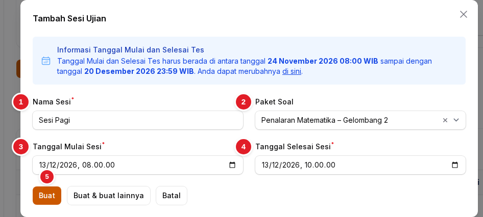
    </Frame>

    Kotak informasi di bagian atas formulir menampilkan rentang tanggal ujian. Tanggal sesi harus berada di dalam rentang tersebut.

    1. **Nama Sesi**: nama yang mudah dikenali. Contoh: **Sesi Pagi**.
    2. **Paket Soal**: paket soal yang dikerjakan pada sesi ini. Daftar hanya menampilkan paket soal yang sesuai dengan jenis tes (paket CBT/CAT untuk tes CBT dan CAT, paket esai untuk tes esai). Contoh: **Penalaran Matematika – Gelombang 2**.
    3. **Tanggal Mulai Sesi**: waktu peserta mulai dapat mengerjakan tes. Contoh: 13 Desember 2026 pukul 08.00.
    4. **Tanggal Selesai Sesi**: batas akhir pengerjaan tes. Contoh: 13 Desember 2026 pukul 10.00.
    5. Klik **Buat**, atau **Buat & buat lainnya** untuk langsung menambahkan sesi berikutnya, misalnya **Sesi Siang**.

    <Note>
      - Rentang **Tanggal Mulai Sesi** sampai **Tanggal Selesai Sesi** harus berada di antara **Tanggal Mulai** dan **Tanggal Selesai** ujian. Contoh: ujian berlangsung 24 November–20 Desember 2026, sehingga sesi tidak dapat dijadwalkan sebelum atau sesudah rentang tersebut. Tautan **di sini** pada kotak informasi membuka pengaturan ujian jika Anda perlu mengubah tanggalnya.
      - Lama sesi tidak boleh lebih pendek dari **Durasi Pengerjaan (menit)** tes. Contoh: tes 60 menit memerlukan sesi minimal 60 menit.
      - Untuk tes CAT, semua soal pada paket soal yang dipilih harus memiliki tingkat kesulitan.
      - **Paket Soal** boleh dikosongkan saat membuat sesi, tetapi sesi tanpa paket soal tidak dapat dimulai peserta.
    </Note>

    <Tip>
      Satu paket soal dapat dipakai di beberapa sesi. Anda tidak perlu membuat paket soal baru jika soalnya sama dan hanya jadwalnya yang berbeda.
    </Tip>
  </Step>
  <Step title="Periksa daftar sesi">
    Sesi yang dibuat tampil pada **Daftar Sesi Ujian** beserta paket soal dan jadwalnya.

    <Frame>
      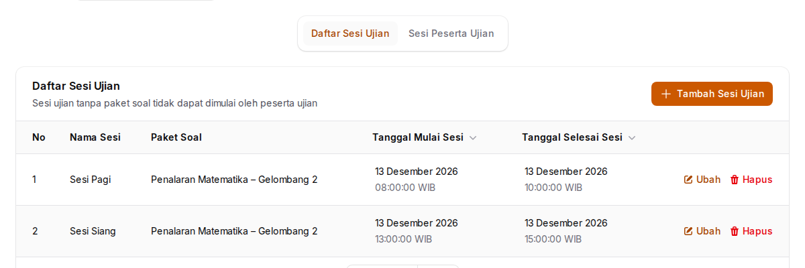
    </Frame>

    Ulangi langkah ini untuk setiap tes pada ujian. Keterangan **Tes belum memiliki sesi ujian** pada **Daftar Tes Ujian** hilang setelah tes memiliki sesi.
  </Step>
</Steps>

### Mengubah atau menghapus sesi

Klik **Ubah** pada baris sesi untuk mengubah nama, paket soal, atau jadwal, dan klik **Hapus** untuk menghapus sesi.

- Sesi tidak dapat diubah selama ada peserta yang sedang mengerjakan tes pada sesi tersebut.
- Paket soal tidak dapat diganti jika sudah ada peserta yang memulai tes pada sesi tersebut.
- Tombol **Hapus** hanya muncul pada sesi yang belum memiliki peserta.

Saat waktu sesi berakhir, sistem otomatis menyelesaikan pengerjaan peserta yang masih berjalan.

## Memasangkan peserta ke sesi ujian

Peserta yang sudah terdaftar di ujian harus dipasangkan ke sesi pada **setiap tes**. Cara menambahkan peserta ke ujian dijelaskan di [Menambahkan Peserta Ujian](/data-ujian/menambahkan-peserta-ujian).

Buka detail tes, lalu pilih bagian **Sesi Peserta Ujian**. Peserta yang belum memiliki sesi berketerangan **Tidak ada sesi ujian** pada kolom **Sesi Ujian**.

<Frame>
  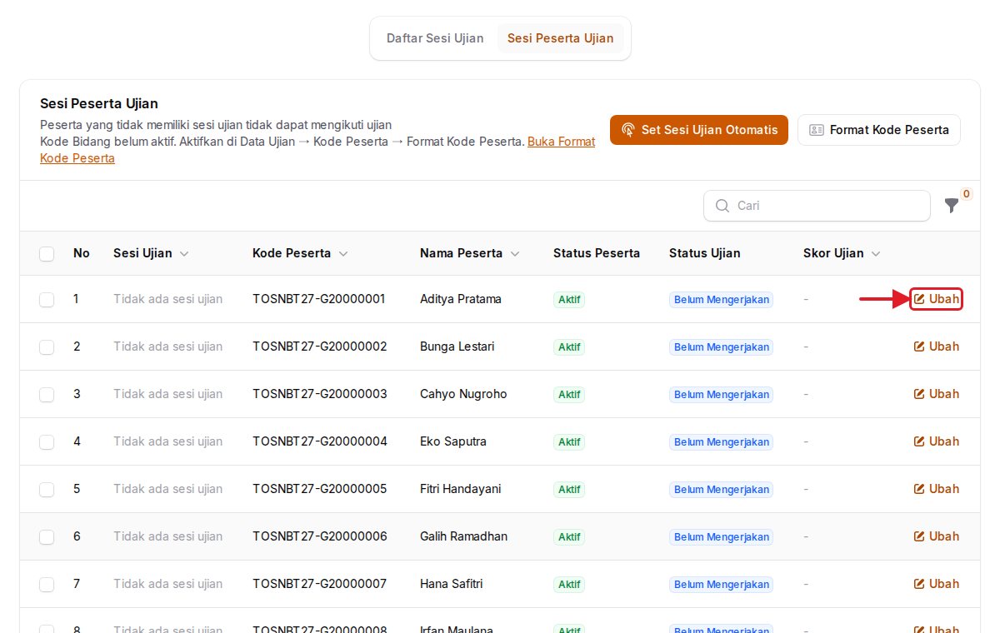
</Frame>

Tabel ini juga menampilkan **Kode Peserta**, **Status Peserta**, **Status Ujian** (**Belum Mengerjakan**, **Sedang Mengerjakan**, atau **Selesai Mengerjakan**), dan **Skor Ujian**. Gunakan **Filter** untuk menyaring peserta berdasarkan **Sesi Ujian** (termasuk **Tidak ada Sesi Ujian**) atau **Label** akun.

Ada tiga cara memasangkan peserta ke sesi:

<AccordionGroup>
  <Accordion title="Satu per satu">
    <Steps>
      <Step title="Klik Ubah pada peserta">
        Klik **Ubah** pada baris peserta, misalnya **Aditya Pratama**.
      </Step>
      <Step title="Pilih sesi dan status">
        <Frame>
          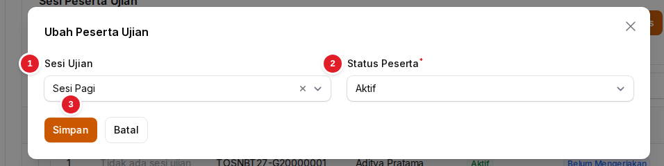
        </Frame>

        1. **Sesi Ujian**: pilih sesi, misalnya **Sesi Pagi**.
        2. **Status Peserta**: pastikan bernilai **Aktif**. Pilihan lainnya adalah **Pending** dan **Ditolak**; peserta berstatus selain **Aktif** tidak dapat mengerjakan tes.
        3. Klik **Simpan**.
      </Step>
    </Steps>

    Tombol **Ubah** tidak tersedia untuk peserta yang sudah mulai mengerjakan tes.
  </Accordion>

  <Accordion title="Secara kolektif">
    <Steps>
      <Step title="Pilih peserta dan Set Sesi Ujian Kolektif">
        Centang peserta yang akan dipasangkan ke sesi yang sama, klik **Tindakan**, lalu pilih **Set Sesi Ujian Kolektif**. Untuk memilih semua peserta, klik **Pilih semua**.

        <Frame>
          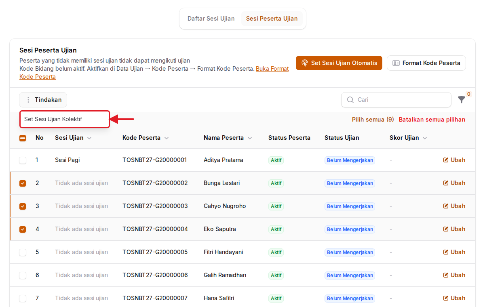
        </Frame>
      </Step>
      <Step title="Pilih sesi">
        <Frame>
          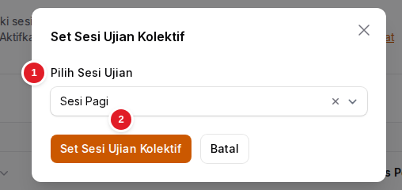
        </Frame>

        1. Pada **Pilih Sesi Ujian**, pilih sesi, misalnya **Sesi Pagi**.
        2. Klik **Set Sesi Ujian Kolektif**.

        Sistem menampilkan notifikasi **Sesi Ujian Berhasil Diperbarui**.
      </Step>
    </Steps>
  </Accordion>

  <Accordion title="Secara otomatis">
    <Steps>
      <Step title="Klik Set Sesi Ujian Otomatis">
        <Frame>
          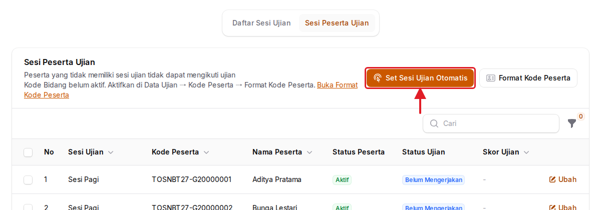
        </Frame>
      </Step>
      <Step title="Konfirmasi">
        Pada jendela konfirmasi, klik **Set Sesi Ujian Otomatis**.

        <Frame>
          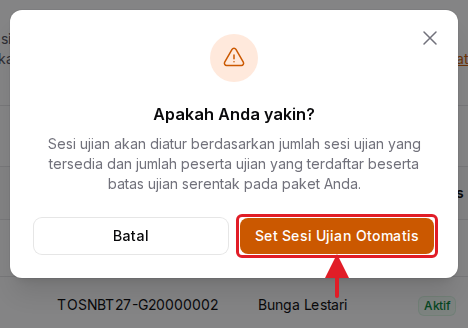
        </Frame>
      </Step>
      <Step title="Periksa hasilnya">
        Sistem menampilkan notifikasi **Berhasil Mengatur Sesi Ujian** dan membagi peserta ke sesi-sesi yang tersedia. Pada contoh ini, sembilan peserta dibagi ke **Sesi Pagi** dan **Sesi Siang**.

        <Frame>
          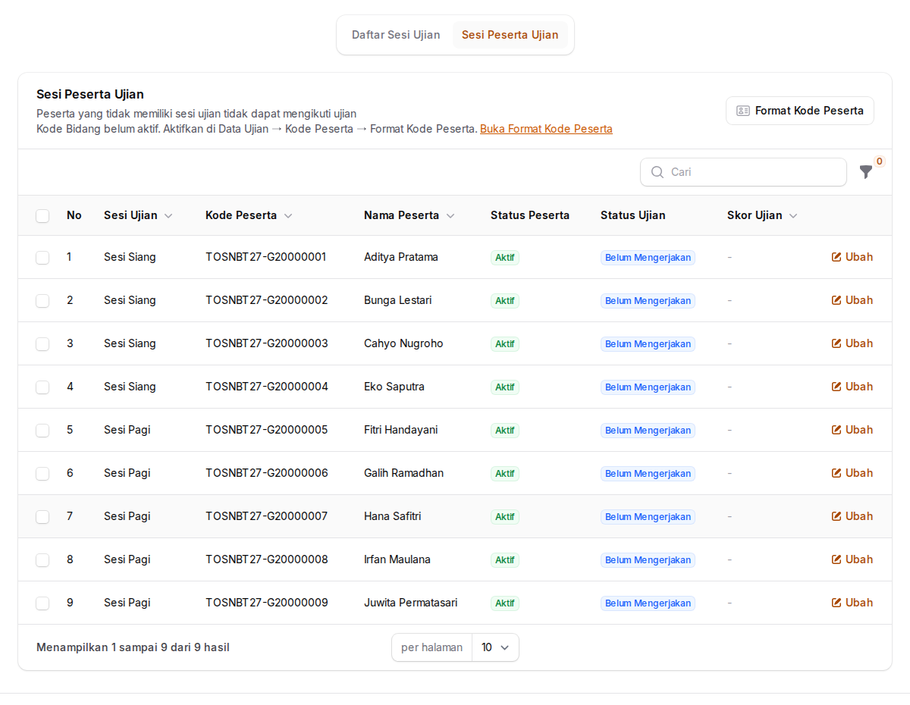
        </Frame>
      </Step>
    </Steps>

    <Info>
      - Sistem membagi rata **semua** peserta berstatus **Aktif** yang belum selesai mengerjakan ke sesi-sesi pada tes ini, sesuai urutan waktu mulai sesi. Peserta yang sebelumnya sudah Anda pasangkan ke sesi juga ikut dibagi ulang, sehingga sesinya dapat berubah. Peserta dengan status lain (misalnya **Pending**) tidak dimasukkan ke sesi. Untuk menempatkan peserta tertentu di sesi tertentu, gunakan cara kolektif.
      - Tombol **Set Sesi Ujian Otomatis** hanya muncul jika tes sudah memiliki minimal satu sesi, masih ada peserta tanpa sesi, dan tidak ada peserta yang sedang mengerjakan tes.
    </Info>
  </Accordion>
</AccordionGroup>

<Check>
  Pastikan tidak ada lagi peserta berketerangan **Tidak ada sesi ujian**. Setelah dipasangkan ke sesi, peserta dapat mulai mengerjakan sesuai jadwal sesinya.
</Check>

## Memindahkan peserta ke sesi lain

Peserta yang sudah memiliki sesi dapat dipindahkan, misalnya karena tidak dapat mengikuti jadwal semula. Pada contoh ini, **Fitri Handayani** dan **Galih Ramadhan** dipindahkan dari **Sesi Pagi** ke **Sesi Siang**.

<Steps>
  <Step title="Pilih peserta">
    <Frame>
      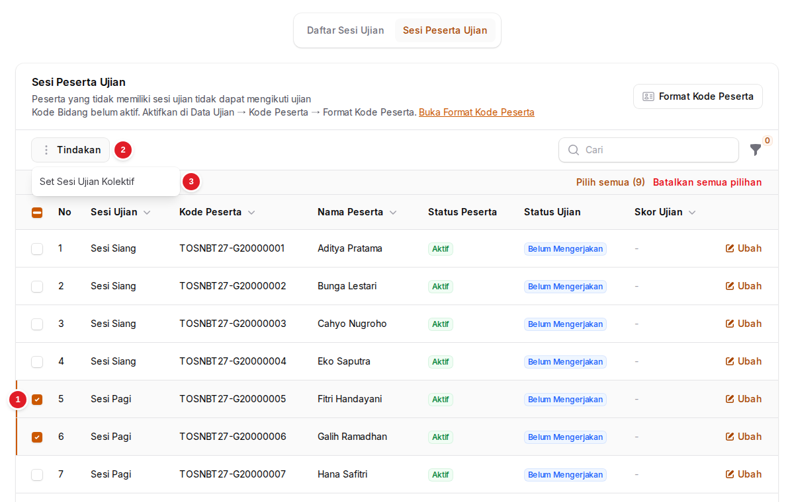
    </Frame>

    1. Centang peserta yang akan dipindahkan.
    2. Klik **Tindakan**.
    3. Pilih **Set Sesi Ujian Kolektif**.
  </Step>
  <Step title="Pilih sesi tujuan">
    Pada **Pilih Sesi Ujian**, pilih sesi tujuan, misalnya **Sesi Siang**, lalu klik **Set Sesi Ujian Kolektif**.

    <Frame>
      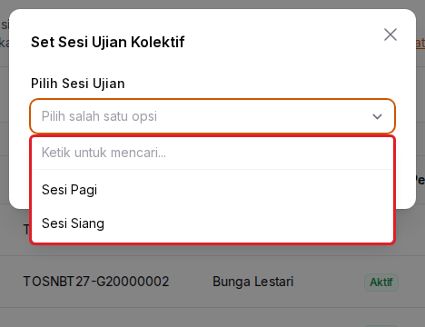
    </Frame>
  </Step>
  <Step title="Periksa hasilnya">
    Setelah notifikasi **Sesi Ujian Berhasil Diperbarui** muncul, kolom **Sesi Ujian** peserta berubah menjadi sesi tujuan.

    <Frame>
      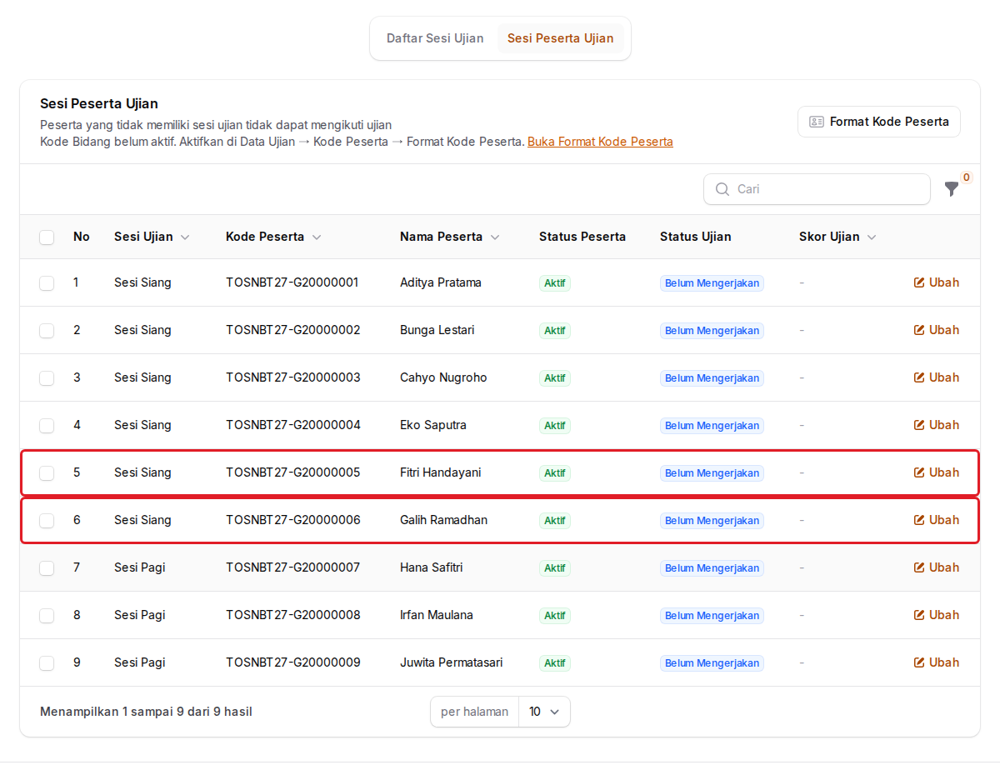
    </Frame>
  </Step>
</Steps>

<Note>
  - Pastikan sesi tujuan memiliki paket soal dan jadwalnya belum berakhir.
  - Peserta yang sedang mengerjakan tes tidak dapat dicentang. Jika ada peserta terpilih yang sudah mulai mengerjakan, pemindahan dibatalkan dengan pesan **Gagal Mengatur Sesi Ujian Kolektif**.
  - Untuk memindahkan peserta yang sudah mulai mengerjakan, klik **Reset Ujian** pada baris peserta terlebih dahulu.
</Note>

<Warning>
  **Reset Ujian** menghapus semua jawaban peserta pada tes tersebut dan peserta harus mengulang dari awal. Tindakan ini tidak dapat dibatalkan.
</Warning>

## Tombol lain pada Sesi Peserta Ujian

- **Hitung Ulang Skor**: menghitung ulang skor peserta tes ini yang sudah selesai. Lihat [Hasil dan Ekspor Ujian](/data-ujian/hasil-dan-ekspor-ujian#menghitung-ulang-skor-satu-tes).
- **Format Kode Peserta**, **Generate Kode Bidang**, dan **Daftar Peserta per Bidang**: mengatur dan membuat kode bidang per sesi. Jika kode bidang aktif, tabel menampilkan kolom **Kode Bidang** dan peserta yang dipindahkan ke sesi lain mendapat kode bidang baru. Lihat [Kode Peserta dan Kode Bidang](/data-ujian/kode-peserta).
