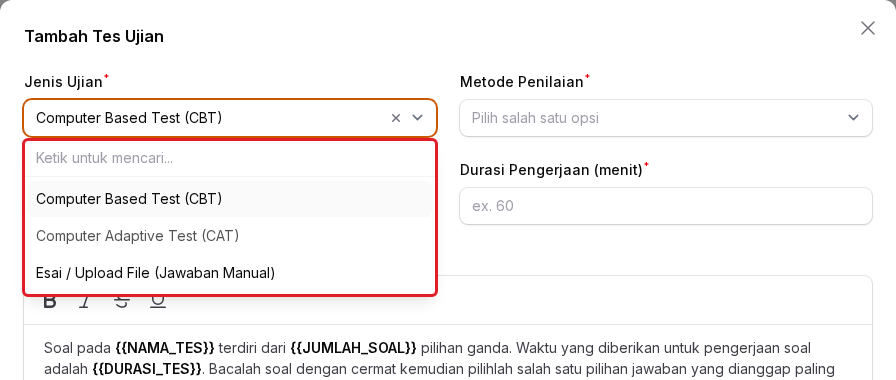
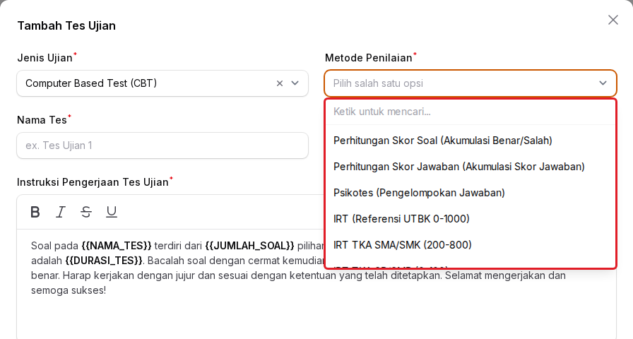
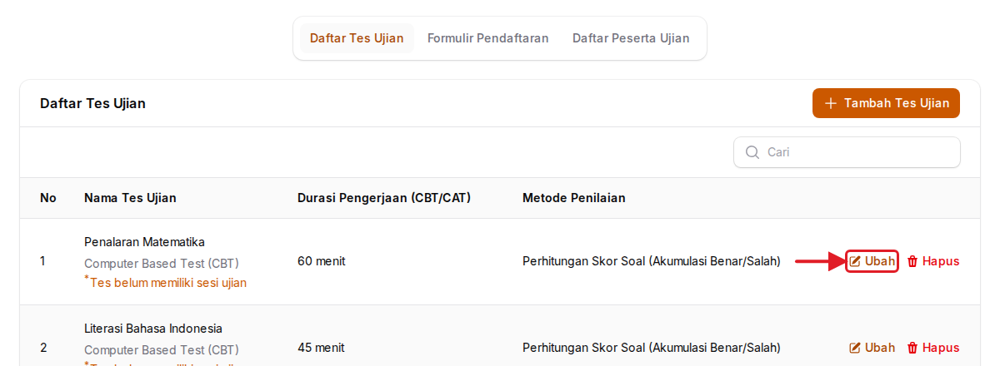
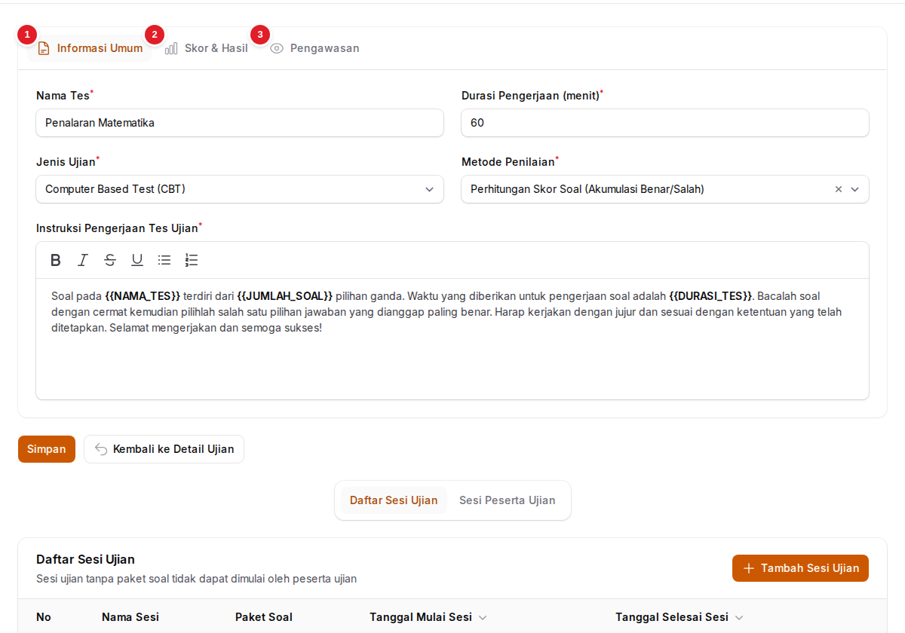

**Tes ujian** adalah bagian tes di dalam sebuah ujian. Setiap tes memiliki jenis ujian, metode penilaian, durasi, instruksi, dan pengaturannya sendiri. Halaman ini menjelaskan cara menambahkan tes ke ujian dan mengatur detailnya.

<Info>
  **Lokasi menu:** **Portal** → **Platform Ujian (CBT)** → **Manajemen Ujian** → **Data Ujian** → **Detail** pada ujian → bagian **Daftar Tes Ujian**.
</Info>

Sebagai contoh, **Tryout Akbar SNBT 2027 – Gelombang 2** terdiri dari dua tes:

- **Penalaran Matematika** (60 menit)
- **Literasi Bahasa Indonesia** (45 menit)

Jika belum memiliki ujian, buat terlebih dahulu melalui panduan [Membuat Ujian](/data-ujian/membuat-ujian).

## Menambahkan tes ujian

<Steps>
  <Step title="Klik Tambah Tes Ujian">
    Buka **Detail** ujian, pilih bagian **Daftar Tes Ujian**, lalu klik **Tambah Tes Ujian**.

    <Frame>
      
    </Frame>

    <Note>
      Jumlah tes dibatasi oleh tipe ujian: maksimal 4 tes untuk **Ujian Standard (Paket Gratis)** dan 30 tes untuk **Ujian Professional (Paket Berbayar)**. Jika batas tercapai, sistem menolak tes baru. Pada ujian multi-level yang sudah memiliki peserta, tombol **Tambah Tes Ujian** tidak ditampilkan.
    </Note>
  </Step>
  <Step title="Isi formulir Tambah Tes Ujian">
    <Frame>
      
    </Frame>

    1. **Jenis Ujian**: cara peserta mengerjakan tes. Penjelasannya ada pada bagian [Jenis Ujian](#jenis-ujian).
    2. **Metode Penilaian**: cara sistem menghitung skor. Penjelasannya ada pada bagian [Metode Penilaian](#metode-penilaian).
    3. **Nama Tes**: nama yang mudah dikenali. Contoh: **Penalaran Matematika**.
    4. **Durasi Pengerjaan (menit)**: lama pengerjaan tes. Contoh: **60**. Kolom ini tidak muncul untuk jenis **Esai / Upload File (Jawaban Manual)**.
    5. **Instruksi Pengerjaan Tes Ujian**: petunjuk yang dibaca peserta sebelum mulai mengerjakan, maksimal 1.000 karakter. Sistem sudah mengisi teks bawaan yang dapat Anda ubah. Untuk tes CBT dan CAT, Anda dapat memakai penanda berikut:
       - `{{NAMA_TES}}` untuk menampilkan nama tes,
       - `{{JUMLAH_SOAL}}` untuk menampilkan jumlah soal,
       - `{{DURASI_TES}}` untuk menampilkan durasi pengerjaan.
    6. Klik **Buat**, atau **Buat & buat lainnya** jika ingin langsung menambahkan tes berikutnya.

    Jika **Tipe Pembayaran** ujian adalah **Berbayar per Tes Ujian**, formulir juga menampilkan kolom **Biaya Tes Ujian**. Isi biaya yang harus dibayar peserta untuk mengikuti tes ini, minimal Rp5.000.
  </Step>
</Steps>

### Jenis Ujian

<Frame>
  
</Frame>

- **Computer Based Test (CBT)** Peserta mengerjakan soal di layar dan menjawab langsung di sistem. Semua peserta mendapat soal dari paket soal yang sama. Pilih jenis ini untuk tryout SNBT biasa.
- **Computer Adaptive Test (CAT)** Soal berikutnya menyesuaikan kemampuan peserta: jawaban benar membuat soal berikutnya cenderung lebih sulit, jawaban salah membuat soal berikutnya cenderung lebih mudah. CAT hanya dapat dipilih pada **Ujian Professional (Paket Berbayar)**; pada **Ujian Standard** pilihan ini berwarna abu-abu. Semua soal pada paket soal CAT wajib memiliki tingkat kesulitan.
- **Esai / Upload File (Jawaban Manual)** Peserta menulis jawaban panjang atau mengunggah berkas, misalnya foto lembar jawaban atau file PDF. Jawaban dinilai secara manual dan tes ini tidak memiliki durasi pengerjaan.

<Note>
  Setelah tes dibuat, **Jenis Ujian** tidak dapat diubah dari esai ke CBT/CAT atau sebaliknya. Perpindahan antara CBT dan CAT masih dapat dilakukan selama belum ada peserta yang memulai tes.
</Note>

### Metode Penilaian

<Frame>
  
</Frame>

Pilihan metode penilaian menyesuaikan **Jenis Ujian**. Semua metode di bawah tersedia untuk **CBT**. **CAT** hanya memakai **Perhitungan Skor Soal (Akumulasi Benar/Salah)**, sedangkan **Esai / Upload File (Jawaban Manual)** memakai **Penilaian Manual**.

- **Perhitungan Skor Soal (Akumulasi Benar/Salah)** Skor dihitung dari soal yang dijawab benar dan salah sesuai bobot setiap soal. Cocok untuk tryout pilihan ganda biasa.
- **Perhitungan Skor Jawaban (Akumulasi Skor Jawaban)** Setiap pilihan jawaban memiliki skor sendiri, lalu skor seluruh jawaban peserta dijumlahkan. Contoh: pada pertanyaan kebiasaan belajar, jawaban "Setiap hari" bernilai 4 dan "Tidak pernah" bernilai 1.
- **Psikotes (Pengelompokan Jawaban)** Jawaban dikelompokkan untuk melihat kecenderungan peserta, misalnya kelompok **Kepemimpinan**, **Kerja Sama**, atau **Mandiri**. Hasilnya berupa kelompok, bukan benar atau salah.
- **IRT (Referensi UTBK 0-1000)**, **IRT TKA SMA/SMK (200-800)**, dan **IRT TKA SD/SMP (0-100)** Skor *Item Response Theory* mempertimbangkan tingkat kesulitan soal berdasarkan pola jawaban seluruh peserta. Ketiga pilihan memakai perhitungan kemampuan (theta) yang sama; yang berbeda hanya rentang nilai laporannya. Rentang UTBK dan TKA tersebut adalah referensi skala, bukan hasil *equating* resmi.

<Note>
  Skor IRT dihitung setelah Anda menjalankan **Hitung Skor** → **Perhitungan IRT** pada halaman **Detail Ujian**. Lihat [Hasil dan Ekspor Ujian](/data-ujian/hasil-dan-ekspor-ujian#menghitung-ulang-skor).
</Note>

<Tip>
  Untuk tryout SNBT sederhana, pilih **Computer Based Test (CBT)** dengan **Perhitungan Skor Soal (Akumulasi Benar/Salah)**.
</Tip>

## Membuka detail tes ujian

Tes yang sudah dibuat tampil pada bagian **Daftar Tes Ujian** beserta jenis ujian, durasi, dan metode penilaiannya.

<Frame>
  
</Frame>

Keterangan **Tes belum memiliki sesi ujian** berarti tes sudah tersimpan, tetapi belum memiliki jadwal pelaksanaan sehingga belum dapat dikerjakan peserta. Klik **Ubah** pada tes untuk membuka halaman detail tes. Cara membuat sesinya dijelaskan di [Membuat Sesi Ujian](/data-ujian/membuat-sesi-ujian).

<Note>
  - Jika **Apakah Tes Ujian Harus Dikerjakan Secara Berurutan?** diaktifkan pada ujian, tombol **Ubah Urutan Tes Ujian** muncul di bagian ini. Seret tes untuk mengatur urutannya, lalu klik **Selesai Mengurutkan**.
  - Tombol **Hapus** menghapus tes. Tes yang sudah memiliki peserta tidak dapat dihapus.
</Note>

<Frame>
  
</Frame>

Halaman detail tes memiliki tab berikut:

1. **Informasi Umum**: **Nama Tes**, **Durasi Pengerjaan (menit)**, **Jenis Ujian**, **Metode Penilaian**, dan **Instruksi Pengerjaan Tes Ujian**.
2. **Skor & Hasil**: informasi yang boleh dilihat peserta setelah selesai.
3. **Pengawasan**: pengawasan peserta dan pengaturan audio.

Tab **Biaya Tes Ujian** juga muncul jika tipe pembayaran ujian adalah **Berbayar per Tes Ujian**. Tab ini berisi **Biaya Tes Ujian (IDR)** dan **Deskripsi Ujian Berbayar**, yaitu keterangan yang ditampilkan kepada peserta di dasbor. Tab **Skor & Hasil** dan **Pengawasan** hanya tersedia untuk tes CBT dan CAT.

Klik **Simpan** setelah mengubah tab mana pun, lalu klik **Kembali ke Detail Ujian** untuk kembali ke halaman ujian. Di bawah tab terdapat bagian **Daftar Sesi Ujian** dan **Sesi Peserta Ujian** yang dijelaskan di [Membuat Sesi Ujian](/data-ujian/membuat-sesi-ujian).

<Note>
  **Durasi Pengerjaan (menit)** tidak dapat diubah selama ada peserta yang sedang mengerjakan tes, dan **Jenis Ujian** tidak dapat diubah setelah tes mulai dikerjakan.
</Note>

## Mengatur skor dan hasil

<Frame>
  
</Frame>

Pada tab **Skor & Hasil**, tentukan informasi yang dapat dilihat peserta setelah menyelesaikan tes.

1. **Tampilkan Skor**: peserta langsung melihat skor tes setelah selesai mengerjakan.
2. **Tampilkan Ringkasan**: peserta melihat ringkasan jumlah jawaban benar dan salah.
3. **Tampilkan Pembahasan Tes (PDF)**: peserta dapat membuka satu file PDF pembahasan. Setelah diaktifkan, unggah file pada kolom **File Pembahasan Tes (PDF)** yang muncul.
4. **Tampilkan Pembahasan Per Soal**: peserta melihat pembahasan pada setiap soal. Pembahasan diambil dari soal di paket soal. Pengaturan ini tidak dapat aktif bersamaan dengan **Tampilkan Pembahasan Tes (PDF)**; mengaktifkan salah satunya menonaktifkan yang lain.
5. Klik **Simpan**.

<Tip>
  Untuk tryout yang hasilnya ingin langsung diketahui peserta, aktifkan **Tampilkan Skor** dan **Tampilkan Ringkasan**.
</Tip>

## Mengatur pengawasan

<Frame>
  
</Frame>

Tab **Pengawasan** berisi dua kelompok pengaturan: **Pengawasan Peserta** dan **Audio & Visual**.

1. **Pengawasan Kamera**: peserta wajib mengaktifkan kamera selama mengerjakan soal.
2. **Pengawasan Layar (Share Screen)**: peserta wajib membagikan tampilan layar selama mengerjakan soal.
3. **Deteksi Pindah Tab**: sistem mencatat saat peserta berpindah ke tab atau jendela lain selama ujian.
4. **Hanya Izinkan Satu Layar**: peserta hanya boleh memakai satu monitor.
5. **Soal Audio Sekali Putar**: audio pada soal hanya dapat diputar satu kali, misalnya untuk soal *listening*.
6. **Jawaban Audio Sekali Putar**: audio pada pilihan jawaban hanya dapat diputar satu kali.
7. Klik **Simpan**.

Pengaturan nomor 5 dan 6 hanya berlaku untuk soal bertipe audio atau video.

<Note>
  Keterangan **(Fitur tidak aktif)** berarti fitur tersebut tidak tersedia untuk tipe ujian yang dipakai. Pada **Ujian Standard (Paket Gratis)**, **Pengawasan Kamera**, **Pengawasan Layar (Share Screen)**, dan **Hanya Izinkan Satu Layar** tidak dapat diaktifkan. **Deteksi Pindah Tab** tersedia pada kedua tipe ujian.
</Note>

<Warning>
  **Pengawasan Kamera** dan **Pengawasan Layar (Share Screen)** memakai kredit proctoring tersendiri (add-on). Setiap kali peserta memulai tes, satu kredit untuk setiap jenis pengawasan yang aktif terpakai. Jika kreditnya habis, peserta tidak dapat memulai tes.
</Warning>

Setelah tes siap, lanjutkan dengan membuat jadwal pelaksanaannya:

<Card title="Membuat Sesi Ujian" icon="arrow-right" horizontal href="/data-ujian/membuat-sesi-ujian">
  Tentukan jadwal tes dan paket soal yang dikerjakan peserta.
</Card>
