Ujian berjenjang digunakan ketika peserta mengikuti beberapa babak secara bertahap. Peserta menyelesaikan satu babak terlebih dahulu, lalu admin memeriksa hasilnya dan menentukan apakah peserta boleh melanjutkan ke babak berikutnya.

<Info>
  Lokasi menu: **Portal** → **Platform Ujian (CBT)** → **Manajemen Ujian** → **Data Ujian**.

  Halaman ini membahas pengaturan yang khusus untuk ujian berjenjang. Pembuatan ujian, tes ujian, sesi ujian, dan peserta ujian secara umum dijelaskan pada [Membuat Ujian](/data-ujian/membuat-ujian), [Membuat Tes Ujian](/data-ujian/membuat-tes-ujian), [Membuat Sesi Ujian](/data-ujian/membuat-sesi-ujian), dan [Menambahkan Peserta Ujian](/data-ujian/menambahkan-peserta-ujian).
</Info>

Sebagai contoh, Anda adalah admin **Bimbel Prestasi Nusantara** yang menyelenggarakan **Kompetisi Matematika Nasional 2027**. Kompetisi ini terdiri dari tiga babak:

1. **Babak Penyisihan**: diikuti semua peserta tanpa biaya.
2. **Babak Semifinal**: hanya untuk peserta yang lolos Babak Penyisihan, dengan biaya Rp30.000.
3. **Babak Final**: hanya untuk peserta yang lolos Babak Semifinal, dengan biaya Rp40.000.

Secara garis besar, langkahnya adalah sebagai berikut:

1. Membuat ujian, baik dari template maupun dari awal.
2. Mengatur ujian sebagai ujian multi-level beserta tipe pembayarannya.
3. Menambahkan tes ujian untuk setiap babak.
4. Menyusun struktur level dan memasukkan tes ke setiap level.
5. Menambahkan sesi ujian dan peserta.
6. Memeriksa hasil setiap babak dan meloloskan peserta ke babak berikutnya.

## 1. Membuat ujian

<AccordionGroup>
  <Accordion title="Menggunakan Template Ujian">
    Template ujian menyiapkan data ujian, tes ujian, dan struktur level secara otomatis sehingga Anda tidak perlu menyusunnya satu per satu.

    <Steps>
      <Step title="Klik Template Ujian">
        Buka **Data Ujian**, lalu klik **Template Ujian**.

        <Frame>
          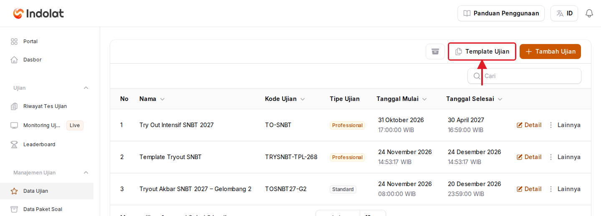
        </Frame>
      </Step>
      <Step title="Pilih Template Kompetisi Berjenjang">
        <Frame>
          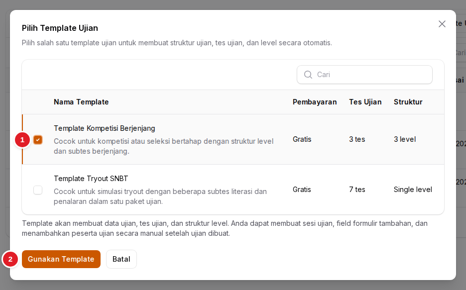
        </Frame>

        1. Centang **Template Kompetisi Berjenjang**. Tabel template menampilkan tipe pembayaran, jumlah tes ujian, dan jumlah level setiap template.
        2. Klik **Gunakan Template**.

        Sistem menampilkan notifikasi **Template Data Ujian Berhasil Ditambahkan**, dan ujian baru bernama **Template Kompetisi Berjenjang** muncul pada daftar **Data Ujian** dengan kode seperti **KOMPETISI-TPL-116**.

        <Frame>
          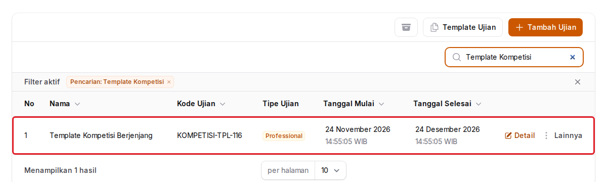
        </Frame>
      </Step>
    </Steps>

    Template Kompetisi Berjenjang menyiapkan:

    - ujian dengan tipe **Ujian Professional (Paket Berbayar)**, tipe pembayaran **Gratis**, dan pengaturan **Ya (Multi-Level)**;
    - tanggal mulai hari ini dan tanggal selesai satu bulan kemudian;
    - tiga tes ujian: **Babak Penyisihan** dan **Babak Semifinal** (CBT, 120 menit, Perhitungan Skor Soal), serta **Babak Final** (Esai / Upload File);
    - tiga level dengan nama yang sama, masing-masing berisi satu tes, dan semuanya memerlukan verifikasi admin;
    - pendaftaran mandiri yang belum dibuka.

    <Note>
      Setelah ujian dari template dibuat, klik **Detail** lalu sesuaikan nama, kode, tanggal, tipe ujian, dan tipe pembayaran sesuai kebutuhan Anda (lihat bagian 2). Anda tetap perlu membuat sesi ujian, memilih paket soal, dan menambahkan peserta. Template ini tidak dapat digunakan bila tipe pembayarannya berbayar dan add-on **Halaman Pendaftaran Ujian dan Pembayaran Otomatis** belum aktif.
    </Note>
  </Accordion>

  <Accordion title="Membuat Ujian Baru">
    <Steps>
      <Step title="Klik Tambah Ujian">
        Buka **Data Ujian**, lalu klik **Tambah Ujian**.

        <Frame>
          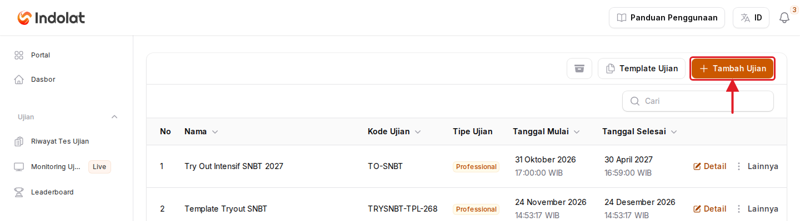
        </Frame>
      </Step>
      <Step title="Isi informasi ujian">
        <Frame>
          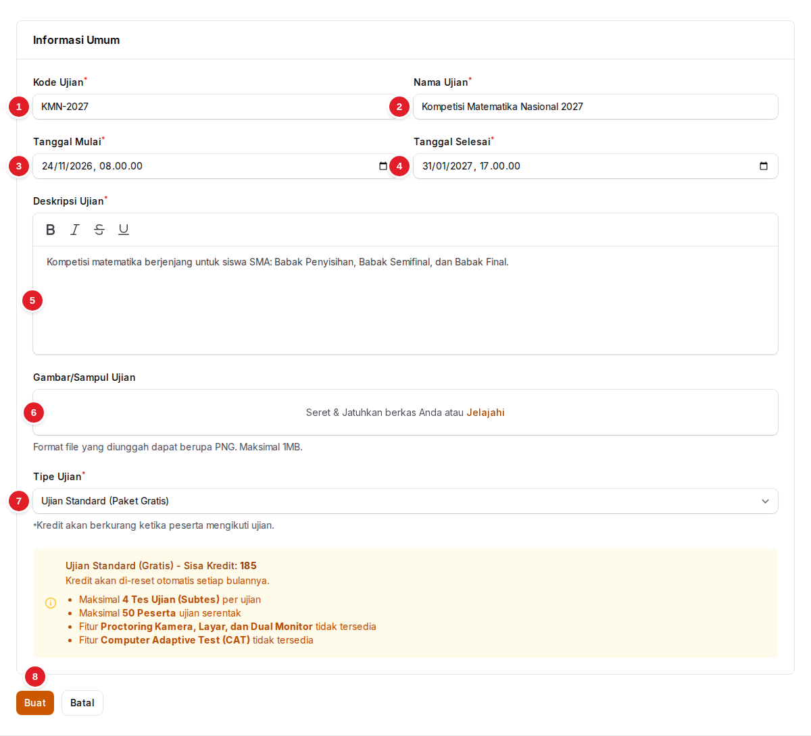
        </Frame>

        1. **Kode Ujian**: kode unik yang hanya berisi huruf, angka, tanda `-`, atau `#`. Huruf otomatis diubah menjadi kapital. Contoh: **KMN-2027**.
        2. **Nama Ujian**: nama yang dilihat admin dan peserta. Contoh: **Kompetisi Matematika Nasional 2027**.
        3. **Tanggal Mulai**: tanggal dan waktu acara ujian dimulai.
        4. **Tanggal Selesai**: tanggal dan waktu acara ujian berakhir. Tanggal ini tidak boleh lebih awal dari tanggal mulai dan paling lambat satu tahun dari hari ini.
        5. **Deskripsi Ujian**: penjelasan singkat tentang ujian, maksimal 1.000 karakter.
        6. **Gambar/Sampul Ujian** (opsional): berkas PNG, maksimal 1 MB.
        7. **Tipe Ujian**: **Ujian Standard (Paket Gratis)** atau **Ujian Professional (Paket Berbayar)**. Penjelasannya ada pada langkah **Periksa Tipe & Paket Ujian** di bawah.
        8. Klik **Buat**. Sistem langsung membuka halaman detail ujian.
      </Step>
    </Steps>
  </Accordion>
</AccordionGroup>

## 2. Melengkapi pengaturan detail ujian

Halaman detail ujian memiliki lima tab pengaturan:

<Frame>
  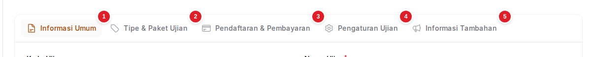
</Frame>

1. **Informasi Umum**
2. **Tipe & Paket Ujian**
3. **Pendaftaran & Pembayaran**
4. **Pengaturan Ujian**
5. **Informasi Tambahan**

Setiap tab disimpan dengan tombol **Simpan** di bawah formulir.

<Steps>
  <Step title="Periksa Informasi Umum">
    Tab **Informasi Umum** berisi kolom yang sama dengan formulir **Tambah Ujian**: kode, nama, tanggal mulai, tanggal selesai, deskripsi, dan gambar sampul. Ubah kolom yang perlu, lalu klik **Simpan**.

    <Note>
      **Kode Ujian** tidak dapat diubah lagi setelah ujian memiliki peserta. **Tanggal Mulai** dan **Tanggal Selesai** tidak dapat diubah selama ada peserta yang sedang mengerjakan ujian.
    </Note>
  </Step>
  <Step title="Periksa Tipe & Paket Ujian">
    <Frame>
      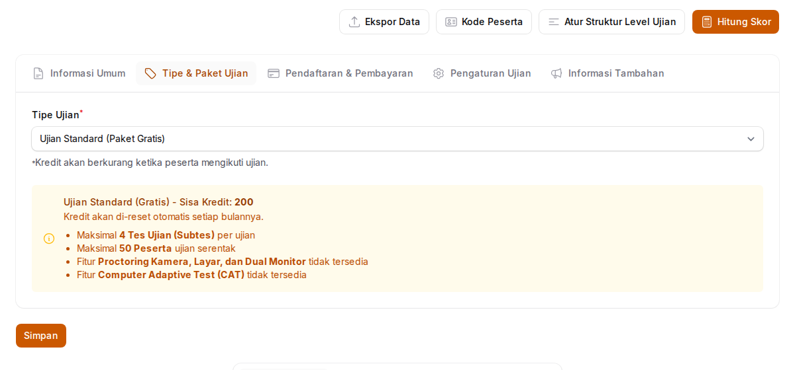
    </Frame>

    **Tipe Ujian** menentukan jenis kredit yang dipakai. Kredit berkurang ketika peserta mengikuti ujian, dan sisa kredit tampil pada kotak keterangan.

    - **Ujian Standard (Paket Gratis)**: kredit di-reset otomatis setiap bulan; maksimal **4 Tes Ujian (Subtes)** per ujian; maksimal **50 peserta** ujian serentak; tanpa **Proctoring Kamera, Layar, dan Dual Monitor**; tanpa **Computer Adaptive Test (CAT)**.
    - **Ujian Professional (Paket Berbayar)**: memakai kredit profesional dari langganan atau pembelian Kredit Ujian (sisa kredit langganan terakumulasi selama langganan diperpanjang tanpa jeda, lihat [Kredit Ujian, Ujian Standard, dan Ujian Professional](/konsep/kredit-dan-tipe-ujian)); maksimal **30 Tes Ujian (Subtes)** per ujian; maksimal **1.000 peserta** ujian serentak; **Proctoring Kamera, Layar, dan Dual Monitor** serta **CAT** tersedia. Jika projek tidak memiliki kredit ujian profesional, sistem menampilkan peringatan dan peserta tidak dapat memulai ujian sampai kredit tersedia.

    <Tip>
      Pada ujian berjenjang, setiap babak biasanya berupa satu tes ujian. Jika jumlah tes seluruh babak lebih dari empat, gunakan **Ujian Professional**.
    </Tip>
  </Step>
  <Step title="Atur Pendaftaran & Pembayaran">
    <Frame>
      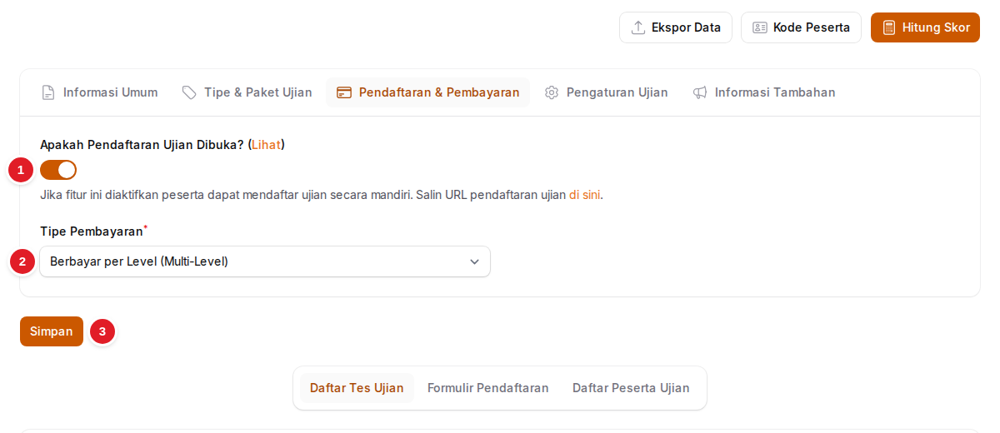
    </Frame>

    1. **Apakah Pendaftaran Ujian Dibuka?**: aktifkan jika peserta boleh mendaftar sendiri melalui aplikasi peserta. Tautan **di sini** pada teks bantuan menyalin URL pendaftaran ujian. Pengaturan ini memerlukan add-on **Halaman Pendaftaran Ujian dan Pembayaran Otomatis**; tanpa add-on, labelnya menampilkan **(Add-on Tidak Aktif)** dan tombolnya tidak dapat diaktifkan.
    2. **Tipe Pembayaran**: pilih salah satu tipe berikut.
       - **Gratis**: peserta tidak membayar.
       - **Sekali Bayar**: peserta membayar satu kali untuk seluruh tes. Kolom **Biaya Ujian Sekali Bayar (IDR)** muncul, minimal Rp5.000.
       - **Berbayar per Tes Ujian**: setiap tes memiliki biaya sendiri yang diisi pada formulir tes ujian.
       - **Berbayar per Level (Multi-Level)**: setiap level memiliki biaya sendiri yang diisi pada struktur level (bagian 4). Saat tipe ini dipilih, **Apakah Ujian Multi-Level?** otomatis diubah menjadi **Ya (Multi-Level)**.
    3. Klik **Simpan**.

    Untuk contoh Kompetisi Matematika Nasional 2027, aktifkan pendaftaran dan pilih **Berbayar per Level (Multi-Level)**.

    <Note>
      Tipe pembayaran selain **Gratis** memerlukan add-on **Halaman Pendaftaran Ujian dan Pembayaran Otomatis**; tanpa add-on, perubahan tidak dapat disimpan. Pada tipe **Berbayar per Level (Multi-Level)**, tagihan dibuat ketika Anda meloloskan peserta ke level berbayar (bagian 6). Biaya level pertama ditagihkan saat peserta mendaftar sendiri melalui formulir pendaftaran; kosongkan biaya level pertama jika babak awal gratis. Peserta yang Anda tambahkan langsung dari tab **Daftar Peserta Ujian** tidak ditagih biaya level pertama.
    </Note>
  </Step>
  <Step title="Atur Pengaturan Ujian">
    <Frame>
      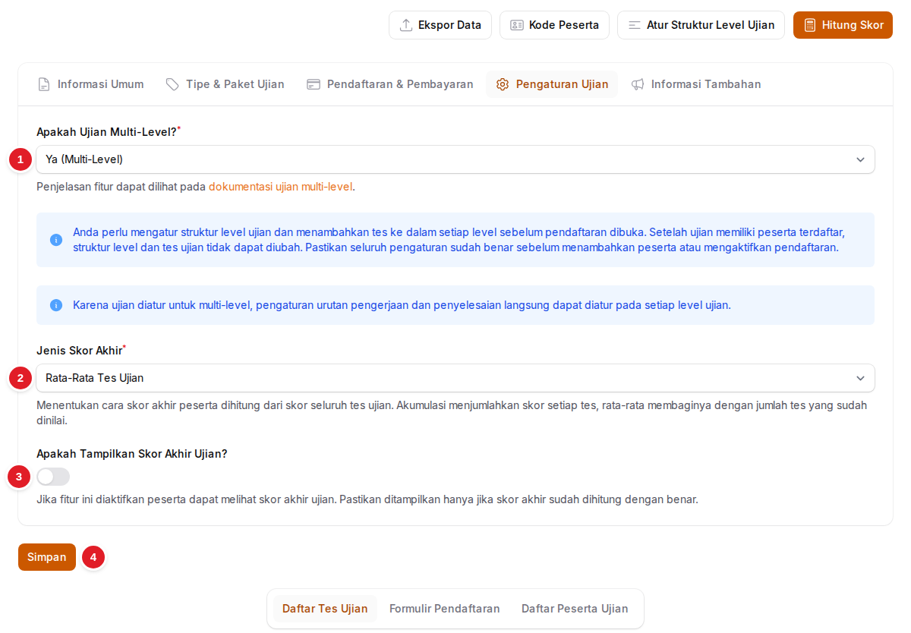
    </Frame>

    1. **Apakah Ujian Multi-Level?**: pilih **Ya (Multi-Level)**. Setelah disimpan, tombol **Atur Struktur Level Ujian** muncul di kanan atas halaman. Pengaturan **Apakah Tes Ujian Harus Dikerjakan Secara Berurutan?** dan **Apakah Tes Ujian Harus Dikerjakan Secara Langsung?** tidak lagi tampil di tab ini karena diatur per level. Pilihan ini tidak dapat diubah setelah ujian memiliki peserta.
    2. **Jenis Skor Akhir**: cara menghitung skor akhir dari seluruh tes.
       - **Akumulasi Tes Ujian**: skor setiap tes dijumlahkan.
       - **Rata-Rata Tes Ujian** (bawaan): jumlah skor dibagi jumlah tes yang sudah dinilai.

       Contoh: skor Babak Penyisihan 80 dan Babak Semifinal 70 menghasilkan skor akhir 150 dengan akumulasi, atau 75 dengan rata-rata. Jika ujian sudah memiliki peserta, skor akhir seluruh peserta dihitung ulang setelah perubahan disimpan.
    3. **Apakah Tampilkan Skor Akhir Ujian?**: aktifkan jika peserta boleh melihat skor akhir. Aktifkan hanya setelah skor dihitung dengan benar.
    4. Klik **Simpan**.
  </Step>
  <Step title="Atur Informasi Tambahan (opsional)">
    Gunakan tab ini untuk menampilkan informasi khusus di dashboard peserta ujian ini, misalnya tautan grup WhatsApp atau kontak panitia. Peserta ujian lain tidak melihat informasi ini.

    <Frame>
      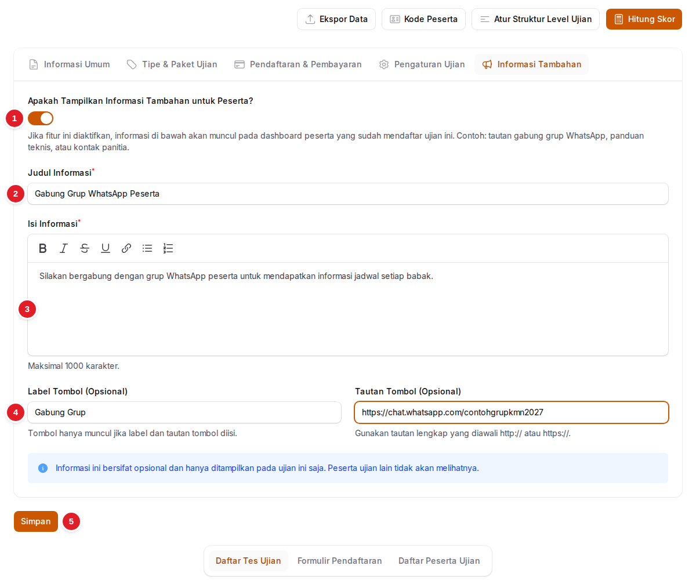
    </Frame>

    1. **Apakah Tampilkan Informasi Tambahan untuk Peserta?**: aktifkan agar kolom informasi muncul.
    2. **Judul Informasi**: maksimal 100 karakter. Contoh: **Gabung Grup WhatsApp Peserta**.
    3. **Isi Informasi**: maksimal 1.000 karakter.
    4. **Label Tombol (Opsional)** dan **Tautan Tombol (Opsional)**: isi keduanya jika ingin menampilkan tombol. Tautan harus diawali `http://` atau `https://`.
    5. Klik **Simpan**.

    Informasi tersebut tampil di bagian atas halaman **Daftar Tes** peserta:

    <Frame>
      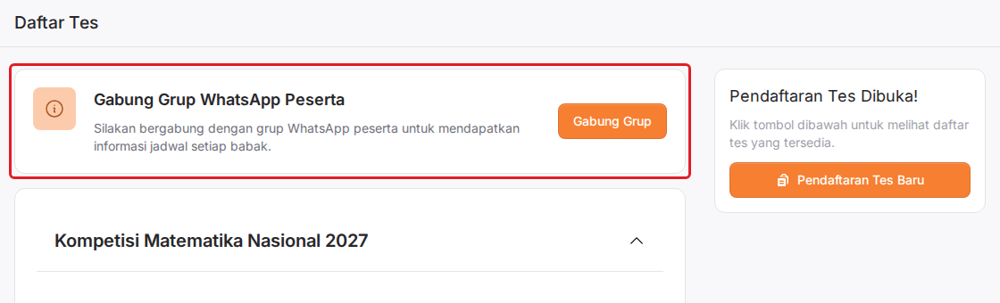
    </Frame>
  </Step>
</Steps>

## 3. Menambahkan tes ujian untuk setiap babak

Buat satu tes ujian untuk setiap babak. Penjelasan lengkap setiap kolom tes ujian ada pada [Membuat Tes Ujian](/data-ujian/membuat-tes-ujian).

<Steps>
  <Step title="Klik Tambah Tes Ujian">
    Gulir ke bawah halaman detail ujian, buka tab **Daftar Tes Ujian**, lalu klik **Tambah Tes Ujian**.

    <Frame>
      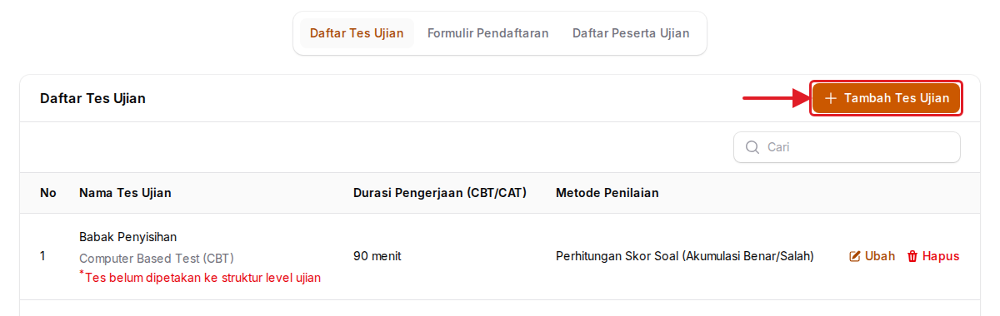
    </Frame>
  </Step>
  <Step title="Isi formulir tes ujian">
    <Frame>
      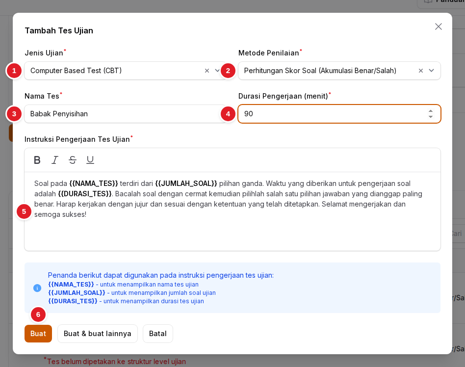
    </Frame>

    1. **Jenis Ujian**: contoh **Computer Based Test (CBT)**.
    2. **Metode Penilaian**: contoh **Perhitungan Skor Soal (Akumulasi Benar/Salah)**.
    3. **Nama Tes**: contoh **Babak Penyisihan**.
    4. **Durasi Pengerjaan (menit)**: contoh **90**.
    5. **Instruksi Pengerjaan Tes Ujian**: petunjuk yang dibaca peserta sebelum mulai. Penanda `{{NAMA_TES}}`, `{{JUMLAH_SOAL}}`, dan `{{DURASI_TES}}` diganti otomatis.
    6. Klik **Buat**, atau **Buat & buat lainnya** untuk langsung membuat tes berikutnya.

    <Warning>
      Skor IRT dihitung melalui **Hitung Skor** → **Perhitungan IRT**, dan menu tersebut tidak dapat digunakan pada ujian multi-level. Untuk ujian berjenjang, pilih metode penilaian selain IRT.
    </Warning>
  </Step>
  <Step title="Ulangi untuk babak lainnya">
    Buat juga tes **Babak Semifinal** dan **Babak Final**. Selama tes belum dimasukkan ke struktur level, daftar tes menampilkan keterangan **Tes belum dipetakan ke struktur level ujian**.

    <Frame>
      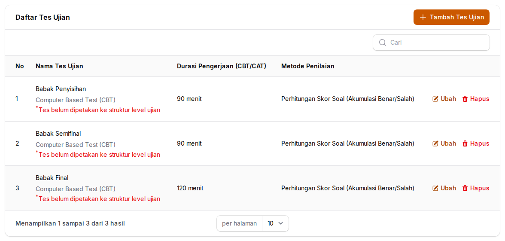
    </Frame>
  </Step>
</Steps>

## 4. Mengatur struktur level ujian

Struktur level menentukan urutan babak dan tes yang dikerjakan pada setiap babak.

<Warning>
  Selesaikan struktur level sebelum pendaftaran dibuka atau peserta ditambahkan. Setelah ujian memiliki peserta, struktur level dan tes ujian tidak dapat diubah, tombol berubah menjadi **Lihat Struktur Level Ujian**, dan halaman struktur hanya dapat dilihat. Selama masih ada tes yang belum dimasukkan ke level, peserta juga tidak dapat ditambahkan melalui **Tambah Peserta** atau **Import Peserta**.
</Warning>

<Steps>
  <Step title="Klik Atur Struktur Level Ujian">
    Pada halaman detail ujian, klik **Atur Struktur Level Ujian** di kanan atas.

    <Frame>
      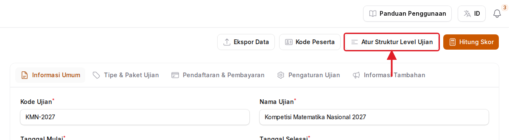
    </Frame>
  </Step>
  <Step title="Klik Level Baru">
    Halaman struktur level masih kosong. Klik **Level Baru**.

    <Frame>
      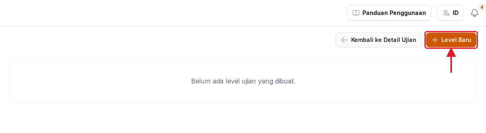
    </Frame>
  </Step>
  <Step title="Isi pengaturan level">
    <Frame>
      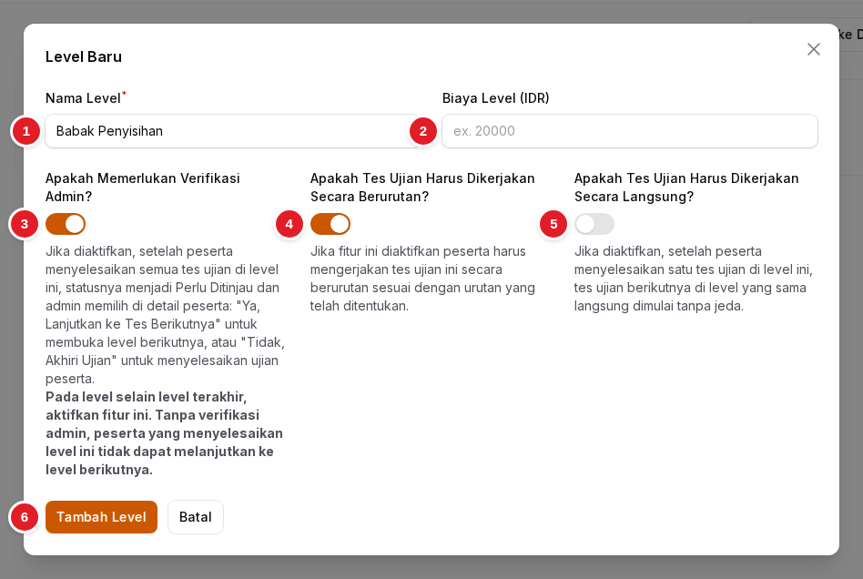
    </Frame>

    1. **Nama Level**: nama babak. Contoh: **Babak Penyisihan**.
    2. **Biaya Level (IDR)**: hanya muncul jika tipe pembayaran **Berbayar per Level (Multi-Level)**. Isi minimal Rp5.000, atau kosongkan jika level tersebut gratis.
    3. **Apakah Memerlukan Verifikasi Admin?**: jika aktif, setelah peserta menyelesaikan semua tes pada level ini, statusnya berubah menjadi **Aktif (Perlu Ditinjau)** dan peserta menunggu keputusan admin sebelum masuk ke level berikutnya (bagian 6).
    4. **Apakah Tes Ujian Harus Dikerjakan Secara Berurutan?**: jika aktif, tes di dalam level ini harus dikerjakan sesuai urutannya; tes berikutnya terkunci sampai tes sebelumnya selesai.
    5. **Apakah Tes Ujian Harus Dikerjakan Secara Langsung?**: jika aktif, setelah satu tes selesai, tes berikutnya di level yang sama langsung dimulai tanpa jeda.
    6. Klik **Tambah Level**.

    Ulangi untuk level lainnya. Pada contoh ini:

    | Level | Biaya Level (IDR) | Verifikasi Admin |
    | --- | --- | --- |
    | Babak Penyisihan | kosong | aktif |
    | Babak Semifinal | 30000 | aktif |
    | Babak Final | 40000 | nonaktif |

    <Warning>
      Peserta hanya dapat naik ke level berikutnya melalui keputusan admin. Aktifkan **Apakah Memerlukan Verifikasi Admin?** pada setiap level yang masih memiliki level sesudahnya. Jika nonaktif, status peserta tidak berubah menjadi **Aktif (Perlu Ditinjau)** setelah level tersebut selesai, sehingga tombol untuk meloloskan peserta tidak muncul. Pada level terakhir, pengaturan ini boleh dinonaktifkan.
    </Warning>

    <Tip>
      Pengaturan berurutan dan pengerjaan langsung baru berpengaruh jika satu level berisi lebih dari satu tes.
    </Tip>
  </Step>
  <Step title="Klik Tambah Tes Ujian">
    Setelah level dibuat, tombol **Tambah Tes Ujian** muncul. Klik tombol tersebut untuk memasukkan tes ke level.

    <Frame>
      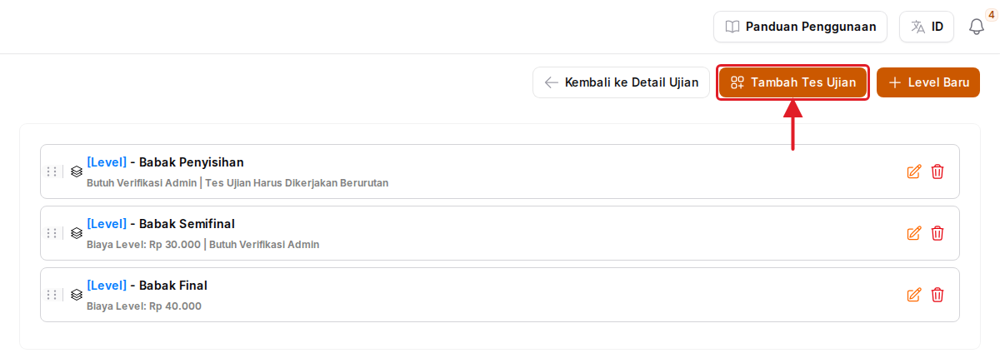
    </Frame>
  </Step>
  <Step title="Pilih tes dan level">
    Kolom **Tes Ujian** hanya menampilkan tes yang belum dimasukkan ke level mana pun, dan Anda dapat memilih lebih dari satu tes.

    <Frame>
      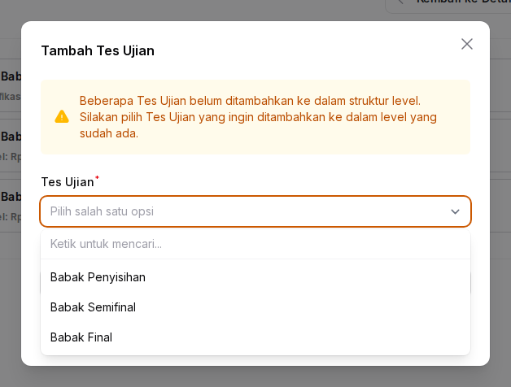
    </Frame>

    Kolom **Level Ujian** menampilkan level yang sudah dibuat.

    <Frame>
      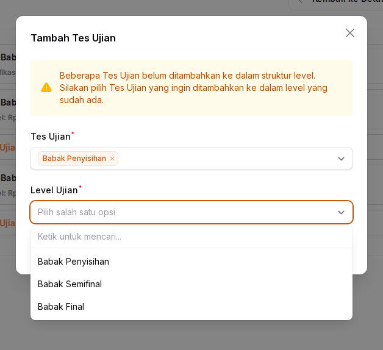
    </Frame>

    <Frame>
      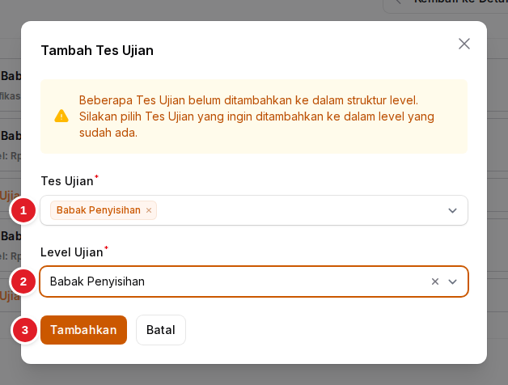
    </Frame>

    1. **Tes Ujian**: pilih tes, contoh **Babak Penyisihan**.
    2. **Level Ujian**: pilih level tujuan, contoh **Babak Penyisihan**.
    3. Klik **Tambahkan**.

    Ulangi sampai semua tes berada di levelnya. Jika semua tes sudah dimasukkan, jendela ini menampilkan keterangan **Semua Tes Ujian sudah ditambahkan ke dalam struktur level**.
  </Step>
  <Step title="Periksa struktur level">
    Setiap level tampil dengan label **[Level]** beserta ringkasan pengaturannya, dan tes di dalamnya tampil dengan label **[Tes Ujian]**.

    <Frame>
      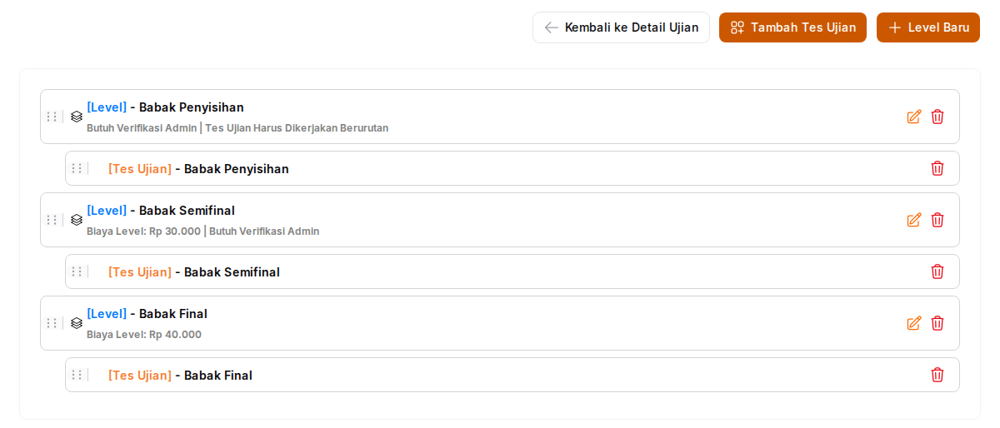
    </Frame>

    - Seret pegangan titik-titik di sisi kiri untuk mengubah urutan level atau urutan tes di dalam level.
    - Klik ikon pensil untuk mengubah pengaturan level, atau ikon tempat sampah untuk menghapus level atau mengeluarkan tes dari level. Menghapus level tidak menghapus tes ujian di dalamnya.
    - Klik **Kembali ke Detail Ujian** setelah selesai.
  </Step>
</Steps>

## 5. Menambahkan sesi ujian dan peserta

Setiap tes memerlukan sesi ujian dengan paket soal agar dapat dikerjakan. Buat sesi untuk setiap babak melalui tab **Daftar Tes Ujian** → **Ubah** pada tes → **Tambah Sesi Ujian**, mengikuti panduan [Membuat Sesi Ujian](/data-ujian/membuat-sesi-ujian). Jadwal sesi harus berada di dalam rentang tanggal ujian.

Setelah struktur level lengkap, tambahkan peserta melalui tab **Daftar Peserta Ujian** (lihat [Menambahkan Peserta Ujian](/data-ujian/menambahkan-peserta-ujian)) atau buka pendaftaran mandiri dengan formulir pendaftaran (lihat [Formulir Pendaftaran Peserta](/data-ujian/membuat-formulir-pendaftaran)). Peserta baru hanya dapat mengerjakan tes pada level pertama; tes pada level berikutnya terkunci.

## 6. Meloloskan peserta ke babak berikutnya

Sebagai contoh, peserta **Rico Sadewa** telah menyelesaikan **Babak Penyisihan**. Karena level ini memerlukan verifikasi admin, babak berikutnya ditandai **Proses Verifikasi** di aplikasi peserta, dan tesnya masih terkunci.

<Frame>
  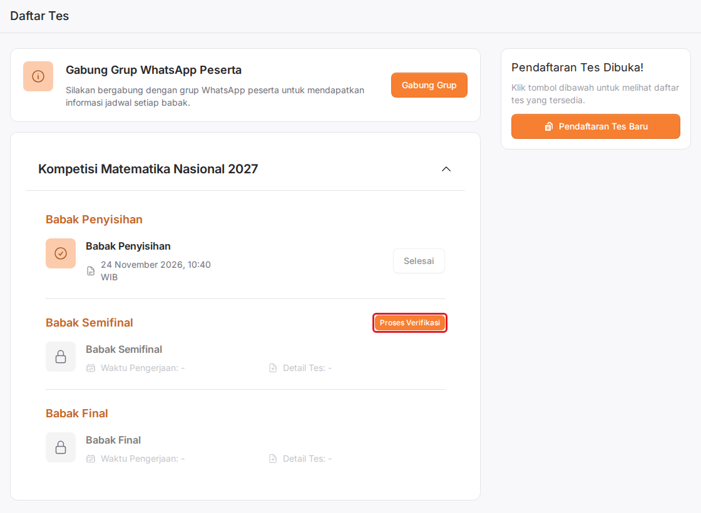
</Frame>

<Steps>
  <Step title="Buka detail ujian">
    Buka **Data Ujian**, cari ujian, lalu klik **Detail**.

    <Frame>
      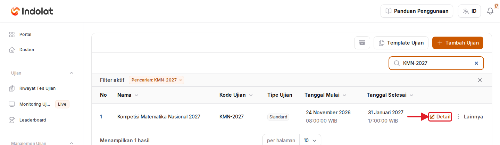
    </Frame>
  </Step>
  <Step title="Klik Lihat pada peserta yang perlu ditinjau">
    Gulir ke bawah, buka tab **Daftar Peserta Ujian**, cari peserta berstatus **Aktif (Perlu Ditinjau)**, lalu klik **Lihat**. Anda dapat memakai filter **Status Peserta** → **Perlu Ditinjau** untuk menampilkan peserta tersebut saja.

    <Frame>
      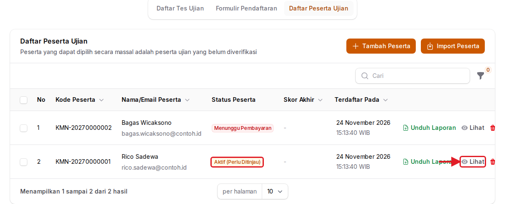
    </Frame>
  </Step>
  <Step title="Tentukan apakah peserta lolos">
    Halaman **Detail Peserta** menampilkan **Tes Ujian Terakhir** dan **Tes Ujian Berikutnya**, serta kotak **Apakah Peserta Lanjut ke Tes Ujian Berikutnya?**.

    <Frame>
      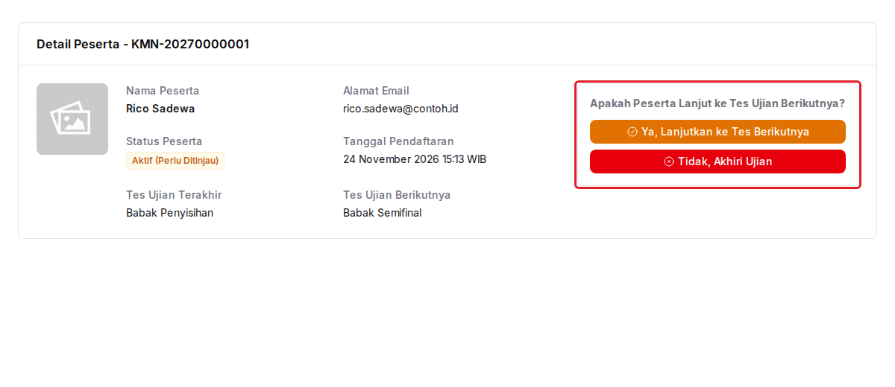
    </Frame>

    - Klik **Ya, Lanjutkan ke Tes Berikutnya** jika peserta lolos. Tes pada level berikutnya terbuka dan status peserta kembali **Aktif**.
    - Klik **Tidak, Akhiri Ujian** jika peserta tidak lolos. Ujian peserta diakhiri, statusnya menjadi **Selesai**, dan tes pada level berikutnya tetap terkunci.

    Konfirmasi pilihan Anda pada jendela yang muncul.
  </Step>
  <Step title="Tentukan batas waktu pembayaran (level berbayar)">
    Jika level berikutnya memiliki biaya, jendela konfirmasi menampilkan nominal biaya dan meminta batas waktu pembayaran.

    <Frame>
      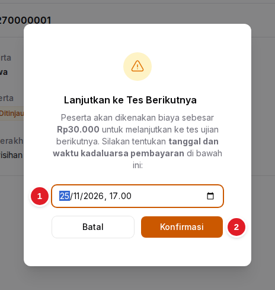
    </Frame>

    1. Isi tanggal dan waktu kedaluwarsa pembayaran. Batas waktu tidak boleh di masa lalu dan paling lama 2 × 24 jam dari sekarang.
    2. Klik **Konfirmasi**.

    Sistem membuat tagihan QRIS untuk peserta. Selama tagihan belum dibayar, status peserta pada daftar adalah **Menunggu Pembayaran**, dan halaman **Detail Peserta** menampilkan kode QR, kode pembayaran, total, dan batas waktunya.
  </Step>
  <Step title="Peserta menyelesaikan pembayaran">
    Di aplikasi peserta, level berbayar menampilkan tombol **Selesaikan Pembayaran**. Peserta membayar melalui QRIS sebelum batas waktu; setelah pembayaran berhasil, tes pada level tersebut terbuka.

    <Frame>
      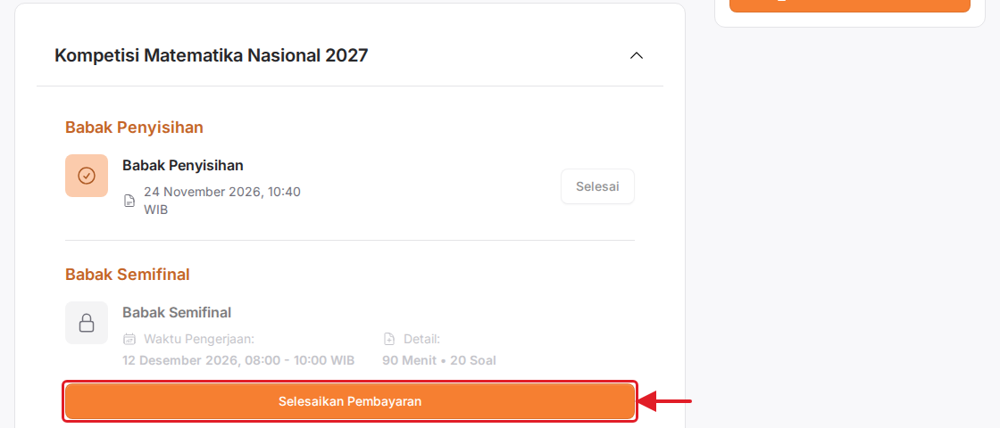
    </Frame>

    <Info>
      Jika level berikutnya gratis, peserta langsung dapat melanjutkan tanpa pembayaran.
    </Info>
  </Step>
</Steps>

<Warning>
  Pastikan peserta yang diloloskan sudah masuk ke sesi ujian pada tes level berikutnya. Tes tetap terkunci bagi peserta yang belum memiliki sesi, atau jika sesi tersebut belum memiliki paket soal.
</Warning>
