Panduan ini menjelaskan cara membuat **ujian** sebagai wadah utama beserta seluruh pengaturannya. Di dalam ujian, Anda mengatur nama dan jadwal pelaksanaan, tipe ujian, cara peserta mendaftar, biaya, aturan pengerjaan, dan informasi yang ditampilkan kepada peserta. Tes, sesi, dan peserta ditambahkan setelah ujian dibuat.

<Info>
  **Lokasi menu:** **Portal** → **Platform Ujian (CBT)** → **Manajemen Ujian** → **Data Ujian**.

  Anda memerlukan akses ke menu **Data Ujian**. Admin dengan peran **Guru** hanya dapat melihat dan mengelola ujian yang ia buat sendiri.
</Info>

Sebagai contoh, Anda adalah admin **Bimbel Prestasi Nusantara** yang akan menyelenggarakan **Tryout Akbar SNBT 2027 – Gelombang 2** dengan ketentuan berikut:

- ujian gratis,
- peserta dapat mendaftar sendiri,
- skor akhir dapat dilihat peserta setelah selesai mengerjakan.

## Membuka menu Data Ujian

<Steps>
  <Step title="Buka modul Platform Ujian (CBT)">
    Setelah masuk, Anda berada di halaman **Portal**. Klik ubin **Platform Ujian (CBT)** pada **Daftar Modul**.

    <Frame>
      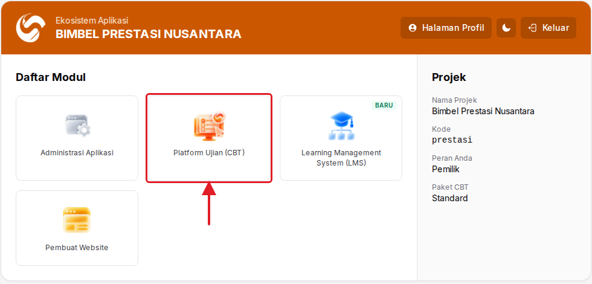
    </Frame>
  </Step>
  <Step title="Klik Data Ujian">
    Pada sidebar, klik **Data Ujian** di grup **Manajemen Ujian**. Halaman ini menampilkan daftar ujian beserta **Kode Ujian**, **Tipe Ujian**, **Tanggal Mulai**, dan **Tanggal Selesai**.

    <Frame>
      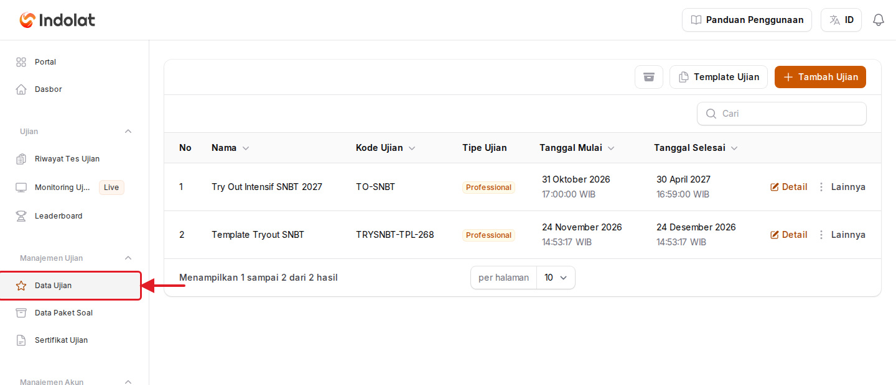
    </Frame>
  </Step>
</Steps>

## Memilih cara membuat ujian

Ada dua cara membuat ujian:

1. **Template Ujian**: sistem langsung menyusun ujian beserta tes ujian dan struktur levelnya.
2. **Tambah Ujian**: Anda menentukan seluruh susunan dan pengaturan ujian sendiri dari awal.

<AccordionGroup>
  <Accordion title="Menggunakan Template Ujian">
    Template ujian adalah contoh susunan ujian yang sudah disiapkan sistem. Saat template dipakai, sistem membuat **ujian, tes ujian, dan struktur level** sekaligus. Anda tinggal melengkapi isinya.

    <Steps>
      <Step title="Klik Template Ujian">
        Pada halaman **Data Ujian**, klik **Template Ujian**.

        <Frame>
          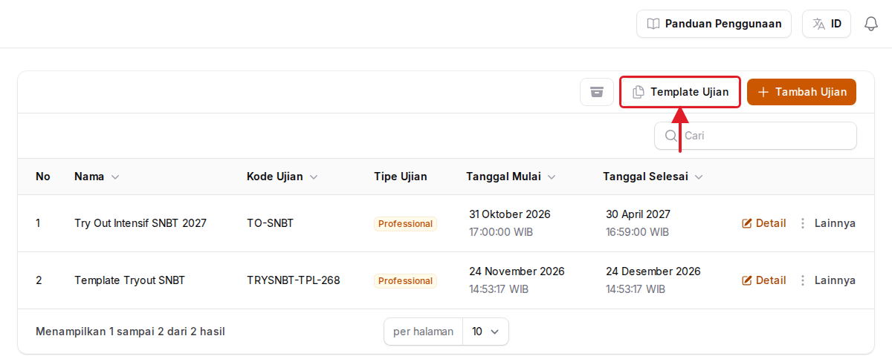
        </Frame>
      </Step>
      <Step title="Pilih template, lalu klik Gunakan Template">
        Jendela **Pilih Template Ujian** menampilkan nama template, jenis **Pembayaran**, jumlah **Tes Ujian**, dan **Struktur** levelnya.

        <Frame>
          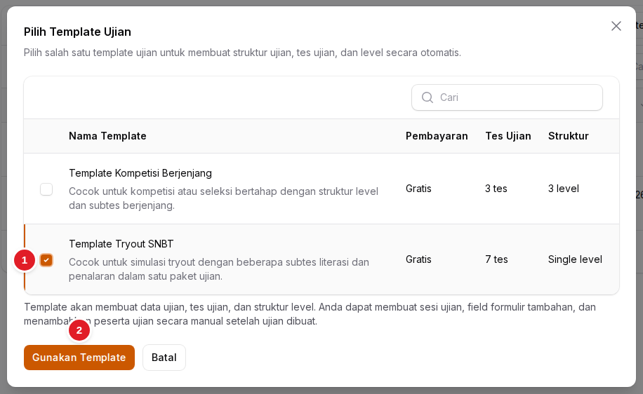
        </Frame>

        1. Centang template yang sesuai. Pada contoh ini, pilih **Template Tryout SNBT** (gratis, 7 tes, satu level).
        2. Klik **Gunakan Template**.

        Template yang tersedia saat ini:

        - **Template Tryout SNBT**: tryout dengan beberapa subtes literasi dan penalaran dalam satu paket ujian.
        - **Template Kompetisi Berjenjang**: kompetisi atau seleksi bertahap dengan 3 tes dan 3 level. Penjelasan ujian bertingkat ada di [Membuat Ujian Berjenjang](/data-ujian/membuat-ujian-berjenjang).
      </Step>
      <Step title="Periksa ujian yang dibuat">
        Ujian baru muncul di daftar **Data Ujian** dengan nama dan kode dari template.

        <Frame>
          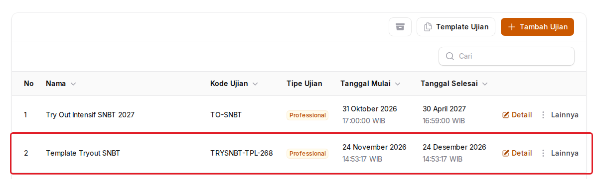
        </Frame>

        <Note>
          - Ujian dari template dibuat sebagai **Ujian Professional (Paket Berbayar)**, dengan tanggal mulai saat template dipakai dan tanggal selesai satu bulan setelahnya. Ubah nama, kode, jadwal, dan tipe ujian melalui **Detail**.
          - Template **tidak** membuat sesi ujian, isian formulir pendaftaran, maupun peserta. Anda tetap perlu [membuat sesi ujian](/data-ujian/membuat-sesi-ujian), memilih paket soal untuk setiap sesi, dan [menambahkan peserta](/data-ujian/menambahkan-peserta-ujian).
          - Template yang memakai pembayaran hanya dapat dipakai jika add-on formulir pendaftaran aktif.
        </Note>
      </Step>
    </Steps>
  </Accordion>

  <Accordion title="Membuat ujian dari awal (Tambah Ujian)">
    <Steps>
      <Step title="Klik Tambah Ujian">
        Pada halaman **Data Ujian**, klik **Tambah Ujian**.

        <Frame>
          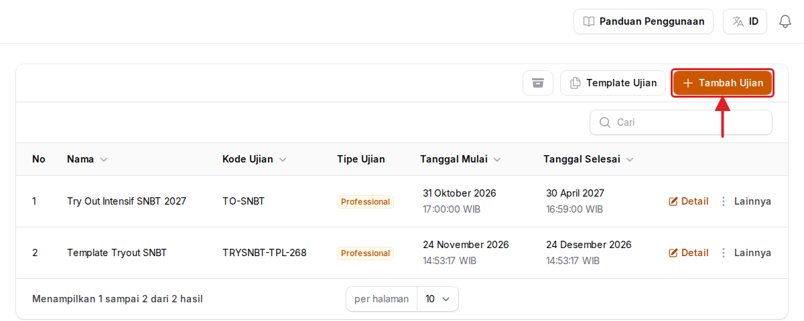
        </Frame>
      </Step>
      <Step title="Isi formulir Informasi Umum">
        <Frame>
          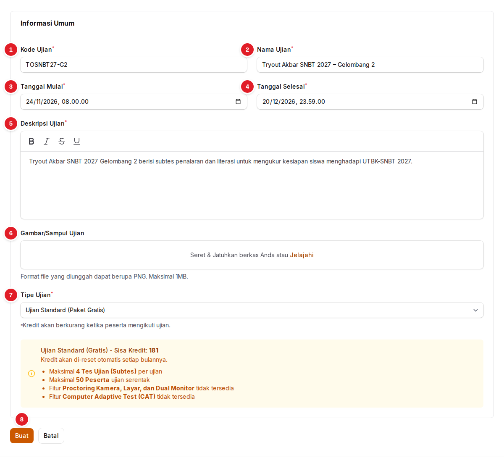
        </Frame>

        1. **Kode Ujian** Kode singkat dan unik dalam projek Anda. Hanya boleh berisi huruf, angka, tanda `-`, dan `#`; huruf otomatis menjadi kapital. Kode ini juga menjadi awalan **Kode Peserta** bawaan (lihat [Kode Peserta dan Kode Bidang](/data-ujian/kode-peserta)). Contoh: **TOSNBT27-G2**.
        2. **Nama Ujian** Nama yang dilihat admin dan peserta. Contoh: **Tryout Akbar SNBT 2027 – Gelombang 2**.
        3. **Tanggal Mulai** Tanggal dan waktu acara ujian dimulai.
        4. **Tanggal Selesai** Tanggal dan waktu acara ujian berakhir. Tanggal ini tidak boleh lebih awal dari tanggal mulai dan paling lambat satu tahun dari hari ini. Semua sesi ujian harus berada di dalam rentang tanggal ini.
        5. **Deskripsi Ujian** Penjelasan singkat tentang ujian, maksimal 1.000 karakter. Kolom ini wajib diisi.
        6. **Gambar/Sampul Ujian** (opsional) Gambar sampul ujian dalam format PNG, maksimal 1 MB.
        7. **Tipe Ujian** Pilih **Ujian Standard (Paket Gratis)** atau **Ujian Professional (Paket Berbayar)**. Perbedaan keduanya dijelaskan pada bagian **Tipe & Paket Ujian** di bawah.
        8. Klik **Buat**. Sistem langsung membuka halaman **Detail Ujian**.
      </Step>
    </Steps>
  </Accordion>
</AccordionGroup>

## Mengatur detail ujian

Halaman **Detail Ujian** terbuka setelah Anda membuat ujian. Untuk membukanya kembali, klik **Detail** pada baris ujian di halaman **Data Ujian**.

<Frame>
  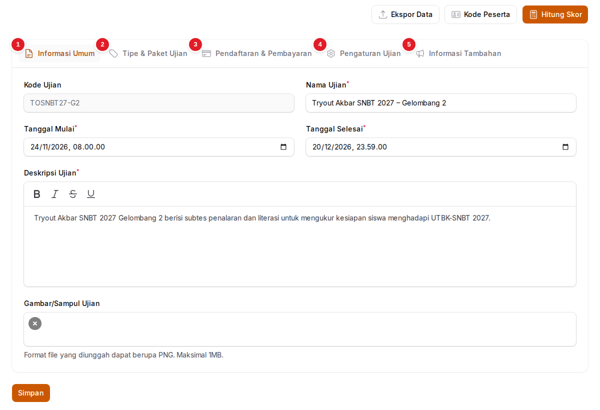
</Frame>

Pengaturan ujian dibagi ke dalam lima tab:

1. **Informasi Umum**
2. **Tipe & Paket Ujian**
3. **Pendaftaran & Pembayaran**
4. **Pengaturan Ujian**
5. **Informasi Tambahan**

Setelah mengubah isi tab mana pun, klik **Simpan**.

### Informasi Umum

Tab ini berisi kolom yang sama dengan formulir **Tambah Ujian**: **Kode Ujian**, **Nama Ujian**, **Tanggal Mulai**, **Tanggal Selesai**, **Deskripsi Ujian**, dan **Gambar/Sampul Ujian**.

<Note>
  - **Kode Ujian** tidak dapat diubah lagi setelah ujian memiliki peserta.
  - **Tanggal Mulai** dan **Tanggal Selesai** tidak dapat diubah selama ada peserta yang sedang mengerjakan tes.
</Note>

### Tipe & Paket Ujian

<Frame>
  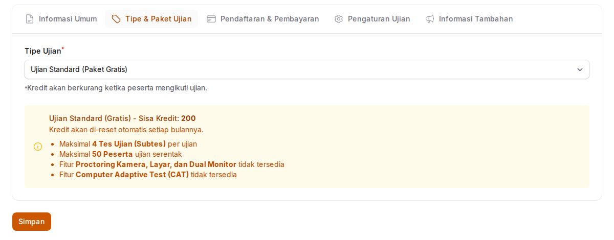
</Frame>

**Tipe Ujian** menentukan jenis kredit yang dipakai dan batasan fitur ujian. Kredit berkurang ketika peserta mengikuti ujian. Kotak di bawah pilihan menampilkan sisa kredit tipe tersebut.

| | **Ujian Standard (Paket Gratis)** | **Ujian Professional (Paket Berbayar)** |
| --- | --- | --- |
| Reset kredit | Otomatis setiap bulan | Setiap bulan sesuai periode langganan |
| Tes ujian per ujian | Maksimal 4 | Maksimal 30 |
| Peserta yang mengerjakan serentak | Maksimal 50 | Maksimal 1.000 |
| Proctoring Kamera, Layar, dan Dual Monitor | Tidak tersedia | Tersedia |
| Computer Adaptive Test (CAT) | Tidak tersedia | Tersedia |

Pada kedua tipe, tes CBT dapat memakai semua metode penilaian (termasuk IRT), dan **Deteksi Pindah Tab** tetap tersedia.

<Warning>
  Jika Anda memilih **Ujian Professional (Paket Berbayar)** tetapi projek tidak memiliki kredit ujian profesional, sistem menampilkan peringatan dan peserta tidak dapat memulai ujian sampai kredit tersedia. Kredit dikelola di **Administrasi Aplikasi** → **Keuangan** → **Langganan & Tagihan**.
</Warning>

<Tip>
  Pilih **Ujian Standard** untuk ujian sederhana dengan paling banyak 4 tes dan 50 peserta serentak. Pilih **Ujian Professional** jika Anda membutuhkan lebih banyak tes atau peserta serentak, CAT, atau proctoring kamera, layar, dan dual monitor.
</Tip>

### Pendaftaran & Pembayaran

<Frame>
  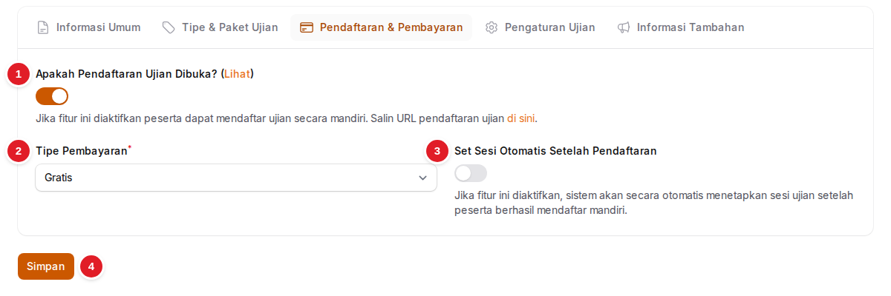
</Frame>

Tab ini menentukan apakah peserta boleh mendaftar sendiri dan apakah ujian gratis atau berbayar. Pengaturan pendaftaran dan pembayaran memerlukan add-on **Halaman Pendaftaran Ujian dan Pembayaran Otomatis**. Jika add-on belum aktif, label pengaturan menampilkan **(Add-on Tidak Aktif)** dan ujian berbayar tidak dapat disimpan.

1. **Apakah Pendaftaran Ujian Dibuka?** Aktifkan agar peserta dapat mendaftar ujian secara mandiri. Setelah diaktifkan, klik tautan **di sini** pada teks bantuan untuk menyalin URL pendaftaran ujian, lalu bagikan kepada calon peserta. Tautan **Lihat** menampilkan contoh halaman pendaftaran. Isian formulir, verifikasi, dan kuota pendaftaran diatur di [Formulir Pendaftaran Peserta](/data-ujian/membuat-formulir-pendaftaran).
2. **Tipe Pembayaran** Pilih salah satu tipe berikut:

   - **Gratis**: peserta tidak membayar.
   - **Sekali Bayar**: peserta membayar satu kali untuk seluruh tes dalam ujian. Contoh: biaya tryout Rp50.000 untuk semua subtes.
   - **Berbayar per Tes Ujian**: peserta membayar setiap tes yang ingin diikuti. Biaya diisi pada setiap tes ujian (lihat [Membuat Tes Ujian](/data-ujian/membuat-tes-ujian)).
   - **Berbayar per Level (Multi-Level)**: peserta membayar setiap level atau babak yang diikuti. Memilih tipe ini otomatis mengubah **Apakah Ujian Multi-Level?** menjadi **Ya (Multi-Level)**. Biaya diisi pada struktur level, lihat [Membuat Ujian Berjenjang](/data-ujian/membuat-ujian-berjenjang).
3. **Set Sesi Otomatis Setelah Pendaftaran** Aktifkan agar peserta yang berhasil mendaftar mandiri langsung dimasukkan ke sesi ujian. Pada tipe **Sekali Bayar** dan **Berbayar per Tes Ujian**, pengaturan ini bernama **Set Sesi Otomatis Setelah Pembayaran** dan berjalan setelah peserta membayar. Pengaturan ini tidak tersedia pada tipe **Berbayar per Level (Multi-Level)**. Jika masih ada tes tanpa sesi ujian, sistem menampilkan peringatan agar Anda menambahkan sesi terlebih dahulu.
4. Klik **Simpan**.

Jika Anda memilih **Sekali Bayar**, kolom **Biaya Ujian Sekali Bayar (IDR)** muncul. Isi biaya yang harus dibayar peserta, minimal Rp5.000. Pengaturan **Set Sesi Otomatis Setelah Pembayaran** baru dapat diaktifkan setelah biaya diisi.

<Frame>
  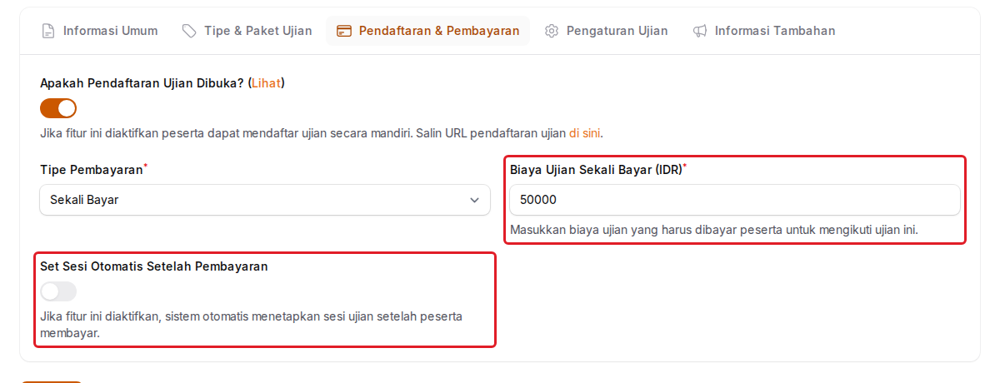
</Frame>

<Note>
  Jika Anda mengubah tipe pembayaran dari **Sekali Bayar** ke tipe lain, isian **Metode Pembayaran** pada formulir pendaftaran ujian otomatis dihapus.
</Note>

<Tip>
  Aktifkan **Set Sesi Otomatis Setelah Pendaftaran** jika Anda sering terlewat memasukkan peserta pendaftar ke sesi ujian.
</Tip>

### Pengaturan Ujian

<Frame>
  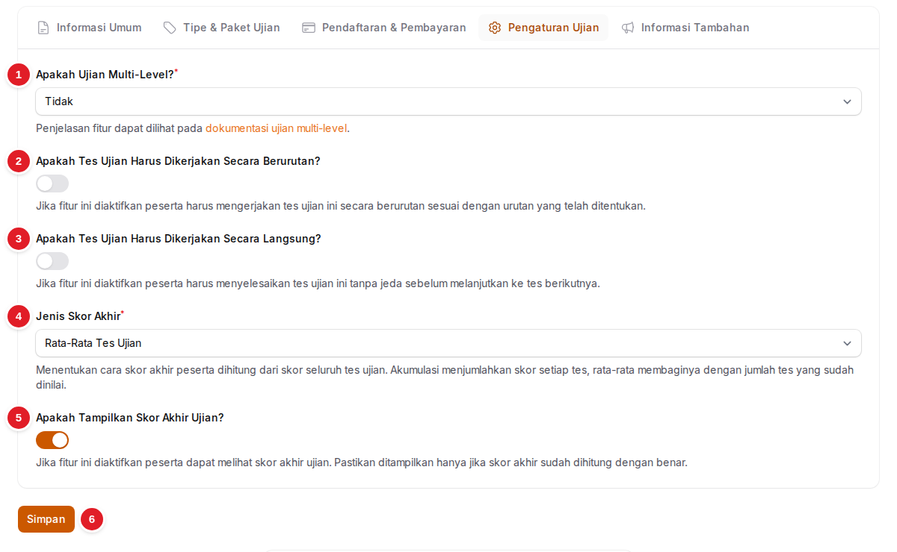
</Frame>

Tab ini menentukan aturan umum pengerjaan dan penghitungan skor akhir.

1. **Apakah Ujian Multi-Level?** Pilih **Ya (Multi-Level)** jika ujian dilaksanakan dalam beberapa babak, misalnya Penyisihan, Semifinal, dan Final. Pilih **Tidak** jika ujian hanya memiliki satu tahap, seperti tryout pada contoh ini. Pengaturan ini tidak dapat diubah setelah ujian memiliki peserta. Panduan lengkapnya ada di [Membuat Ujian Berjenjang](/data-ujian/membuat-ujian-berjenjang).
2. **Apakah Tes Ujian Harus Dikerjakan Secara Berurutan?** Jika diaktifkan, peserta harus mengerjakan tes sesuai urutan yang Anda tentukan. Urutan diatur dengan tombol **Ubah Urutan Tes Ujian** pada bagian **Daftar Tes Ujian**. Jika dinonaktifkan, peserta bebas memilih tes yang dikerjakan lebih dulu.
3. **Apakah Tes Ujian Harus Dikerjakan Secara Langsung?** Jika diaktifkan, peserta harus menyelesaikan tes tanpa jeda sebelum melanjutkan ke tes berikutnya. Jika dinonaktifkan, peserta boleh berhenti setelah satu tes dan melanjutkan tes lain selama jadwalnya masih berlaku.
4. **Jenis Skor Akhir** Cara skor akhir dihitung dari skor seluruh tes:
   - **Akumulasi Tes Ujian**: skor setiap tes dijumlahkan.
   - **Rata-Rata Tes Ujian** (bawaan): jumlah skor dibagi jumlah tes yang sudah dinilai.

   Contoh: skor Penalaran Matematika 80 dan Literasi Bahasa Indonesia 70 menghasilkan skor akhir 150 dengan akumulasi, atau 75 dengan rata-rata. Jika ujian sudah memiliki peserta, skor akhir seluruh peserta dihitung ulang setelah perubahan disimpan.
5. **Apakah Tampilkan Skor Akhir Ujian?** Aktifkan agar peserta dapat melihat skor akhir ujian. Aktifkan hanya jika skor akhir sudah dihitung dengan benar. Nonaktifkan jika nilai masih perlu diperiksa atau akan diumumkan kemudian.
6. Klik **Simpan**.

<Note>
  Jika ujian diatur sebagai **Ya (Multi-Level)**, pengaturan nomor 2 dan 3 tidak ditampilkan karena urutan pengerjaan dan penyelesaian langsung diatur pada setiap level.
</Note>

### Informasi Tambahan

<Frame>
  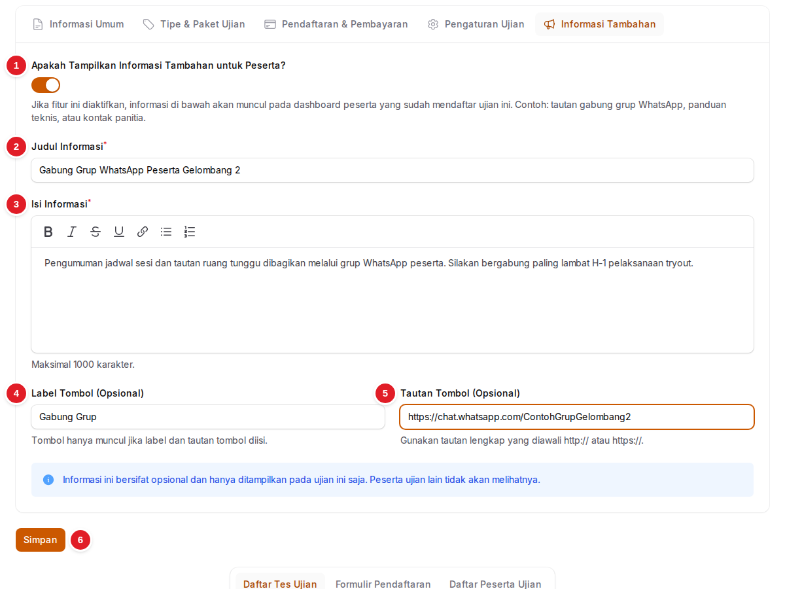
</Frame>

Tab opsional ini menampilkan informasi khusus di dasbor peserta yang sudah terdaftar pada ujian ini, misalnya tautan grup WhatsApp, panduan teknis, atau kontak panitia. Peserta ujian lain tidak melihat informasi ini.

1. **Apakah Tampilkan Informasi Tambahan untuk Peserta?** Aktifkan untuk menampilkan kolom lainnya.
2. **Judul Informasi** Maksimal 100 karakter. Contoh: **Gabung Grup WhatsApp Peserta Gelombang 2**.
3. **Isi Informasi** Maksimal 1.000 karakter. Anda dapat memakai huruf tebal, miring, tautan, dan daftar.
4. **Label Tombol (Opsional)** Teks tombol, maksimal 50 karakter. Contoh: **Gabung Grup**.
5. **Tautan Tombol (Opsional)** Tautan lengkap yang diawali `http://` atau `https://`. Tombol hanya muncul jika label dan tautan sama-sama diisi.
6. Klik **Simpan**.

Peserta melihat informasi tersebut di bagian atas halaman **Daftar Tes**:

<Frame>
  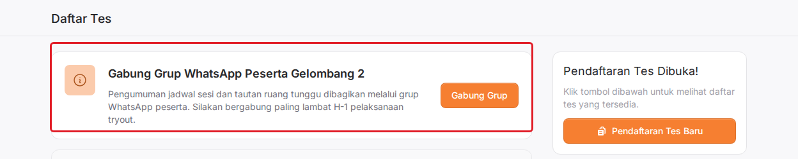
</Frame>

## Bagian lain pada halaman Detail Ujian

Di bawah tab pengaturan terdapat tiga bagian untuk melengkapi ujian:

<Frame>
  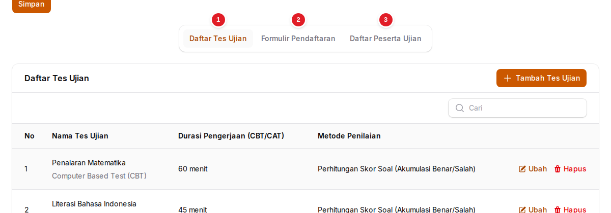
</Frame>

1. **Daftar Tes Ujian**: menambahkan dan mengatur tes. Lihat [Membuat Tes Ujian](/data-ujian/membuat-tes-ujian).
2. **Formulir Pendaftaran**: menyusun isian formulir pendaftaran mandiri. Lihat [Formulir Pendaftaran Peserta](/data-ujian/membuat-formulir-pendaftaran).
3. **Daftar Peserta Ujian**: menambahkan dan mengelola peserta. Lihat [Menambahkan Peserta Ujian](/data-ujian/menambahkan-peserta-ujian).

Di kanan atas halaman terdapat tiga tombol:

<Frame>
  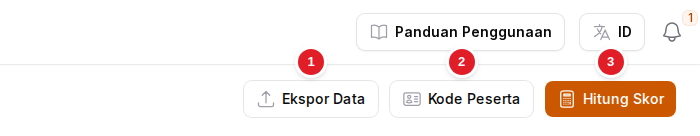
</Frame>

1. **Ekspor Data**: mengekspor hasil tes, link jawaban esai, analisis butir soal, dan template leaderboard ke Excel. Lihat [Hasil dan Ekspor Ujian](/data-ujian/hasil-dan-ekspor-ujian).
2. **Kode Peserta**: mengatur format kode peserta dan kode bidang per sesi. Lihat [Kode Peserta dan Kode Bidang](/data-ujian/kode-peserta).
3. **Hitung Skor**: menghitung ulang skor peserta, termasuk skor IRT. Lihat [Hasil dan Ekspor Ujian](/data-ujian/hasil-dan-ekspor-ujian#menghitung-ulang-skor).

Pada ujian multi-level, tombol **Atur Struktur Level Ujian** juga muncul di bagian ini.

## Mengelola ujian pada daftar Data Ujian

Klik **Lainnya** pada baris ujian untuk membuka tindakan tambahan:

<Frame>
  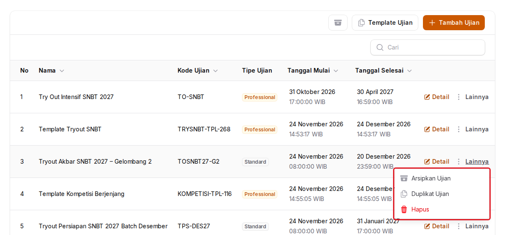
</Frame>

- **Arsipkan Ujian**: menyembunyikan ujian dari daftar dan mengunci seluruh datanya. Ujian yang diarsipkan dapat dilihat melalui tombol ikon arsip di samping **Template Ujian** (halaman **Arsip Ujian**) dan dikeluarkan dengan **Keluarkan dari Arsip**, tetapi datanya tetap terkunci dan tidak dapat diubah lagi.
- **Duplikat Ujian**: menyalin ujian beserta tes ujian, struktur level, formulir pendaftaran, kupon, dan berkas medianya. Proses berjalan di latar belakang dan Anda menerima notifikasi setelah selesai.
- **Hapus**: menghapus ujian. Ujian yang sudah mulai dikerjakan peserta tidak dapat dihapus.

<Warning>
  Mengarsipkan ujian mengunci seluruh datanya secara permanen, meskipun ujian dikeluarkan lagi dari arsip. Pastikan ujian sudah benar-benar selesai sebelum mengarsipkannya.
</Warning>

## Periksa kembali ujian Anda

<Check>
  - Nama, kode, dan jadwal ujian sudah benar.
  - Tipe ujian sesuai dengan jumlah tes, jumlah peserta serentak, dan fitur yang dibutuhkan.
  - Pendaftaran mandiri dan tipe pembayaran sudah sesuai.
  - Aturan pengerjaan dan jenis skor akhir sudah tepat.
  - Pengaturan tampilan skor akhir sudah diperiksa.
</Check>

Setelah pengaturan selesai, tambahkan tes ke dalam ujian:

<Card title="Membuat Tes Ujian" icon="arrow-right" horizontal href="/data-ujian/membuat-tes-ujian">
  Tambahkan tes ke dalam ujian yang sudah Anda buat.
</Card>
