Setelah ujian dan tesnya siap, langkah berikutnya adalah memasukkan peserta ke ujian. Halaman ini menjelaskan cara menambahkan peserta yang sudah memiliki akun maupun yang belum, serta cara mengelola daftar peserta ujian.

<Info>
  **Lokasi menu:** **Portal** → **Platform Ujian (CBT)** → **Manajemen Ujian** → **Data Ujian** → **Detail** pada ujian → bagian **Daftar Peserta Ujian**.
</Info>

Ada tiga cara memasukkan peserta ke ujian:

| Cara | Kapan dipakai |
| --- | --- |
| **Tambah Peserta** | Akun peserta sudah ada di **Data Akun**, misalnya dibuat melalui **Tambah Akun**, **Import Akun**, atau pendaftaran akun mandiri. |
| **Import Peserta** | Anda memiliki daftar peserta khusus untuk ujian ini. Akun dibuat sekaligus dimasukkan ke ujian. |
| Pendaftaran mandiri | Peserta mendaftar sendiri melalui tautan pendaftaran ujian. |

Sebagai contoh, admin **Bimbel Prestasi Nusantara** memasukkan peserta ke **Tryout Akbar SNBT 2027 – Gelombang 2**: lima siswa berlabel **Gelombang 2** yang akunnya sudah ada di **Data Akun**, ditambah empat siswa **Kelas Intensif** dari file Excel.

<Frame>
  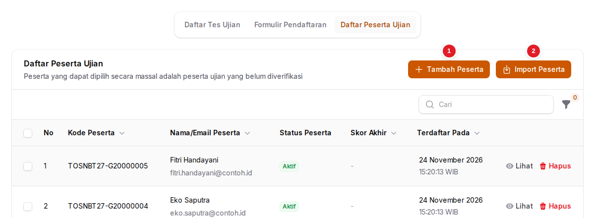
</Frame>

1. **Tambah Peserta**: memilih akun yang sudah ada.
2. **Import Peserta**: mengimpor peserta dari file Excel.

<Note>
  Peserta hanya dapat ditambahkan jika ujian sudah memiliki minimal satu tes. Pada ujian multi-level, semua tes harus sudah dipetakan ke struktur level.
</Note>

## Cara 1: Memilih akun dari Data Akun

Gunakan cara ini jika akun peserta sudah tersedia di **Platform Ujian (CBT)** → **Manajemen Akun** → **Data Akun** (data induknya ada di **Administrasi Aplikasi** → **Pengguna** → **Pengguna**). Cara membuat akun, baik satu per satu maupun melalui **Import Akun**, dijelaskan di [Menambahkan Akun Peserta](/data-akun/menambahkan-akun-peserta).

<Steps>
  <Step title="Klik Tambah Peserta">
    Pada bagian **Daftar Peserta Ujian**, klik **Tambah Peserta**. Jendela **Tambah Peserta** menampilkan semua akun di projek Anda beserta **Label**, **Status Ujian**, dan **Status Akun**.

    <Frame>
      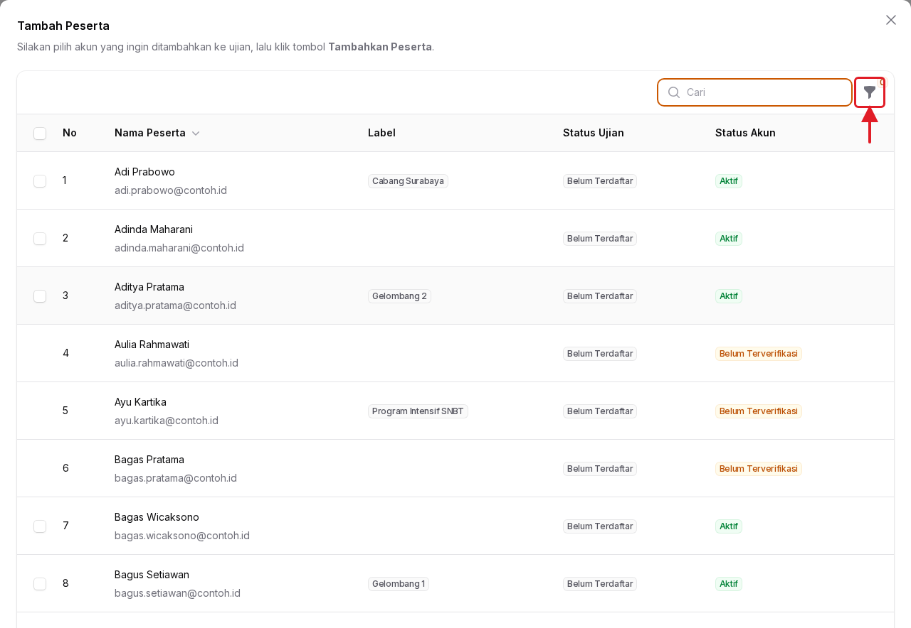
    </Frame>

    Hanya akun dengan **Status Akun** **Aktif** dan **Status Ujian** **Belum Terdaftar** yang memiliki kotak centang. Akun **Belum Terverifikasi** (peserta yang belum memverifikasi email) atau **Tidak Aktif** tidak dapat dipilih.
  </Step>
  <Step title="Saring akun dengan Filter">
    Jika akunnya banyak, klik ikon **Filter**, lalu atur:

    - **Label**: misalnya **Gelombang 2**. Pilih **Tanpa Label** untuk akun yang belum berlabel.
    - **Status Ujian**: pilih **Belum Terdaftar** agar hanya akun yang belum masuk ke ujian ini yang ditampilkan.

    Klik **Terapkan filter**. Anda juga dapat mencari nama peserta melalui kolom **Cari**.

    <Frame>
      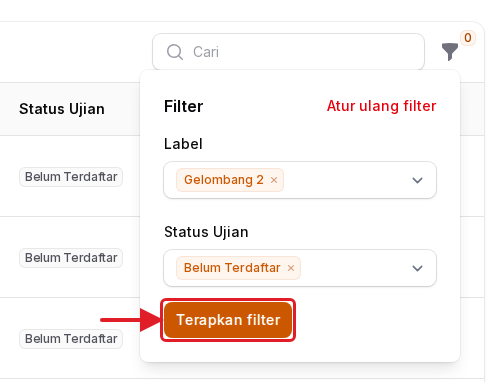
    </Frame>
  </Step>
  <Step title="Pilih peserta lalu klik Tambahkan Peserta">
    <Frame>
      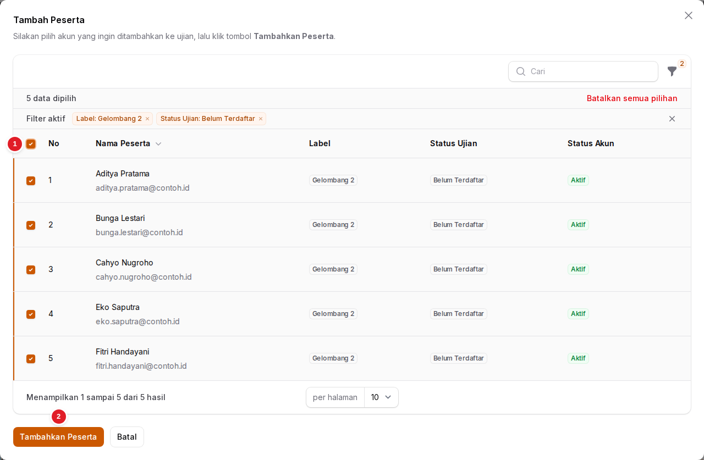
    </Frame>

    1. Centang akun yang akan dimasukkan. Centang kotak di judul kolom untuk memilih semua akun yang tampil, atau klik baris akun untuk memilihnya satu per satu.
    2. Klik **Tambahkan Peserta**.

    Penambahan diproses di latar belakang. Anda menerima notifikasi setelah proses selesai.
  </Step>
  <Step title="Periksa Daftar Peserta Ujian">
    Peserta yang berhasil ditambahkan muncul dengan **Status Peserta** **Aktif**. Sistem memberi setiap peserta **Kode Peserta**, secara bawaan berupa **Kode Ujian** diikuti 7 digit nomor urut. Formatnya dapat diatur, lihat [Kode Peserta dan Kode Bidang](/data-ujian/kode-peserta).

    <Frame>
      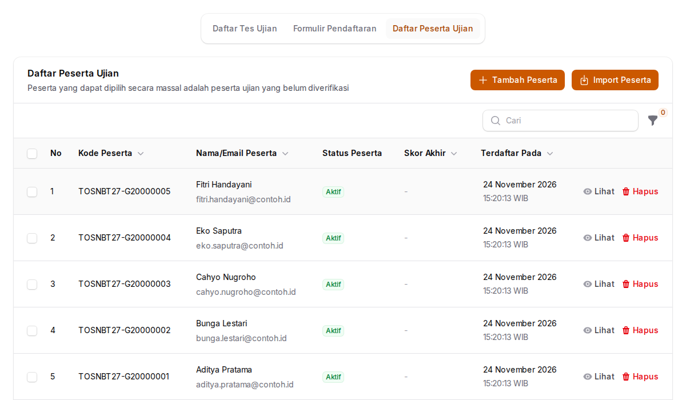
    </Frame>
  </Step>
</Steps>

## Cara 2: Mengimpor peserta dari file Excel

Gunakan cara ini jika Anda memiliki daftar peserta khusus untuk ujian ini. Sistem membuat akun peserta di **Data Akun** dan langsung memasukkannya ke ujian, sehingga Anda tidak perlu memakai **Tambah Peserta** lagi.

<Steps>
  <Step title="Klik Import Peserta dan unduh template">
    Pada bagian **Daftar Peserta Ujian**, klik **Import Peserta**, lalu klik **Unduh Template** untuk mendapatkan format Excel yang benar.

    <Frame>
      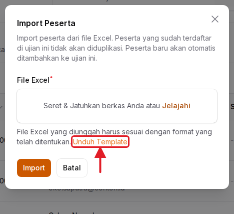
    </Frame>
  </Step>
  <Step title="Isi data peserta pada template">
    <Frame>
      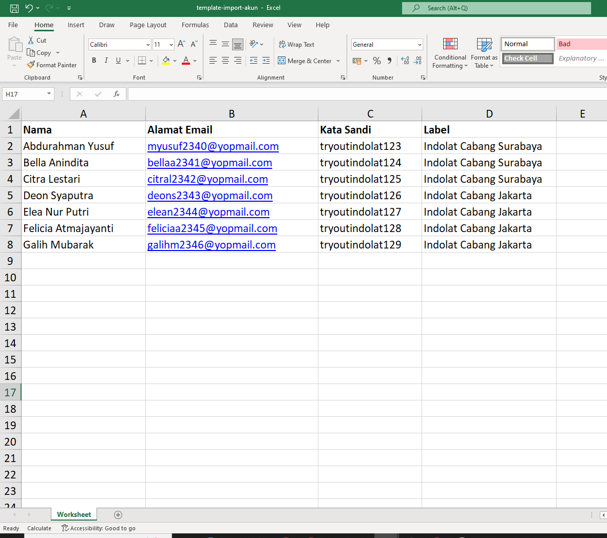
    </Frame>

    Template berisi empat kolom. Jangan mengubah judul kolom pada baris pertama.

    1. **Nama**: nama peserta.
    2. **Alamat Email**: email yang dipakai peserta untuk masuk. Setiap peserta harus memakai email yang berbeda.
    3. **Kata Sandi**: kata sandi untuk masuk.
    4. **Label** (opsional): penanda untuk mengelompokkan peserta, misalnya **Kelas Intensif**, **Gelombang 2**, atau **Cabang Surabaya**. Label yang belum ada akan dibuat otomatis.

    <Note>
      - Sistem tidak memeriksa apakah email benar-benar aktif, sehingga Anda dapat memakai email khusus ujian. Namun, formatnya harus berupa alamat email yang valid.
      - Baris yang tidak lengkap atau emailnya tidak valid dilewati, sedangkan baris lain tetap diimpor.
      - Akun hasil impor langsung aktif dan terverifikasi.
    </Note>

    <Warning>
      Jika email pada file sudah dipakai oleh akun di projek Anda, akun tersebut **tidak diduplikasi**, tetapi **nama, kata sandi, dan labelnya diperbarui** sesuai isi file, lalu akun dimasukkan ke ujian. Periksa kembali file Anda agar tidak mengubah akun peserta lain tanpa sengaja.
    </Warning>
  </Step>
  <Step title="Unggah file lalu klik Import">
    <Frame>
      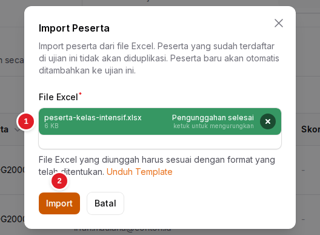
    </Frame>

    1. Unggah file `.xlsx` yang sudah diisi. Tunggu hingga muncul keterangan **Pengunggahan selesai**.
    2. Klik **Import**.

    Impor berjalan di latar belakang. Selama proses berjalan, kotak **Mengimpor Akun Peserta** di bagian atas halaman menampilkan kemajuannya. Setelah selesai, Anda menerima notifikasi berisi jumlah akun baru dan akun yang sudah terdaftar sebelumnya.
  </Step>
  <Step title="Periksa hasil impor">
    Peserta hasil impor muncul pada **Daftar Peserta Ujian** dengan status **Aktif**. Peserta yang sudah terdaftar di ujian ini tidak ditambahkan dua kali.

    <Frame>
      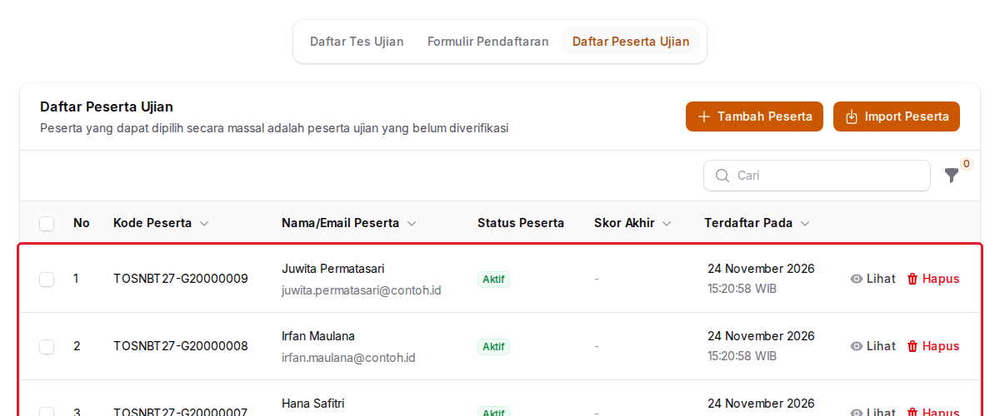
    </Frame>
  </Step>
</Steps>

## Cara 3: Pendaftaran mandiri oleh peserta

Peserta juga dapat mendaftar sendiri melalui tautan pendaftaran ujian:

1. Aktifkan **Apakah Pendaftaran Ujian Dibuka?** pada tab **Pendaftaran & Pembayaran** di halaman **Detail Ujian**, lalu salin URL pendaftaran ujian dari teks bantuannya. Lihat [Membuat Ujian](/data-ujian/membuat-ujian).
2. Susun isian formulir pendaftaran dan atur verifikasinya. Lihat [Formulir Pendaftaran Peserta](/data-ujian/membuat-formulir-pendaftaran).
3. Pendaftar yang perlu diverifikasi muncul di **Daftar Peserta Ujian** dengan status **Menunggu Verifikasi** (atau **Menunggu Pembayaran** pada ujian berbayar yang belum dibayar). Klik **Verifikasi Peserta** pada baris peserta untuk memeriksa isian formulirnya dan menyetujuinya, atau **Tolak & Hapus** untuk menolaknya.

<Note>
  Ujian yang dibuat dari kelas di modul **Learning Management System (LMS)** otomatis ditautkan ke kelas tersebut, dan peserta kelas langsung didaftarkan ke ujian.
</Note>

## Mengelola daftar peserta ujian

Tabel **Daftar Peserta Ujian** menampilkan **Kode Peserta**, **Nama/Email Peserta**, **Status Peserta**, **Skor Akhir**, dan **Terdaftar Pada**. Gunakan **Filter** untuk menyaring berdasarkan **Status Peserta** atau peserta yang **Memiliki Skor Akhir**.

Tombol pada setiap baris:

- **Lihat**: membuka detail akun dan hasil ujian peserta.
- **Unduh Laporan**: mengunduh laporan hasil peserta dalam format PDF setelah peserta menyelesaikan tes. Lihat [Hasil dan Ekspor Ujian](/data-ujian/hasil-dan-ekspor-ujian#mengunduh-laporan-hasil-peserta).
- **Verifikasi Peserta**: muncul untuk peserta berstatus **Menunggu Verifikasi**.
- **Hapus** (atau **Tolak & Hapus** untuk peserta yang menunggu verifikasi): mengeluarkan peserta dari ujian. Peserta yang sudah mulai mengerjakan tidak dapat dihapus.

Untuk mengelola beberapa peserta sekaligus, centang pesertanya lalu klik **Tindakan**:

<Frame>
  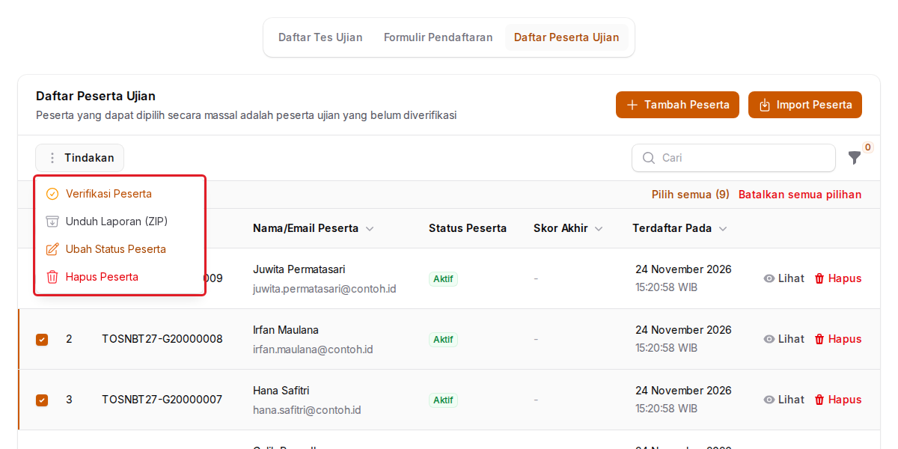
</Frame>

- **Verifikasi Peserta**: memverifikasi semua peserta terpilih yang menunggu verifikasi. Peserta yang masih menunggu pembayaran dilewati.
- **Unduh Laporan (ZIP)**: membuat arsip ZIP berisi laporan peserta terpilih.
- **Ubah Status Peserta**: mengubah status menjadi **Aktif**, **Ditangguhkan**, **Perlu Ditinjau**, atau **Selesai**.
- **Hapus Peserta**: mengeluarkan peserta terpilih dari ujian. Peserta yang sudah mulai mengerjakan dilewati.

<Warning>
  Menghapus peserta dari ujian juga menghapus pemasangan sesinya dan membatalkan transaksi pembayaran yang masih tertunda. Tindakan ini tidak dapat dibatalkan.
</Warning>

## Memasangkan peserta ke sesi ujian

Peserta yang sudah terdaftar **wajib dipasangkan ke sesi ujian** pada setiap tes agar dapat mulai mengerjakan. Ikuti panduan [Membuat Sesi Ujian](/data-ujian/membuat-sesi-ujian), atau aktifkan **Set Sesi Otomatis Setelah Pendaftaran** untuk peserta yang mendaftar mandiri.

Jika peserta belum memiliki sesi pada sebuah tes, tes tersebut tampil dengan status **Terkunci** di halaman **Daftar Tes** peserta:

<Frame>
  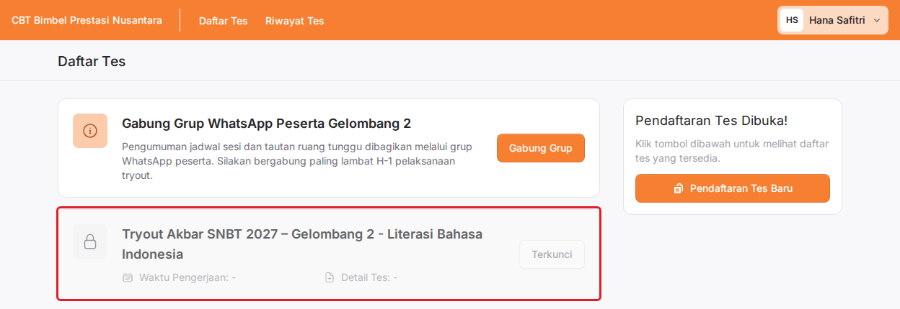
</Frame>
