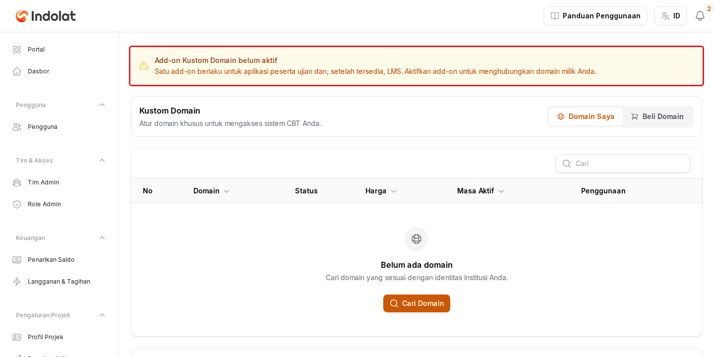
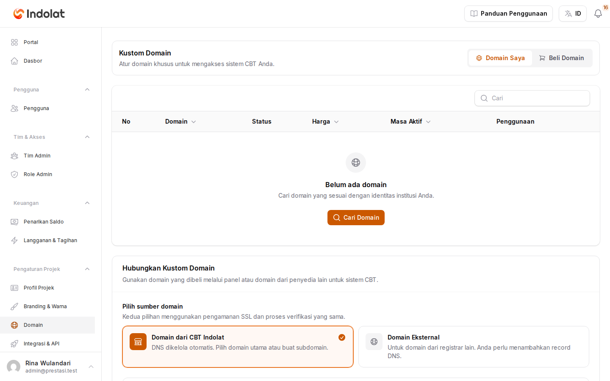
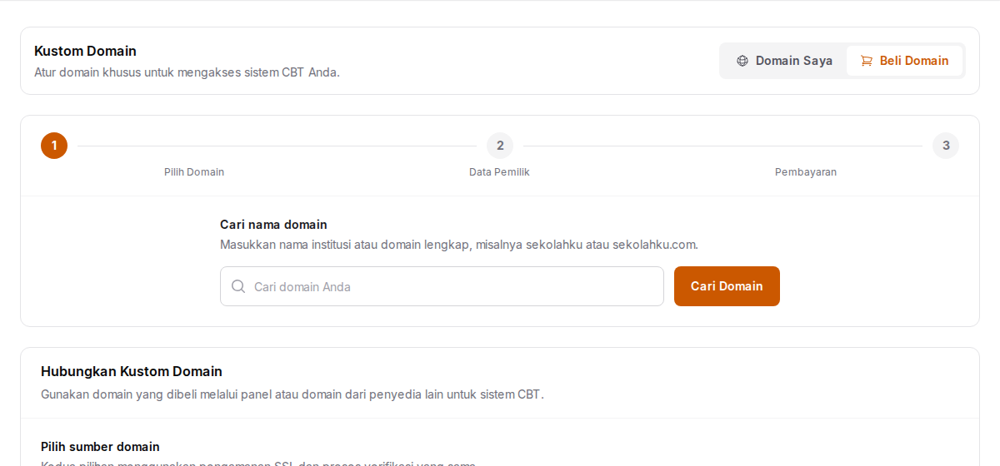
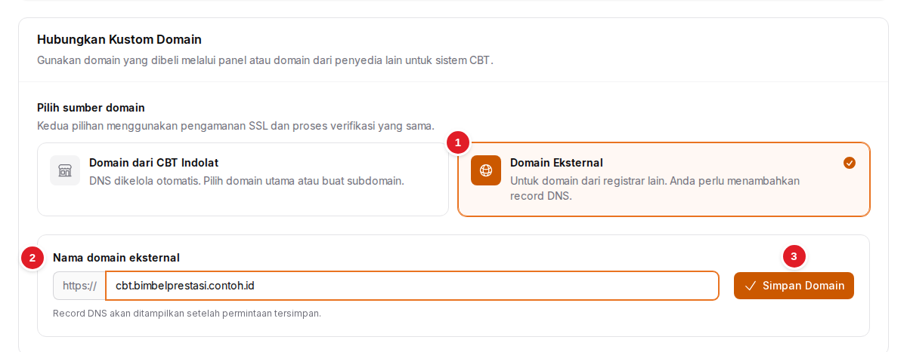

Every project automatically gets a default address built from its **Kode Projek** (project code). If you want participants to open the exam app at your institution's own address, for example `cbt.bimbelprestasi.sch.id`, connect a custom domain through the **Domain** menu.

<Info>
  **Menu location:** **Portal** → **Administrasi Aplikasi** → **Pengaturan Projek** → **Domain**.

  **Required role:** the project owner, or a team member whose role includes the **Domain** module.
</Info>

## Default addresses

Without a custom domain, the project is reachable at:

| Service | Default address | Example for code `prestasi` |
| --- | --- | --- |
| Participant exam app (CBT) | `https://<project-code>.indolat.web.id` | `https://prestasi.indolat.web.id/auth/login` |
| LMS | `https://lms.indolat.com/<project-code>` | `https://lms.indolat.com/prestasi` |

These addresses always work, including after a custom domain is connected or removed. To change them, change the **Kode Projek** in [Project Profile](/en/administrasi/profil-projek).

## The Kustom Domain add-on

Connecting a custom domain requires the **Kustom Domain** (custom domain) add-on (Rp100.000/year, or a bonus with yearly plans). One add-on covers the participant exam app and, once available, the LMS. While the add-on is inactive, the **Domain** page shows the **Add-on Kustom Domain belum aktif** warning and an **Aktifkan Add-on** button in the **Hubungkan Kustom Domain** section.

<Frame>
  
</Frame>

<Note>
  Custom domains for the LMS aren't available yet; the LMS keeps its default address. Website domains from **Pembuat Website** are connected from the website's own page, not from this menu.
</Note>

## The Domain page

<Frame>
  
</Frame>

- **Kustom Domain**: the domains bought through the panel (**Domain Saya**, my domains) and where you buy new ones (**Beli Domain**, buy domain). Table columns: **Domain**, **Status**, **Harga** (price), **Masa Aktif** (active period) and **Penggunaan** (usage). Available actions depend on the domain's status, including **Lanjutkan Pembayaran** (continue payment), **Perpanjang** (renew), **Beli Lagi** (buy again) and **Gunakan untuk CBT** (use for CBT).
- **Hubungkan Kustom Domain** (connect a custom domain): where you link a domain to the participant exam app.

## 1. Buy a domain through the panel (optional)

If your institution has no domain yet, you can buy one directly. DNS for domains bought through the panel is managed automatically.

<Frame>
  
</Frame>

<Steps>
  <Step title="Pilih Domain (choose a domain)">
    Click **Beli Domain** (or **Cari Domain**), type your institution name or a full domain, for example `bimbelprestasi` or `bimbelprestasi.com`, then click **Cari Domain** (search domain). The results show available domains with their first-year and renewal prices. Click **Pilih** (choose) on the domain you want.
  </Step>
  <Step title="Data Pemilik (owner details)">
    Fill in the **Data Pemilik Domain** the registrar needs, such as full name, email address, phone number and address. WHOIS information uses privacy protection where supported. Some domain extensions also ask for **Data Tambahan Registry** (extra registry data).
  </Step>
  <Step title="Pembayaran (payment)">
    Pick a **Metode Pembayaran** (payment method), check the **Ringkasan Pembayaran** (payment summary), then pay. If the **Kustom Domain** add-on isn't active, it's added to the order automatically. The domain is active for 1 year, and registration starts once the payment is verified.
  </Step>
</Steps>

<Note>
  If the registrar rejects a domain registration or renewal, the purchase amount is returned to the project's **Saldo Dapat Ditarik** (withdrawable balance). See [Transactions & Balance Withdrawal](/en/lainnya/transaksi-dan-penarikan-saldo).
</Note>

## 2. Connect a custom domain

Under **Pilih sumber domain** (choose domain source), pick one source. Both use the same SSL protection and verification process.

### Domain dari CBT Indolat

For a domain bought through the panel:

1. Click **Domain dari CBT Indolat** (domain from CBT Indolat).
2. Pick the domain under **Domain yang akan digunakan** (domain to use).
3. Pick the **Jenis alamat** (address type):
   - **Domain Utama** (root domain), for example `bimbelprestasi.com`. A root domain can only be used by one CBT or one website.
   - **Subdomain**, then fill in **Nama subdomain**, for example `cbt` for `cbt.bimbelprestasi.com`. Use lowercase letters, digits or hyphens without dots. One domain can have many subdomains.
4. Click **Gunakan Domain** (use domain), then **Ya, Gunakan Domain**. DNS records are created and kept up to date automatically.

### Domain Eksternal

For a domain bought from another registrar:

<Frame>
  
</Frame>

1. Click **Domain Eksternal** (external domain).
2. Fill in **Nama domain eksternal** (external domain name) without `https://`, for example `cbt.bimbelprestasi.contoh.id`.
3. Click **Simpan Domain** (save domain), then **Ya, Simpan Domain** in the confirmation window.

Once saved, the **Record DNS Domain Eksternal** section lists the records to add at your domain's DNS provider. Add all of them and turn off the proxy for CNAME records during verification. If the records aren't shown yet, reload the page a few minutes later.

## 3. Track the status and remove a domain

A connected domain appears at the top of **Hubungkan Kustom Domain** with one of these statuses:

| Status | Meaning |
| --- | --- |
| **Menunggu Verifikasi** (awaiting verification) | The domain is being verified. This usually finishes within minutes once DNS is correct. |
| **Aktif** (active) | The domain is ready. Click **Buka kustom domain** to try it. |
| **Perlu Tindakan** (action needed) | Verification failed. Check the DNS settings against the message shown, then resubmit. |
| **Verifikasi Dibatalkan** (verification cancelled) | The verification request was cancelled. Connect the domain again if you still want to use it. |

To stop using the custom domain, click **Lepas Domain** (remove domain), then **Ya, Lepas Domain**. Participants can still reach the app through the default address.

<Warning>
  Once the custom domain is active, share the new address with participants. Domain changes are rate-limited; if you change domains too often, the system asks you to try again later.
</Warning>
