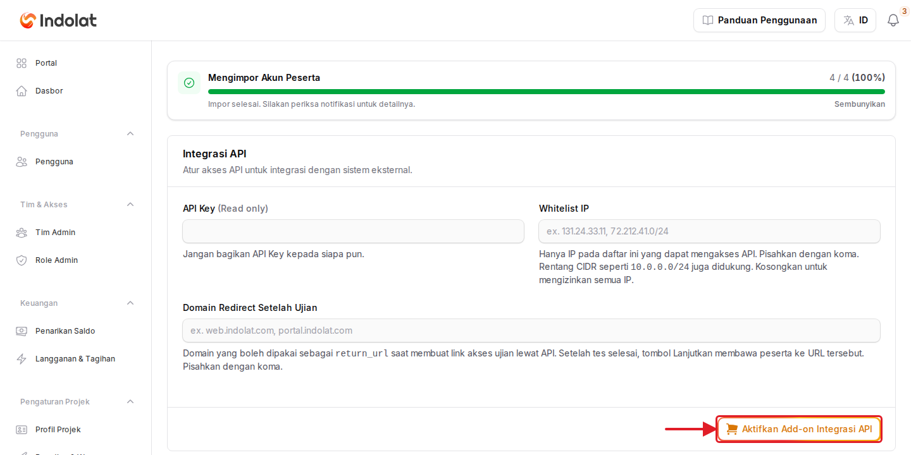
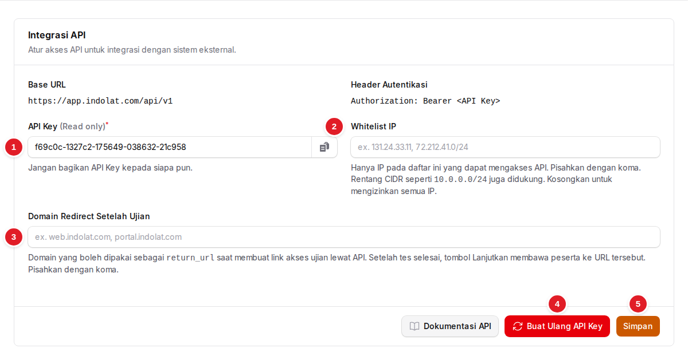
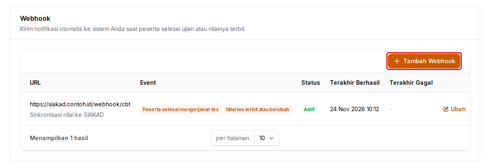
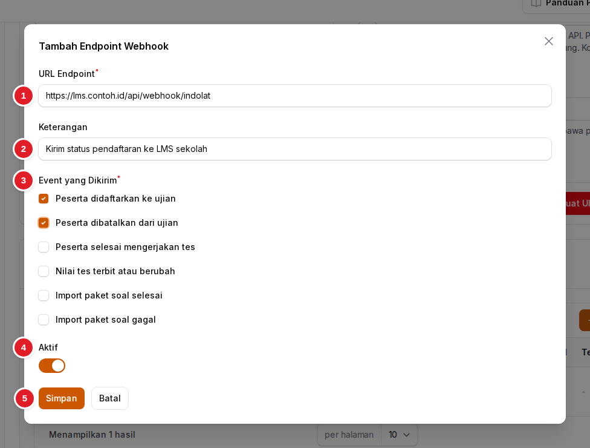

The **Integrasi & API** (Integrations & API) menu connects the project to your institution's other systems, such as an academic information system or a school LMS. Through the REST API, your system can manage participants, register them for exams, create exam links and pull exam results. Webhooks send automatic notifications to your system when something happens, for example when a participant finishes a test.

<Info>
  **Menu location:** **Portal** → **Administrasi Aplikasi** → **Pengaturan Projek** → **Integrasi & API**.

  **Required role:** the project owner, or a team member whose role includes the **Integrasi & API** module.
</Info>

Technical guides for every endpoint are in the **API Documentation** tab, starting with [API Authentication](/en/api/autentikasi) and [Webhook API](/en/api/webhook).

## The Integrasi API add-on

The API and webhooks only work while the **Integrasi API** (API integration) add-on (Rp200.000/year) is active. While it's inactive, the **Integrasi API** fields can't be edited, the **API Key** is hidden and the **Webhook** section doesn't appear. Click **Aktifkan Add-on Integrasi API** to go straight to the add-on purchase page.

<Frame>
  
</Frame>

## 1. Set up API access

Once the add-on is active, the **Integrasi API** section shows the connection details:

- **Base URL**: the API base address, `https://app.indolat.com/api/v1`.
- **Header Autentikasi** (authentication header): every request sends `Authorization: Bearer <API Key>`.

<Frame>
  
</Frame>

1. **API Key (Read only)**: the project's secret key. Click the copy icon at the end of the field to copy it. One API Key works for all of the project's APIs.
2. **Whitelist IP** (optional): IP addresses of servers allowed to call the API, separated by commas, for example `131.24.33.11, 72.212.41.0/24`. CIDR ranges are supported. Leave it empty to allow every IP.
3. **Domain Redirect Setelah Ujian** (post-exam redirect domains, optional): domains allowed as `return_url` when creating exam access links through the API, separated by commas, for example `siakad.bimbelprestasi.sch.id`. When the test ends, the **Lanjutkan** (continue) button takes the participant to that URL.
4. **Buat Ulang API Key** (regenerate API Key): creates a new API Key.
5. **Simpan** (Save): saves **Whitelist IP** and **Domain Redirect Setelah Ujian**.

The **Dokumentasi API** button opens the API documentation in a new tab.

<Warning>
  Once **Buat Ulang API Key** is confirmed, the old API Key stops working immediately. Update every integration that still uses it. Never share the API Key with anyone.
</Warning>

<Note>
  Invalid IP addresses or CIDR ranges are refused when saving, for example with *Alamat IP "..." tidak valid.*
</Note>

## 2. Add a webhook

The **Webhook** section lists the registered endpoints with the events they receive, their status, and the **Terakhir Berhasil** (last success) and **Terakhir Gagal** (last failure) delivery times.

<Frame>
  
</Frame>

<Steps>
  <Step title="Click Tambah Webhook">
    In the **Webhook** section, click **Tambah Webhook** (add webhook).
  </Step>
  <Step title="Fill in the endpoint">
    <Frame>
      
    </Frame>

    1. **URL Endpoint**: the full `https://` address on a public server that receives notifications, for example `https://lms.contoh.id/api/webhook/indolat`.
    2. **Keterangan** (description, optional): a label for the endpoint, for example `Kirim status pendaftaran ke LMS sekolah`.
    3. **Event yang Dikirim** (events sent): tick at least one event:
       - **Peserta didaftarkan ke ujian** (participant registered for an exam)
       - **Peserta dibatalkan dari ujian** (participant removed from an exam)
       - **Peserta selesai mengerjakan tes** (participant finished a test)
       - **Nilai tes terbit atau berubah** (test score published or changed)
       - **Import paket soal selesai** (question package import finished)
       - **Import paket soal gagal** (question package import failed)
    4. **Aktif** (active): leave it on so the endpoint receives notifications straight away.
    5. Click **Simpan**.
  </Step>
  <Step title="Save the signing secret">
    The **Webhook Berhasil Ditambahkan** notification shows the endpoint's *signing secret*. Copy it into your system to verify each notification's signature; it can't be viewed again.
  </Step>
</Steps>

<Note>
  A project can have at most 5 webhook endpoints. Webhooks are only sent while the **Integrasi API** add-on is active and the endpoint is **Aktif**. Signature verification is explained in [Webhook API](/en/api/webhook).
</Note>

## 3. Manage webhooks

Each endpoint row has these actions (scroll the table right if you can't see them):

- **Ubah** (Edit): changes the URL, description, events or active status.
- **Ganti Secret** (rotate secret): creates a new signing secret. The old secret stops working immediately, so update the signature check in your system.
- **Kirim Uji Coba** (send test): sends a test notification to an active endpoint. Check the result in **Riwayat** a moment later.
- **Riwayat** (history): shows the **Riwayat Pengiriman** (delivery history) for that endpoint.
- **Hapus** (Delete): deletes the endpoint.

The **Status** column shows **Aktif**, **Nonaktif** (inactive) or **Dinonaktifkan Sistem** (disabled by the system). An endpoint is disabled by the system after 10 consecutive failures; fix the receiving server, then switch it back on through **Ubah**.
