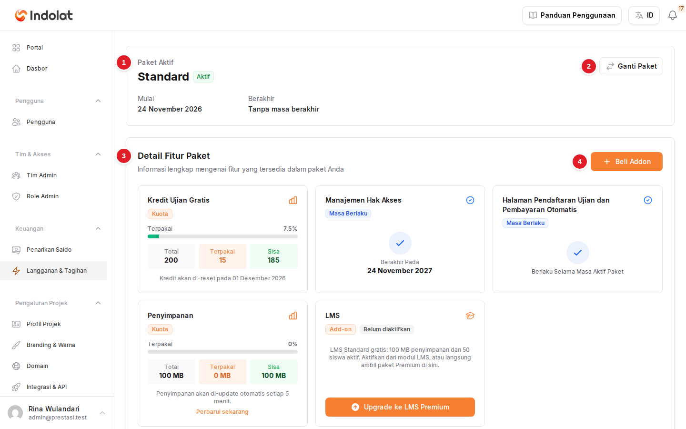
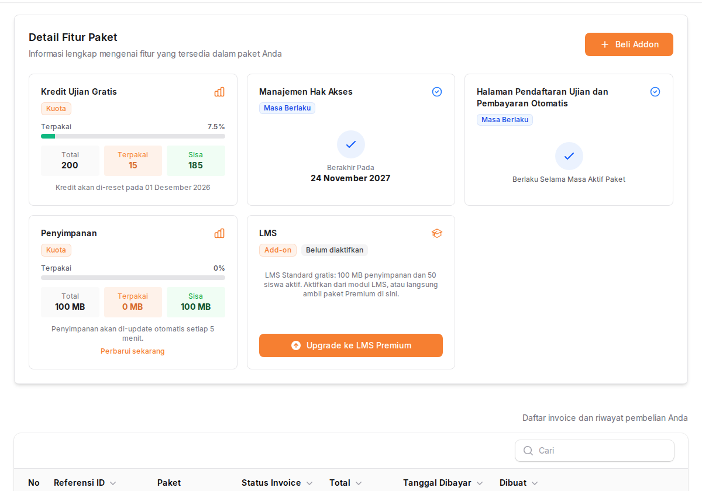
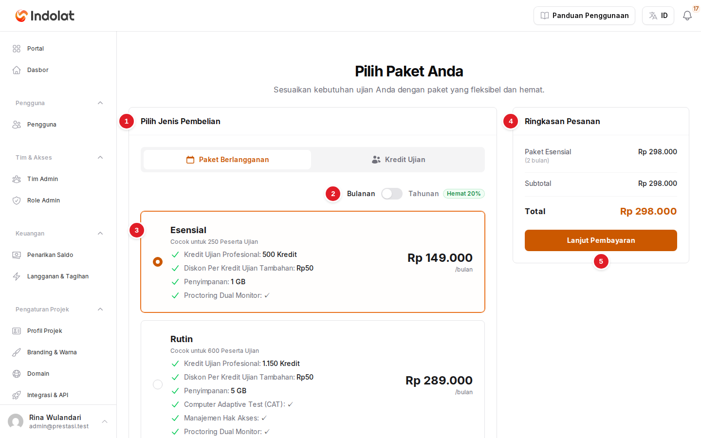
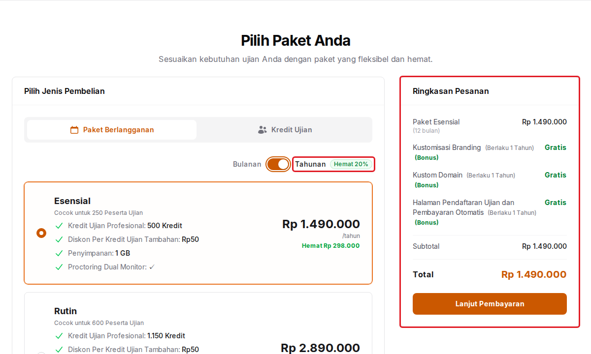
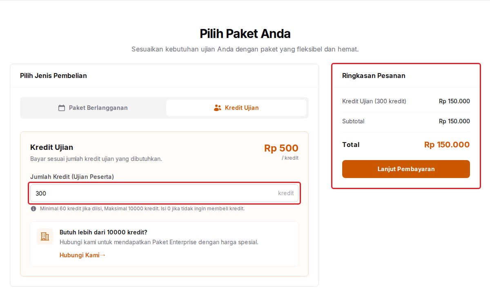
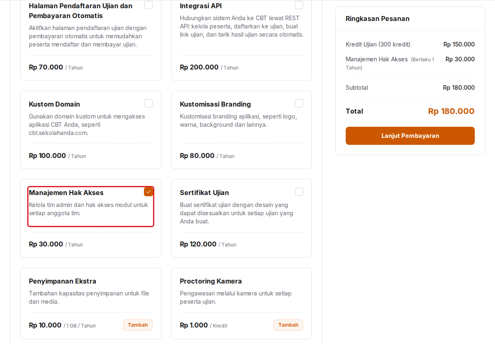
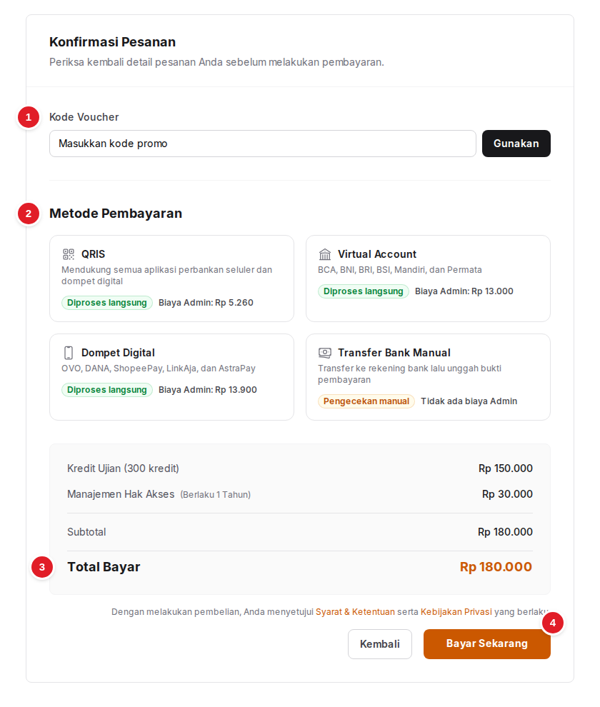
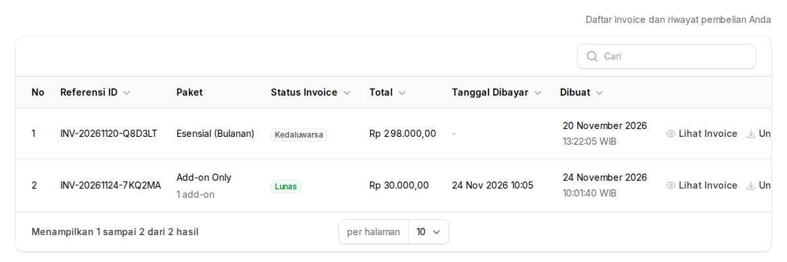

The **Langganan & Tagihan** (Subscription & Billing) menu shows the active plan, the remaining quota of each feature and the invoice history. It's also where you buy subscription plans, extra exam credits or add-ons.

<Info>
  **Menu location:** **Portal** → **Administrasi Aplikasi** → **Keuangan** → **Langganan & Tagihan**.

  **Required role:** the project owner, or a team member whose role includes the **Langganan & Tagihan** module.
</Info>

## Plan options

Every new project starts on the free **Standard** plan with no end date: **200 free exam credits** per month and **100 MB** of storage. One credit is used each time a participant starts one exam test. If you need more, there are three ways to add capacity:

| Option | Best for | Price |
| --- | --- | --- |
| **Paket Berlangganan** (subscription plan) | Institutions running exams every month | Esensial, Rutin or Intensif, billed monthly or yearly |
| **Kredit Ujian** (exam credits) | Occasional exams without a subscription | **Rp500 per credit**, 60 to 10,000 credits per purchase |
| **Add-on** | Adding a specific feature to any plan | Priced per add-on, valid for 1 year or per use |

Available subscription plans:

| Plan | Suited to | Professional exam credits | Storage | Extra features | Monthly | Yearly |
| --- | --- | --- | --- | --- | --- | --- |
| **Esensial** | 250 exam participants | 500 credits | 1 GB | Dual Monitor Proctoring | Rp149.000 | Rp1.490.000 |
| **Rutin** | 600 exam participants | 1,150 credits | 5 GB | Dual Monitor Proctoring, Computer Adaptive Test (CAT), Manajemen Hak Akses | Rp289.000 | Rp2.890.000 |
| **Intensif** | 1,400 exam participants | 2,800 credits | 20 GB | Dual Monitor Proctoring, Computer Adaptive Test (CAT), Manajemen Hak Akses | Rp699.000 | Rp6.990.000 |

Every subscription plan also gives a **Diskon Per Kredit Ujian Tambahan** (extra credit discount) of **Rp50**, so extra credits cost Rp450 each while the subscription is active.

<Note>
  For more than 10,000 credits, use the **Hubungi Kami** (contact us) link under **Kredit Ujian** to get an Enterprise plan at a special price.
</Note>

## 1. Check the active plan and quota

Open **Administrasi Aplikasi** → **Keuangan** → **Langganan & Tagihan**.

<Frame>
  
</Frame>

1. **Paket Aktif** (active plan): plan name, status, **Mulai** (start) date and **Berakhir** (end) date. The **Standard** plan shows *Tanpa masa berakhir* (no end date).
2. **Ganti Paket** (change plan): opens the purchase page to pick or upgrade a plan.
3. **Detail Fitur Paket** (plan feature details): the features and quotas active on the project.
4. **Beli Addon** (buy add-on): opens the purchase page for add-ons and credits only, without picking a plan.

The **Detail Fitur Paket** cards come in two kinds:

<Frame>
  
</Frame>

- Cards labelled **Kuota** (quota), such as **Kredit Ujian Gratis** (free exam credits) and **Penyimpanan** (storage), show **Total**, **Terpakai** (used) and **Sisa** (remaining) with a usage percentage. **Kredit Ujian Gratis** is refilled at the start of every month; the next refill date is shown below the card. Storage usage updates automatically every 5 minutes; click **Perbarui sekarang** (update now) to recalculate it immediately.
- Cards labelled **Masa Berlaku** (validity), such as the **Manajemen Hak Akses** add-on, show the **Berakhir Pada** (ends on) date, or *Berlaku Selama Masa Aktif Paket* (valid while the plan is active) when the feature comes with the plan.

The **LMS** card shows the project's LMS plan status. The free LMS Standard plan (100 MB storage and 50 active students) is activated from the LMS module; click **Upgrade ke LMS Premium** to buy the Premium plan.

## 2. Buy or upgrade a plan

<Steps>
  <Step title="Click Ganti Paket">
    On the **Paket Aktif** card, click **Ganti Paket**. The **Pilih Paket Anda** (choose your plan) page opens.

    <Frame>
      
    </Frame>

    1. **Pilih Jenis Pembelian** (purchase type): **Paket Berlangganan** or **Kredit Ujian**.
    2. The **Bulanan**/**Tahunan** (monthly/yearly) switch: the billing period.
    3. Plan cards: click **Esensial**, **Rutin** or **Intensif**.
    4. **Ringkasan Pesanan** (order summary): the breakdown and total due, updated whenever you change a choice.
    5. **Lanjut Pembayaran** (continue to payment): goes to the order confirmation.
  </Step>
  <Step title="Pick monthly or yearly">
    - **Bulanan** (monthly): the first purchase is at least **2 months**, then renewals are monthly. If the project already has an active paid subscription, the minimum is 1 month.
    - **Tahunan** (yearly): the price for 12 months, about 20% cheaper. The **Kustomisasi Branding**, **Kustom Domain** and **Halaman Pendaftaran Ujian dan Pembayaran Otomatis** add-ons are added automatically as a free **Bonus Tahunan** (yearly bonus).

    <Frame>
      
    </Frame>
  </Step>
  <Step title="Continue to payment">
    Click **Lanjut Pembayaran**, then follow [Complete the payment](#4-complete-the-payment).
  </Step>
</Steps>

## 3. Buy exam credits and add-ons

<Steps>
  <Step title="Enter the number of credits">
    On the **Pilih Paket Anda** page, click **Kredit Ujian**, then fill in **Jumlah Kredit (Ujian Peserta)** (number of credits), for example `300`. The **Ringkasan Pesanan** works out the total: 300 × Rp500 = **Rp150.000**.

    <Frame>
      
    </Frame>

    Enter `0` if you only want add-ons. Otherwise the amount must be between 60 and 10,000 credits.
  </Step>
  <Step title="Pick add-ons (optional)">
    Scroll to **Add-on Tambahan** and tick the add-ons you need. In the example, **Manajemen Hak Akses** is added, bringing the total to **Rp180.000**.

    <Frame>
      
    </Frame>

    | Add-on | Price | Notes |
    | --- | --- | --- |
    | **LMS Premium** | Rp150.000/month (12 months Rp1.500.000) | 5 GB storage and up to 250 active LMS students. Pick 1, 3, 6 or 12 months. |
    | **Halaman Pendaftaran Ujian dan Pembayaran Otomatis** | Rp70.000/year | Exam registration page with automatic payment. |
    | **Integrasi API** | Rp200.000/year | REST API and webhook access. See [Integrations & API](/en/administrasi/integrasi-dan-api). |
    | **Kustom Domain** | Rp100.000/year | Your own domain for the participant app. See [Domain](/en/administrasi/domain). |
    | **Kustomisasi Branding** | Rp80.000/year | Logo, colours and background of the participant app. |
    | **Manajemen Hak Akses** | Rp30.000/year | Admin Team and Admin Roles. See [Admin Access Management](/en/lainnya/manajemen-akses-admin). |
    | **Sertifikat Ujian** | Rp120.000/year | Custom-designed certificates for each exam. |
    | **Penyimpanan Ekstra** | Rp10.000 per 1 GB/year | Click **Tambah** (add) and set the amount. |
    | **Proctoring Kamera** | Rp1.000 per credit | Camera proctoring of participants. |
    | **Proctoring Layar** | Rp1.000 per credit | Screen proctoring of participants. |
    | **Jasper AI** | Rp10.000 per 300 questions | AI question generation. |

    Click **Beli Addon** on the **Langganan & Tagihan** page if you only want add-ons or credits without picking a plan.
  </Step>
  <Step title="Continue to payment">
    Click **Lanjut Pembayaran**. If no credits or add-ons are selected, the button is disabled and the summary shows **Pesanan Kosong** (empty order).
  </Step>
</Steps>

## 4. Complete the payment

After **Lanjut Pembayaran**, the **Konfirmasi Pesanan** (order confirmation) page shows the order breakdown.

<Frame>
  
</Frame>

1. **Kode Voucher** (voucher code): enter a promo code if you have one, then click **Gunakan** (apply).
2. **Metode Pembayaran** (payment method): pick one.
   - **QRIS**, **Virtual Account** (BCA, BNI, BRI, BSI, Mandiri and Permata) or **Dompet Digital** (e-wallets: OVO, DANA, ShopeePay, LinkAja and AstraPay): processed immediately, with the admin fee shown on each option.
   - **Transfer Bank Manual** (manual bank transfer): no admin fee. After choosing it, the destination account is shown; transfer the total, then upload the payment proof (JPG, PNG or PDF, max 5 MB). Payments are verified within 1 working day.
3. **Total Bayar** (amount due): the total including the payment method's admin fee.
4. **Bayar Sekarang** (pay now): creates the invoice and opens the payment page. Click **Kembali** (back) to change the order.

<Warning>
  Clicking **Bayar Sekarang** creates a new invoice. While an invoice is unpaid, you can't start a new payment; pay or cancel that invoice first.
</Warning>

The plan, credits or add-ons become active once the payment is verified.

## 5. Manage invoices

The purchase history is at the bottom of the **Langganan & Tagihan** page.

<Frame>
  
</Frame>

- **Referensi ID** (reference ID): the invoice number, for example `INV-20261124-7KQ2MA`.
- **Paket** (plan): the plan name and period, for example **Esensial (Bulanan)**, or **Add-on Only** with the number of add-ons below it.
- **Status Invoice**: **Pending**, **Lunas** (paid) or **Kedaluwarsa** (expired).
- **Bayar Sekarang**: shown on **Pending** invoices to reopen the payment page.
- **Lihat Invoice** (view invoice) and **Unduh PDF** (download PDF): open or download the invoice as a PDF.
