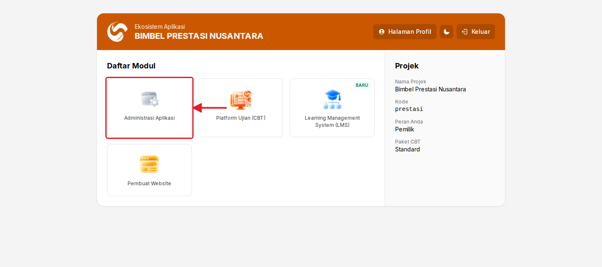
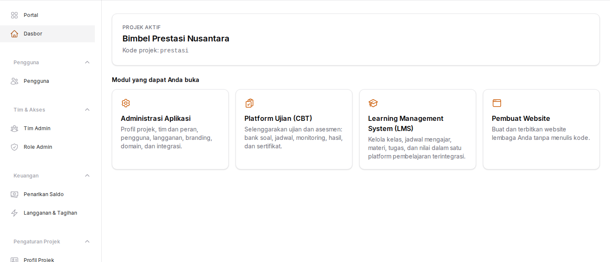
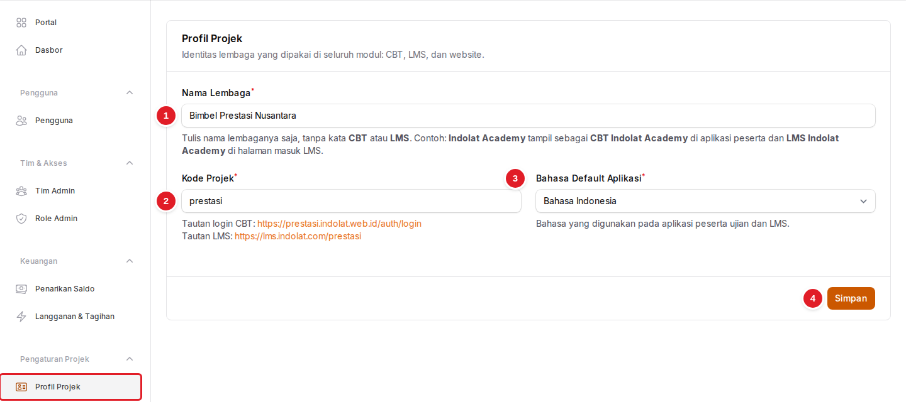

The **Administrasi Aplikasi** (Application Administration) module holds settings that apply to the whole project rather than a single product. This page covers the module's dashboard and the **Profil Projek** (Project Profile) menu, where you set the institution identity used by the CBT, the LMS and the website.

<Info>
  **Menu location:** **Portal** → **Administrasi Aplikasi** → **Pengaturan Projek** → **Profil Projek**.

  **Required role:** the project owner, or a team member whose role includes the **Profil Projek** module.
</Info>

## Open Administrasi Aplikasi

On the **Portal**, click the **Administrasi Aplikasi** tile under **Daftar Modul**.

<Frame>
  
</Frame>

You land on the **Dasbor Administrasi** (administration dashboard). It shows the active project and its code, plus **Modul yang dapat Anda buka** (modules you can open) cards as shortcuts to each module.

<Frame>
  
</Frame>

The **Administrasi Aplikasi** sidebar is grouped as follows:

| Group | Menu | Guide |
| --- | --- | --- |
| **Pengguna** | **Pengguna** | The project's participant accounts |
| **Tim & Akses** | **Tim Admin**, **Role Admin** | [Admin Access Management](/en/lainnya/manajemen-akses-admin) |
| **Keuangan** | **Penarikan Saldo** | [Transactions & Balance Withdrawal](/en/lainnya/transaksi-dan-penarikan-saldo) |
| | **Langganan & Tagihan** | [Subscription & Billing](/en/administrasi/langganan-dan-tagihan) |
| **Pengaturan Projek** | **Profil Projek** | This page |
| | **Branding & Warna** | [Website Appearance Customization](/en/lainnya/kustomisasi-tampilan-website) |
| | **Domain** | [Domain](/en/administrasi/domain) |
| | **Integrasi & API** | [Integrations & API](/en/administrasi/integrasi-dan-api) |

The **Portal** item at the top of the sidebar takes you back to the Portal to switch modules.

## Change the project profile

<Steps>
  <Step title="Open Profil Projek">
    Click **Pengaturan Projek** → **Profil Projek** in the sidebar.
  </Step>
  <Step title="Edit the project details">
    <Frame>
      
    </Frame>

    1. **Nama Lembaga** (institution name): the institution name only, without the words *CBT* or *LMS*, 3–43 characters, and without `<` or `>`. The system adds its own prefix: **Bimbel Prestasi Nusantara** appears as **CBT Bimbel Prestasi Nusantara** in the participant app and **LMS Bimbel Prestasi Nusantara** on the LMS sign-in page.
    2. **Kode Projek** (project code): the project's unique code, at least 4 characters, using lowercase letters, digits and hyphens only. It forms the default addresses shown under the field:
       - **Tautan login CBT** (CBT login link), for example `https://prestasi.indolat.web.id/auth/login`;
       - **Tautan LMS** (LMS link), for example `https://lms.indolat.com/prestasi`.

       The links update as you type, so you can check the new address before saving.
    3. **Bahasa Default Aplikasi** (default app language): **Bahasa Indonesia** or **English**. It's used by the participant exam app and the LMS.
    4. Click **Simpan** (Save).
  </Step>
</Steps>

<Warning>
  Changing the **Kode Projek** immediately changes the participant login address, the LMS address and the exam registration link. Links you've already shared stop working, so announce the new address to participants. A code already used by another project or website is refused with *Kode projek sudah digunakan.*
</Warning>

<Note>
  In the **Platform Ujian (CBT)** module, **Lainnya** → **Pengaturan Aplikasi** shows the institution name and project code as read-only information, with an **Ubah di Profil Projek** link that opens this page. Participant login settings are covered in [Participant Login](/en/lainnya/login-peserta).
</Note>
