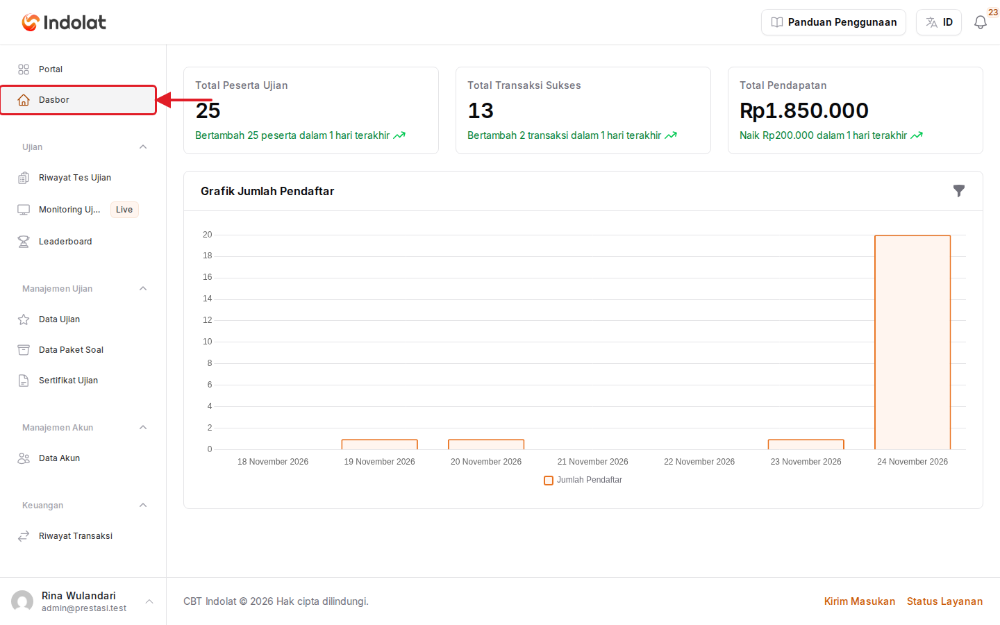
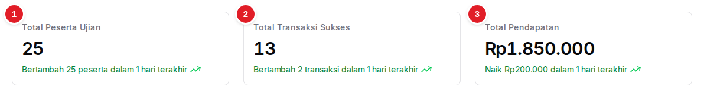
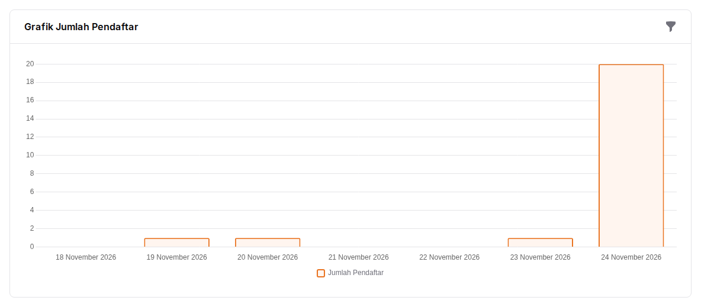
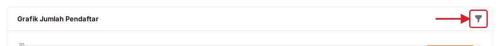
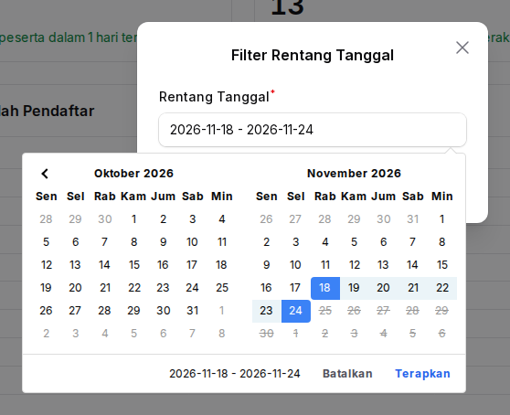
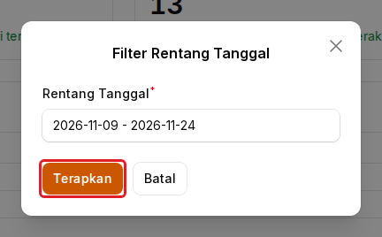
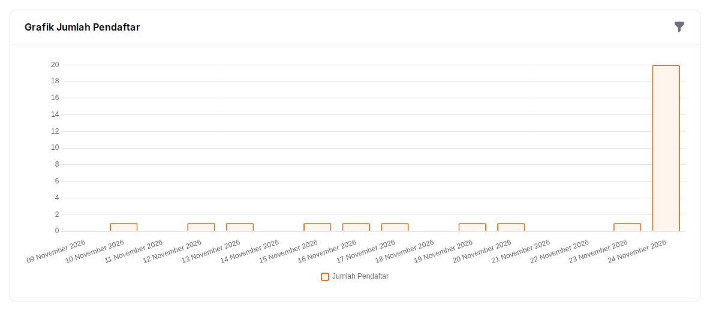

The **Dasbor** (Dashboard) page is the first page you see when you open the **Platform Ujian (CBT)** module. It summarises project activity in three statistic cards and one registrations chart, so you can follow how your exams are doing without opening other menus.

<Info>
  **Menu location:** **Portal** → **Platform Ujian (CBT)** → **Dasbor**. The page is shown to admins who have access to the CBT Dashboard. Opening a module from the Portal is explained in [Mengenal Portal dan Modul](/en/memulai/mengenal-portal-dan-modul).
</Info>

## Opening the Dashboard

Click the **Platform Ujian (CBT)** tile on the Portal. You are taken straight to the **Dasbor**. From any other CBT menu, click **Dasbor** in the sidebar to return to this page.

<Frame>
  
</Frame>

## Statistic cards

The top of the Dashboard shows three cards.

<Frame>
  
</Frame>

1. **Total Peserta Ujian** (total exam participants): the number of participant accounts registered for exams, counted once per account even if the account takes several exams. Registrations still waiting for verification or suspended are not counted.
2. **Total Transaksi Sukses** (successful transactions): the number of exam payment transactions with a successful status.
3. **Total Pendapatan** (total revenue): the total amount of all successful transactions, in rupiah.

The line under each number shows today's change, for example **Bertambah 2 transaksi dalam 1 hari terakhir** or **Naik Rp200.000 dalam 1 hari terakhir**. When nothing has changed, it shows **Tidak ada perubahan**.

<Note>
  Archived or deleted exams are not counted in the statistic cards. Individual transactions are listed under **Riwayat Transaksi**; see [Transaksi dan Penarikan Saldo](/en/lainnya/transaksi-dan-penarikan-saldo).
</Note>

## Registrations chart

**Grafik Jumlah Pendaftar** (registrations chart) shows the number of new participant accounts per day. By default it shows the last seven days, including today.

<Frame>
  
</Frame>

It counts participant accounts created on each date, whether through self-registration or added one by one by an admin. Accounts imported from an Excel file are not counted. If nobody registered in the selected range, the chart shows **Belum ada pendaftar**.

### Changing the chart date range

<Steps>
  <Step title="Click the filter icon">
    Click the funnel icon (**Filter rentang tanggal**) at the top right of the chart.

    <Frame>
      
    </Frame>
  </Step>
  <Step title="Choose a date range">
    In the **Filter Rentang Tanggal** window, click the **Rentang Tanggal** field. In the calendar, click the start date and then the end date. Dates after today cannot be selected. Click **Terapkan** in the calendar.

    <Frame>
      
    </Frame>
  </Step>
  <Step title="Apply the filter">
    Click **Terapkan** (Apply) in the **Filter Rentang Tanggal** window.

    <Frame>
      
    </Frame>

    The chart is updated for the selected range.

    <Frame>
      
    </Frame>
  </Step>
</Steps>

<Tip>
  The date range only applies while the page is open. When you open the Dashboard again, the chart returns to the last seven days.
</Tip>

## When the Dashboard is empty

Admins who have not been given access to any other menu in the project see the message **Belum ada modul yang bisa diakses** on the Dashboard. Ask the project owner to grant the access you need. Admin access is explained in [Manajemen Akses Admin](/en/lainnya/manajemen-akses-admin).
