The **Leaderboard** menu is used to build participant rankings from exam results. An active leaderboard appears automatically in the participant CBT app (the **Peringkat** menu) and in the LMS during its display period.

<Info>
  **Menu location:** **Portal** → **Platform Ujian (CBT)** → **Ujian** → **Leaderboard**.
</Info>

The examples on this page use the leaderboard **Peringkat Tryout Mingguan Penalaran – Pekan 3** for the exam **Tryout Mingguan Penalaran – Pekan 3**, which has two subtests: **Penalaran Umum** and **Esai Penalaran**.

<Note>
  Rankings are not updated in real time. A ranking is built when the leaderboard is generated and then stored. Results that come in afterwards only appear after you run **Generate Ulang** (regenerate).
</Note>

## Creating a leaderboard

<Steps>
  <Step title="Click Buat Leaderboard">
    Open the **Leaderboard** menu and click **Buat Leaderboard** (create leaderboard).

    <Frame>
      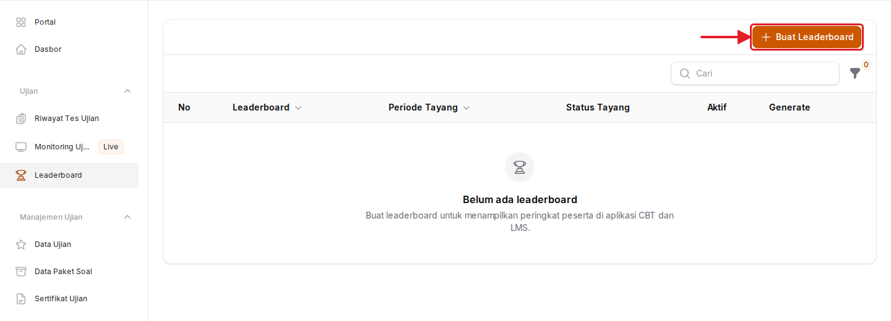
    </Frame>
  </Step>
  <Step title="Fill in Informasi Leaderboard">
    <Frame>
      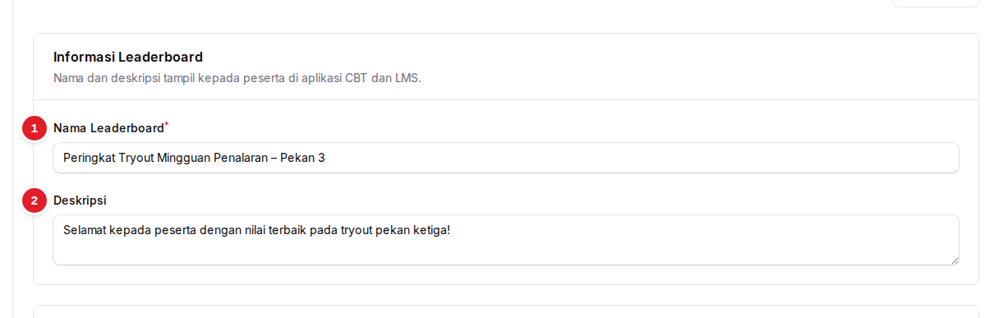
    </Frame>

    1. **Nama Leaderboard**: the name shown to participants. Example: **Peringkat Tryout Mingguan Penalaran – Pekan 3**.
    2. **Deskripsi** (optional): a short message shown under the leaderboard name in the participant app.
  </Step>
  <Step title="Set Sumber Nilai (score source)">
    <Frame>
      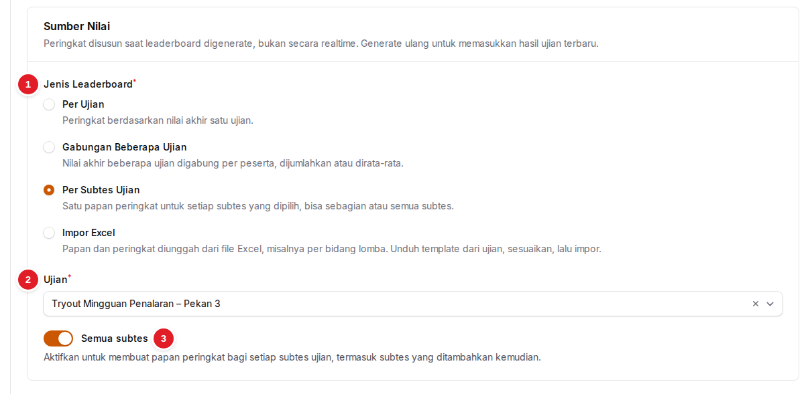
    </Frame>

    1. **Jenis Leaderboard** (leaderboard type): where the scores come from.
       - **Per Ujian**: ranking by the final score of one exam.
       - **Gabungan Beberapa Ujian**: the final scores of several exams are combined per participant. Choose at least two exams in **Ujian**, then set **Cara Menggabungkan Nilai**: **Jumlah Nilai Akhir** (sum) or **Rata-Rata Nilai Akhir** (average). Participants are matched by the same account in every exam.
       - **Per Subtes Ujian**: one ranking board for each selected subtest (exam test).
       - **Impor Excel**: boards and ranks are uploaded from an Excel file, for example one board per competition field. See [Leaderboard from an Excel file](#leaderboard-from-an-excel-file).
    2. **Ujian**: the source exam. Example: **Tryout Mingguan Penalaran – Pekan 3**.
    3. Extra settings depending on the type:
       - **Semua subtes** (all subtests, type **Per Subtes Ujian**): turn on to create a board for every subtest, including subtests added later.
       - **Hanya peserta yang menyelesaikan seluruh tes** (only participants who finished every test, types **Per Ujian** and **Gabungan Beberapa Ujian**): when on, participants who have not finished every subtest are left out.

    When **Semua subtes** is off, tick the subtests that get a board in the **Subtes** list. Click **Pilih semua** to tick them all. Subtests scored as Psikotes are not listed because they do not produce a score.

    <Frame>
      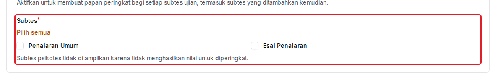
    </Frame>
  </Step>
  <Step title="Set Penayangan (display)">
    <Frame>
      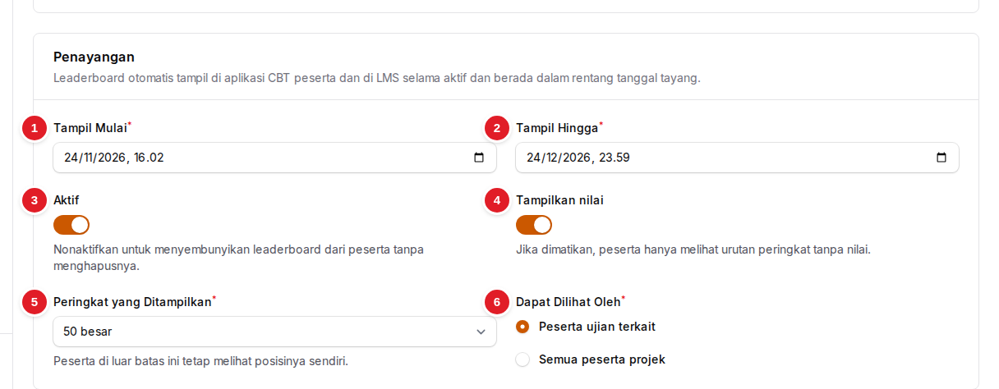
    </Frame>

    1. **Tampil Mulai**: when the leaderboard starts showing to participants. The default is now.
    2. **Tampil Hingga**: when it stops showing. It must be after **Tampil Mulai**. The default is 30 days from now.
    3. **Aktif**: turn off to hide the leaderboard from participants without deleting it.
    4. **Tampilkan nilai** (show scores): when off, participants only see the order of ranks without scores.
    5. **Peringkat yang Ditampilkan** (ranks shown): **10 besar**, **20 besar**, **50 besar**, **100 besar**, or **Semua peringkat** (all ranks). Participants outside this limit still see their own position.
    6. **Dapat Dilihat Oleh** (visible to): **Peserta ujian terkait** (only participants of the source exam) or **Semua peserta projek** (all participants of the project).
  </Step>
  <Step title="Save">
    Click **Buat**. The leaderboard is generated straight away and you are taken to its ranking page. Click **Buat & buat lainnya** to go on to the next leaderboard.
  </Step>
</Steps>

## Who gets ranked

- Only participants whose exam registration is verified and not suspended.
- Only finished tests that have a score. Essay tests are ranked once they are scored; see [manual scoring](/en/cbt/riwayat-tes-ujian#giving-a-manual-score-to-an-essay-test).
- Participants with the same score share a rank and are listed by name. The next rank is skipped, for example 1, 2, 3, 3, 5.

## Leaderboard list

The **Leaderboard** page lists every leaderboard in the project.

<Frame>
  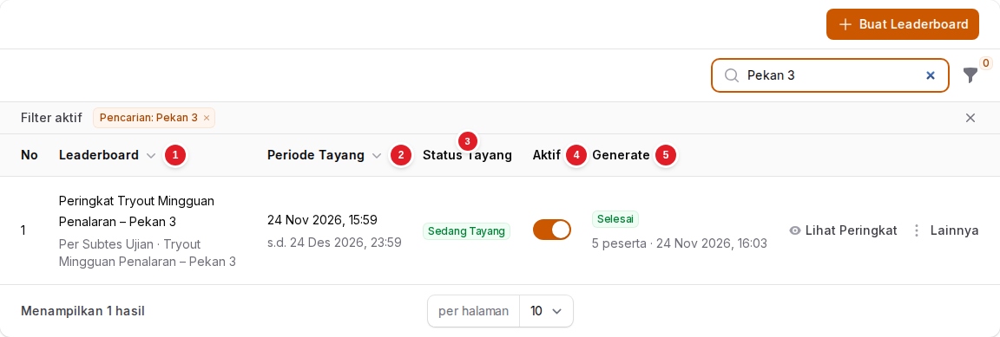
</Frame>

1. **Leaderboard**: the leaderboard name, with its type and exam below it.
2. **Periode Tayang** (display period): **Tampil Mulai** and **Tampil Hingga**.
3. **Status Tayang** (display status):
   - **Sedang Tayang**: active, generated, and within the display period.
   - **Terjadwal**: the display period has not started yet.
   - **Berakhir**: the display period is over.
   - **Belum Digenerate**: the ranking has never been built.
   - **Nonaktif**: the **Aktif** switch is off.
4. **Aktif**: a switch to show or hide the leaderboard straight from the list.
5. **Generate**: the ranking build status (**Menunggu Antrean**, **Sedang Diproses**, **Selesai**, or **Gagal**), the number of participants, and the last generated time. While a build is running, the list refreshes automatically.

Use the **Jenis Leaderboard** and **Aktif** filters to narrow the list.

### The Lainnya menu

Click **Lainnya** (more) on a leaderboard row.

<Frame>
  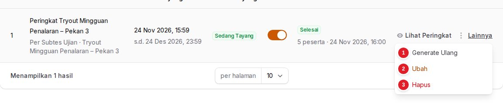
</Frame>

1. **Generate Ulang**: rebuild the ranking from the latest exam results.
2. **Ubah** (edit): change the leaderboard settings. If you change the score source (type, exam, or subtests), the ranking is regenerated automatically after saving.
3. **Hapus** (delete): delete the leaderboard.

For **Impor Excel** leaderboards, this menu also has **Impor Ulang Excel** (re-import Excel).

### Refreshing the ranking (Generate Ulang)

Click **Lainnya** → **Generate Ulang**, then click **Generate**. Participants see the new ranking once the build is finished.

<Frame>
  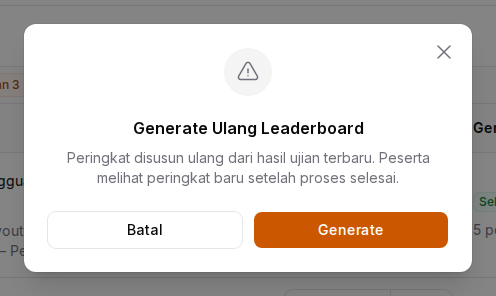
</Frame>

<Tip>
  Run **Generate Ulang** after every participant has finished, after essay tests are scored, or after you reset a participant's test.
</Tip>

## Viewing the ranking

Click **Lihat Peringkat** (view ranking) on the leaderboard row. The **Ringkasan Leaderboard** (summary) section shows the name, type, exam, display status, display period, last generated time, number of participants, generate status, and who can see it. **Generate Ulang** and **Ubah** are also available at the top right.

<Frame>
  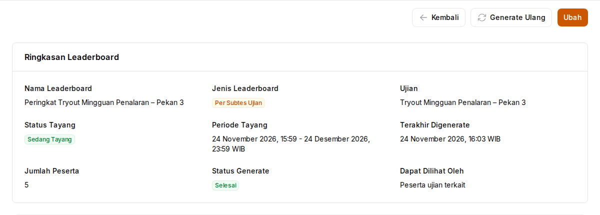
</Frame>

The **Peringkat Peserta** section has the columns **Peringkat** (rank), **Nama Peserta** (with participant code), **Nilai** (score), and **Selesai Ujian** (finished at). In the example, Daffa Alfarizi and Galih Prasetyo Utomo both scored 15, so both are ranked 3 and the next rank is 5.

<Frame>
  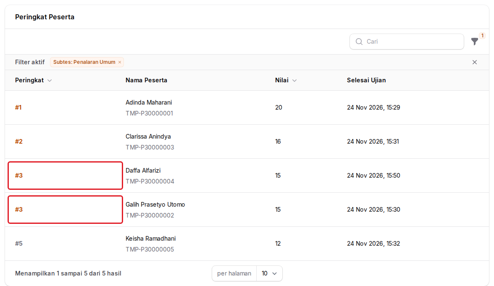
</Frame>

For **Per Subtes Ujian** leaderboards, use the **Subtes** filter to switch boards.

<Frame>
  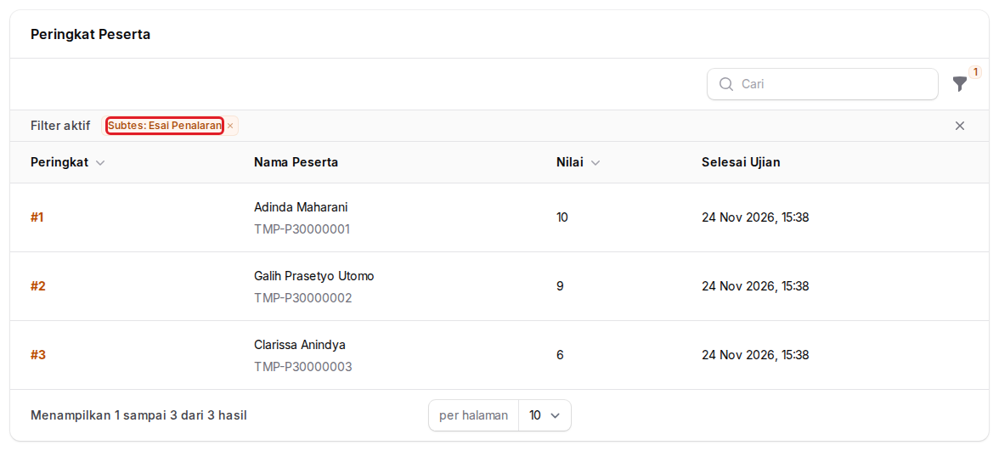
</Frame>

## Leaderboard from an Excel file

The **Impor Excel** type suits rankings you compile yourself, for example per competition field.

1. Download the template from the exam detail page: **Ekspor Data** → **Template Leaderboard**. See [Hasil dan Ekspor Ujian](/en/data-ujian/hasil-dan-ekspor-ujian). The template can also be downloaded with **Unduh Template** on the upload field in the leaderboard form.
2. Adjust the content. File columns: **Papan** (board), **Kode Peserta**, **Email**, **Nama**, **Skor**, **Waktu Selesai**, and **Peringkat** (optional).
3. In the leaderboard form, choose **Impor Excel**, choose the **Ujian**, and upload the file in **File Excel Peringkat** (.xlsx).

Participants are matched by email, then by participant code. Fill in **Peringkat** on every row of a board to use your own ranks; otherwise ranks are calculated from the scores, and equal scores are ordered by the earliest **Waktu Selesai**. If any row is invalid, nothing is imported. To replace the ranking, use **Lainnya** → **Impor Ulang Excel**; the whole ranking is replaced by the content of the new file.

## What participants see

A leaderboard that is on display appears under the **Peringkat** menu in the participant CBT app. Its card shows the type, number of participants, display end date, and **Peringkat Anda** (your rank).

<Frame>
  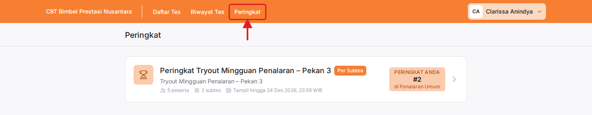
</Frame>

After opening the card, participants see their own position, a top-three podium, and the list of the following ranks. For **Per Subtes Ujian** leaderboards, they switch boards with the subtest buttons at the top.

<Frame>
  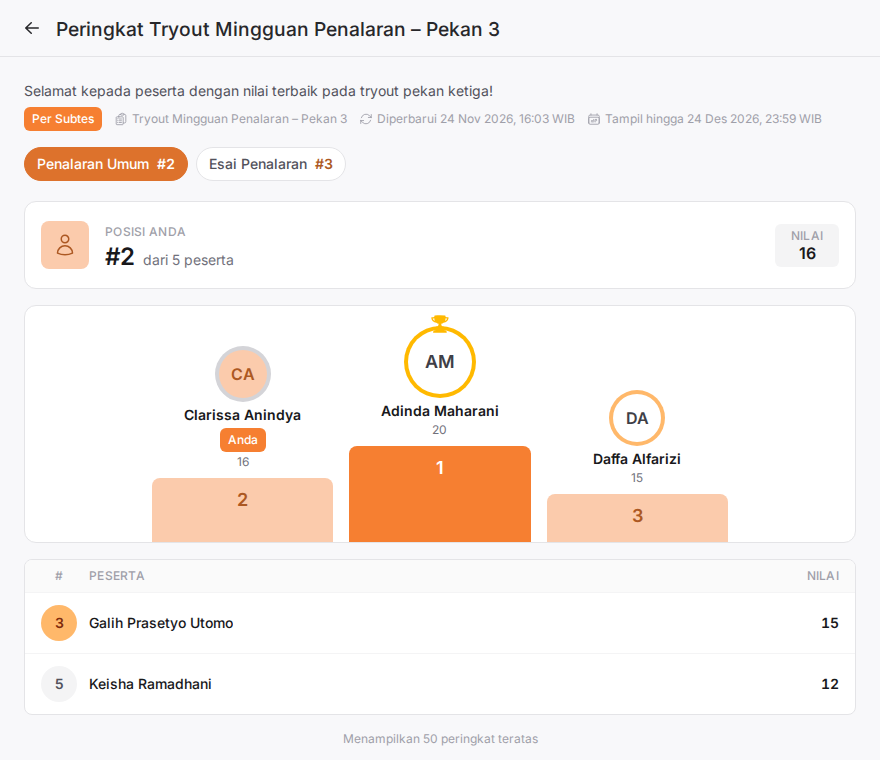
</Frame>
