The **Monitoring Ujian** (Exam Monitoring) menu shows the participants of ongoing exams in real time. You can see who is taking a test, how much time they have left, and whether cheating was detected, and then act: send a notice, suspend the exam, or stop it.

<Info>
  **Menu location:** **Portal** → **Platform Ujian (CBT)** → **Ujian** → **Monitoring Ujian**. The menu has a **Live** label in the sidebar. Finished tests are listed in [Riwayat Tes Ujian](/en/cbt/riwayat-tes-ujian).
</Info>

The examples on this page use the exam **Tryout Mingguan Penalaran – Pekan 3**. When the screenshots were taken, Rafi Hidayatullah was taking the **Penalaran Umum** test, while Daffa Alfarizi and Keisha Ramadhani had not started the **Esai Penalaran** test.

## Who is listed

Each row is one participant in one exam. A participant is listed when:

- the exam has not passed its **Tanggal Selesai** (end date) and is not archived, and
- the participant still has a test that is not finished, whether in progress or not yet started.

Participants who have finished every test of the exam are no longer listed. Participants who are taking a test come first, ordered by the earliest start time. The table refreshes automatically every 10 seconds, so there is no need to reload the page.

<Frame>
  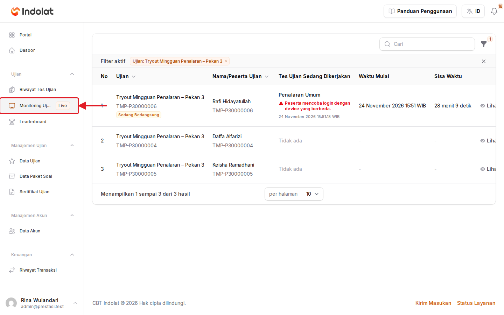
</Frame>

## What each column means

<Frame>
  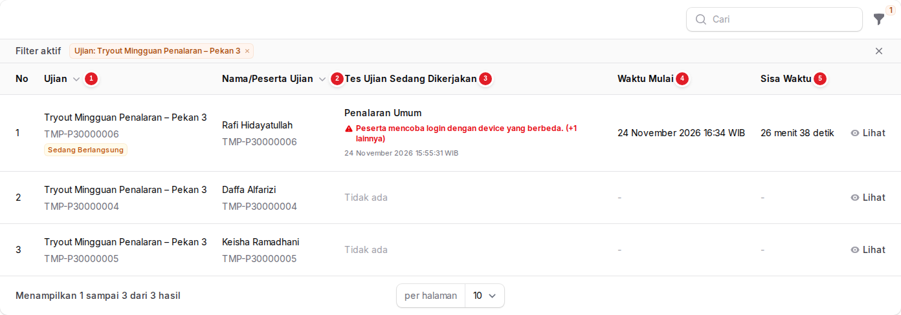
</Frame>

1. **Ujian**: exam name and participant code. A status label appears below it:
   - **Sedang Berlangsung** (yellow, in progress): the participant is taking a test.
   - **Ditangguhkan** (red, suspended): an admin has suspended the participant's exam.
   - No label: the participant has not started the remaining test.
2. **Nama/Peserta Ujian**: participant name and code.
3. **Tes Ujian Sedang Dikerjakan** (test in progress): the test being taken, or **Tidak ada** (none) if the participant has not started. If cheating was detected, the latest message is shown with a red warning icon, for example **Peserta mencoba login dengan device yang berbeda.** (the participant tried to sign in on a different device), with the time it happened. When there are more records, the number of other records is shown in brackets, for example *(+2 lainnya)*.
4. **Waktu Mulai**: when the participant started the test.
5. **Sisa Waktu** (time left): the remaining time, counted as the test duration from the start time, or until the exam session ends if that comes first. For essay tests, the time left runs until the session ends. When time is up, the column shows **Waktu Habis** in red.

<Note>
  Cheating messages come from the supervision settings active on the test, such as detecting another device. Supervision settings are explained in [Membuat Tes Ujian](/en/data-ujian/membuat-tes-ujian).
</Note>

## Filtering participants

Click the funnel icon at the top right of the table to open the **Filter** panel.

<Frame>
  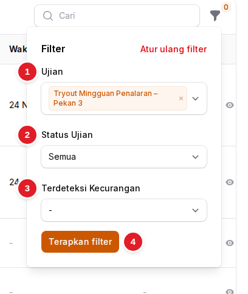
</Frame>

1. **Ujian**: choose one or more ongoing exams.
2. **Status Ujian**: **Sedang Mengerjakan Ujian** for participants taking a test, or **Tidak Mengerjakan Ujian** for participants who have not started their remaining test.
3. **Terdeteksi Kecurangan**: **Ya** to show only participants whose running test has a cheating record, **Tidak** for the opposite.
4. Click **Terapkan filter**.

Use the **Cari** field to search by exam name or participant name.

## Opening a participant's detail

Click **Lihat** on the participant's row. If the table is wider than the screen, scroll the table to the right to find this button.

<Frame>
  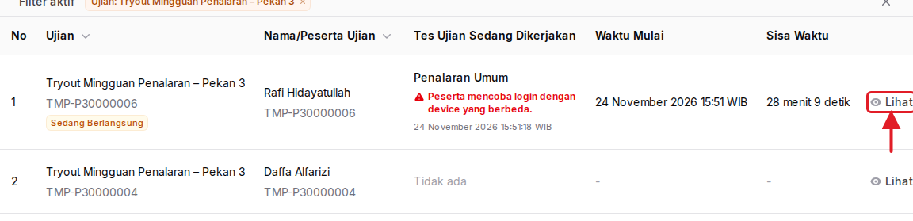
</Frame>

The detail page is the same as in Test History: participant information, **Log Peserta & Ujian**, and **Jawaban Peserta**. For a participant who is taking a test, the information section also shows **Sisa Waktu**, and **Jawaban Peserta** shows the questions answered so far (unanswered ones are marked **Belum**). The sections are explained in [Riwayat Tes Ujian](/en/cbt/riwayat-tes-ujian#viewing-a-test-result).

## Admin actions during an exam

When a participant is taking a CBT or CAT test, an **Aksi Admin** (admin actions) box appears to the right of the participant information.

<Frame>
  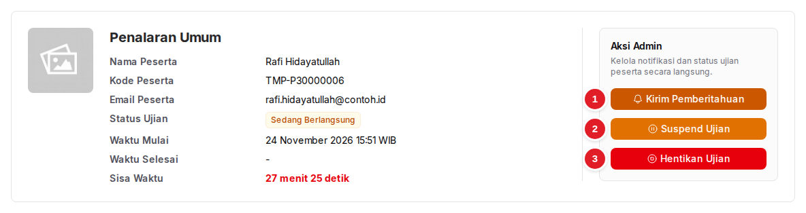
</Frame>

1. **Kirim Pemberitahuan** (send notice): sends a message that appears immediately on the participant's exam screen.
2. **Suspend Ujian**: pauses the participant's exam for a while.
3. **Hentikan Ujian** (stop exam): ends the participant's exam right away.

<Note>
  For **Esai / Upload File (Jawaban Manual)** tests, the **Aksi Admin** box only contains **Beri Skor Manual**. See [Riwayat Tes Ujian](/en/cbt/riwayat-tes-ujian#giving-a-manual-score-to-an-essay-test).
</Note>

### Sending a notice

Click **Kirim Pemberitahuan**, write the message in the window, then click **Kirim** (send). The message appears on the participant's screen as a notice, for example to remind them of the time left.

<Frame>
  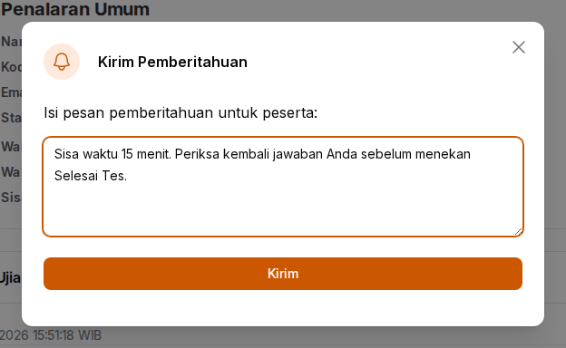
</Frame>

### Suspending an exam (Suspend Ujian)

Use **Suspend Ujian** when a participant needs to pause, for example while the proctor checks their identity or there is a disturbance in the room.

<Steps>
  <Step title="Choose the suspend type">
    Click **Suspend Ujian**, then choose one option:

    - **Suspend dengan durasi** (timed suspend): the participant resumes automatically when the time runs out. Pick a duration under **Pilih Durasi Cepat** (5, 10, 15, 30, or 60 minutes) or fill in **Durasi Manual (menit)**.
    - **Suspend sampai dibuka lagi** (suspend until reopened): the participant waits until an admin clicks **Lanjutkan Ujian**.

    <Frame>
      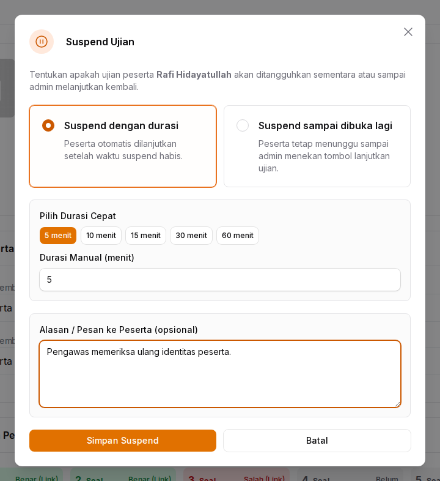
    </Frame>
  </Step>
  <Step title="Enter a reason and save">
    Fill in **Alasan / Pesan ke Peserta (opsional)** (reason or message to the participant). The reason is shown to the participant. Click **Simpan Suspend**.
  </Step>
</Steps>

After saving, **Status Ujian** changes to **Sedang Ditangguhkan**, and the information section shows **Suspend Dimulai**, **Suspend Sampai**, and **Alasan Suspend**. The **Suspend Ujian** button changes to **Lanjutkan Ujian** (resume exam).

<Frame>
  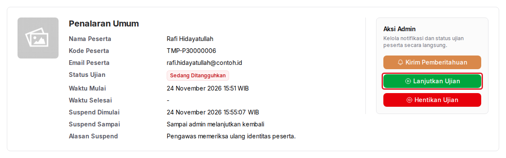
</Frame>

In the Monitoring Ujian list, the participant gets the **Ditangguhkan** label.

<Frame>
  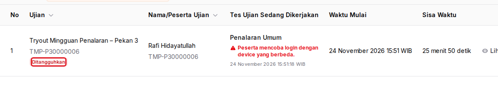
</Frame>

On the participant's screen, a **Tes Ditangguhkan** window appears with the reason and the time limit, and the participant cannot answer questions until the exam is resumed.

<Frame>
  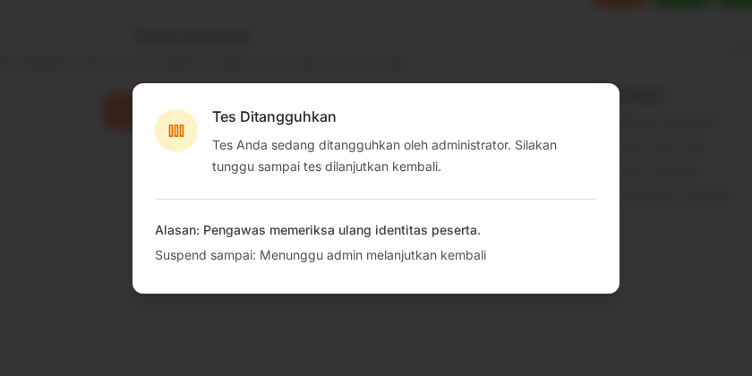
</Frame>

### Resuming an exam

Click **Lanjutkan Ujian**, then click **Ya, Lanjutkan Ujian**. The participant can answer questions again straight away. A timed suspend also ends automatically when its duration runs out.

<Frame>
  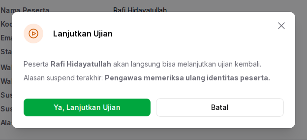
</Frame>

<Note>
  If the participant has no time left, **Lanjutkan Ujian** is not available and the page shows **Ujian tidak dapat dilanjutkan karena sisa waktu peserta sudah habis.**
</Note>

Every suspend and resume is recorded in **Log Peserta & Ujian** with the admin's email and the reason.

### Stopping an exam

Click **Hentikan Ujian**, check the participant's name in the confirmation window, then click **Ya, Hentikan Ujian**.

<Frame>
  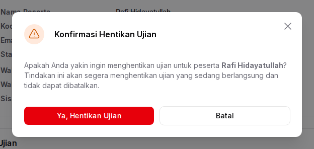
</Frame>

<Warning>
  **Hentikan Ujian** ends the participant's test immediately and cannot be undone. The saved answers are scored as if the participant had clicked **Selesai Tes**, and the result moves to [Riwayat Tes Ujian](/en/cbt/riwayat-tes-ujian). If the participant needs to retake the test, use **Reset Ujian** in Riwayat Tes Ujian.
</Warning>
