The **Riwayat Tes Ujian** (Test History) menu lists every exam test that participants have finished in your project, across all exams. From this page you can look up a participant's result, open the answer details and activity log, score essay tests, reset a test so the participant can take it again, and export the history to Excel.

<Info>
  **Menu location:** **Portal** → **Platform Ujian (CBT)** → **Ujian** → **Riwayat Tes Ujian**. Participants who are still taking a test are not listed here; follow them in [Exam Monitoring](/en/cbt/monitoring-ujian). Per-exam actions (exporting the results of all participants, calculating scores, participant reports) are covered in [Exam Results and Exports](/en/data-ujian/hasil-dan-ekspor-ujian).
</Info>

The examples on this page use the exam **Tryout Mingguan Penalaran – Pekan 3** (code **TMP-P3**) with two tests: **Penalaran Umum** (CBT, five multiple-choice questions) and **Esai Penalaran** (Esai / Upload File, one essay question).

## Test history list

Click **Riwayat Tes Ujian** in the sidebar. Each row is one test finished by one participant. The most recent results are at the top. Use the **Cari** (search) field to search by participant name or participant code, for example **TMP-P3** to show every participant of the example exam.

<Frame>
  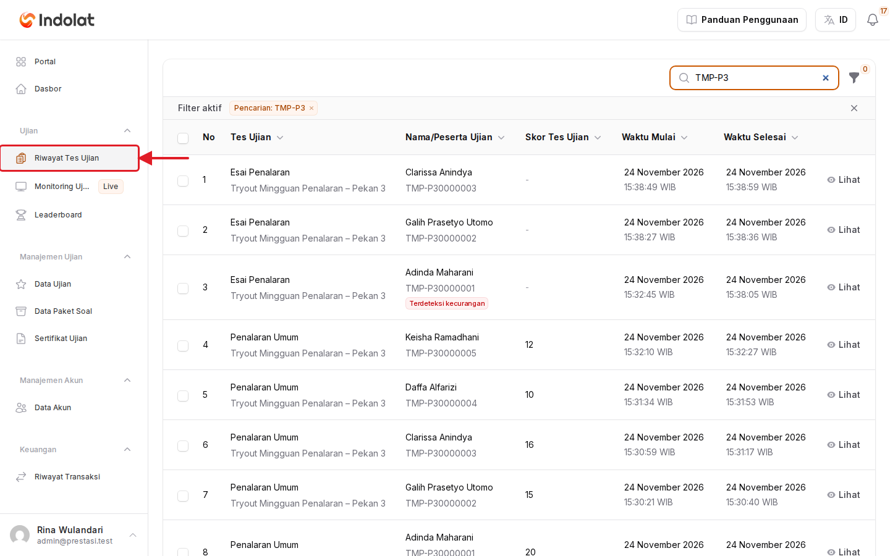
</Frame>

<Frame>
  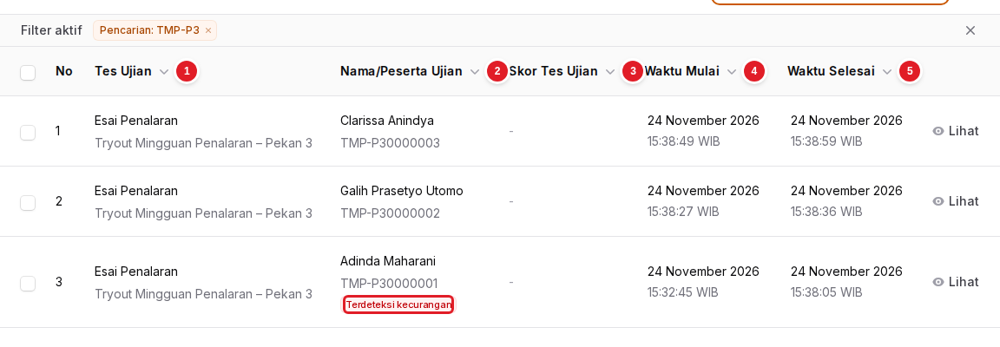
</Frame>

1. **Tes Ujian**: the test name, with the exam name below it.
2. **Nama/Peserta Ujian**: participant name and participant code. A red **Terdeteksi kecurangan** (cheating detected) label appears when the system recorded possible cheating during the test, for example the participant trying to sign in from another device.
3. **Skor Tes Ujian**: the participant's score for the test. A **-** is shown when no score has been given yet (an essay test that has not been graded) or when the scoring method is **Psikotes (Pengelompokan Jawaban)**, which does not produce a score.
4. **Waktu Mulai**: when the participant started the test.
5. **Waktu Selesai**: when the participant finished the test.

<Note>
  Tests from archived exams are not shown in Riwayat Tes Ujian.
</Note>

### Filtering the history

Click the funnel icon at the top right of the table to open the **Filter** panel.

<Frame>
  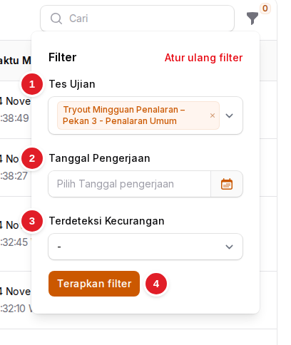
</Frame>

1. **Tes Ujian**: choose one or more tests. Each option is written as *exam name - test name*.
2. **Tanggal Pengerjaan**: a date range for when the test was started.
3. **Terdeteksi Kecurangan**: choose **Ya** (yes) to show only tests with a cheating record, or **Tidak** (no) to show tests without one.
4. Click **Terapkan filter** (apply filter). Click **Atur ulang filter** to clear all filters.

Your filters are kept for as long as you stay signed in.

## Viewing a test result

Click **Lihat** (view) on the participant's row.

<Frame>
  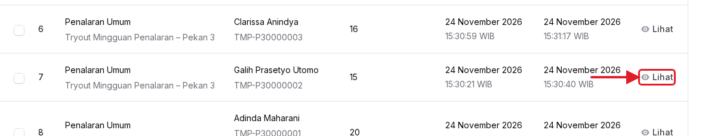
</Frame>

The detail page has several sections.

<Frame>
  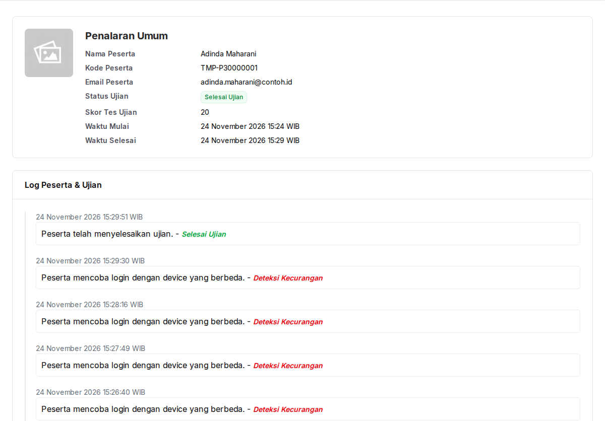
</Frame>

- **Participant information**: test name, **Nama Peserta**, **Kode Peserta**, **Email Peserta**, **Status Ujian** (**Belum Ujian**, **Sedang Berlangsung**, **Sedang Ditangguhkan**, or **Selesai Ujian**), **Skor Tes Ujian**, **Waktu Mulai**, and **Waktu Selesai**.
- **Log Peserta & Ujian** (participant and exam log): events during the test, newest first. Each entry has a type, for example **Mulai Ujian** (started), **Selesai Ujian** (finished), **Kehabisan Waktu** (time ran out), **Deteksi Kecurangan** (cheating detected), or **Lainnya** (admin actions such as reset, score change, and suspend). Scroll down inside the log box to load older entries.

  <Frame>
    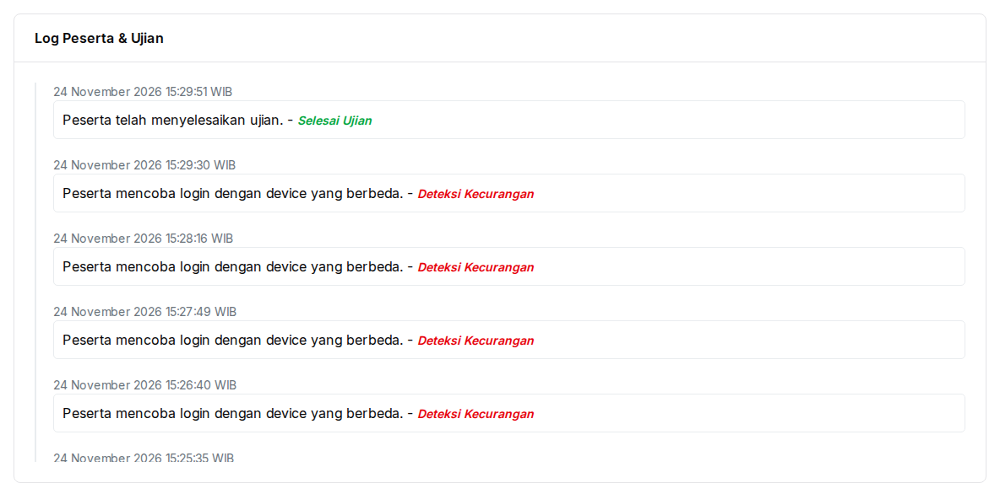
  </Frame>

- **Jawaban Peserta** (participant answers): the result for each question. For CBT/CAT tests, each box shows the question number and **Benar** (correct), **Salah** (wrong), or **Tidak Dijawab** (unanswered), with a **Total Benar**, **Total Salah**, and **Tidak Dijawab** summary. Click **Soal** to open the question in its question package, or **Link** to open the answer option the participant chose. For essay tests, this section shows the participant's text answer and uploaded files.

  <Frame>
    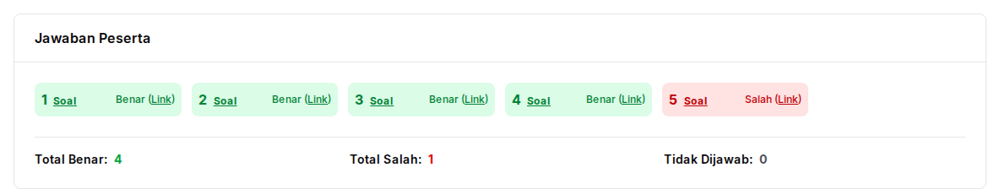
  </Frame>

Other sections appear depending on the test settings:

- **Log Foto Peserta** and **Log Screen Peserta** appear when camera or screen proctoring is active on the test. Click **Unduh Foto Kamera** or **Unduh Foto Layar** to prepare a ZIP file, then click **Unduh ZIP Kamera** or **Unduh ZIP Layar** once it is ready. Photos and screenshots are deleted automatically once the exam ended more than three months ago.
- **Analisa Kelompok Jawaban**, **Analisa Konsentrasi**, and **Detail Jawaban Per Pertanyaan** appear for tests scored with **Psikotes (Pengelompokan Jawaban)**. Click **Unduh Data** in that section to download the participant report as a PDF.

## Giving a manual score to an essay test

Tests of the type **Esai / Upload File (Jawaban Manual)** are not graded automatically. After the participant finishes, the score stays **-** until you give it.

<Steps>
  <Step title="Open the essay test detail">
    In **Riwayat Tes Ujian**, click **Lihat** on the participant's essay test row. Read the answer in the **Jawaban Peserta** section.
  </Step>
  <Step title="Click Beri Skor Manual">
    In the **Aksi Admin** (admin actions) box, click **Beri Skor Manual** (give manual score).

    <Frame>
      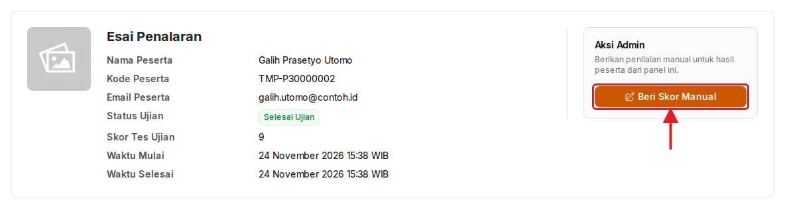
    </Frame>
  </Step>
  <Step title="Enter the score and save">
    In the **Berikan Skor** window, enter the score and click **Simpan** (save).

    <Frame>
      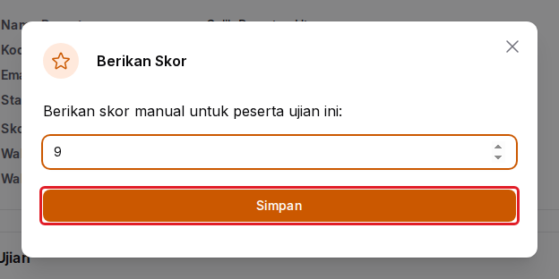
    </Frame>

    The score appears at once under **Skor Tes Ujian**, and the participant's final score for the exam is recalculated.

    <Frame>
      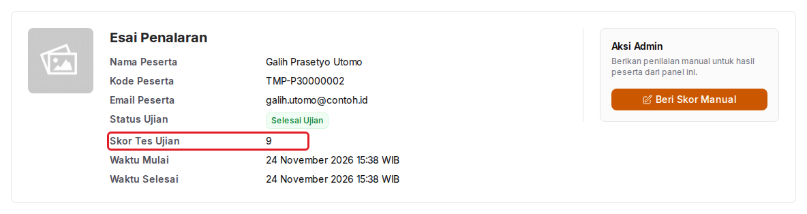
    </Frame>
  </Step>
</Steps>

<Note>
  Every score change is recorded in **Log Peserta & Ujian** together with the email of the admin who made it. The score field cannot be empty.
</Note>

## Bulk actions

Tick one or more rows, or tick the box in the table header to select every row on the page. A **Tindakan** (actions) button appears at the top left of the table.

<Frame>
  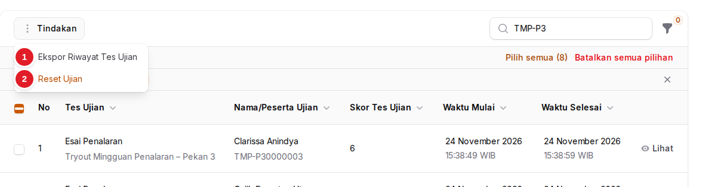
</Frame>

1. **Ekspor Riwayat Tes Ujian**: export the selected rows to Excel.
2. **Reset Ujian**: reset the selected tests so participants can take them again.

### Resetting a test (Reset Ujian)

Use **Reset Ujian** when a participant needs to retake a test, for example after a technical problem.

<Steps>
  <Step title="Select the test to reset">
    Tick the participant's test row, then click **Tindakan** → **Reset Ujian**.
  </Step>
  <Step title="Confirm">
    Click **Konfirmasi** in the **Reset Ujian** window.

    <Frame>
      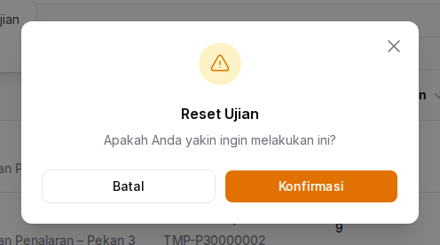
    </Frame>
  </Step>
</Steps>

<Warning>
  Reset Ujian deletes all answers, the score, and the start and finish times of the test. This cannot be undone. The log is kept, and the system adds an entry saying the test was reset by an admin.
</Warning>

After a reset, the test disappears from **Riwayat Tes Ujian** and the participant can take it again from the **Daftar Tes** page as long as the exam session is still open. The new result appears here again once the participant finishes.

### Exporting the history to Excel

<Steps>
  <Step title="Select the rows to export">
    Search or filter first, then tick the rows you need. Click **Tindakan** → **Ekspor Riwayat Tes Ujian**.
  </Step>
  <Step title="Confirm the export">
    Click **Konfirmasi**.

    <Frame>
      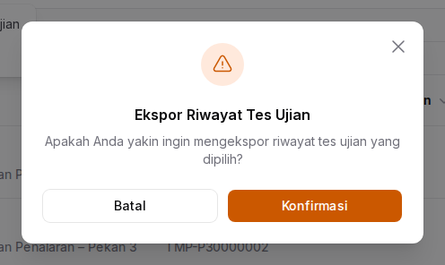
    </Frame>
  </Step>
  <Step title="Download the file">
    The export runs in the background. When it is done, a **Berhasil Ekspor Riwayat Ujian** notification appears under the bell icon. The file, named `riwayat_ujian_<date and time>.xlsx`, can be downloaded from [Export Downloads](/en/cbt/unduh-hasil-ekspor).
  </Step>
</Steps>

The Excel file has the columns **Tes Ujian**, **Kode Peserta**, **Nama Peserta**, **Skor**, **Jumlah Jawaban Benar**, **Jumlah Jawaban Salah**, **Jumlah Jawaban Tidak Dijawab**, **Waktu Pengerjaan**, **Waktu Mulai Ujian**, and **Waktu Selesai Ujian**.

<Tip>
  To export the results of every participant in one exam, including final scores, use **Ekspor Data** → **Hasil Tes Ujian** on the exam detail page. See [Exam Results and Exports](/en/data-ujian/hasil-dan-ekspor-ujian).
</Tip>
