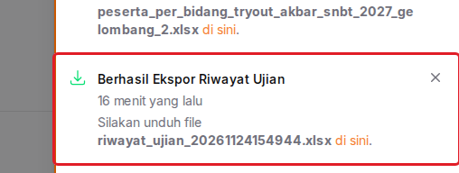
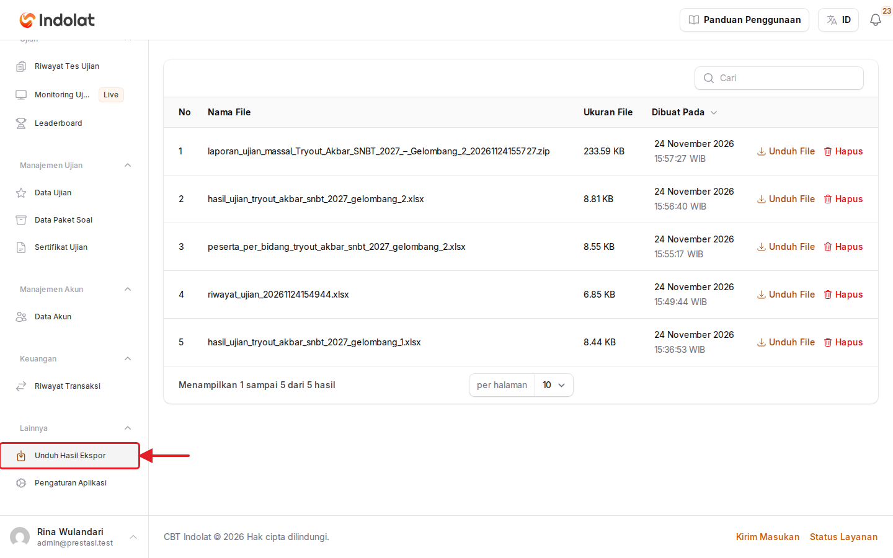
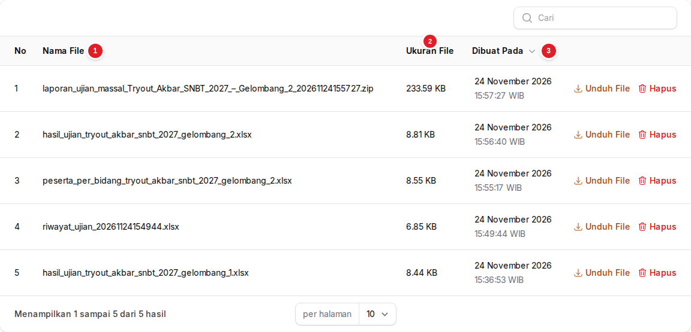
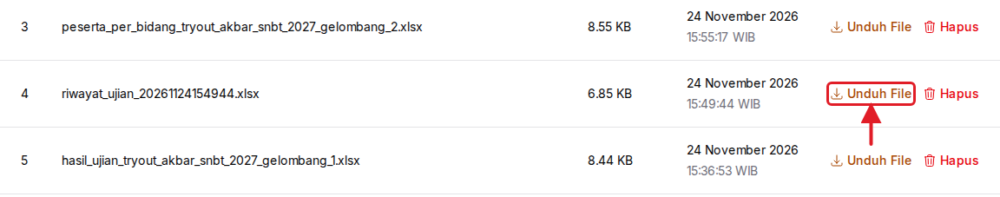
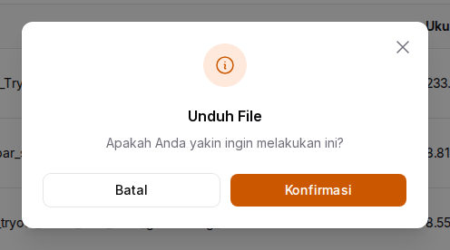
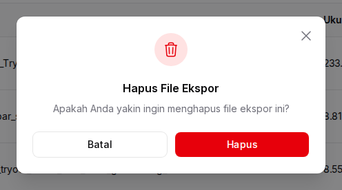

Some exports in CBT Indolat are processed in the background so you do not have to wait on the same page. When an export is finished, the file is stored in the **Unduh Hasil Ekspor** (Export Downloads) menu. From this menu you can download the file or delete it when it is no longer needed.

<Info>
  **Menu location:** **Portal** → **Platform Ujian (CBT)** → **Lainnya** → **Unduh Hasil Ekspor**.
</Info>

## Exports that land on this page

| Export | Where to start it | Example file name |
| --- | --- | --- |
| Test history | **Riwayat Tes Ujian** → select rows → **Tindakan** → **Ekspor Riwayat Tes Ujian**. See [Riwayat Tes Ujian](/en/cbt/riwayat-tes-ujian#exporting-the-history-to-excel). | `riwayat_ujian_20261124154944.xlsx` |
| Exam results, essay answer links, item analysis, leaderboard template | Exam detail page → **Ekspor Data**. See [Hasil dan Ekspor Ujian](/en/data-ujian/hasil-dan-ekspor-ujian). | `hasil_ujian_<exam_name>.xlsx` |
| Participant reports (ZIP) | Exam detail page → **Daftar Peserta Ujian** → select participants → **Tindakan** → **Unduh Laporan (ZIP)**. | `laporan_ujian_massal_<exam name>_<time>.zip` |
| Participants per field | Exam detail page → **Kode Peserta** → **Daftar Peserta per Bidang**. See [Kode Peserta](/en/data-ujian/kode-peserta). | `peserta_per_bidang_<exam_name>.xlsx` |
| Question package to PDF | **Data Paket Soal** → edit a CBT/CAT package → **Ekspor ke PDF**. | `paket_soal_<package name>_<variant>_<time>.pdf` |

When an export is finished, a notification appears under the bell icon at the top right. Click **di sini** (here) in the notification to open **Unduh Hasil Ekspor** directly.

<Frame>
  
</Frame>

## Opening the file list

Click **Unduh Hasil Ekspor** in the sidebar, in the **Lainnya** group. The newest file is at the top.

<Frame>
  
</Frame>

<Frame>
  
</Frame>

1. **Nama File** (file name): including the extension (.xlsx, .pdf, or .zip).
2. **Ukuran File** (file size): in KB or MB.
3. **Dibuat Pada** (created at): the date and time the file was finished.

Use the **Cari** field to search by file name.

<Note>
  The list contains the project's export files, including exports created by other admins in the same project.
</Note>

## Downloading a file

<Steps>
  <Step title="Click Unduh File">
    Click **Unduh File** (download file) on the row you need.

    <Frame>
      
    </Frame>
  </Step>
  <Step title="Confirm">
    Click **Konfirmasi** in the **Unduh File** window. The file is downloaded to your device.

    <Frame>
      
    </Frame>
  </Step>
</Steps>

## Deleting a file

Click **Hapus** (delete) on the file row, then click **Hapus** in the **Hapus File Ekspor** window.

<Frame>
  
</Frame>

<Warning>
  A deleted file cannot be recovered. If you still need it, run the export again from its original page. Deleting files you no longer use also frees up the project's storage.
</Warning>
