Before participants can log in and take an exam, **every participant needs an account** in your project. This page explains where participant accounts are managed, how to add accounts, and how to group, search and tidy them up with labels.

<Info>
  **Menu location (master list):** **Portal** → **Administrasi Aplikasi** (Application Administration) → **Pengguna** (Users) → **Pengguna**

  **Menu location (CBT mirror):** **Portal** → **Platform Ujian (CBT)** (Exam Platform) → **Manajemen Akun** (Account Management) → **Data Akun** (Account Data)

  **Required role:** project owner, or an admin whose role has access to the **Pengguna** module (Administrasi Aplikasi) or the **Data Akun** module (Platform Ujian).
</Info>

Participant accounts can be added in three ways:

1. **Participants create their own account** through the **Daftar** (Register) link on the participant login page.
2. **The admin adds accounts one by one** with the **Tambah Akun** (Add Account) button.
3. **The admin adds many accounts at once** with the **Import Akun** (Import Accounts) button and an Excel file.

<Tip>
  Choose the method that best fits your needs:

  - **Self-registration** suits cases where participants may create their own accounts, for example an open tryout.
  - **Tambah Akun** suits cases where you only need to add a few accounts.
  - **Import Akun** suits cases where the participant data has already been prepared by a school, branch or organiser.
</Tip>

## The Pengguna menu and the Data Akun menu

Participant accounts are shared by every product in your project. That is why the master list lives in the **Administrasi Aplikasi** module, under **Pengguna** → **Pengguna**.

<Frame>
  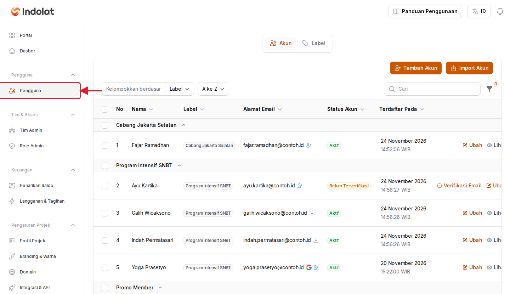
</Frame>

The same list is also shown in the **Platform Ujian (CBT)** module, under **Manajemen Akun** → **Data Akun**, so you do not have to switch modules while preparing an exam.

<Frame>
  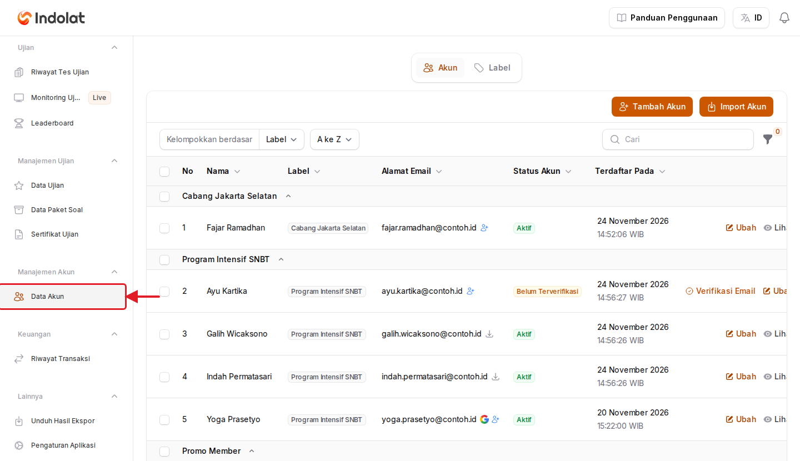
</Frame>

Both menus show **the same data** with the same features: the **Akun** (Accounts) and **Label** tabs, the **Tambah Akun** and **Import Akun** buttons, grouping, search, filters and the actions on each account. Any account or label you add, edit or delete in one menu appears immediately in the other.

| | **Pengguna** (Administrasi Aplikasi) | **Data Akun** (Platform Ujian (CBT)) |
| --- | --- | --- |
| Data | Every participant account in the project | Exactly the same |
| When to use it | Managing participants for all products (CBT and LMS) | Managing participants while preparing exams in CBT |
| Admin access | Granted through the **Pengguna** module in **Role Admin** | Granted through the **Data Akun** module in **Role Admin** |

<Note>
  Access to the two menus is granted separately. An admin who only has access to **Data Akun** can still manage participant accounts from the CBT module without seeing the **Pengguna** menu in Administrasi Aplikasi. See [Admin Access Management](/en/lainnya/manajemen-akses-admin) to set up admin roles. The same list is also available in the LMS module as **Akun Siswa** (Student Accounts).
</Note>

## The participant account page

The page has two tabs: **Akun** lists the participant accounts, and **Label** is where you manage labels. Each row in the **Akun** tab is one participant account, with the columns **No**, **Nama** (Name), **Label**, **Alamat Email** (Email Address), **Status Akun** (Account Status) and **Terdaftar Pada** (Registered On).

<Frame>
  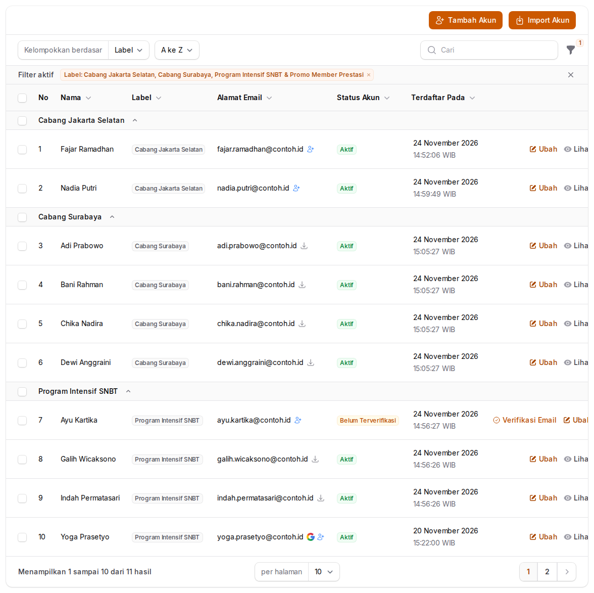
</Frame>

Each row offers these actions:

- **Verifikasi Email** (Verify Email): shown only for unverified accounts. See [Account status](#account-status).
- **Ubah** (Edit): opens the form to change the name, label, password or status of the account.
- **Lihat** (View): shown for verified accounts and opens the participant's **Detail Akun** (Account Details) page.
- **Hapus** (Delete): deletes the participant account after confirmation.

You can show 10, 25 or 50 accounts per page with the **per halaman** (per page) option below the table.

### Kelompokkan berdasar (Group by)

The **Kelompokkan berdasar** option controls how the list is displayed. By default, the list is grouped by **Label**, and accounts without a label are collected in the **Tanpa Label** (No Label) group. The option next to it (**A ke Z** or **Z ke A**) sets the order of the groups.

<Frame>
  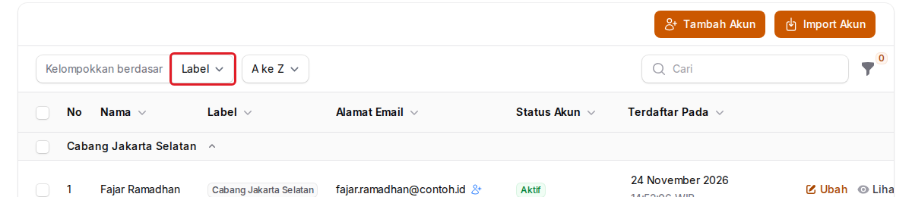
</Frame>

- Choose **Label** to show participants with the same label next to each other. Each group can be collapsed with the arrow next to its name.
- Choose **Tidak Dikelompokkan** (Not Grouped) to show every account in a single list.

<Frame>
  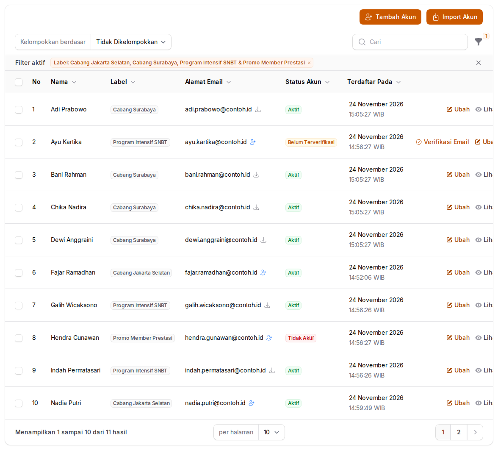
</Frame>

### Cari (Search)

Use the **Cari** field to find accounts by name, email address or label name. For example, type **Adi Prabowo** to show that participant's account. The search term appears in the **Filter aktif** (Active filters) bar and can be removed with the **×** mark.

<Frame>
  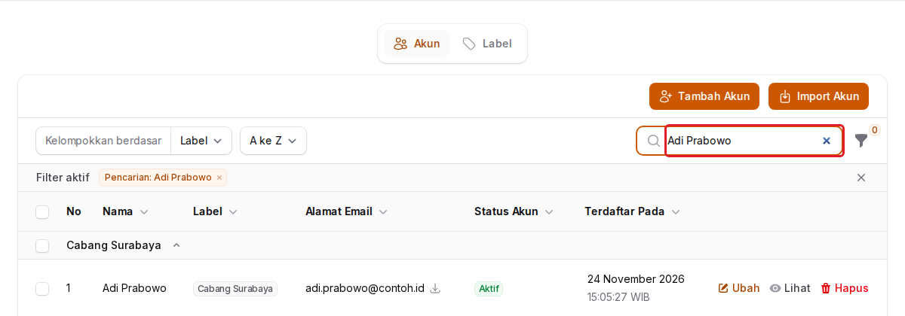
</Frame>

### Filter

Click the **Filter** icon next to the **Cari** field to narrow down the list. The options are:

- **Akun Google** (Google Account): only accounts created with a Google account.
- **Apakah Akun diimport?** (Imported account?): only accounts added through an import.
- **Label**: one or more labels, including **Tanpa Label**.
- **Status Akun**: **Aktif** (Active), **Tidak Aktif** (Inactive) or **Belum Terverifikasi** (Not Verified).

<Frame>
  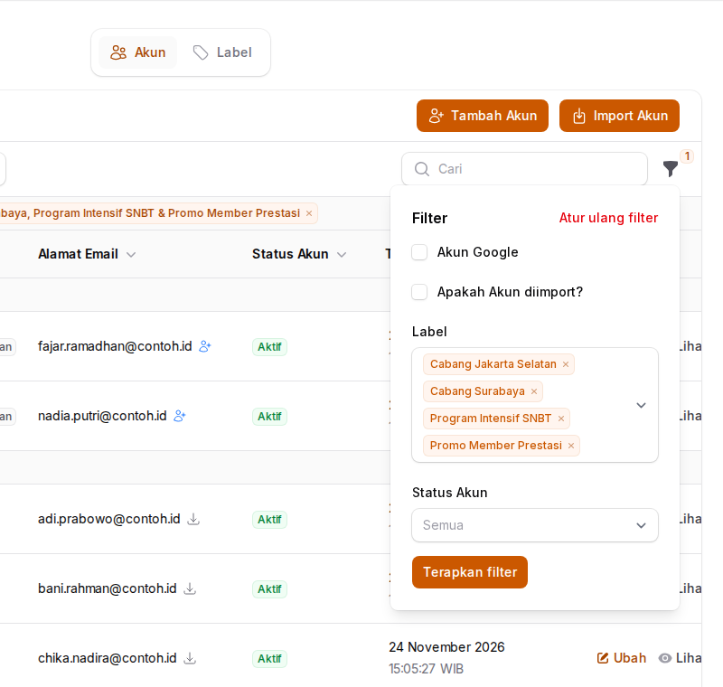
</Frame>

After choosing your criteria, click **Terapkan filter** (Apply filters). The filters in effect appear in the **Filter aktif** bar above the table. Click **Atur ulang filter** (Reset filters) in the filter panel, or the **×** mark in the **Filter aktif** bar, to remove them.

<Tip>
  For **Status Akun**, choose a single status. If several statuses are selected at once, only one of them is applied.
</Tip>

### Account origin icons

The **Alamat Email** column shows an icon that indicates where the account came from:

- **Person icon with a plus sign (blue)**: the account was not imported. It was created by the participant on the registration page or added by an admin with **Tambah Akun**.
- **Down arrow icon (grey)**: the account was added through an import, for example **Import Akun** on this page, the participant import on an exam, or the API.
- **Google icon**: the account was created with a Google account. This icon appears next to one of the icons above.

<Frame>
  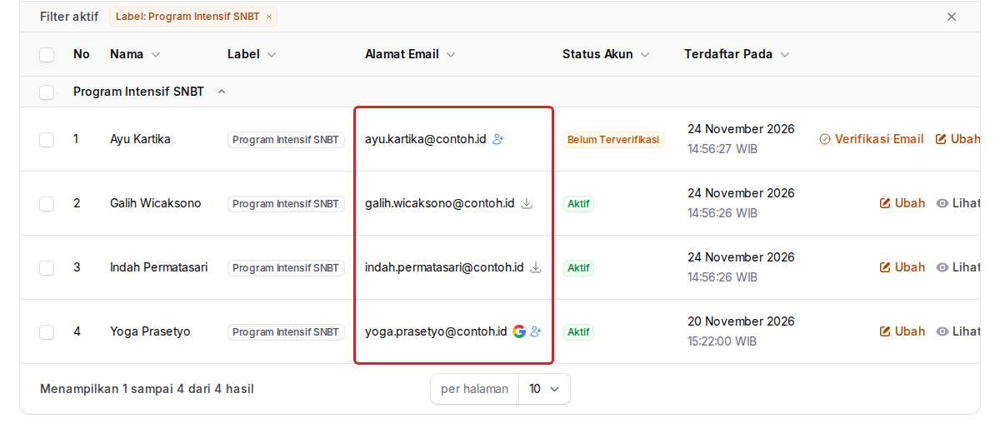
</Frame>

### Account status

The **Status Akun** column shows one of these statuses:

- **Aktif** (green): the account can be used to log in.
- **Belum Terverifikasi** (yellow): the participant registered themselves but has not entered the email verification code yet.
- **Tidak Aktif** (red): the account's **Status Aktif** switch is off, so the participant cannot log in.

If a participant does not receive the verification email, you can verify the account manually. Click **Verifikasi Email** on that account's row and confirm. The account status changes to **Aktif** for your project.

<Frame>
  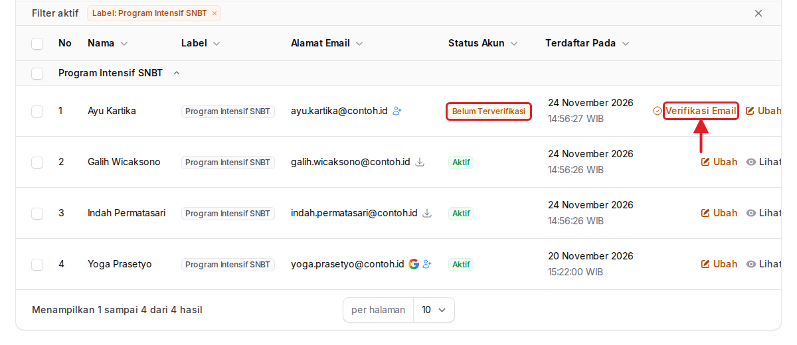
</Frame>

## Managing labels

Labels group participants, for example by branch, class or programme. They make it easier to search, filter and select many participants at once. All labels are managed in the **Label** tab, which shows the **Nama Label** (Label Name), the **Jumlah Akun** (Number of Accounts) using it, and when it was **Terakhir Diubah** (Last Changed).

### Add a label

<Steps>
  <Step title="Open the Label tab">
    <Frame>
      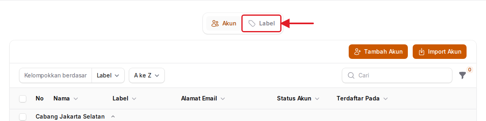
    </Frame>
  </Step>
  <Step title="Click Tambah Label, fill in Nama Label, then click Simpan">
    For example, create the label **Cabang Surabaya** for participants from the Surabaya branch.

    <Frame>
      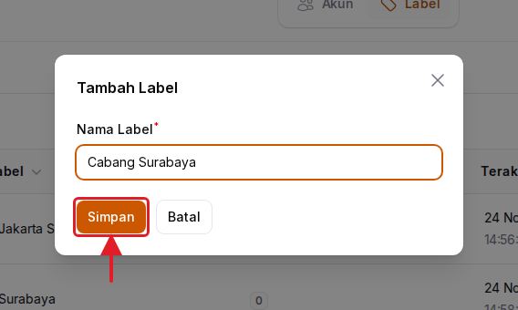
    </Frame>

    <Note>
      A label name must differ from existing labels (upper and lower case are treated as the same). If the name is already in use, a message says the label already exists.
    </Note>
  </Step>
</Steps>

### Edit a label

For example, the label **Promo Member** is renamed to **Promo Member Prestasi** to make it clearer.

<Steps>
  <Step title="Click Ubah on the label you want to change">
    <Frame>
      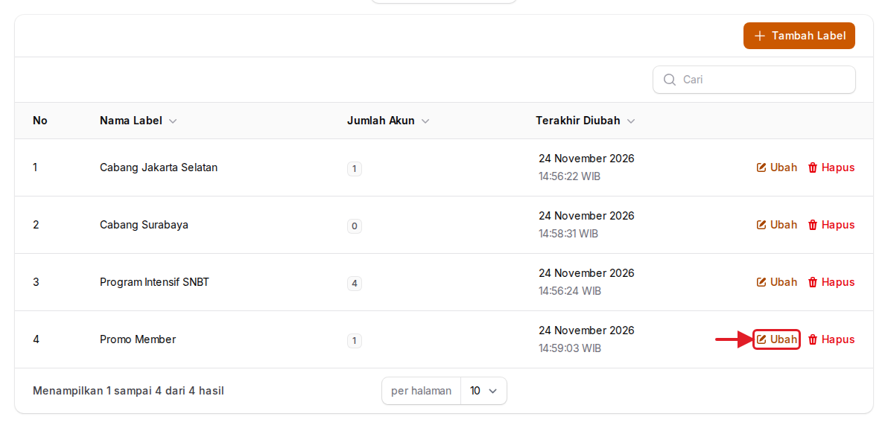
    </Frame>
  </Step>
  <Step title="Enter the new name in Nama Label, then click Simpan">
    <Frame>
      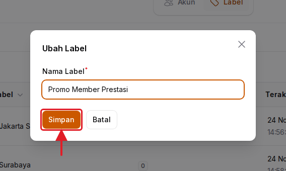
    </Frame>

    The new label name applies straight away to every account that uses the label.
  </Step>
</Steps>

### Delete a label

Click **Hapus** on the label row, then click **Hapus** in the confirmation window.

<Frame>
  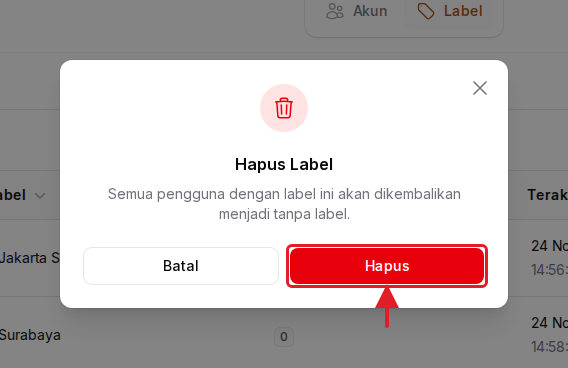
</Frame>

<Note>
  Deleting a label only removes the group. The participant accounts **are kept** and become **Tanpa Label**.
</Note>

### Apply a label to many accounts at once

<Steps>
  <Step title="Tick the accounts, then click Tindakan → Ubah Label">
    <Frame>
      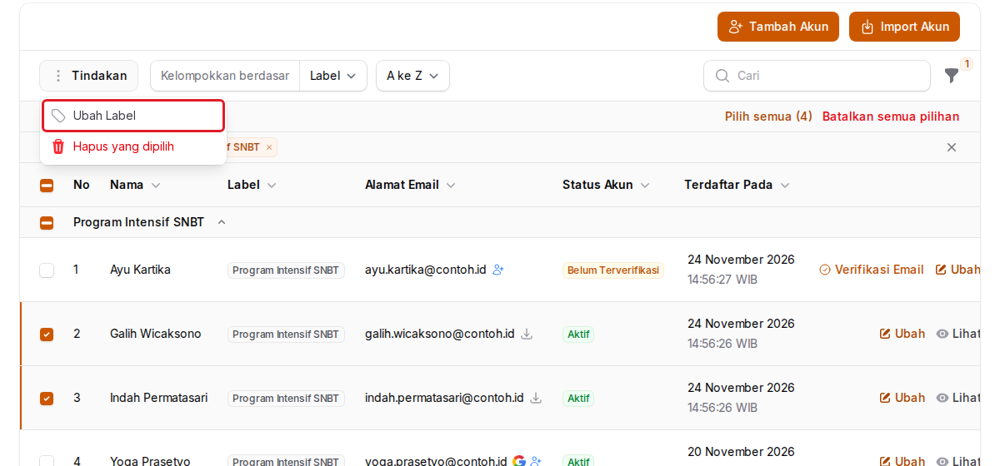
    </Frame>
  </Step>
  <Step title="Choose a label, then click Simpan">
    Choose **Tanpa Label** to remove the label from the selected accounts.

    <Frame>
      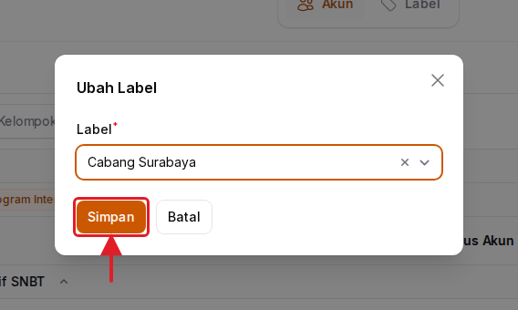
    </Frame>
  </Step>
</Steps>

## Add accounts one by one (Tambah Akun)

<Steps>
  <Step title="In the Akun tab, click Tambah Akun">
    <Frame>
      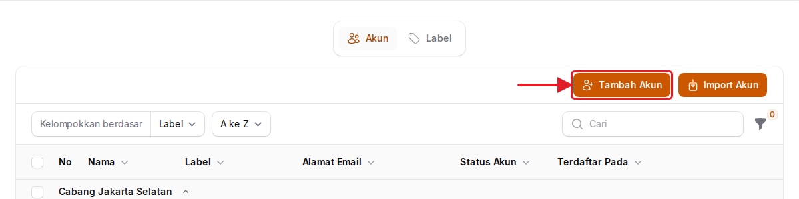
    </Frame>
  </Step>
  <Step title="Fill in the account details, then click Buat">
    <Frame>
      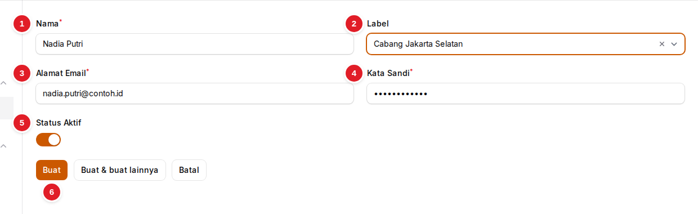
    </Frame>

    1. **Nama** (Name): the participant's name, for example **Nadia Putri**.
    2. **Label**: the participant's label (may be left empty, which makes the account **Tanpa Label**).
    3. **Alamat Email** (Email Address): the address the participant uses to log in, for example `nadia.putri@contoh.id`.
    4. **Kata Sandi** (Password): the participant's initial password.
    5. **Status Aktif** (Active Status): leave it on so the account can be used straight away.
    6. **Buat** (Create): saves the account. Use **Buat & buat lainnya** (Create & create another) to go straight on to the next account.
  </Step>
</Steps>

Accounts added this way are verified immediately, so participants do not need to verify their email. Give participants their email address and password together with the participant login link (see [Participant Login](/en/lainnya/login-peserta)).

<Note>
  An email address can only be used for one participant account in the same project. If the address is already registered, the message **Alamat email sudah terdaftar pada projek ini.** (This email address is already registered in this project.) appears.
</Note>

## Edit or delete an account

Click **Ubah** on an account row to open the **Ubah Akun** (Edit Account) form.

<Frame>
  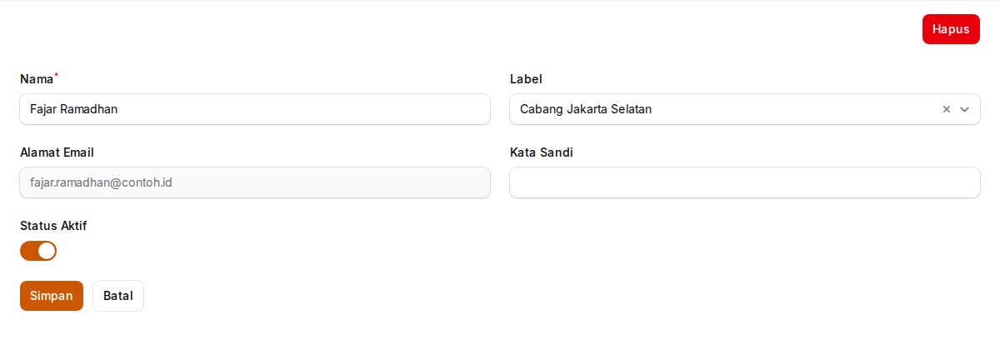
</Frame>

- **Alamat Email** cannot be changed.
- **Kata Sandi** may be left empty. Fill it in only if you want to change the participant's password.
- Turning **Status Aktif** off prevents the participant from logging in and also ends any session the participant has open.

To delete an account, click **Hapus** on the account row or in the **Ubah Akun** form. To delete several accounts at once, tick them, then click **Tindakan** → **Hapus yang dipilih** (Delete selected).

<Warning>
  Deleting an account cannot be undone. Accounts already registered for an exam cannot be deleted; remove the participant from that exam first.
</Warning>

## Add many accounts at once (Import Akun)

Use this method when you already have a list of participants but have not yet decided which exams they will take. For example, you have a list of participants from **Cabang Surabaya** who may later take several different exams.

<Steps>
  <Step title="In the Akun tab, click Import Akun">
    <Frame>
      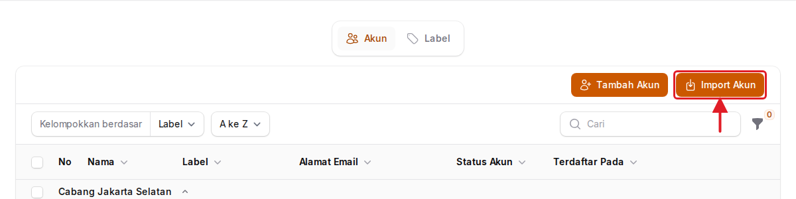
    </Frame>
  </Step>
  <Step title="Click Unduh Template">
    <Frame>
      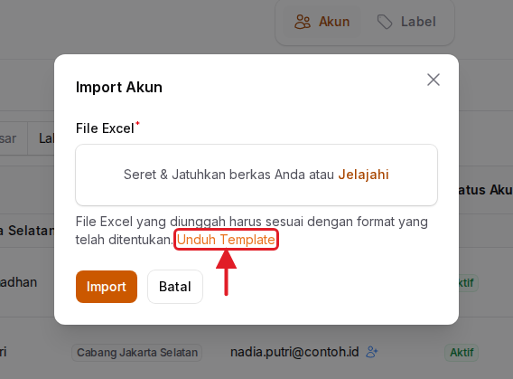
    </Frame>

    The file **template-import-akun.xlsx** is downloaded. The template has the columns **Nama**, **Alamat Email**, **Kata Sandi** and **Label**, plus a few example rows.
  </Step>
  <Step title="Fill in the participant data in the Excel file">
    Replace the example rows with your participants. Do not change the column headings in the first row.

    <Frame>
      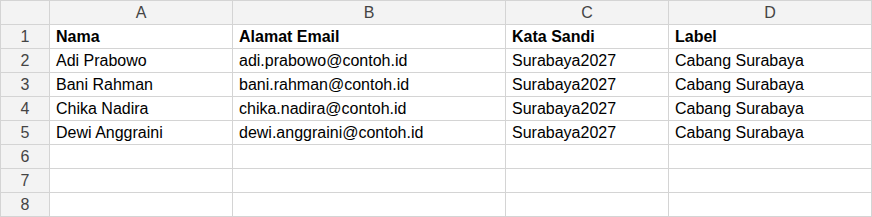
    </Frame>

    1. **Nama**: the participant's name (required).
    2. **Alamat Email**: the address the participant uses to log in (required).
    3. **Kata Sandi**: a password for each participant (required).
    4. **Label**: a label name to group participants (optional). If the label does not exist yet, it is created automatically.

    <Note>
      During the import, the system **does not check** whether an email address is actually active; it only checks the format. You can therefore use exam-only addresses, for example `peserta001@contoh.id`. Make sure every participant has a different email address.
    </Note>

    <Warning>
      Delete the example rows from the template before uploading. Any row you leave in is imported as an account.
    </Warning>
  </Step>
  <Step title="Upload the file, then click Import">
    <Frame>
      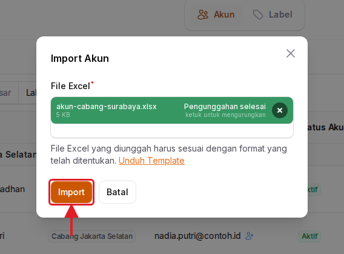
    </Frame>

    The file is processed in the background. While it runs, a **Mengimpor Akun Peserta** (Importing Participant Accounts) card with a progress bar appears above the account list. When it finishes, you receive a **Berhasil Mengimpor Akun Peserta** (Participant Accounts Imported) notification with the number of accounts imported.

    <Frame>
      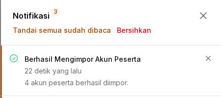
    </Frame>

    Imported accounts are active and verified straight away, and are marked with the down arrow icon in the **Alamat Email** column.
  </Step>
</Steps>

<Note>
  The whole import is cancelled if any row has an empty **Nama**, **Alamat Email** or **Kata Sandi**, or if any email address has an invalid format. Fix the file as described in the notification, then import it again.

  If an email address in the file is already registered in your project, the account is not duplicated. Its name, password and label are updated from the file, and the account is reactivated.
</Note>

<Warning>
  Imported accounts are not added to any exam automatically. To add them to an exam, open **Data Ujian**, choose **Daftar Peserta Ujian**, then use the **Tambah Peserta** button. The full steps are in [Add Participants to an Exam](/en/data-ujian/menambahkan-peserta-ujian).
</Warning>

## Participants create their own account

This method is only available when **Izinkan pendaftaran akun mandiri** (Allow self-registration) is turned on in **Platform Ujian (CBT)** → **Lainnya** → **Pengaturan Aplikasi**. See [Participant Login](/en/lainnya/login-peserta) for the setting.

<Steps>
  <Step title="The participant opens the login link and clicks Daftar">
    <Frame>
      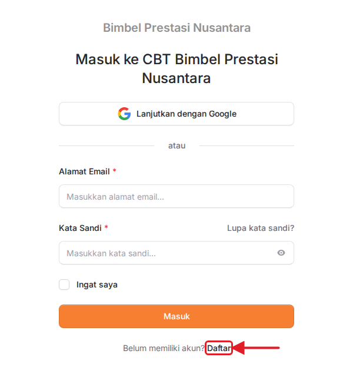
    </Frame>
  </Step>
  <Step title="The participant fills in the registration form">
    <Frame>
      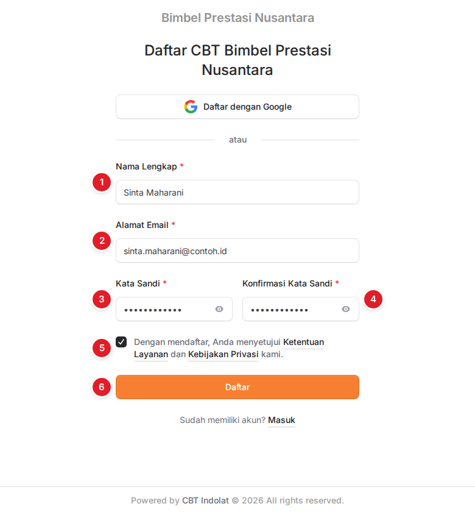
    </Frame>

    The participant fills in **Nama Lengkap** (Full Name), **Alamat Email**, **Kata Sandi** (at least 8 characters) and **Konfirmasi Kata Sandi** (Confirm Password), ticks the agreement to the **Ketentuan Layanan** (Terms of Service) and **Kebijakan Privasi** (Privacy Policy), then clicks **Daftar**. If **Autentikasi dengan Google** is on, the participant can also choose **Daftar dengan Google** (Register with Google).
  </Step>
  <Step title="The participant verifies their email address">
    The system sends a 6-digit verification code to the participant's email address. The participant enters the code, then clicks **Verifikasi Akun** (Verify Account).

    <Frame>
      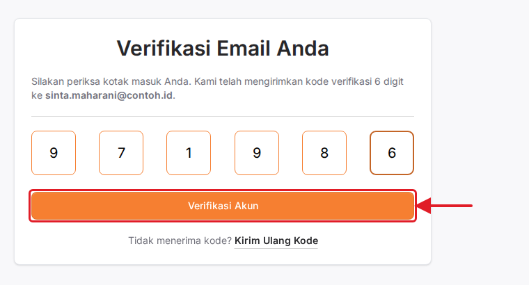
    </Frame>

    Until the code is entered, the account is listed with the **Belum Terverifikasi** status. Once verification succeeds, the participant lands on the **Daftar Tes** (Test List) page and the account status becomes **Aktif**.
  </Step>
</Steps>

<Info>
  Email verification is only needed for participants who register themselves. Accounts added by an admin with **Tambah Akun** or **Import Akun** are verified immediately. The full participant-side registration steps are in [Participant Login](/en/lainnya/login-peserta#how-participants-register-and-log-in).
</Info>
