Once participants have taken tests, you can work with an exam's results directly from the **Detail Ujian** (Exam Details) page: export data to Excel, recalculate scores and download each participant's result report. This page only covers per-exam actions. The test history across all exams is in [Test History](/en/cbt/riwayat-tes-ujian), live monitoring in [Exam Monitoring](/en/cbt/monitoring-ujian), and rankings in [Leaderboard](/en/cbt/leaderboard).

<Info>
  **Menu location:** **Portal** → **Platform Ujian (CBT)** → **Manajemen Ujian** → **Data Ujian** → **Detail** on the exam. The **Ekspor Data** (Export Data) and **Hitung Skor** (Calculate Score) buttons are at the top right of the page; participant reports are in the **Daftar Peserta Ujian** (Participant List) section.
</Info>

The examples on this page use **Tryout Akbar SNBT 2027 – Gelombang 2**, whose Penalaran Matematika test has been taken by three participants.

## Export exam data

Click **Ekspor Data** at the top right of the **Detail Ujian** page.

<Frame>
  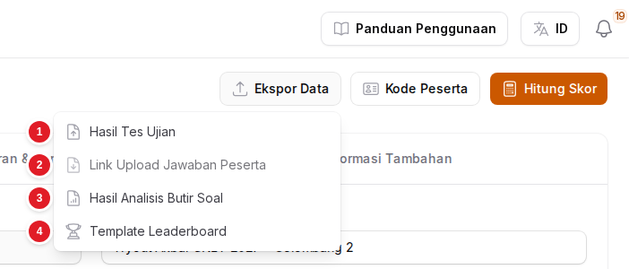
</Frame>

1. **Hasil Tes Ujian** (Test Results): all participants' results in one Excel file with two sheets:
   - **Hasil Ujian** (Exam Results): **Kode Peserta**, **Nama Peserta**, the score of each test, **Skor Akhir** (Final Score) and **Kode Bidang** (Field Code) when field codes are on.
   - **Detail Peserta** (Participant Details): start and finish times, time taken, total points, cheating indications and the percentage for each question group.
2. **Link Upload Jawaban Peserta** (Participant Answer Upload Links): download links for the files participants uploaded in **Esai / Upload File (Jawaban Manual)** tests, one column per question. Enabled when the exam has an essay test that participants have finished.
3. **Hasil Analisis Butir Soal** (Item Analysis): an analysis of every question in CBT and CAT tests, with an **Analisis Per Soal** (Per-Question Analysis) sheet (correct, incorrect and unanswered counts, percentage correct, and data for each answer option) and a **Ringkasan Per Kelompok** (Per-Group Summary) sheet. Enabled when the exam has a CBT/CAT test that participants have finished.
4. **Template Leaderboard**: one row per participant per finished, scored subtest, with the columns **Papan** (Board), **Kode Peserta**, **Email**, **Nama**, **Skor**, **Waktu Selesai** (Finish Time) and **Peringkat** (Rank). **Papan** holds the session (field) name, or the subtest name when the subtest has only one session. **Kode Peserta** holds the field code when the participant has one. Use the file to fill a leaderboard, see [Leaderboard](/en/cbt/leaderboard). This option only appears if you have access to the **Leaderboard** menu.

Options that cannot be used yet are greyed out.

<Steps>
  <Step title="Confirm the export">
    Click an option, then click **Konfirmasi** (Confirm), or **Ekspor** (Export) for **Template Leaderboard**.

    <Frame>
      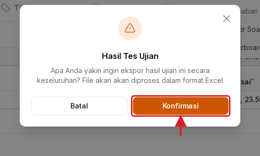
    </Frame>

    <Frame>
      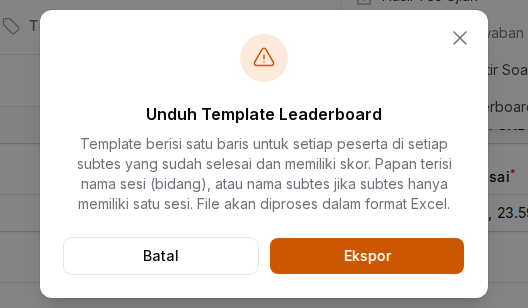
    </Frame>
  </Step>
  <Step title="Download the file when it is ready">
    The file is processed in the background. When it is ready, a notification appears under the bell icon. Click **di sini** (here) in the notification to open [Download Exports](/en/cbt/unduh-hasil-ekspor), where every export file can be downloaded.

    <Frame>
      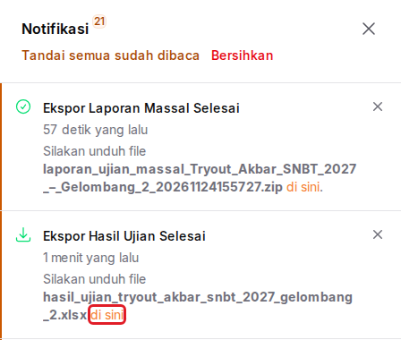
    </Frame>
  </Step>
</Steps>

<Tip>
  If you have just changed an answer key, question weight or scoring method, run **Hitung Skor** first so the result file uses the latest scores.
</Tip>

## Recalculate scores

Click **Hitung Skor** at the top right of the **Detail Ujian** page.

<Frame>
  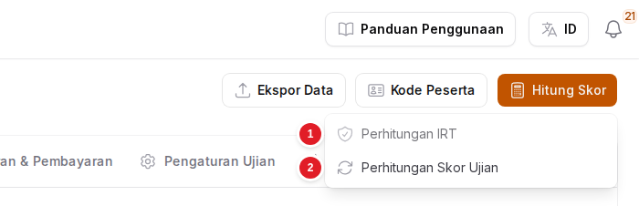
</Frame>

1. **Perhitungan IRT** (IRT Calculation): calculates scores for IRT tests for every participant who has finished. IRT scores depend on the answer patterns of all participants, so run it after everyone has finished. It is enabled when the exam has an IRT test, some participants have finished, no one is still taking a test, the previous IRT calculation has finished, and the exam is not multi-level.
2. **Perhitungan Skor Ujian** (Exam Score Calculation): recalculates scores for tests that use **Perhitungan Skor Soal**, **Perhitungan Skor Jawaban** and **Psikotes** for every participant who has finished. Use it after correcting answer keys or question scores in the question package.

Click **Konfirmasi** in the window that appears.

<Frame>
  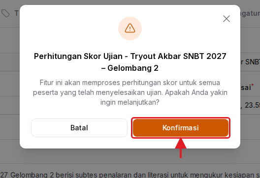
</Frame>

The calculation runs in the background and you get a notification when it is done. Neither option is available on an archived exam.

### Recalculate one test

To recalculate a single test, open the test details, go to **Sesi Peserta Ujian** (Participant Sessions) and click **Hitung Ulang Skor** (Recalculate Score). The button appears on tests that use **Perhitungan Skor Soal** or **Perhitungan Skor Jawaban** and have finished participants.

<Frame>
  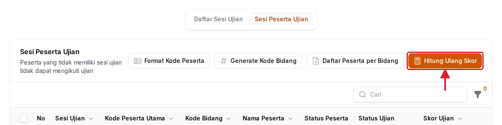
</Frame>

<Frame>
  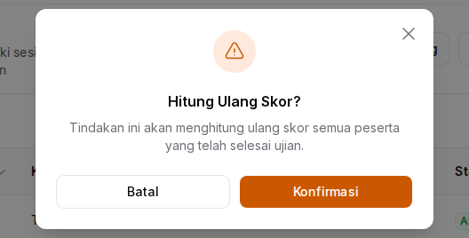
</Frame>

## Download participant result reports

A result report is a PDF for one participant. It includes the participant's details, a score analysis per test, a time analysis and answer details per question.

### Report for one participant

In the **Daftar Peserta Ujian** section, click **Unduh Laporan** (Download Report) on the participant's row. The button appears once the participant has finished at least one test. The PDF downloads straight away.

<Frame>
  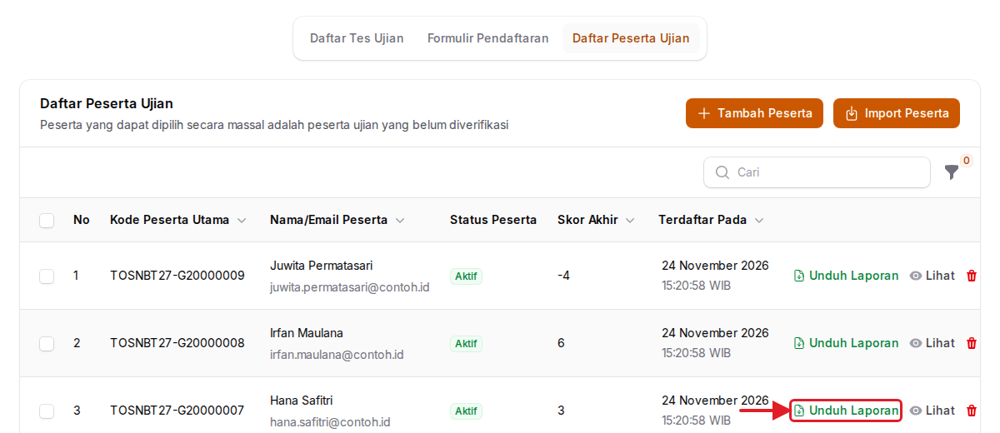
</Frame>

### Reports for several participants (ZIP)

<Steps>
  <Step title="Select participants, then Unduh Laporan (ZIP)">
    Tick the participants, click **Tindakan** (Actions), then choose **Unduh Laporan (ZIP)**.

    <Frame>
      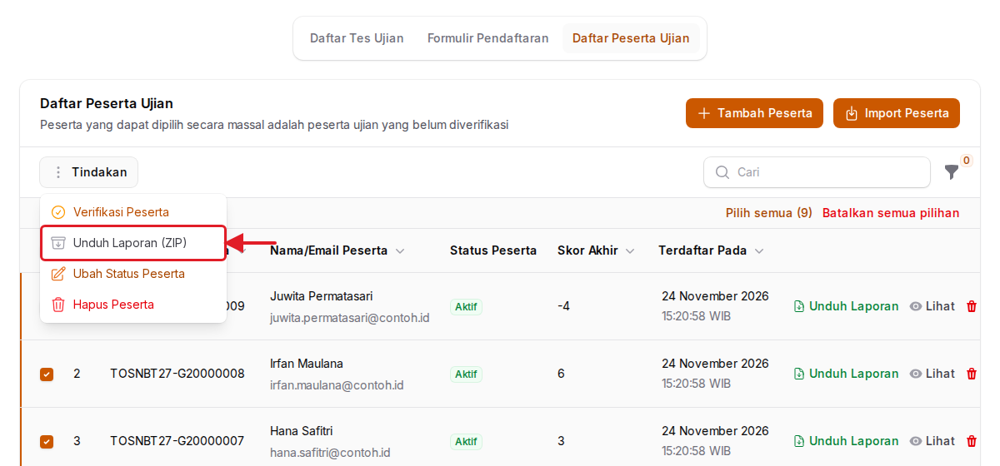
    </Frame>
  </Step>
  <Step title="Confirm">
    In the **Unduh Laporan Massal** (Bulk Report Download) window, click **Konfirmasi**.

    <Frame>
      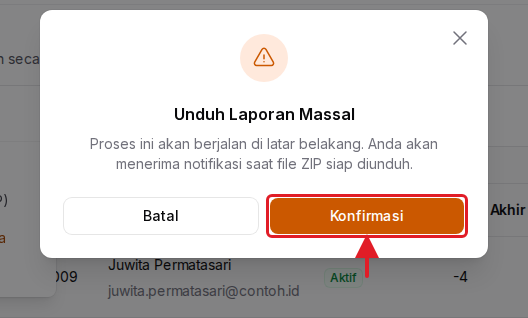
    </Frame>

    A ZIP archive with each participant's PDF report is created in the background. When the **Ekspor Laporan Massal Selesai** (Bulk report export finished) notification appears, download the file with its **di sini** link or from [Download Exports](/en/cbt/unduh-hasil-ekspor).
  </Step>
</Steps>
