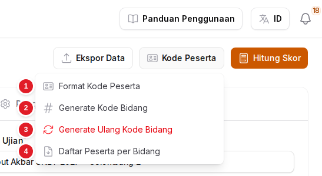
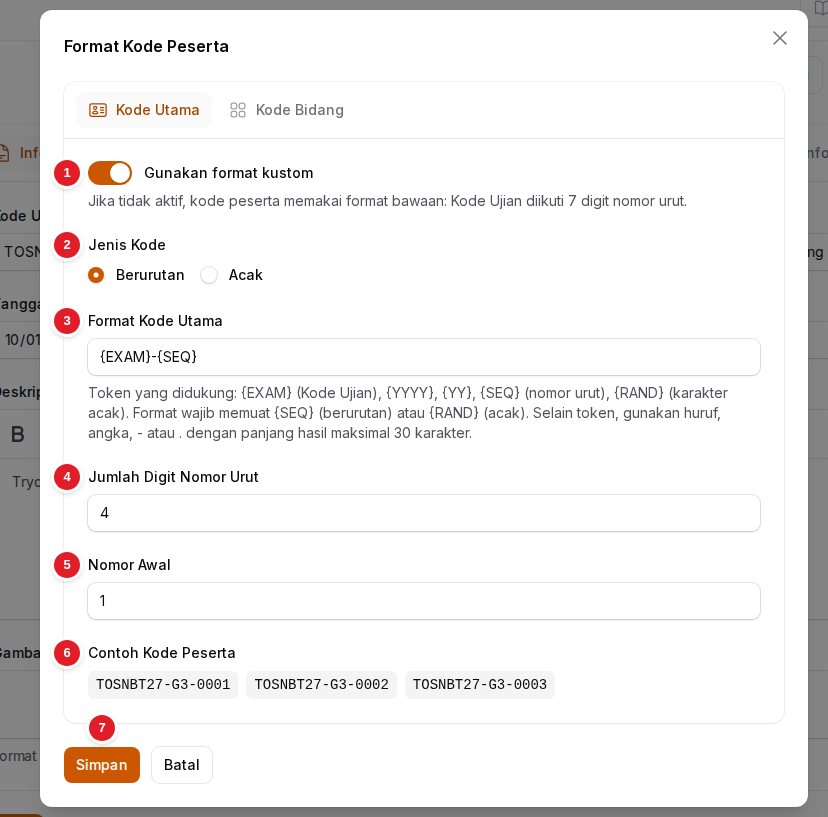
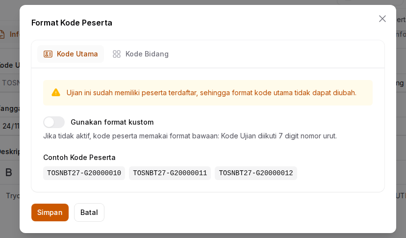
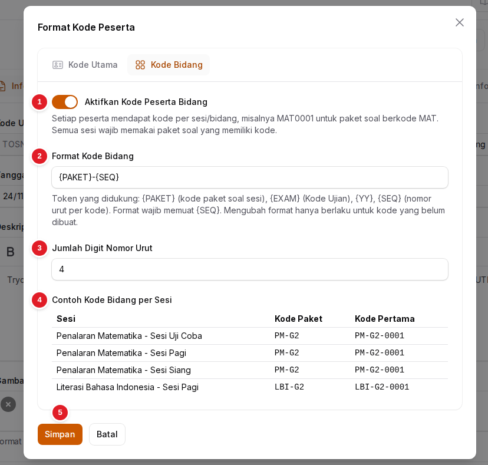
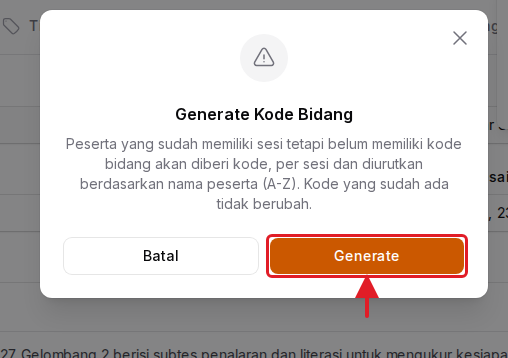
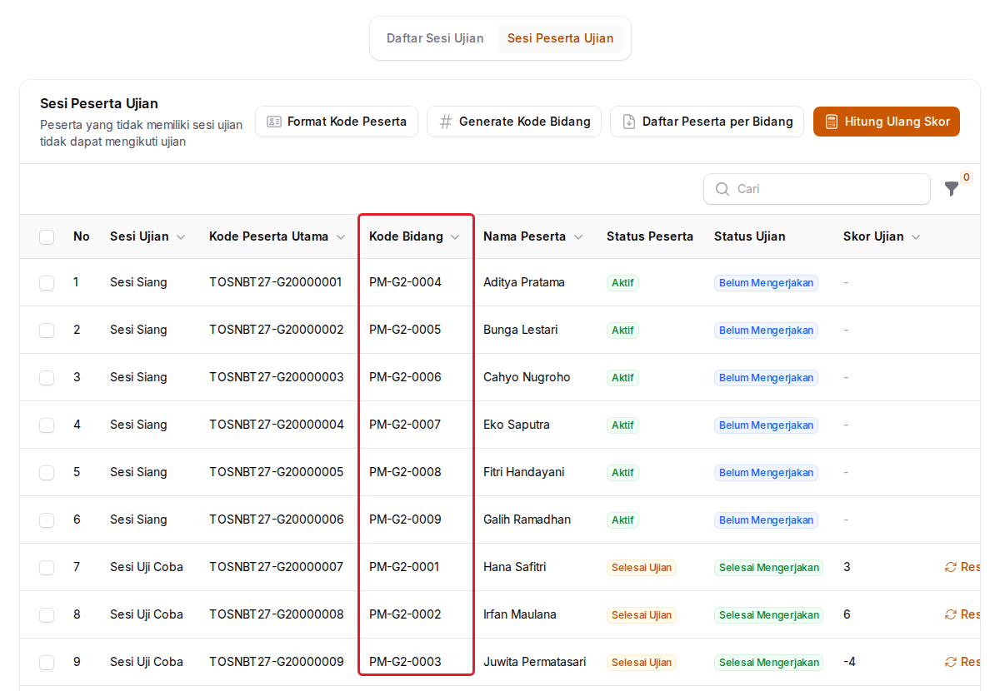
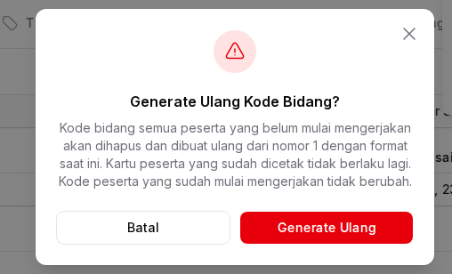
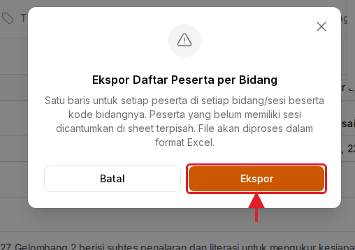
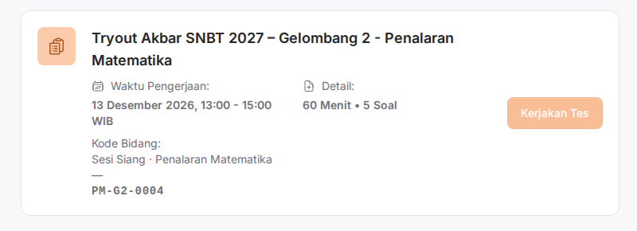
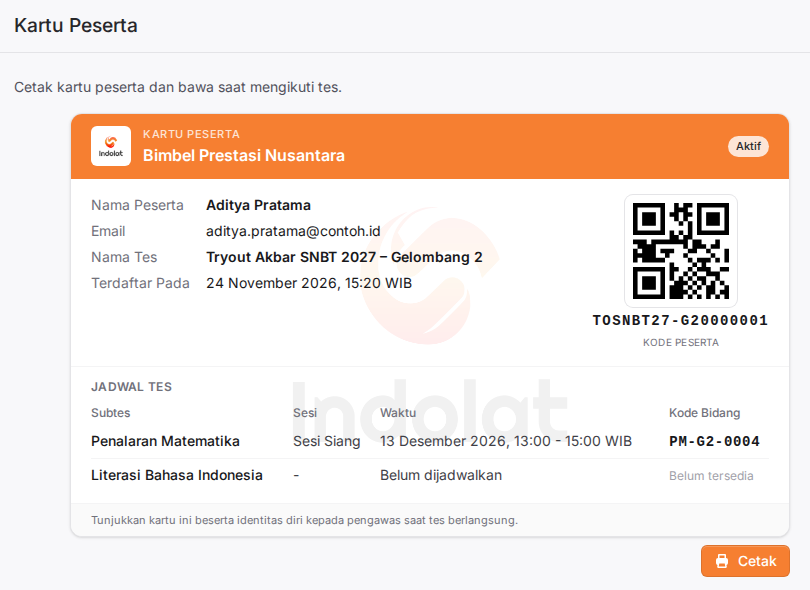

Every exam participant gets a **participant code**. It appears in the participant lists, in the exam result files and on the **Kartu Peserta** (Participant Card) participants can print. This page explains how to set the participant code format and how to use **field codes**: extra per-session codes for exams whose participants are split across fields or rooms.

<Info>
  **Menu location:** **Portal** → **Platform Ujian (CBT)** → **Manajemen Ujian** → **Data Ujian** → **Detail** on the exam → **Kode Peserta** (Participant Code) button at the top right.
</Info>

There are two kinds of code:

| Code | Issued | Example |
| --- | --- | --- |
| **Kode Peserta Utama** (Main Participant Code) | One code per participant per exam, when the participant registers. | **TOSNBT27-G20000001** |
| **Kode Bidang** (Field Code) | One code per participant per test, based on the session and that session's question package. Only issued when turned on. | **PM-G2-0001** |

For example, **Tryout Akbar SNBT 2027 – Gelombang 2** uses the default main code and the field code format `{PAKET}-{SEQ}`, so participants of the Penalaran Matematika test (question package code **PM-G2**) get **PM-G2-0001**, **PM-G2-0002** and so on.

## Open the Kode Peserta menu

Click **Kode Peserta** at the top right of the **Detail Ujian** page. Before field codes are turned on, the menu only contains **Format Kode Peserta**. Once field codes are on, it contains:

<Frame>
  
</Frame>

1. **Format Kode Peserta** (Participant Code Format): set the main code and field code formats.
2. **Generate Kode Bidang** (Generate Field Codes): create field codes for participants who do not have one yet.
3. **Generate Ulang Kode Bidang** (Regenerate Field Codes): recreate the field codes of every participant who has not started.
4. **Daftar Peserta per Bidang** (Participants per Field): export the participant list with field codes to Excel.

**Format Kode Peserta**, **Generate Kode Bidang** and **Daftar Peserta per Bidang** are also available in the **Sesi Peserta Ujian** (Participant Sessions) section of a test's details.

## Set the main code format

By default, the main code is the **Kode Ujian** (Exam Code) followed by a 7-digit sequence number, such as **TOSNBT27-G20000001**. To use your own format, set it before the exam has participants. The example below uses **Tryout Akbar SNBT 2027 – Gelombang 3**, which has no participants yet.

<Steps>
  <Step title="Open Format Kode Peserta">
    Click **Kode Peserta** → **Format Kode Peserta**. The window opens on the **Kode Utama** (Main Code) tab.
  </Step>
  <Step title="Fill in the main code format">
    <Frame>
      
    </Frame>

    1. **Gunakan format kustom** (Use a custom format): turn this on to use your own format. When it is off, the default format is used.
    2. **Jenis Kode** (Code Type): choose **Berurutan** (Sequential) or **Acak** (Random).
    3. **Format Kode Utama** (Main Code Format): the code pattern. Supported tokens:
       - `{EXAM}`: the **Kode Ujian**,
       - `{YYYY}` and `{YY}`: four- or two-digit year,
       - `{SEQ}`: sequence number, required for **Berurutan**,
       - `{RAND}`: random characters, required for **Acak**.

       Apart from tokens, you may only use letters, numbers, `-` or `.`. The resulting code can be at most 30 characters. Example: `{EXAM}-{SEQ}`.
    4. **Jumlah Digit Nomor Urut** (Number of Digits): length of the sequence number; **4** gives **0001**. For **Acak** this field is replaced by **Jumlah Karakter Acak** (Number of Random Characters); random codes never use 0, O, 1, I or L so they are not confused.
    5. **Nomor Awal** (Starting Number): the first sequence number, such as **1**.
    6. **Contoh Kode Peserta** (Sample Codes): a preview of the next three codes. If the format is invalid, the error appears here.
    7. Click **Simpan** (Save).
  </Step>
</Steps>

<Warning>
  Once the exam has registered participants, the main code format **can no longer be changed**, because codes that have been shared or printed must not change. The **Kode Utama** tab shows this warning:

  <Frame>
    
  </Frame>
</Warning>

## Turn on field codes

Field codes are useful when participants of one test are split across several sessions or fields, such as rooms or subjects, and each participant needs a number within that field.

<Note>
  If the field code format uses `{PAKET}`, **every session** in the exam must use a question package that has a **Kode Paket Soal** (Question Package Code). The code is set in **Data Paket Soal**, see [Create a Question Package](/en/paket-soal/membuat-paket-soal). If any session's package has no code, the system lists those sessions and the settings cannot be saved.
</Note>

<Steps>
  <Step title="Open the Kode Bidang tab">
    Click **Kode Peserta** → **Format Kode Peserta**, then choose the **Kode Bidang** tab.
  </Step>
  <Step title="Set up field codes">
    <Frame>
      
    </Frame>

    1. **Aktifkan Kode Peserta Bidang** (Turn On Field Codes): turn this on so each participant gets a per-session code.
    2. **Format Kode Bidang** (Field Code Format): the code pattern. Supported tokens: `{PAKET}` (the session's question package code), `{EXAM}` (Exam Code), `{YY}` and `{SEQ}` (sequence number per code, required). Default: `{PAKET}{SEQ}`. Example: `{PAKET}-{SEQ}`.
    3. **Jumlah Digit Nomor Urut** (Number of Digits): length of the sequence number, **4** by default.
    4. **Contoh Kode Bidang per Sesi** (Sample Field Code per Session): a table with **Sesi** (Session), **Kode Paket** (Package Code) and **Kode Pertama** (First Code) for each session.
    5. Click **Simpan**.

    Numbers are counted per resulting code. In this example every Penalaran Matematika session uses the **PM-G2** package, so numbering continues across those sessions. Changing the format only affects codes that have not been created yet.
  </Step>
</Steps>

Once field codes are on, participants who are assigned or moved to a session get a field code straight away. Participants who were already in a session before field codes were turned on need **Generate Kode Bidang**.

## Generate field codes

<Steps>
  <Step title="Click Generate Kode Bidang">
    Click **Kode Peserta** → **Generate Kode Bidang**, then click **Generate** in the confirmation window.

    <Frame>
      
    </Frame>

    The system gives a code to every participant who has a session but no field code, session by session and sorted by participant name (A–Z). Existing codes do not change. The notification shows how many codes were created and which participants were skipped because their session's question package has no code.
  </Step>
  <Step title="Check participants' field codes">
    Open the test details and go to **Sesi Peserta Ujian**. The **Kode Bidang** column appears next to **Kode Peserta Utama**.

    <Frame>
      
    </Frame>
  </Step>
</Steps>

### Regenerate field codes

**Generate Ulang Kode Bidang** deletes the field codes of every participant who has not started and recreates them from number 1 with the current format. Codes of participants who have started are kept.

<Frame>
  
</Frame>

<Warning>
  After field codes are regenerated, participant cards that were already printed are no longer valid. Only do this before participant cards are handed out.
</Warning>

## Export participants per field

Click **Kode Peserta** → **Daftar Peserta per Bidang**, then click **Ekspor** (Export).

<Frame>
  
</Frame>

The Excel file has two sheets:

- **Peserta per Bidang** (Participants per Field): one row per participant per session, with **Kode Bidang**, **Kode Peserta Utama**, **Nama** (Name), **Email**, **Label**, **Subtes** (Subtest), **Bidang/Sesi** (Field/Session), **Jadwal Mulai** (Start) and **Jadwal Selesai** (End).
- **Belum Ada Sesi** (No Session Yet): participants who have not been assigned to a session for a subtest.

The file is processed in the background. When it is ready you get a notification, and the file can be downloaded from [Download Exports](/en/cbt/unduh-hasil-ekspor).

## Participant codes in the participant app

Participants see their field code on the test card on the **Daftar Tes** (Test List) page:

<Frame>
  
</Frame>

Participants can also open **Kartu Peserta** from the name menu at the top right. The card shows the main participant code (with a QR code), the schedule of each subtest and its field code. Participants can print it with **Cetak** (Print).

<Frame>
  
</Frame>

Participant codes are also used in the **Hasil Tes Ujian** and **Template Leaderboard** files. See [Exam Results and Exports](/en/data-ujian/hasil-dan-ekspor-ujian).
