The registration form contains the questions participants answer when they register for an exam themselves in the participant app. This page explains how to open registration, build the form questions, charge a registration fee, offer voucher codes, verify registrants, and limit the quota.

<Info>
  Menu location: **Portal** → **Platform Ujian (CBT)** → **Manajemen Ujian** → **Data Ujian** (Exam Data) → **Detail** on the exam → **Formulir Pendaftaran** (Registration Form) tab.

  This feature requires the **Halaman Pendaftaran Ujian dan Pembayaran Otomatis** (Exam Registration Page and Automatic Payment) add-on. If the add-on is not active, the **Formulir Pendaftaran** tab only shows the **Aktifkan Add-on Formulir Pendaftaran** button, which leads to **Administrasi Aplikasi** → **Keuangan** → **Langganan & Tagihan** (Subscription & Billing).
</Info>

As an example, you are the admin of **Bimbel Prestasi Nusantara** opening registration for **Tryout Persiapan SNBT 2027 Batch Desember** (code **TPS-DES27**) with a fee of Rp50,000. When registering, participants are asked for:

- **Asal Cabang Lembaga** (Branch: Surabaya or Jakarta)
- **Nomor WhatsApp** (WhatsApp number)
- **Asal Sekolah** (School)

Participants from the Jakarta branch pay the registration fee, while participants from the Surabaya branch do not.

## 1. Open registration and set the fee

The exam and its exam tests must already exist. If not, follow [Create an Exam](/en/data-ujian/membuat-ujian).

<Steps>
  <Step title="Open the exam detail">
    Open **Data Ujian**, find the exam, then click **Detail**.

    <Frame>
      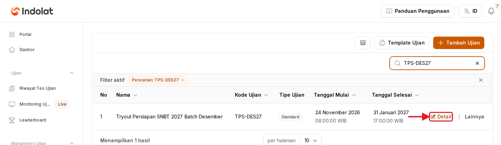
    </Frame>
  </Step>
  <Step title="Set the Pendaftaran & Pembayaran tab">
    <Frame>
      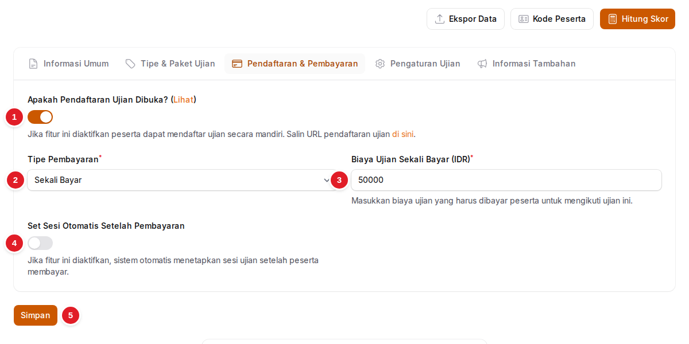
    </Frame>

    1. **Apakah Pendaftaran Ujian Dibuka?** (Is Registration Open?): turn on so the exam appears on the participant registration page.
    2. **Tipe Pembayaran** (Payment Type): choose **Sekali Bayar** (One-Time Payment) if participants pay when registering. The **Metode Pembayaran** (Payment Method) question, which triggers the payment, is only available for this type. The other payment types are explained in [Create a Multi-Level Exam](/en/data-ujian/membuat-ujian-berjenjang).
    3. **Biaya Ujian Sekali Bayar (IDR)** (One-Time Exam Fee): the registration fee, minimum Rp5,000. Example: **50000**.
    4. **Set Sesi Otomatis Setelah Pembayaran** (Assign Session Automatically After Payment, optional): when on, participants are automatically placed in the first exam session of each test after the payment succeeds. It can only be turned on once the fee is filled in. For **Gratis** (Free) exams, this setting is called **Set Sesi Otomatis Setelah Pendaftaran** (after registration). Make sure every test already has an exam session.
    5. Click **Simpan** (Save).

    The exam appears on the participant registration page while registration is open and the current time is between the exam's **Tanggal Mulai** and **Tanggal Selesai**.

    <Tip>
      Click the **di sini** (here) link in the helper text of **Apakah Pendaftaran Ujian Dibuka?** to copy the exam registration URL. Share it with participants; after signing in to their account, they go straight to this exam's registration form.
    </Tip>
  </Step>
</Steps>

## 2. Build the registration form

Form questions are created one by one in the **Formulir Pendaftaran** tab at the bottom of the exam detail page. The tab has three buttons: the gear icon (form settings, see section 6), **Kode Voucher** (Voucher Code, see section 4), and **Tambah Formulir Pendaftaran** (Add Registration Form).

<Frame>
  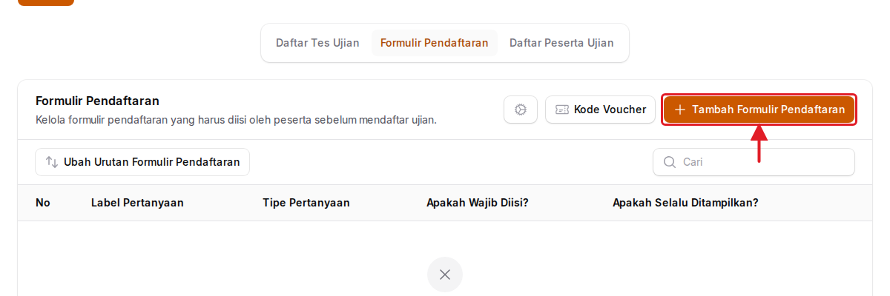
</Frame>

Click **Tambah Formulir Pendaftaran** to open the question window. The **Template Pertanyaan (Opsional)** (Question Template) field lists the templates provided by the system, namely **Metode Pembayaran**. Each template can be used only once per exam.

<Frame>
  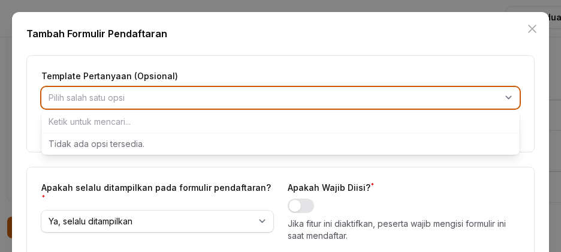
</Frame>

<AccordionGroup>
  <Accordion title="Adding the Metode Pembayaran question for all participants">
    Use this when every registrant must pay.

    <Frame>
      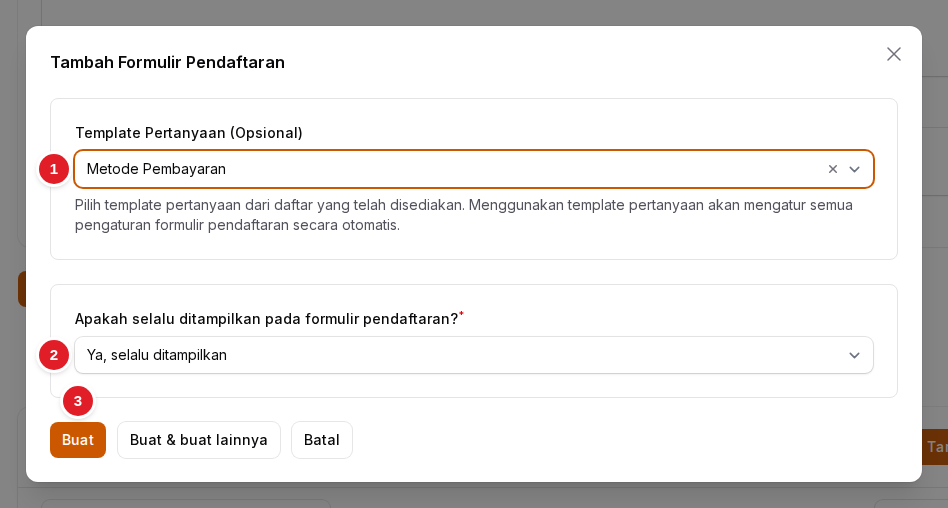
    </Frame>

    1. **Template Pertanyaan (Opsional)**: choose **Metode Pembayaran**. The label, type, answer option (**QRIS**), and instructions are filled in automatically, and the question is always required.
    2. **Apakah selalu ditampilkan pada formulir pendaftaran?** (Always show on the registration form?): choose **Ya, selalu ditampilkan** (Yes, always show).
    3. Click **Buat** (Create).

    <Note>
      The **Metode Pembayaran** template can only be chosen when **Tipe Pembayaran** is **Sekali Bayar**. If the payment type is later changed to another type, the **Metode Pembayaran** question is removed from the form automatically.
    </Note>
  </Accordion>

  <Accordion title="Creating your own question">
    Example: the question **Asal Cabang Lembaga** with the options **Surabaya** and **Jakarta**.

    <Frame>
      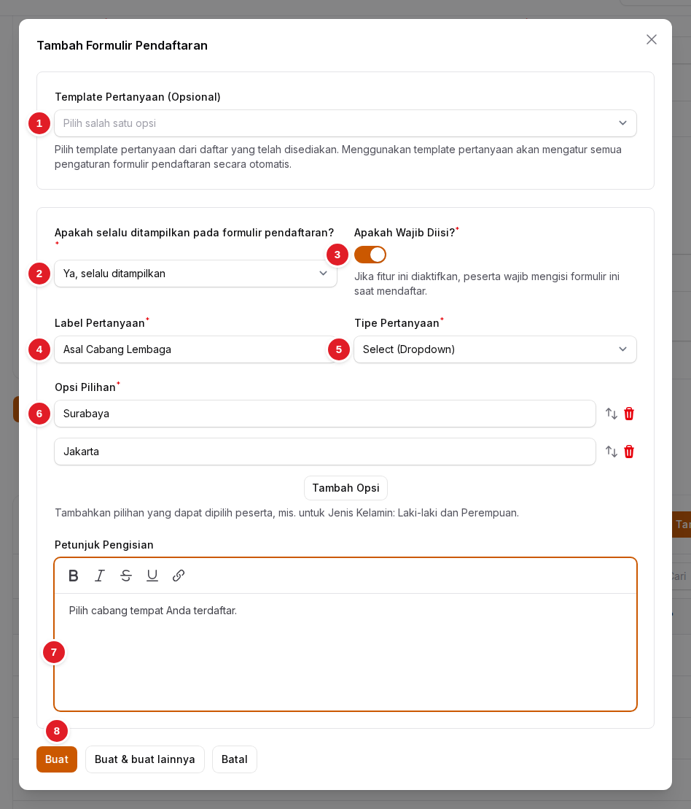
    </Frame>

    1. **Template Pertanyaan (Opsional)**: leave empty.
    2. **Apakah selalu ditampilkan pada formulir pendaftaran?**: choose **Ya, selalu ditampilkan**.
    3. **Apakah Wajib Diisi?** (Required?): turn on so participants cannot register without answering.
    4. **Label Pertanyaan** (Question Label): the question text participants see. Example: **Asal Cabang Lembaga**.
    5. **Tipe Pertanyaan** (Question Type): how participants answer. The options are:
       - **Text (Input Biasa)**: a short answer, such as a WhatsApp number or school.
       - **Textarea (Paragraf)**: a long answer, such as a full address.
       - **Select (Dropdown)**: one answer from a list opened like a menu.
       - **Radio (Pilihan Tunggal)**: one answer, with all options shown at once.
       - **Checkbox (Pilihan Ganda)**: more than one answer allowed.
       - **File (Berkas)**: the participant uploads a JPG, JPEG, PNG, PDF, DOC, or DOCX file of up to about 4 MB.
       - **Date (Tanggal)**: a date only, such as a date of birth.
       - **Datetime (Tanggal & Waktu)**: a date and time.
    6. **Opsi Pilihan** (Options): appears for Select, Radio, and Checkbox. Fill in each option, for example **Surabaya** and **Jakarta**, and click **Tambah Opsi** (Add Option) for another row. Options must be different from each other, and their order can be changed with the arrow icon.
    7. **Petunjuk Pengisian** (Instructions, optional): a short hint below the answer field, up to 1,000 characters. Example: _Pilih cabang tempat Anda terdaftar._
    8. Click **Buat**, or **Buat & buat lainnya** (Create & create another) to create the next question right away.

    In the same way, create the questions **Nomor WhatsApp** and **Asal Sekolah** of type **Text (Input Biasa)**, both required.

    <Note>
      When a question is edited, **Template Pertanyaan (Opsional)** and **Tipe Pertanyaan** cannot be changed. Delete the question and create it again if its type needs to change.
    </Note>
  </Accordion>

  <Accordion title="Showing a question based on a condition">
    A question can be set to appear only when the participant gives a specific answer to another question. In this example, **Metode Pembayaran** only appears for Jakarta participants, so Surabaya participants are not charged a registration fee.

    <Frame>
      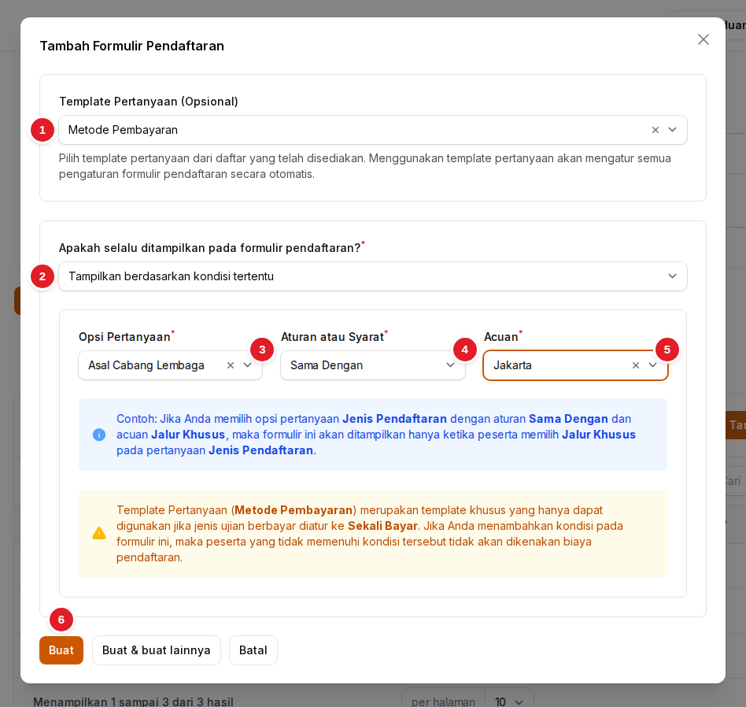
    </Frame>

    1. **Template Pertanyaan (Opsional)**: choose **Metode Pembayaran** (or create your own question as above).
    2. **Apakah selalu ditampilkan pada formulir pendaftaran?**: choose **Tampilkan berdasarkan kondisi tertentu** (Show based on a condition).
    3. **Opsi Pertanyaan** (Question): the question the condition is based on. This list contains the other questions on the same form, except **Metode Pembayaran**.

       <Frame>
         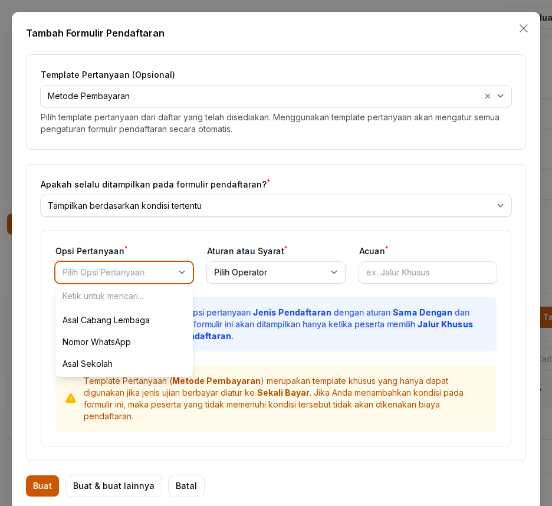
       </Frame>
    4. **Aturan atau Syarat** (Rule): how the answer is compared.
       - **Sama Dengan** (Equals) and **Bukan** (Not): the answer equals or does not equal the reference.
       - **Kurang Dari**, **Lebih Dari**, **Kurang Dari Sama Dengan**, and **Lebih Dari Sama Dengan** (less than, greater than, less than or equal, greater than or equal): for numeric answers.
       - **Salah Satu dari** (One of) and **Bukan Salah Satu dari** (None of): the answer is or is not among several references. References for these rules are chosen from the project's reference list; if a reference does not exist yet, create it directly from the field.
    5. **Acuan** (Reference): the answer that makes the question appear. If the **Opsi Pertanyaan** question is a Select or Radio, the reference is chosen from its options. Example: **Jakarta**.

       <Frame>
         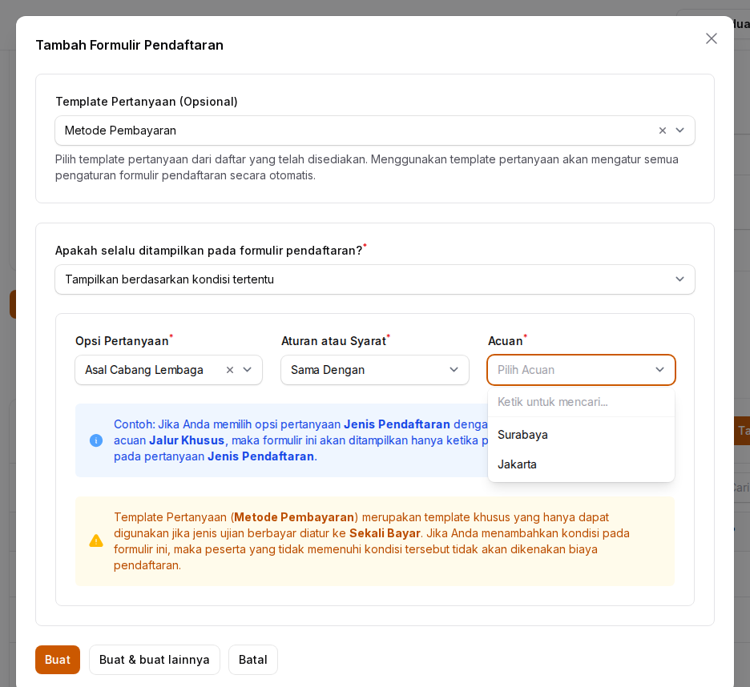
       </Frame>
    6. Click **Buat**.

    Result: if a participant chooses **Asal Cabang Lembaga** = **Jakarta**, the **Metode Pembayaran** question appears and the participant must pay. If they choose **Surabaya**, the question does not appear and they register without a fee.
  </Accordion>
</AccordionGroup>

All questions appear in the **Formulir Pendaftaran** table with their type, required status, and **Selalu Ditampilkan** (Always shown) or **Kondisi Tertentu** (Conditional). Click **Ubah Urutan Formulir Pendaftaran** (Reorder Registration Form) to change the question order, then click **Selesai Mengurutkan** (Done Reordering). Use **Ubah** (Edit) or **Hapus** (Delete) on each row to manage a question.

<Frame>
  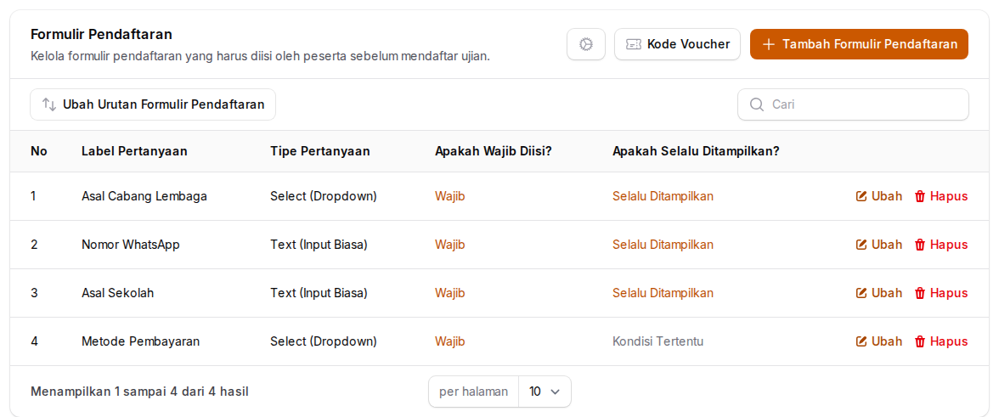
</Frame>

## 3. Registration from the participant's side

This is the flow participants follow in the participant app, for example `https://prestasi.indolat.web.id`.

<Steps>
  <Step title="The participant signs in to the participant app">
    The participant signs in with their account. Sign-in settings are explained in [Participant Login Settings](/en/lainnya/login-peserta).

    <Frame>
      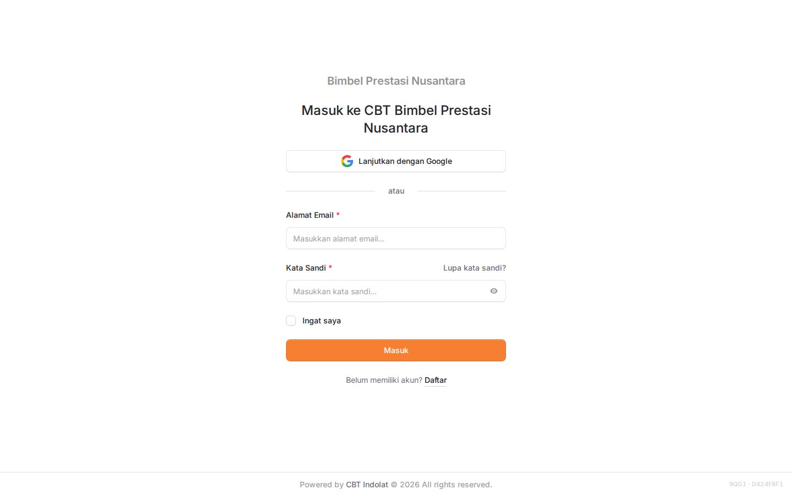
    </Frame>
  </Step>
  <Step title="The participant clicks Pendaftaran Tes Baru">
    The **Pendaftaran Tes Baru** (New Test Registration) button is on the **Daftar Tes** (Test List) page. If the participant opens the registration URL you shared, this step and the next are skipped.

    <Frame>
      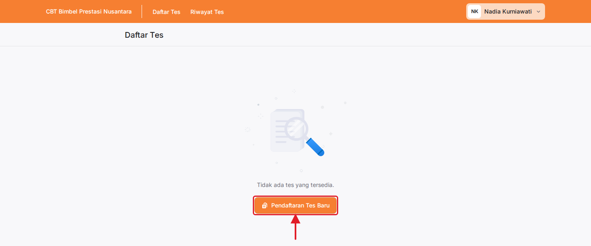
    </Frame>
  </Step>
  <Step title="The participant chooses the exam">
    <Frame>
      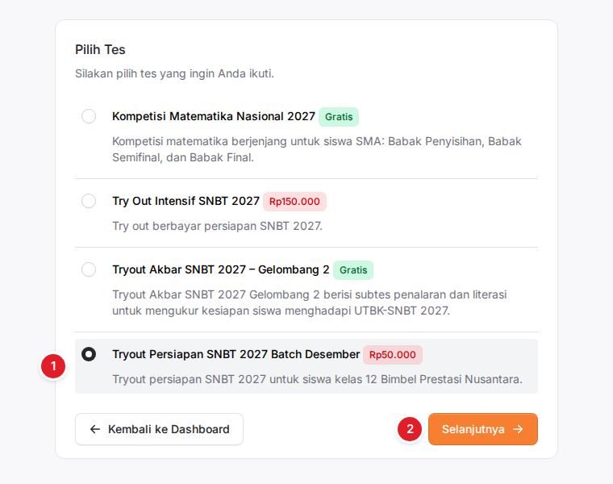
    </Frame>

    1. The participant chooses the exam. Each exam is labelled **Gratis**, its fee (for example **Rp50.000**), or **Kuota Penuh** (Quota Full). Exams already registered for are labelled **Terdaftar** (Registered), **Menunggu Pembayaran** (Awaiting Payment), or **Sedang Verifikasi** (Under Verification).
    2. The participant clicks **Selanjutnya** (Next).
  </Step>
  <Step title="The participant fills in the form">
    The registration page shows the exam name and the form questions. Example for a Jakarta participant:

    <Frame>
      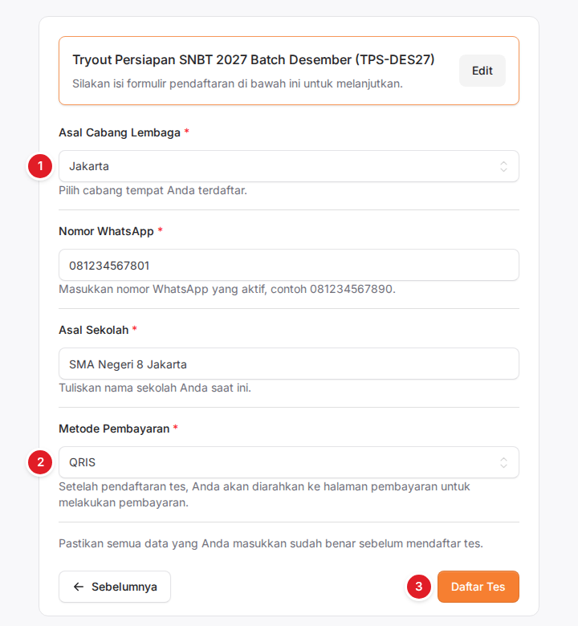
    </Frame>

    1. The participant chooses **Jakarta** for **Asal Cabang Lembaga**, then fills in the other questions.
    2. The **Metode Pembayaran** question appears; the participant chooses **QRIS**.
    3. The participant clicks **Daftar Tes** (Register).

    For a Surabaya participant, the **Metode Pembayaran** question does not appear:

    <Frame>
      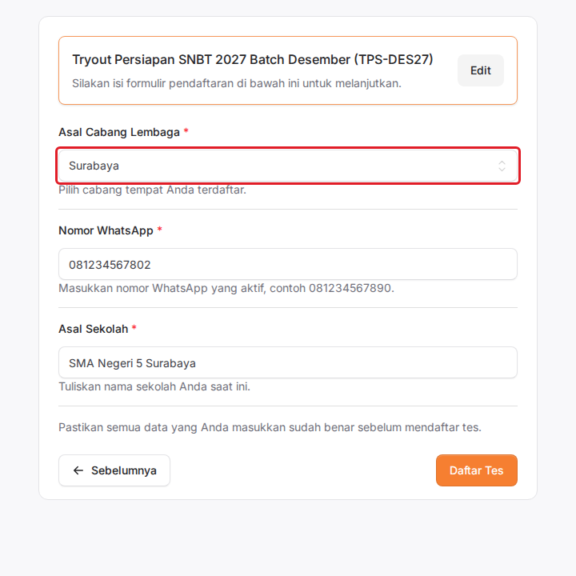
    </Frame>

    If the exam has no form questions, this page states that no registration form is required and the participant can register right away.
  </Step>
  <Step title="The participant confirms the registration">
    The participant checks the data, then clicks **Ya, Daftar** (Yes, Register) in the **Konfirmasi Pendaftaran** (Registration Confirmation) window.

    <Frame>
      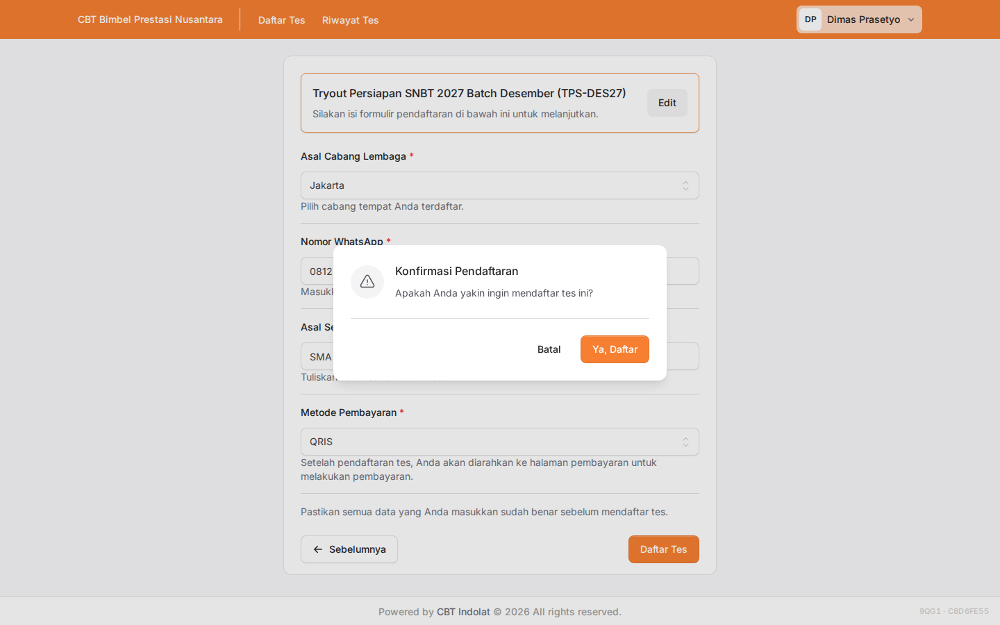
    </Frame>

    Participants who do not need to pay are taken to the **Daftar Tes** page. Participants who must pay are taken to the **Detail Pembayaran** (Payment Details) page.
  </Step>
  <Step title="The participant pays by QRIS">
    <Frame>
      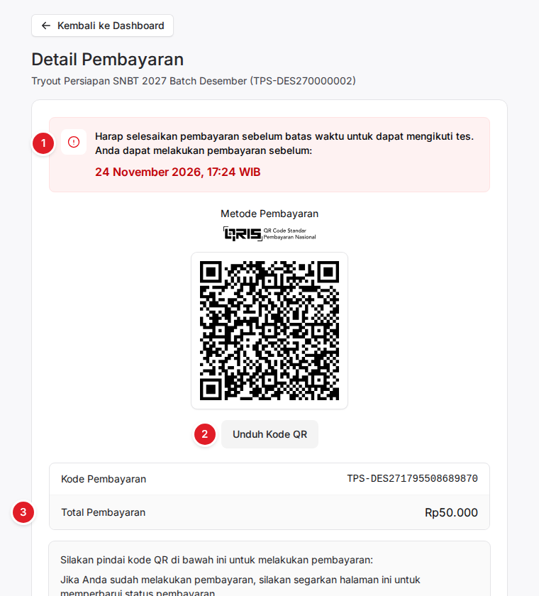
    </Frame>

    1. The payment deadline, which is 2 hours after registration.
    2. The QR code, scanned with any payment app that supports QRIS. The participant can click **Unduh Kode QR** (Download QR Code) to save it.
    3. **Kode Pembayaran** (Payment Code) and **Total Pembayaran** (Total Payment).

    <Note>
      If **Bebankan Biaya Transaksi ke Admin** (Charge Transaction Fees to Admin) in **Platform Ujian (CBT)** → **Lainnya** → **Pengaturan Aplikasi** is off, this page also shows a **Biaya Transaksi** (Transaction Fee) row, and the total the participant pays includes that fee.
    </Note>

    After paying, the participant reloads this page. If the payment succeeded, the page shows that the payment has been received and **Status Pembayaran** (Payment Status) **Sudah Dibayar** (Paid).

    <Frame>
      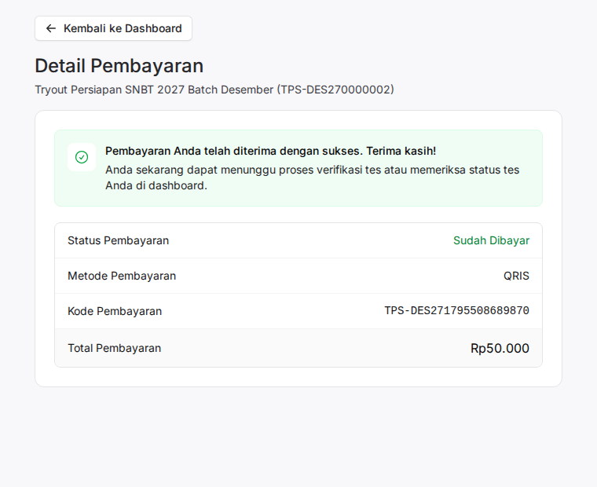
    </Frame>

    Participants who have not paid by the deadline cannot take the exam. Payment history can be monitored in **Riwayat Transaksi** (Transaction History; see [Transactions and Balance Withdrawals](/en/lainnya/transaksi-dan-penarikan-saldo)).
  </Step>
</Steps>

## 4. Create voucher codes

A voucher code gives selected participants a discount on the registration fee without changing the exam fee. Example: the voucher **PROMO-PRESTASI** gives a 10% discount to the first 100 participants.

<Steps>
  <Step title="Click Kode Voucher">
    On the **Formulir Pendaftaran** tab, click **Kode Voucher**.

    <Frame>
      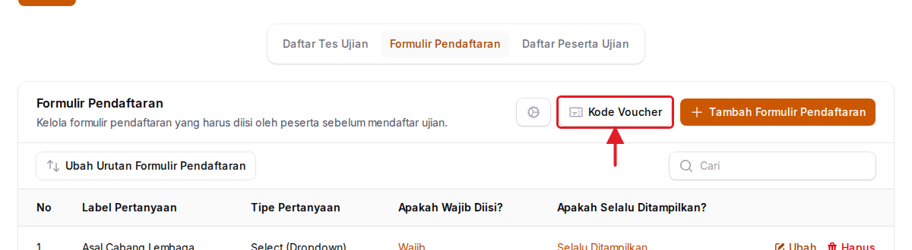
    </Frame>
  </Step>
  <Step title="Click Tambah Voucher">
    <Frame>
      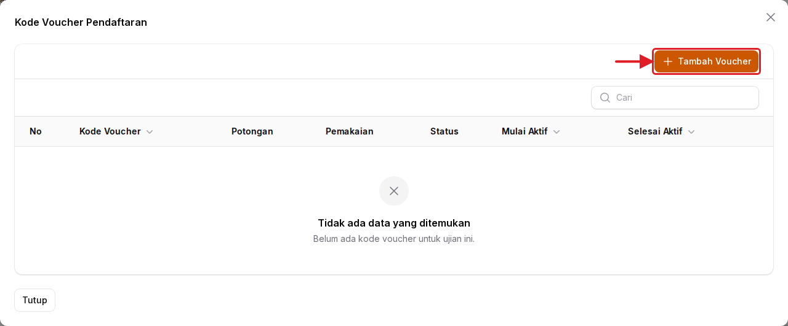
    </Frame>
  </Step>
  <Step title="Fill in the voucher information">
    <Frame>
      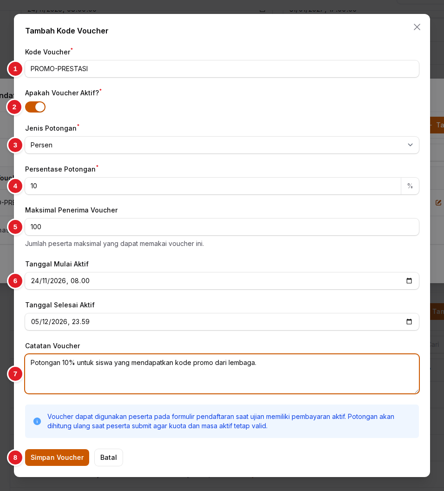
    </Frame>

    1. **Kode Voucher** (Voucher Code): the code participants enter, up to 100 characters and converted to uppercase automatically. It cannot match another voucher on the same exam. Example: **PROMO-PRESTASI**.
    2. **Apakah Voucher Aktif?** (Is the Voucher Active?): the voucher can only be used while active.
    3. **Jenis Potongan** (Discount Type): **Flat / Nominal** (a rupiah amount) or **Persen** (percentage).
    4. **Nominal Potongan** (Discount Amount, in Rp) for **Flat / Nominal**, or **Persentase Potongan** (Discount Percentage, 1–100%) for **Persen**. Example: **10**%.
    5. **Maksimal Penerima Voucher** (Maximum Voucher Recipients, optional): how many participants can use the voucher. Leave empty for no limit.
    6. **Tanggal Mulai Aktif** and **Tanggal Selesai Aktif** (Active From and Active Until, optional): the voucher's validity period.
    7. **Catatan Voucher** (Voucher Notes, optional): a note for admins.
    8. Click **Simpan Voucher** (Save Voucher).
  </Step>
  <Step title="Check the voucher list">
    The voucher appears with its discount, usage (for example **0 / 100**), status, and active period. Use **Ubah** or **Hapus** to manage it, then click **Tutup** (Close).

    <Frame>
      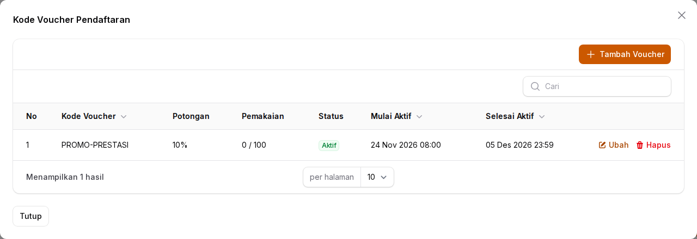
    </Frame>
  </Step>
</Steps>

## 5. Participants use a voucher code

The **Kode Voucher** field appears on the participant form when the exam has at least one voucher and the **Metode Pembayaran** question is showing.

<Steps>
  <Step title="The participant sees the Kode Voucher field">
    <Frame>
      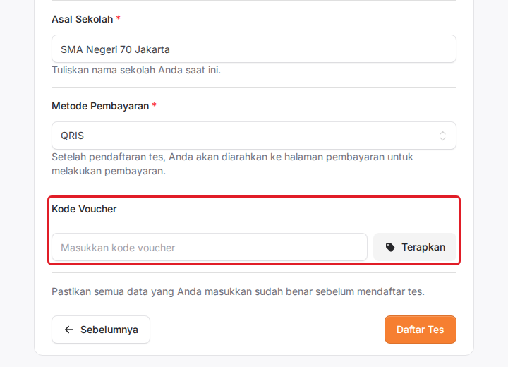
    </Frame>
  </Step>
  <Step title="The participant enters the code and clicks Terapkan">
    <Frame>
      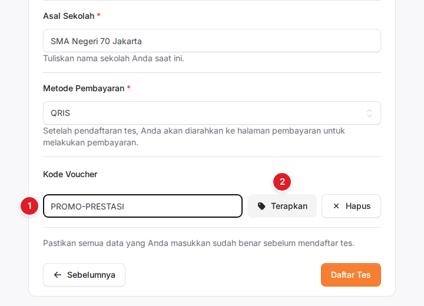
    </Frame>

    1. The participant types the voucher code.
    2. The participant clicks **Terapkan** (Apply). The **Hapus** button removes the entered voucher.
  </Step>
  <Step title="The system recalculates the fee">
    If the voucher is valid, the system shows **Voucher berhasil diterapkan.** (Voucher applied) with **Biaya ujian** (Exam fee), **Potongan voucher** (Voucher discount), and **Total pembayaran** (Total payment).

    <Frame>
      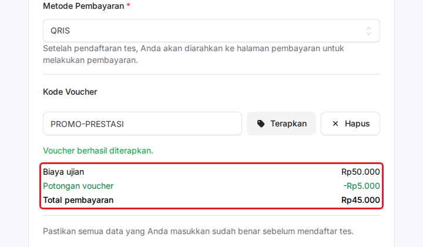
    </Frame>

    A voucher is rejected if the code is invalid, inactive, not yet started or already expired, its quota is used up, or it has already been used by the same account. The discount is recalculated when the participant clicks **Daftar Tes**. If the total becomes Rp0 (for example with a 100% discount), the participant is registered without payment.
  </Step>
</Steps>

## 6. Registration verification and quota

### Opening the registration form settings

Click the gear icon on the **Formulir Pendaftaran** tab to open **Pengaturan Formulir Pendaftaran** (Registration Form Settings).

<Frame>
  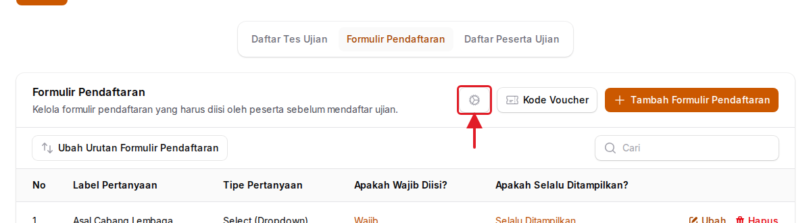
</Frame>

<Frame>
  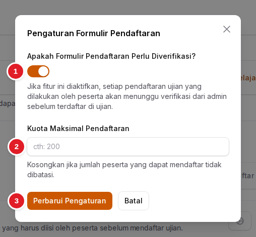
</Frame>

1. **Apakah Formulir Pendaftaran Perlu Diverifikasi?** (Does the Registration Form Need Verification?): when on, every registrant waits for admin verification before being registered for the exam. This setting is on by default.
2. **Kuota Maksimal Pendaftaran** (Maximum Registration Quota): the maximum number of exam participants. Leave empty for no limit.
3. Click **Perbarui Pengaturan** (Update Settings) to save.

<Note>
  Verification only applies to participants who fill in a registration form. If the exam has no form questions, participants become active right after registering (and after paying, for paid exams).
</Note>

### Verifying participants

Until verified, the exam shows a **Proses Verifikasi** (Verification in Progress) button on the participant's **Daftar Tes** page and cannot be taken yet.

<Frame>
  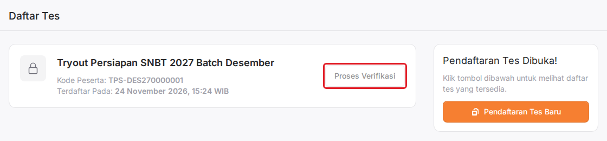
</Frame>

<Steps>
  <Step title="Click Verifikasi Peserta">
    Open the **Daftar Peserta Ujian** (Exam Participant List) tab on the exam detail page. Waiting registrants have the status **Menunggu Verifikasi** (Awaiting Verification); click **Verifikasi Peserta** (Verify Participant) on their row.

    <Frame>
      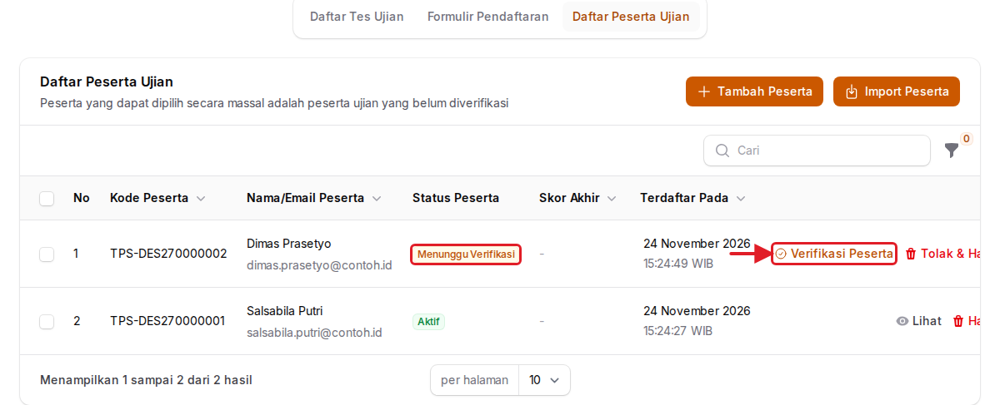
    </Frame>

    Participants who have not paid have the status **Menunggu Pembayaran** (Awaiting Payment) and cannot be verified yet.
  </Step>
  <Step title="Review the form answers and click Verifikasi">
    The **Verifikasi Peserta** window shows the participant's form answers. Click **Verifikasi** (Verify) if the data is correct.

    <Frame>
      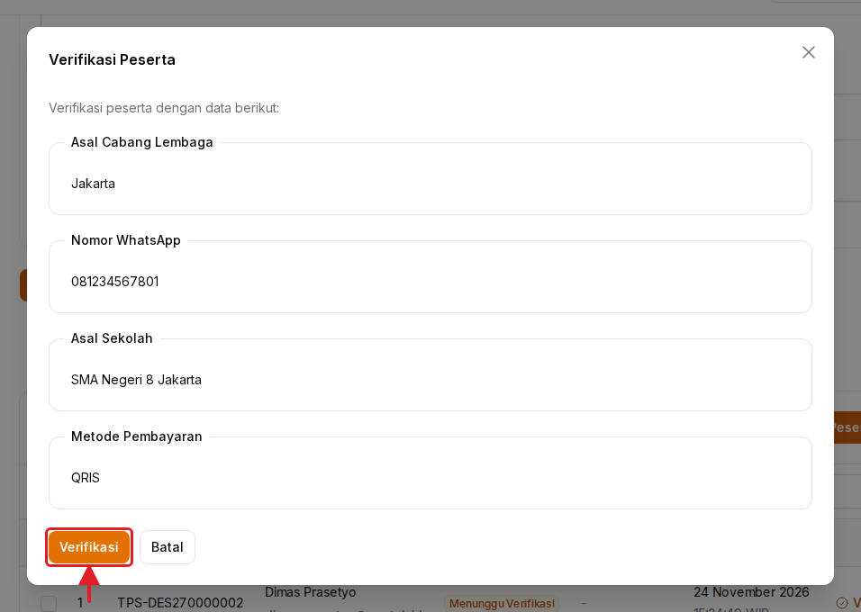
    </Frame>
  </Step>
  <Step title="The participant becomes Aktif">
    The system shows the notification **Berhasil Verifikasi Peserta** (Participant verified) and the participant's status changes to **Aktif** (Active).

    <Frame>
      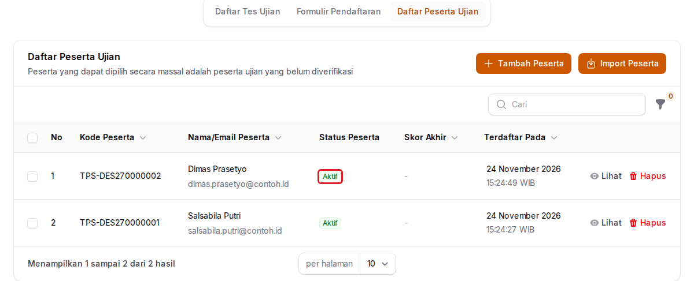
    </Frame>
  </Step>
</Steps>

<Tip>
  To verify many participants at once, tick them in the table, then choose **Tindakan** (Actions) → **Verifikasi Peserta**. To reject a registrant, click **Tolak & Hapus** (Reject & Delete) on their row.
</Tip>

### Viewing the form answers of verified participants

Click **Lihat** (View) on the participant in the **Daftar Peserta Ujian** tab.

<Frame>
  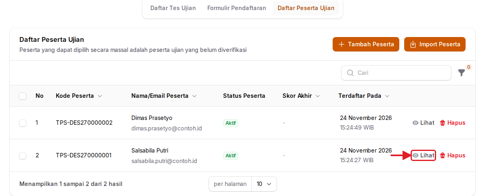
</Frame>

The form answers appear in the **Formulir Pendaftaran** section of the **Detail Peserta** (Participant Detail) page.

<Frame>
  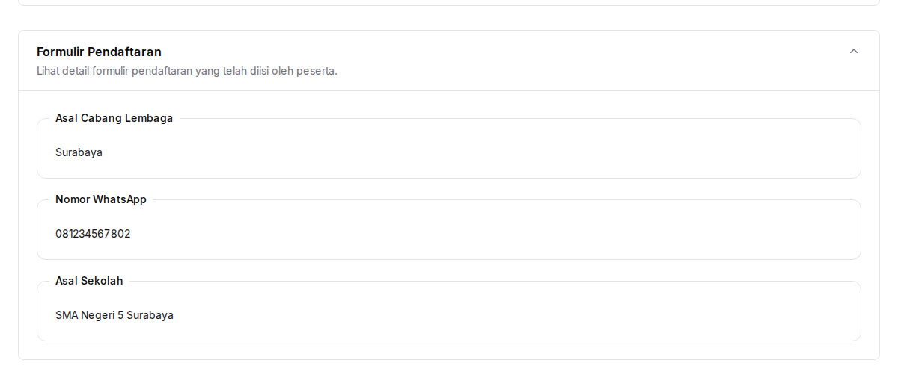
</Frame>

### Turning off verification

If registrants do not need to be checked, open the registration form settings, then:

<Frame>
  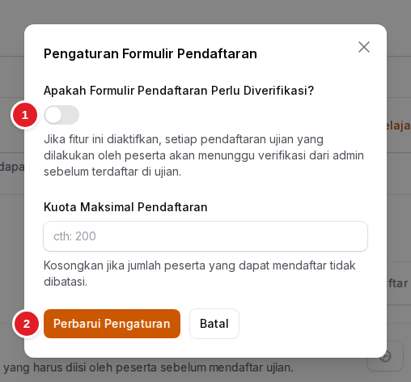
</Frame>

1. Turn off **Apakah Formulir Pendaftaran Perlu Diverifikasi?**.
2. Click **Perbarui Pengaturan**.

New registrants become **Aktif** right after registering (and after paying, for paid exams). Registrants who already have the status **Menunggu Verifikasi** still need to be verified.

<Frame>
  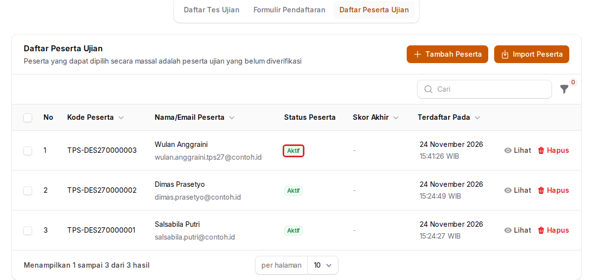
</Frame>

### Limiting the registration quota

Example: you only have 200 places.

<Frame>
  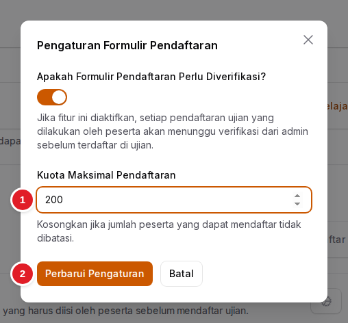
</Frame>

1. Fill in **Kuota Maksimal Pendaftaran**, for example **200**.
2. Click **Perbarui Pengaturan**.

The quota counts all exam participants, including those added by admins. Once the quota is reached, the exam is labelled **Kuota Penuh** on the registration page and further participants cannot register.
