An **exam session** sets **when** a test can be taken and which **question package** is used. Every participant must also be assigned to one of the sessions. This page explains how to create sessions, assign participants to them and move participants to another session.

<Info>
  **Menu location:** **Portal** → **Platform Ujian (CBT)** → **Manajemen Ujian** → **Data Ujian** → **Detail** on the exam → **Daftar Tes Ujian** → **Ubah** on the test. Sessions are managed in the **Daftar Sesi Ujian** (Session List) section and participant assignment in the **Sesi Peserta Ujian** (Participant Sessions) section.
</Info>

In short:

- The **test** defines what participants work on.
- The **session** defines the schedule and the question package.
- The **participant session** defines which participants take each schedule.

For example, the **Penalaran Matematika** test in **Tryout Akbar SNBT 2027 – Gelombang 2** is split into two sessions on 13 December 2026:

- **Sesi Pagi** (Morning Session), 08:00–10:00 WIB
- **Sesi Siang** (Afternoon Session), 13:00–15:00 WIB

Both sessions use the **Penalaran Matematika – Gelombang 2** question package.

<Warning>
  Participants cannot start a test if the test has no session, the session has no question package, or the participant has not been assigned to a session.
</Warning>

## Create a session

<Steps>
  <Step title="Open the test details">
    On the **Detail Ujian** page, open the **Daftar Tes Ujian** section and click **Ubah** (Edit) on a test marked **Tes belum memiliki sesi ujian** (This test has no exam session yet). This step is also described in [Create a Test](/en/data-ujian/membuat-tes-ujian).
  </Step>
  <Step title="Click Tambah Sesi Ujian">
    Scroll to the **Daftar Sesi Ujian** section and click **Tambah Sesi Ujian** (Add Session).

    <Frame>
      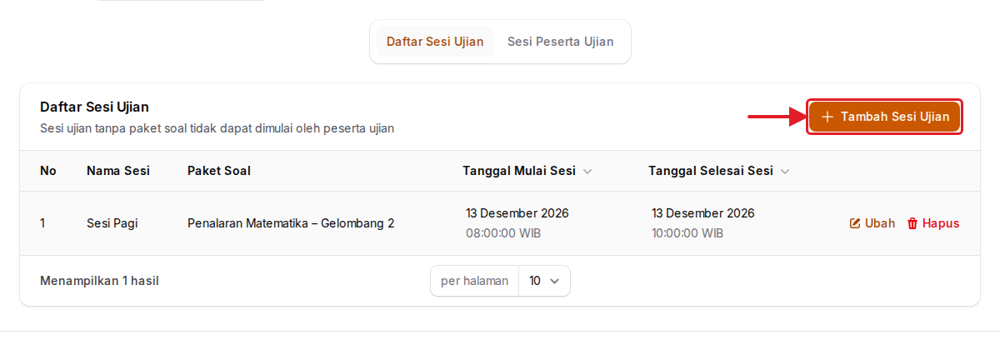
    </Frame>
  </Step>
  <Step title="Fill in the session details">
    <Frame>
      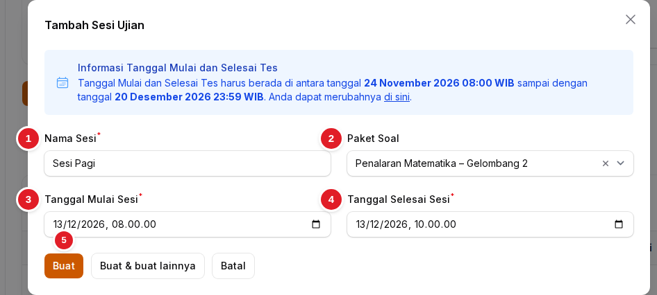
    </Frame>

    The information box at the top of the form shows the exam's date range. Session dates must fall inside it.

    1. **Nama Sesi** (Session Name): an easy-to-recognise name. Example: **Sesi Pagi**.
    2. **Paket Soal** (Question Package): the package answered in this session. The list only shows packages that match the test type (CBT/CAT packages for CBT and CAT tests, essay packages for essay tests). Example: **Penalaran Matematika – Gelombang 2**.
    3. **Tanggal Mulai Sesi** (Session Start): when participants can start the test. Example: 13 December 2026 at 08:00.
    4. **Tanggal Selesai Sesi** (Session End): the deadline for the test. Example: 13 December 2026 at 10:00.
    5. Click **Buat** (Create), or **Buat & buat lainnya** (Create & create another) to add the next session, such as **Sesi Siang**, straight away.

    <Note>
      - The range from **Tanggal Mulai Sesi** to **Tanggal Selesai Sesi** must fall between the exam's **Tanggal Mulai** and **Tanggal Selesai**. Example: the exam runs from 24 November to 20 December 2026, so a session cannot be scheduled before or after that range. The **di sini** (here) link in the information box opens the exam settings if you need to change its dates.
      - A session cannot be shorter than the test's **Durasi Pengerjaan (menit)**. Example: a 60-minute test needs a session of at least 60 minutes.
      - For CAT tests, every question in the chosen package must have a difficulty level. If the CAT test uses **Jumlah Soal yang Dikerjakan (CAT)** (number of questions answered), choose a package with more questions than that limit so the system has enough questions to adjust the difficulty. If the package has fewer questions, participants answer every question in it.
      - **Paket Soal** can be left empty when you create the session, but participants cannot start a session without a question package.
    </Note>

    <Tip>
      One question package can be used in several sessions. You do not need a new package when the questions are the same and only the schedule differs.
    </Tip>
  </Step>
  <Step title="Check the session list">
    The sessions appear in **Daftar Sesi Ujian** with their question package and schedule.

    <Frame>
      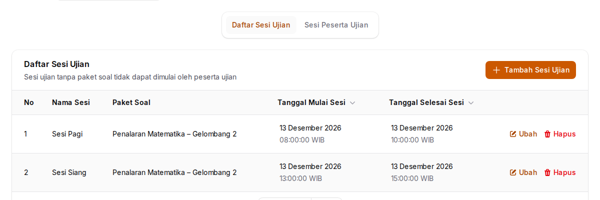
    </Frame>

    Repeat these steps for every test in the exam. The note **Tes belum memiliki sesi ujian** in **Daftar Tes Ujian** disappears once a test has a session.
  </Step>
</Steps>

### Edit or delete a session

Click **Ubah** on a session's row to change its name, question package or schedule, and **Hapus** (Delete) to delete it.

- A session cannot be edited while a participant is taking the test in that session.
- The question package cannot be replaced once a participant has started the test in that session.
- **Hapus** only appears on sessions that have no participants yet.

When a session ends, the system automatically finishes any attempts that are still in progress.

## Assign participants to sessions

Participants registered for the exam must be assigned to a session on **every test**. Adding participants to an exam is explained in [Add Participants to an Exam](/en/data-ujian/menambahkan-peserta-ujian).

Open the test details and select the **Sesi Peserta Ujian** section. Participants without a session show **Tidak ada sesi ujian** (No exam session) in the **Sesi Ujian** column.

<Frame>
  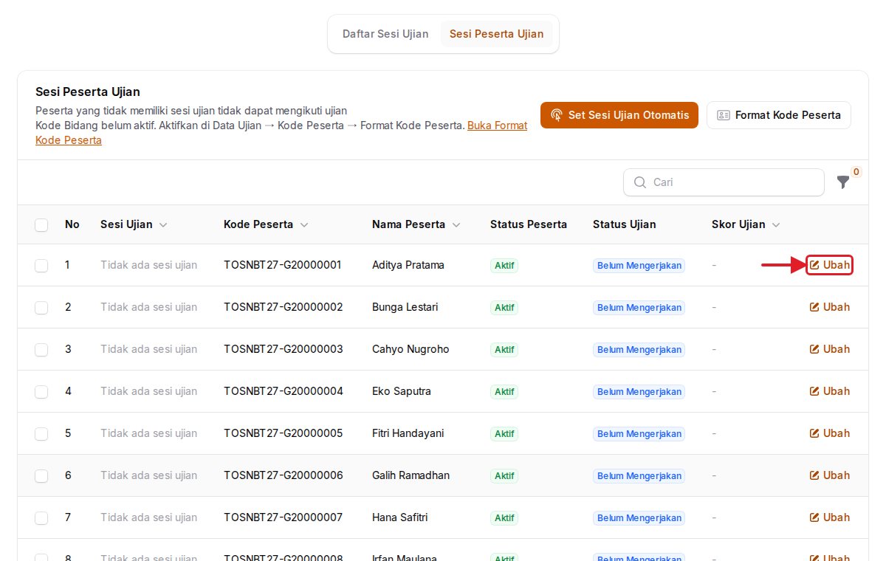
</Frame>

The table also shows **Kode Peserta** (Participant Code), **Status Peserta** (Participant Status), **Status Ujian** (Test Status: **Belum Mengerjakan** not started, **Sedang Mengerjakan** in progress, or **Selesai Mengerjakan** finished) and **Skor Ujian** (Test Score). Use **Filter** to narrow the list by **Sesi Ujian** (including **Tidak ada Sesi Ujian**) or account **Label**.

There are three ways to assign participants:

<AccordionGroup>
  <Accordion title="One by one">
    <Steps>
      <Step title="Click Ubah on a participant">
        Click **Ubah** on a participant's row, for example **Aditya Pratama**.
      </Step>
      <Step title="Choose the session and status">
        <Frame>
          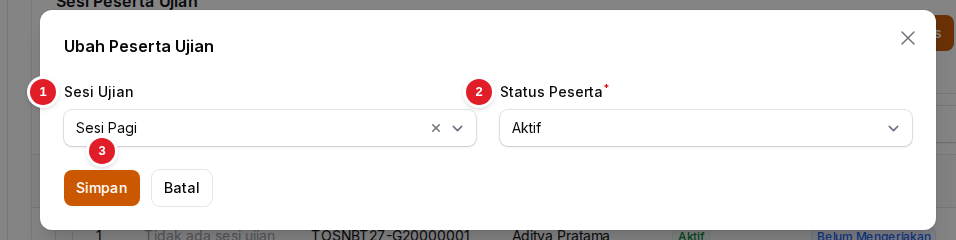
        </Frame>

        1. **Sesi Ujian** (Exam Session): choose a session, for example **Sesi Pagi**.
        2. **Status Peserta**: make sure it is **Aktif** (Active). The other options are **Pending** and **Ditolak** (Rejected); participants with a status other than **Aktif** cannot take the test.
        3. Click **Simpan** (Save).
      </Step>
    </Steps>

    The **Ubah** button is not available for participants who have already started the test.
  </Accordion>

  <Accordion title="In bulk">
    <Steps>
      <Step title="Select participants and Set Sesi Ujian Kolektif">
        Tick the participants who will share a session, click **Tindakan** (Actions), then choose **Set Sesi Ujian Kolektif** (Set Session in Bulk). To select everyone, click **Pilih semua** (Select all).

        <Frame>
          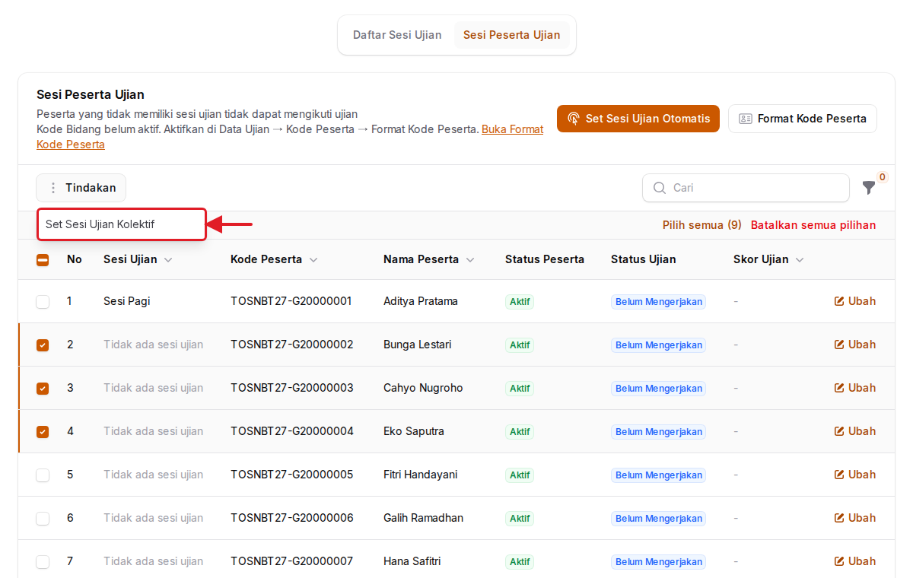
        </Frame>
      </Step>
      <Step title="Choose the session">
        <Frame>
          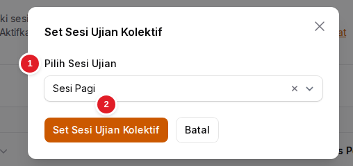
        </Frame>

        1. In **Pilih Sesi Ujian** (Choose Exam Session), choose a session, for example **Sesi Pagi**.
        2. Click **Set Sesi Ujian Kolektif**.

        The system shows the notification **Sesi Ujian Berhasil Diperbarui** (Exam session updated).
      </Step>
    </Steps>
  </Accordion>

  <Accordion title="Automatically">
    <Steps>
      <Step title="Click Set Sesi Ujian Otomatis">
        <Frame>
          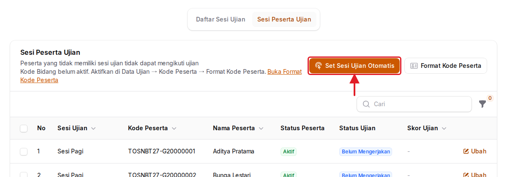
        </Frame>
      </Step>
      <Step title="Confirm">
        In the confirmation window, click **Set Sesi Ujian Otomatis** (Set Sessions Automatically).

        <Frame>
          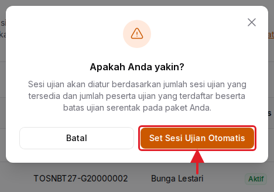
        </Frame>
      </Step>
      <Step title="Check the result">
        The system shows **Berhasil Mengatur Sesi Ujian** (Sessions assigned) and spreads participants across the available sessions. In this example, nine participants are split between **Sesi Pagi** and **Sesi Siang**.

        <Frame>
          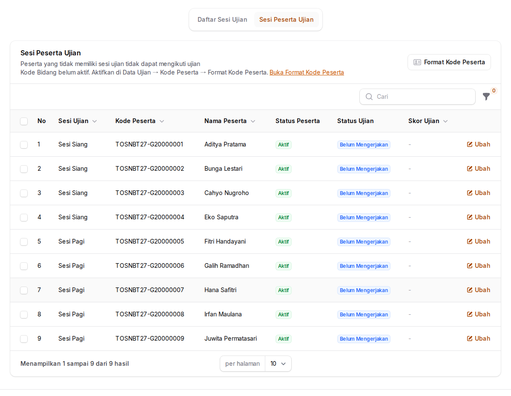
        </Frame>
      </Step>
    </Steps>

    <Info>
      - The system spreads **all** participants with the **Aktif** status who have not finished evenly across this test's sessions, in order of session start time. Participants you assigned earlier are redistributed too, so their session may change. Participants with other statuses (such as **Pending**) are not assigned. To put specific participants in a specific session, use the bulk method.
      - **Set Sesi Ujian Otomatis** only appears when the test has at least one session, at least one participant has no session, and no participant is taking the test.
    </Info>
  </Accordion>
</AccordionGroup>

<Check>
  Make sure no participant still shows **Tidak ada sesi ujian**. Once assigned, participants can start according to their session schedule.
</Check>

## Move participants to another session

Participants who already have a session can be moved, for example when they cannot attend the original schedule. In this example, **Fitri Handayani** and **Galih Ramadhan** move from **Sesi Pagi** to **Sesi Siang**.

<Steps>
  <Step title="Select participants">
    <Frame>
      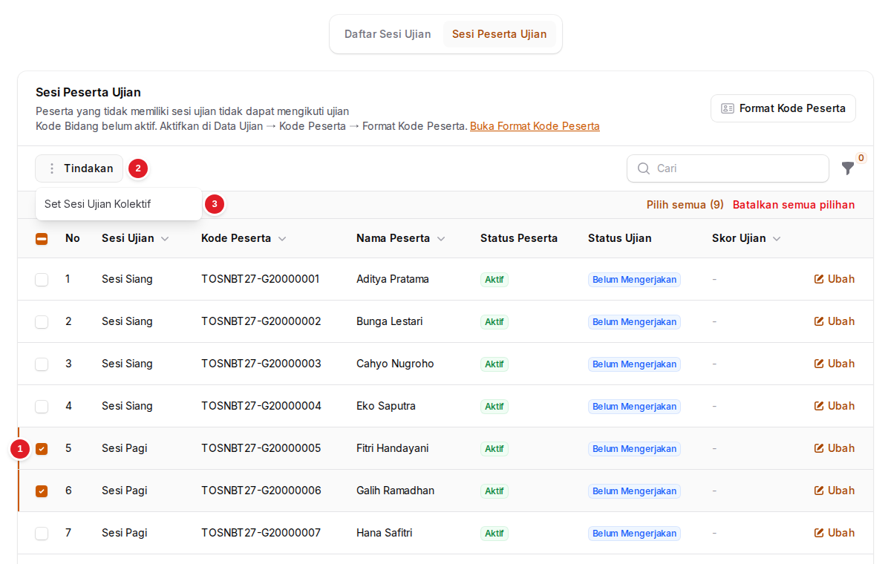
    </Frame>

    1. Tick the participants to move.
    2. Click **Tindakan**.
    3. Choose **Set Sesi Ujian Kolektif**.
  </Step>
  <Step title="Choose the new session">
    In **Pilih Sesi Ujian**, choose the new session, for example **Sesi Siang**, then click **Set Sesi Ujian Kolektif**.

    <Frame>
      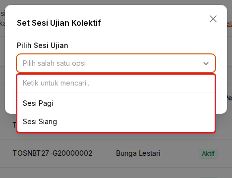
    </Frame>
  </Step>
  <Step title="Check the result">
    After the **Sesi Ujian Berhasil Diperbarui** notification, the participants' **Sesi Ujian** column shows the new session.

    <Frame>
      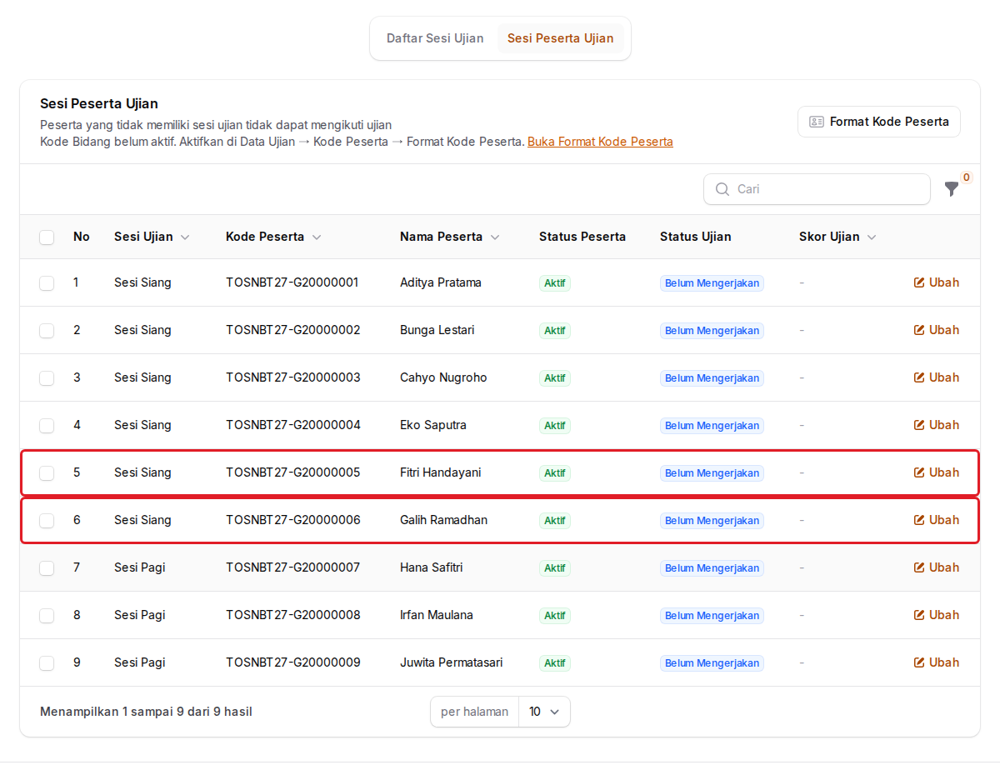
    </Frame>
  </Step>
</Steps>

<Note>
  - Make sure the new session has a question package and has not ended yet.
  - Participants who are taking the test cannot be ticked. If any selected participant has already started the test, the move is cancelled with the message **Gagal Mengatur Sesi Ujian Kolektif** (Failed to set sessions in bulk).
  - To move a participant who has already started, first click **Reset Ujian** (Reset Test) on that participant's row.
</Note>

<Warning>
  **Reset Ujian** deletes all of the participant's answers for the test, and the participant has to start again. This cannot be undone.
</Warning>

## Other buttons in Sesi Peserta Ujian

- **Hitung Ulang Skor** (Recalculate Score): recalculates the scores of this test's finished participants. See [Exam Results and Exports](/en/data-ujian/hasil-dan-ekspor-ujian#recalculate-one-test).
- **Format Kode Peserta**, **Generate Kode Bidang** and **Daftar Peserta per Bidang**: set up and create per-session field codes. When field codes are on, the table shows a **Kode Bidang** column and participants moved to another session get a new field code. See [Participant Codes and Field Codes](/en/data-ujian/kode-peserta).
