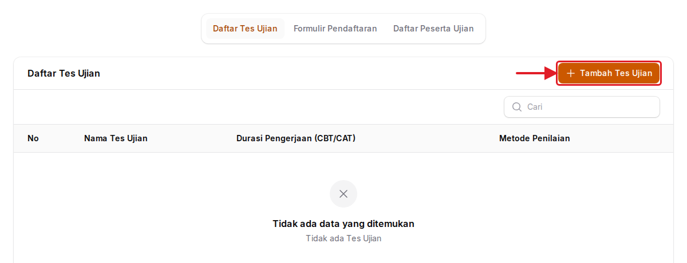
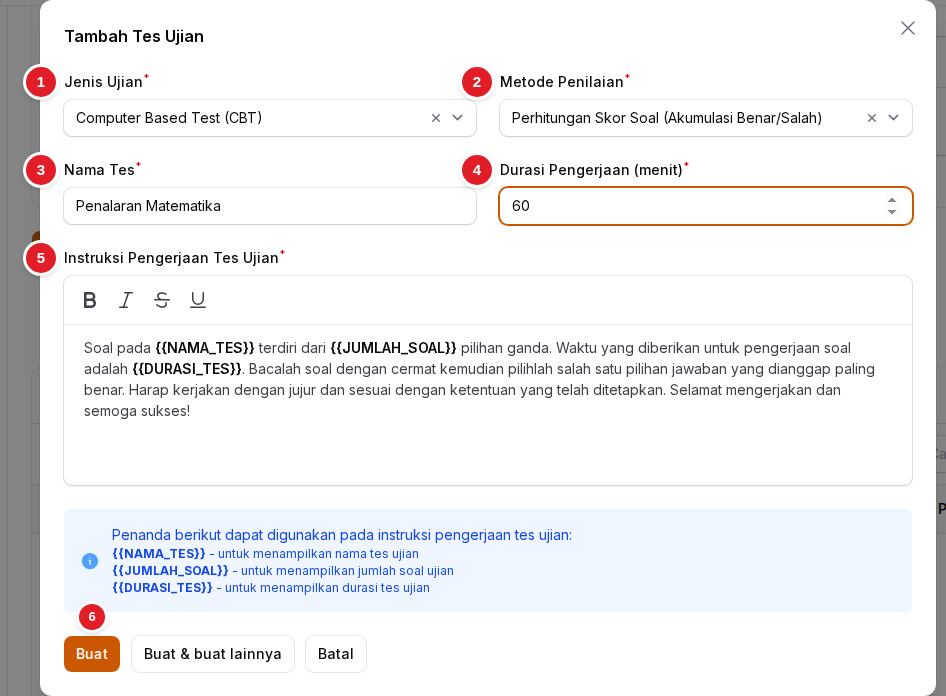
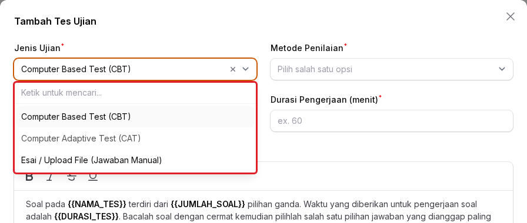
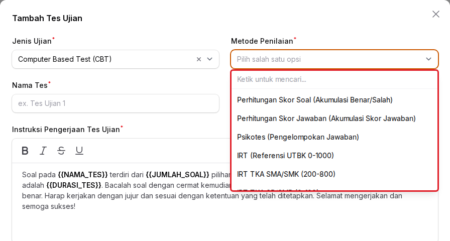
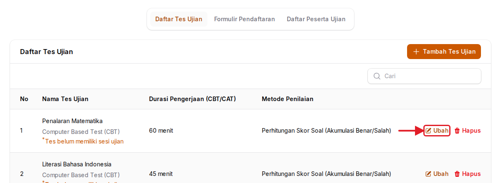
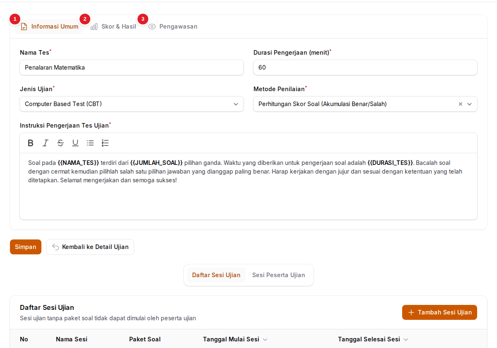
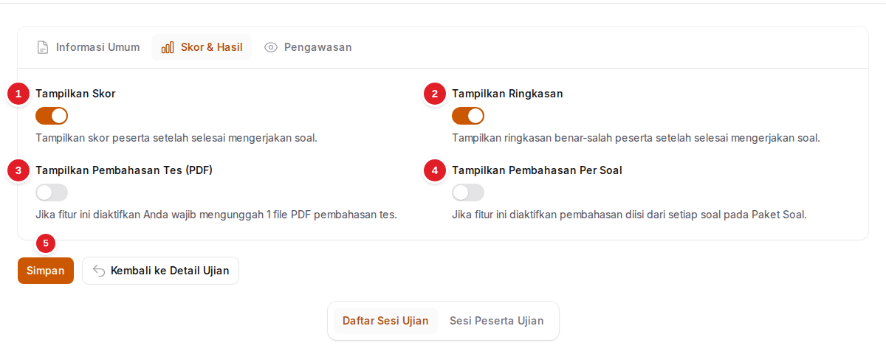
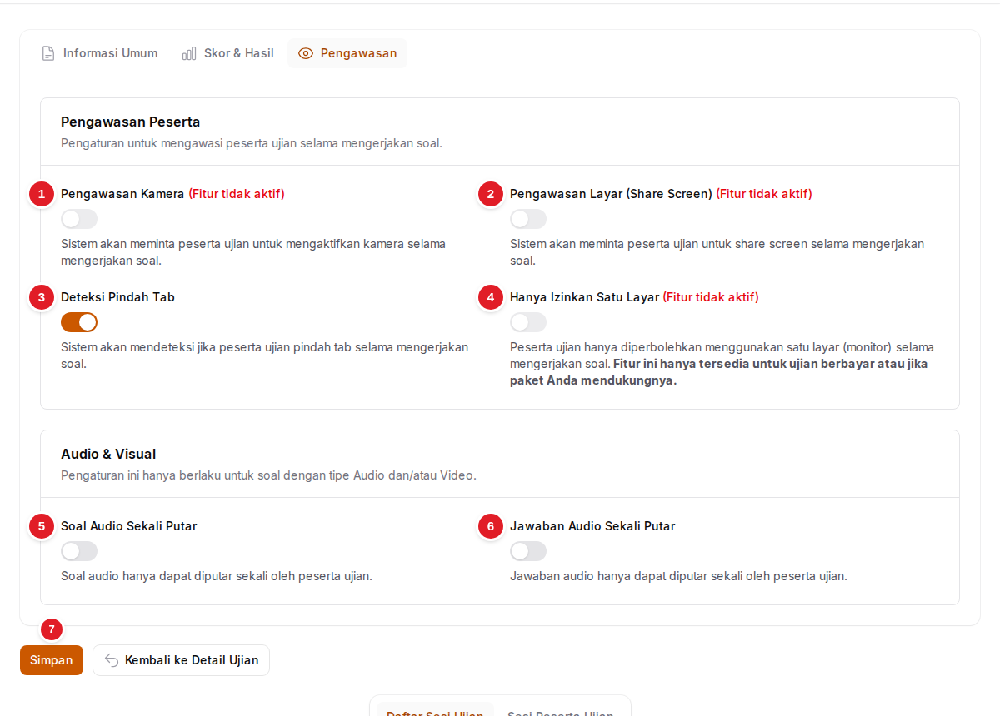

A **tes ujian** (test) is one part of an exam. Each test has its own exam type, scoring method, duration, instructions and settings. This page explains how to add tests to an exam and configure them.

<Info>
  **Menu location:** **Portal** → **Platform Ujian (CBT)** → **Manajemen Ujian** → **Data Ujian** → **Detail** on the exam → **Daftar Tes Ujian** (Test List) section.
</Info>

For example, **Tryout Akbar SNBT 2027 – Gelombang 2** has two tests:

- **Penalaran Matematika** (Mathematical Reasoning, 60 minutes)
- **Literasi Bahasa Indonesia** (Indonesian Literacy, 45 minutes)

If you do not have an exam yet, create one first with [Create an Exam](/en/data-ujian/membuat-ujian).

## Add a test

<Steps>
  <Step title="Click Tambah Tes Ujian">
    Open the exam's **Detail**, go to the **Daftar Tes Ujian** section, then click **Tambah Tes Ujian** (Add Test).

    <Frame>
      
    </Frame>

    <Note>
      The number of tests depends on the exam type: up to 4 tests for **Ujian Standard (Paket Gratis)** and 30 for **Ujian Professional (Paket Berbayar)**. Once the limit is reached, new tests are rejected. On a multi-level exam that already has participants, the **Tambah Tes Ujian** button is hidden.
    </Note>
  </Step>
  <Step title="Fill in the Tambah Tes Ujian form">
    <Frame>
      
    </Frame>

    1. **Jenis Ujian** (Exam Type): how participants take the test. See [Exam type](#exam-type).
    2. **Metode Penilaian** (Scoring Method): how the system calculates scores. See [Scoring method](#scoring-method).
    3. **Nama Tes** (Test Name): an easy-to-recognise name. Example: **Penalaran Matematika**.
    4. **Durasi Pengerjaan (menit)** (Duration in minutes): how long participants have. Example: **60**. This field does not appear for **Esai / Upload File (Jawaban Manual)**.
    5. **Instruksi Pengerjaan Tes Ujian** (Test Instructions): what participants read before they start, up to 1,000 characters. The system fills in default text you can change. For CBT and CAT tests you can use these placeholders:
       - `{{NAMA_TES}}` shows the test name,
       - `{{JUMLAH_SOAL}}` shows the number of questions,
       - `{{DURASI_TES}}` shows the duration.
    6. Click **Buat** (Create), or **Buat & buat lainnya** (Create & create another) to add the next test straight away.

    If the exam's **Tipe Pembayaran** is **Berbayar per Tes Ujian** (Paid per Test), the form also shows **Biaya Tes Ujian** (Test Fee). Enter the fee participants pay to take this test, at least Rp5,000.
  </Step>
</Steps>

### Exam type

<Frame>
  
</Frame>

- **Computer Based Test (CBT)** Participants answer on screen. Everyone gets questions from the same question package. Choose this for a regular SNBT tryout.
- **Computer Adaptive Test (CAT)** The next question adapts to the participant: a correct answer tends to lead to a harder question, a wrong answer to an easier one. CAT is only available on **Ujian Professional (Paket Berbayar)**; on **Ujian Standard** the option is greyed out. Every question in a CAT question package must have a difficulty level.
- **Esai / Upload File (Jawaban Manual)** (Essay / File Upload, Manual Answers) Participants write long answers or upload files, such as a photo of an answer sheet or a PDF. Answers are marked manually and the test has no duration.

<Note>
  After a test is created, **Jenis Ujian** cannot be switched between essay and CBT/CAT. Switching between CBT and CAT is still possible until a participant starts the test.
</Note>

### Scoring method

<Frame>
  
</Frame>

The scoring methods depend on **Jenis Ujian**. All of the methods below are available for **CBT**. **CAT** only uses **Perhitungan Skor Soal (Akumulasi Benar/Salah)**, and **Esai / Upload File (Jawaban Manual)** uses **Penilaian Manual** (Manual Marking).

- **Perhitungan Skor Soal (Akumulasi Benar/Salah)** (Question Score, Correct/Incorrect Sum) The score comes from questions answered correctly and incorrectly, using each question's weight. Suitable for a regular multiple-choice tryout.
- **Perhitungan Skor Jawaban (Akumulasi Skor Jawaban)** (Answer Score Sum) Each answer option has its own score, and the scores of all the participant's answers are added up. Example: in a question about study habits, "Every day" is worth 4 and "Never" is worth 1.
- **Psikotes (Pengelompokan Jawaban)** (Psychometric, Answer Grouping) Answers are grouped to show a participant's tendencies, such as **Kepemimpinan** (Leadership), **Kerja Sama** (Teamwork) or **Mandiri** (Independent). The result is a group, not right or wrong.
- **IRT (Referensi UTBK 0-1000)**, **IRT TKA SMA/SMK (200-800)** and **IRT TKA SD/SMP (0-100)** Item Response Theory scores take question difficulty into account, based on the answer patterns of all participants. All three options use the same ability (theta) estimate; only the reported score range differs. The UTBK and TKA ranges are reference scales, not official equating.

<Note>
  IRT scores are calculated when you run **Hitung Skor** → **Perhitungan IRT** on the **Detail Ujian** page. See [Exam Results and Exports](/en/data-ujian/hasil-dan-ekspor-ujian#recalculate-scores).
</Note>

<Tip>
  For a simple SNBT tryout, choose **Computer Based Test (CBT)** with **Perhitungan Skor Soal (Akumulasi Benar/Salah)**.
</Tip>

## Open a test's details

Created tests appear in the **Daftar Tes Ujian** section with their exam type, duration and scoring method.

<Frame>
  
</Frame>

The note **Tes belum memiliki sesi ujian** (This test has no exam session yet) means the test is saved but has no schedule, so participants cannot take it yet. Click **Ubah** (Edit) on the test to open its details. Creating sessions is explained in [Create Exam Sessions](/en/data-ujian/membuat-sesi-ujian).

<Note>
  - If **Apakah Tes Ujian Harus Dikerjakan Secara Berurutan?** is on for the exam, the **Ubah Urutan Tes Ujian** (Reorder Tests) button appears in this section. Drag the tests into order, then click **Selesai Mengurutkan** (Finish Reordering).
  - **Hapus** (Delete) deletes a test. A test that already has participants cannot be deleted.
</Note>

<Frame>
  
</Frame>

The test details page has these tabs:

1. **Informasi Umum** (General Information): **Nama Tes**, **Durasi Pengerjaan (menit)**, **Jenis Ujian**, **Metode Penilaian** and **Instruksi Pengerjaan Tes Ujian**.
2. **Skor & Hasil** (Score & Results): what participants may see after they finish.
3. **Pengawasan** (Proctoring): participant monitoring and audio settings.

A **Biaya Tes Ujian** (Test Fee) tab also appears when the exam's payment type is **Berbayar per Tes Ujian**. It contains **Biaya Tes Ujian (IDR)** and **Deskripsi Ujian Berbayar** (Paid Test Description), the text shown to participants on their dashboard. The **Skor & Hasil** and **Pengawasan** tabs are only available for CBT and CAT tests.

Click **Simpan** (Save) after changing any tab, then click **Kembali ke Detail Ujian** (Back to Exam Details) to return to the exam. Below the tabs are the **Daftar Sesi Ujian** (Session List) and **Sesi Peserta Ujian** (Participant Sessions) sections, explained in [Create Exam Sessions](/en/data-ujian/membuat-sesi-ujian).

<Note>
  **Durasi Pengerjaan (menit)** cannot be changed while a participant is taking the test, and **Jenis Ujian** cannot be changed once the test has been started.
</Note>

## Set score and result display

<Frame>
  
</Frame>

On the **Skor & Hasil** tab, choose what participants can see after finishing the test.

1. **Tampilkan Skor** (Show Score): participants see their test score as soon as they finish.
2. **Tampilkan Ringkasan** (Show Summary): participants see how many answers were correct and incorrect.
3. **Tampilkan Pembahasan Tes (PDF)** (Show Test Explanations as PDF): participants can open one PDF with the explanations. After turning it on, upload the file in the **File Pembahasan Tes (PDF)** field that appears.
4. **Tampilkan Pembahasan Per Soal** (Show Explanation per Question): participants see the explanation for each question, taken from the questions in the question package. This cannot be on at the same time as **Tampilkan Pembahasan Tes (PDF)**; turning one on turns the other off.
5. Click **Simpan**.

<Tip>
  For a tryout where participants should see their results straight away, turn on **Tampilkan Skor** and **Tampilkan Ringkasan**.
</Tip>

## Set up proctoring

<Frame>
  
</Frame>

The **Pengawasan** tab has two groups: **Pengawasan Peserta** (Participant Monitoring) and **Audio & Visual**.

1. **Pengawasan Kamera** (Camera Proctoring): participants must turn on their camera while answering.
2. **Pengawasan Layar (Share Screen)** (Screen Proctoring): participants must share their screen while answering.
3. **Deteksi Pindah Tab** (Tab Switch Detection): the system records when participants switch to another tab or window during the exam.
4. **Hanya Izinkan Satu Layar** (Allow One Screen Only): participants may use only one monitor.
5. **Soal Audio Sekali Putar** (Play Question Audio Once): audio in a question can only be played once, for example in listening questions.
6. **Jawaban Audio Sekali Putar** (Play Answer Audio Once): audio in answer options can only be played once.
7. Click **Simpan**.

Settings 5 and 6 only apply to audio or video questions.

<Note>
  **(Fitur tidak aktif)** (Feature not active) means the feature is not available for the exam type in use. On **Ujian Standard (Paket Gratis)**, **Pengawasan Kamera**, **Pengawasan Layar (Share Screen)** and **Hanya Izinkan Satu Layar** cannot be turned on. **Deteksi Pindah Tab** is available on both exam types.
</Note>

<Warning>
  **Pengawasan Kamera** and **Pengawasan Layar (Share Screen)** use separate proctoring credits (an add-on). Each time a participant starts the test, one credit is used for each active proctoring type. When the credits run out, participants cannot start the test.
</Warning>

Once the test is ready, set up its schedule:

<Card title="Create Exam Sessions" icon="arrow-right" horizontal href="/en/data-ujian/membuat-sesi-ujian">
  Set the test schedule and the question package participants answer.
</Card>
