A multi-level exam is used when participants take several rounds in stages. Participants finish one round first, then the admin checks the results and decides whether they may continue to the next round.

<Info>
  Menu location: **Portal** → **Platform Ujian (CBT)** → **Manajemen Ujian** → **Data Ujian** (Exam Data).

  This page covers the settings specific to multi-level exams. Creating exams, exam tests, exam sessions, and exam participants in general is explained in [Create an Exam](/en/data-ujian/membuat-ujian), [Create an Exam Test](/en/data-ujian/membuat-tes-ujian), [Create an Exam Session](/en/data-ujian/membuat-sesi-ujian), and [Add Exam Participants](/en/data-ujian/menambahkan-peserta-ujian).
</Info>

As an example, you are the admin of **Bimbel Prestasi Nusantara**, organising the **Kompetisi Matematika Nasional 2027** (National Mathematics Competition 2027). It has three rounds:

1. **Babak Penyisihan** (Preliminary Round): taken by all participants, free of charge.
2. **Babak Semifinal** (Semifinal): only for participants who pass the Preliminary Round, with a fee of Rp30,000.
3. **Babak Final** (Final): only for participants who pass the Semifinal, with a fee of Rp40,000.

In outline, the steps are:

1. Create the exam, either from a template or from scratch.
2. Set the exam as multi-level and choose its payment type.
3. Add an exam test for each round.
4. Build the level structure and put the tests into each level.
5. Add exam sessions and participants.
6. Review each round's results and move participants on to the next round.

## 1. Create the exam

<AccordionGroup>
  <Accordion title="Using an exam template">
    An exam template sets up the exam data, exam tests, and level structure automatically, so you do not have to build them one by one.

    <Steps>
      <Step title="Click Template Ujian">
        Open **Data Ujian**, then click **Template Ujian** (Exam Template).

        <Frame>
          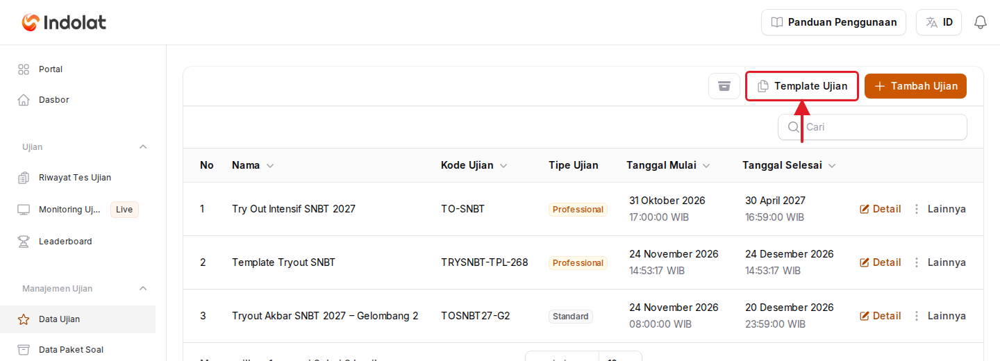
        </Frame>
      </Step>
      <Step title="Choose Template Kompetisi Berjenjang">
        <Frame>
          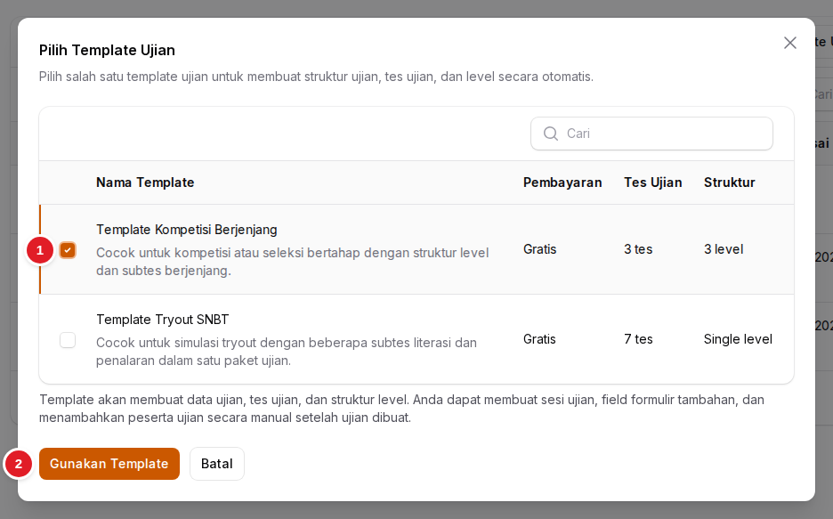
        </Frame>

        1. Tick **Template Kompetisi Berjenjang** (Tiered Competition Template). The template table shows each template's payment type, number of exam tests, and number of levels.
        2. Click **Gunakan Template** (Use Template).

        The system shows the notification **Template Data Ujian Berhasil Ditambahkan**, and a new exam named **Template Kompetisi Berjenjang** appears in the **Data Ujian** list with a code such as **KOMPETISI-TPL-116**.

        <Frame>
          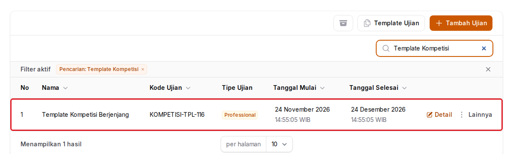
        </Frame>
      </Step>
    </Steps>

    The Tiered Competition Template prepares:

    - an exam with type **Ujian Professional (Paket Berbayar)**, payment type **Gratis** (Free), and the setting **Ya (Multi-Level)**;
    - a start date of today and an end date one month later;
    - three exam tests: **Babak Penyisihan** and **Babak Semifinal** (CBT, 120 minutes, Perhitungan Skor Soal, with **Hanya Izinkan Satu Layar** on when the project's plan includes **Proctoring Dual Monitor**; otherwise this setting is turned off), and **Babak Final** (Esai / Upload File);
    - three levels with the same names, each containing one test, all requiring admin verification;
    - self-registration that is not yet open.

    <Note>
      After the exam is created from the template, click **Detail** and adjust the name, code, dates, exam type, and payment type to your needs (see section 2). You still need to create exam sessions, choose question packages, and add participants. This template cannot be used when its payment type is paid and the **Halaman Pendaftaran Ujian dan Pembayaran Otomatis** add-on is not active.
    </Note>
  </Accordion>

  <Accordion title="Creating a new exam">
    <Steps>
      <Step title="Click Tambah Ujian">
        Open **Data Ujian**, then click **Tambah Ujian** (Add Exam).

        <Frame>
          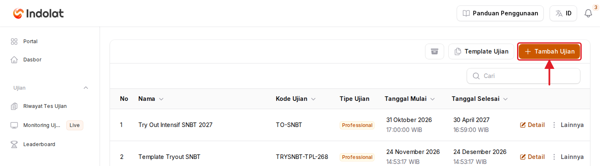
        </Frame>
      </Step>
      <Step title="Fill in the exam information">
        <Frame>
          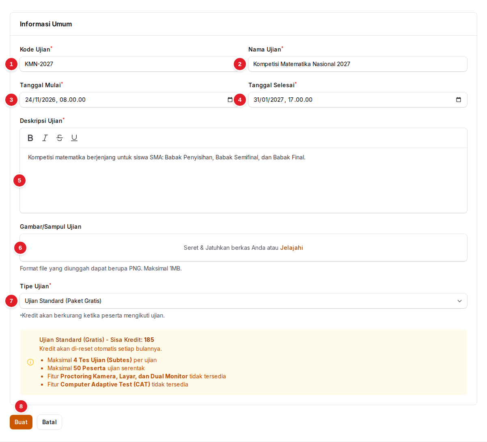
        </Frame>

        1. **Kode Ujian** (Exam Code): a unique code containing only letters, numbers, `-`, or `#`. Letters are converted to uppercase automatically. Example: **KMN-2027**.
        2. **Nama Ujian** (Exam Name): the name seen by admins and participants. Example: **Kompetisi Matematika Nasional 2027**.
        3. **Tanggal Mulai** (Start Date): the date and time the exam event starts.
        4. **Tanggal Selesai** (End Date): the date and time the exam event ends. It cannot be earlier than the start date and can be at most one year from today.
        5. **Deskripsi Ujian** (Exam Description): a short description, up to 1,000 characters.
        6. **Gambar/Sampul Ujian** (Exam Cover, optional): a PNG file, up to 1 MB.
        7. **Tipe Ujian** (Exam Type): **Ujian Standard (Paket Gratis)** or **Ujian Professional (Paket Berbayar)**. See the **Check Tipe & Paket Ujian** step below.
        8. Click **Buat** (Create). The system opens the exam detail page right away.
      </Step>
    </Steps>
  </Accordion>
</AccordionGroup>

## 2. Complete the exam detail settings

The exam detail page has five settings tabs:

<Frame>
  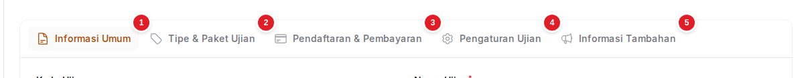
</Frame>

1. **Informasi Umum** (General Information)
2. **Tipe & Paket Ujian** (Exam Type & Package)
3. **Pendaftaran & Pembayaran** (Registration & Payment)
4. **Pengaturan Ujian** (Exam Settings)
5. **Informasi Tambahan** (Additional Information)

Each tab is saved with the **Simpan** (Save) button below the form.

<Steps>
  <Step title="Check Informasi Umum">
    The **Informasi Umum** tab has the same fields as the **Tambah Ujian** form: code, name, start date, end date, description, and cover image. Change the fields you need, then click **Simpan**.

    <Note>
      **Kode Ujian** can no longer be changed once the exam has participants. **Tanggal Mulai** and **Tanggal Selesai** cannot be changed while any participant is taking the exam.
    </Note>
  </Step>
  <Step title="Check Tipe & Paket Ujian">
    <Frame>
      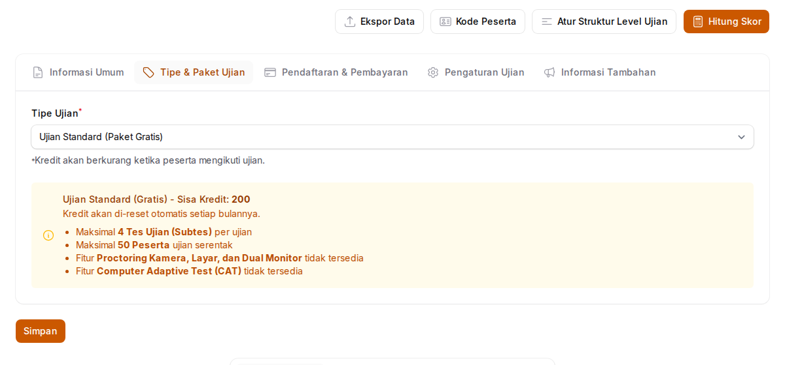
    </Frame>

    **Tipe Ujian** determines which credits are used. Credits are deducted when participants take the exam, and the remaining credits are shown in the information box.

    - **Ujian Standard (Paket Gratis)**: credits reset automatically every month; at most **4 Tes Ujian (Subtes)** per exam; at most **50 participants** taking the exam at the same time; no **Proctoring Kamera, Layar, dan Dual Monitor** (camera, screen, and dual-monitor proctoring); no **Computer Adaptive Test (CAT)**.
    - **Ujian Professional (Paket Berbayar)**: uses professional credits from your subscription or purchased Kredit Ujian (subscription credits accumulate while the subscription is renewed without a gap, and separately purchased exam credits are valid for 6 months from the purchase date; see [Exam Credits, Standard and Professional Exams](/en/konsep/kredit-dan-tipe-ujian)); at most **30 Tes Ujian (Subtes)** per exam; at most **1,000 participants** at the same time; proctoring and **CAT** are available. Dual monitor (**Hanya Izinkan Satu Layar**) and CAT also need a subscription plan that includes them: dual monitor on the **Esensial**, **Rutin** and **Intensif** plans, CAT on the **Rutin** and **Intensif** plans. If the project has no professional exam credits, the system shows a warning and participants cannot start the exam until credits are available.

    <Tip>
      In a multi-level exam, each round is usually one exam test. If all rounds together have more than four tests, use **Ujian Professional**.
    </Tip>
  </Step>
  <Step title="Set Pendaftaran & Pembayaran">
    <Frame>
      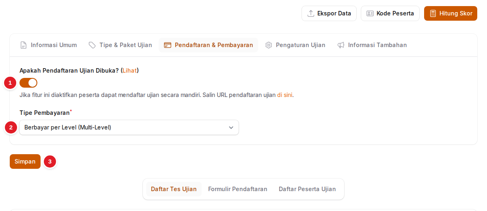
    </Frame>

    1. **Apakah Pendaftaran Ujian Dibuka?** (Is Registration Open?): turn on if participants may register themselves in the participant app. The **di sini** (here) link in the helper text copies the exam registration URL. This setting requires the **Halaman Pendaftaran Ujian dan Pembayaran Otomatis** add-on; without it, the label shows **(Add-on Tidak Aktif)** and the toggle cannot be turned on.
    2. **Tipe Pembayaran** (Payment Type): choose one of the following.
       - **Gratis** (Free): participants do not pay.
       - **Sekali Bayar** (One-Time Payment): participants pay once for all tests. The **Biaya Ujian Sekali Bayar (IDR)** field appears, minimum Rp5,000.
       - **Berbayar per Tes Ujian** (Paid per Test): each test has its own fee, entered in the exam test form.
       - **Berbayar per Level (Multi-Level)** (Paid per Level): each level has its own fee, entered in the level structure (section 4). When this type is selected, **Apakah Ujian Multi-Level?** is automatically set to **Ya (Multi-Level)**.
    3. Click **Simpan**.

    For the Kompetisi Matematika Nasional 2027 example, open registration and choose **Berbayar per Level (Multi-Level)**.

    <Note>
      Payment types other than **Gratis** require the **Halaman Pendaftaran Ujian dan Pembayaran Otomatis** add-on; without it, the change cannot be saved. With **Berbayar per Level (Multi-Level)**, the bill is created when you move a participant on to a paid level (section 6). The first level's fee is charged when a participant registers through the registration form; leave it empty if the first round is free. Participants you add directly from the **Daftar Peserta Ujian** tab are not charged the first level's fee.
    </Note>
  </Step>
  <Step title="Set Pengaturan Ujian">
    <Frame>
      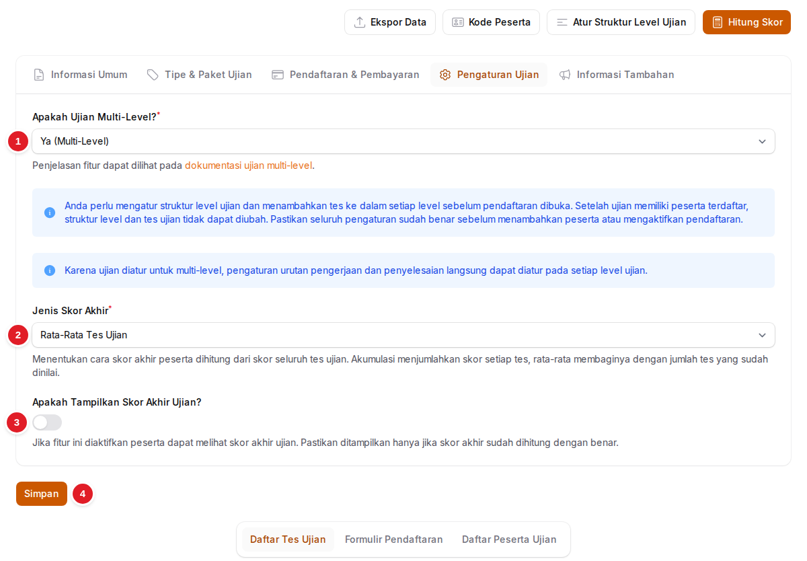
    </Frame>

    1. **Apakah Ujian Multi-Level?** (Is this a Multi-Level Exam?): choose **Ya (Multi-Level)**. After saving, the **Atur Struktur Level Ujian** (Set Exam Level Structure) button appears at the top right of the page. The **Apakah Tes Ujian Harus Dikerjakan Secara Berurutan?** and **Apakah Tes Ujian Harus Dikerjakan Secara Langsung?** settings no longer appear in this tab because they are set per level. This option cannot be changed once the exam has participants.
    2. **Jenis Skor Akhir** (Final Score Type): how the final score is calculated from all tests.
       - **Akumulasi Tes Ujian** (Sum of Tests): the scores of all tests are added up.
       - **Rata-Rata Tes Ujian** (Average of Tests, default): the total score divided by the number of scored tests.

       Example: a Preliminary Round score of 80 and a Semifinal score of 70 give a final score of 150 with the sum, or 75 with the average. If the exam already has participants, all final scores are recalculated after the change is saved. Tests scored with **Psikotes (Pengelompokan Jawaban)** are left out of both the sum and the average.
    3. **Apakah Tampilkan Skor Akhir Ujian?** (Show Final Score?): turn on if participants may see their final score. Only turn it on once the scores have been calculated correctly.
    4. Click **Simpan**.
  </Step>
  <Step title="Set Informasi Tambahan (optional)">
    Use this tab to show specific information on the dashboard of this exam's participants, such as a WhatsApp group link or the committee's contact. Participants of other exams do not see it.

    <Frame>
      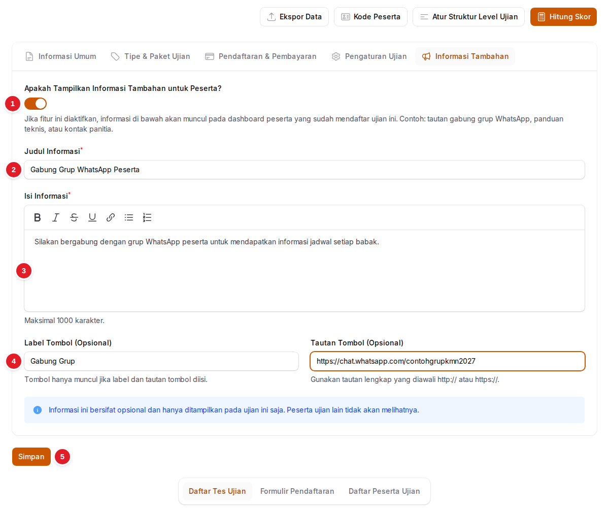
    </Frame>

    1. **Apakah Tampilkan Informasi Tambahan untuk Peserta?** (Show Additional Information to Participants?): turn on so the information fields appear.
    2. **Judul Informasi** (Information Title): up to 100 characters. Example: **Gabung Grup WhatsApp Peserta**.
    3. **Isi Informasi** (Information Content): up to 1,000 characters.
    4. **Label Tombol (Opsional)** and **Tautan Tombol (Opsional)** (Button Label and Button Link): fill in both to show a button. The link must start with `http://` or `https://`.
    5. Click **Simpan**.

    The information appears at the top of the participant's **Daftar Tes** (Test List) page:

    <Frame>
      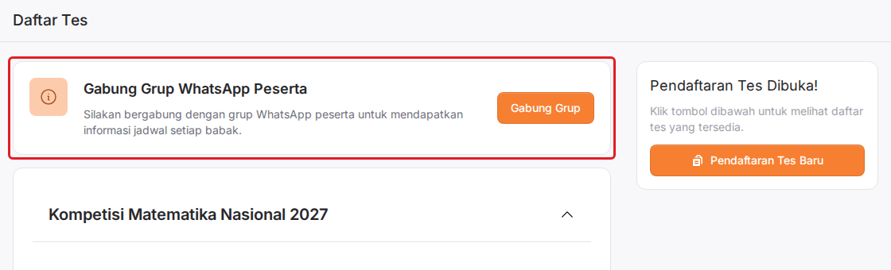
    </Frame>
  </Step>
</Steps>

## 3. Add an exam test for each round

Create one exam test for each round. Every exam test field is explained in [Create an Exam Test](/en/data-ujian/membuat-tes-ujian).

<Steps>
  <Step title="Click Tambah Tes Ujian">
    Scroll down the exam detail page, open the **Daftar Tes Ujian** (Exam Test List) tab, then click **Tambah Tes Ujian** (Add Exam Test).

    <Frame>
      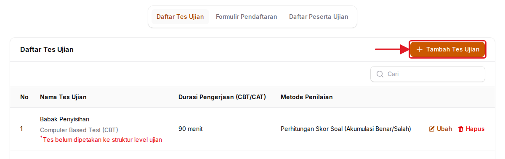
    </Frame>
  </Step>
  <Step title="Fill in the exam test form">
    <Frame>
      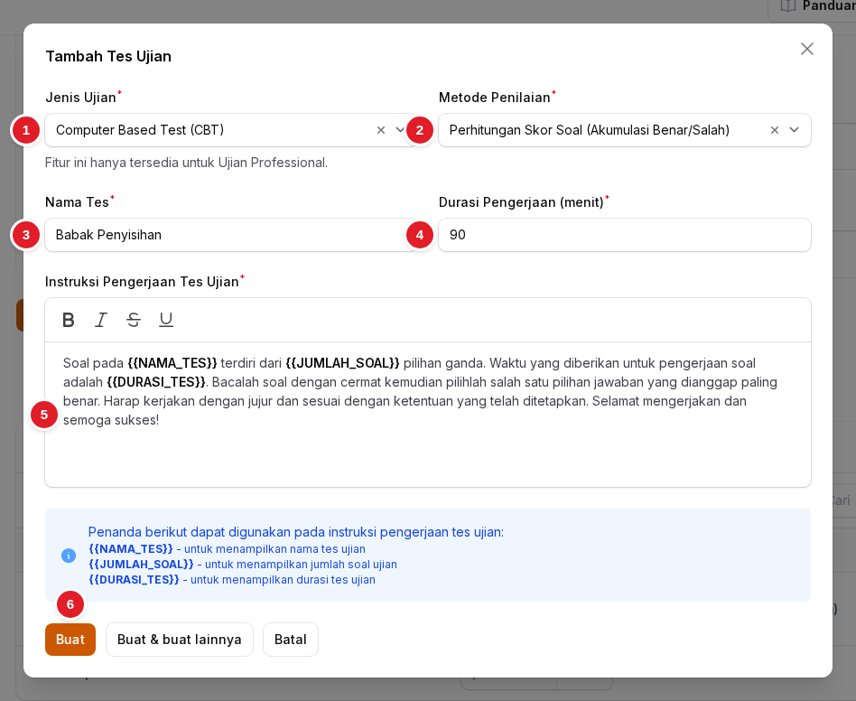
    </Frame>

    1. **Jenis Ujian** (Exam Type): for example **Computer Based Test (CBT)**. On a Standard exam, the helper text **Fitur ini hanya tersedia untuk Ujian Professional.** (This feature is only available for Professional Exams.) is a reminder that CAT cannot be chosen (see [Create a Test](/en/data-ujian/membuat-tes-ujian#exam-type)).
    2. **Metode Penilaian** (Scoring Method): for example **Perhitungan Skor Soal (Akumulasi Benar/Salah)**.
    3. **Nama Tes** (Test Name): for example **Babak Penyisihan**.
    4. **Durasi Pengerjaan (menit)** (Duration in minutes): for example **90**.
    5. **Instruksi Pengerjaan Tes Ujian** (Test Instructions): read by participants before they start. The placeholders `{{NAMA_TES}}`, `{{JUMLAH_SOAL}}`, and `{{DURASI_TES}}` are replaced automatically.
    6. Click **Buat**, or **Buat & buat lainnya** (Create & create another) to create the next test right away.

    <Warning>
      IRT scores are calculated through **Hitung Skor** → **Perhitungan IRT**, and that menu cannot be used on multi-level exams. For a multi-level exam, choose a scoring method other than IRT.
    </Warning>
  </Step>
  <Step title="Repeat for the other rounds">
    Also create the **Babak Semifinal** and **Babak Final** tests. Until a test is put into the level structure, the test list shows the note **Tes belum dipetakan ke struktur level ujian** (Test not yet mapped to the exam level structure).

    <Frame>
      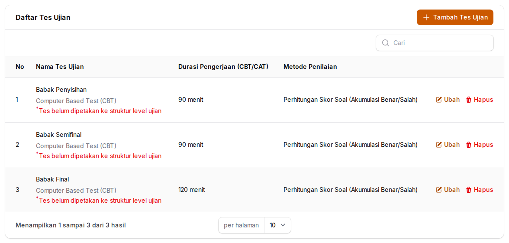
    </Frame>
  </Step>
</Steps>

## 4. Set up the exam level structure

The level structure determines the order of the rounds and which tests are taken in each round.

<Warning>
  Finish the level structure before opening registration or adding participants. Once the exam has participants, the level structure and exam tests can no longer be changed, the button changes to **Lihat Struktur Level Ujian** (View Exam Level Structure), and the structure page becomes read-only. While some tests are not yet in a level, participants also cannot be added through **Tambah Peserta** or **Import Peserta**.
</Warning>

<Steps>
  <Step title="Click Atur Struktur Level Ujian">
    On the exam detail page, click **Atur Struktur Level Ujian** at the top right.

    <Frame>
      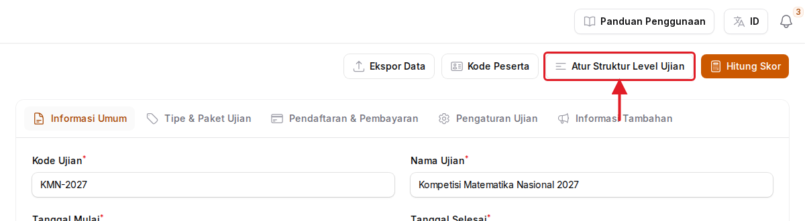
    </Frame>
  </Step>
  <Step title="Click Level Baru">
    The level structure page is still empty. Click **Level Baru** (New Level).

    <Frame>
      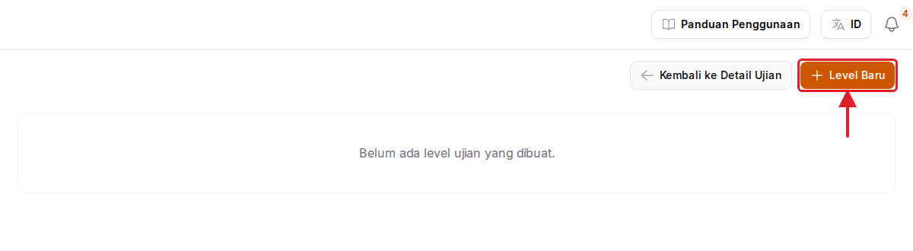
    </Frame>
  </Step>
  <Step title="Fill in the level settings">
    <Frame>
      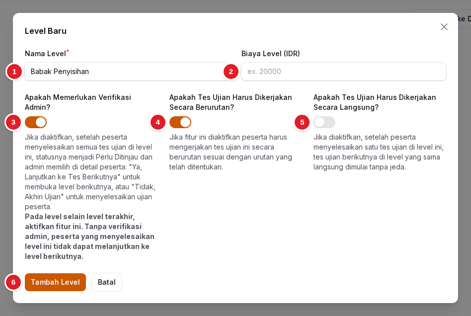
    </Frame>

    1. **Nama Level** (Level Name): the round's name. Example: **Babak Penyisihan**.
    2. **Biaya Level (IDR)** (Level Fee): only appears with the **Berbayar per Level (Multi-Level)** payment type. Enter at least Rp5,000, or leave it empty if the level is free.
    3. **Apakah Memerlukan Verifikasi Admin?** (Requires Admin Verification?): when on, once a participant finishes all tests in this level, their status changes to **Aktif (Perlu Ditinjau)** (Active, Needs Review) and they wait for the admin's decision before entering the next level (section 6).
    4. **Apakah Tes Ujian Harus Dikerjakan Secara Berurutan?** (Must Tests Be Taken in Order?): when on, the tests in this level must be taken in order; the next test stays locked until the previous one is finished.
    5. **Apakah Tes Ujian Harus Dikerjakan Secara Langsung?** (Must Tests Be Taken Without a Break?): when on, after one test is finished, the next test in the same level starts immediately.
    6. Click **Tambah Level** (Add Level).

    Repeat for the other levels. In this example:

    | Level | Biaya Level (IDR) | Admin verification |
    | --- | --- | --- |
    | Babak Penyisihan | empty | on |
    | Babak Semifinal | 30000 | on |
    | Babak Final | 40000 | off |

    <Warning>
      Participants only move up to the next level through an admin decision. Turn on **Apakah Memerlukan Verifikasi Admin?** on every level that has a level after it. If it is off, the participant's status does not change to **Aktif (Perlu Ditinjau)** after that level is finished, so the button to move the participant on does not appear. On the last level, this setting may be turned off.
    </Warning>

    <Tip>
      The in-order and without-a-break settings only matter when a level contains more than one test.
    </Tip>
  </Step>
  <Step title="Click Tambah Tes Ujian">
    Once a level exists, the **Tambah Tes Ujian** button appears. Click it to put tests into levels.

    <Frame>
      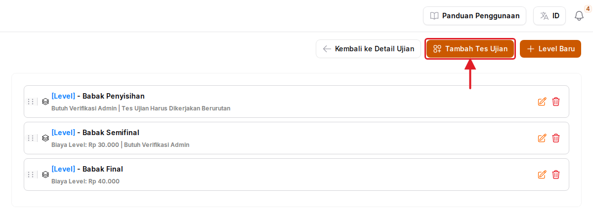
    </Frame>
  </Step>
  <Step title="Choose the test and the level">
    The **Tes Ujian** field only lists tests that are not yet in any level, and you can choose more than one test.

    <Frame>
      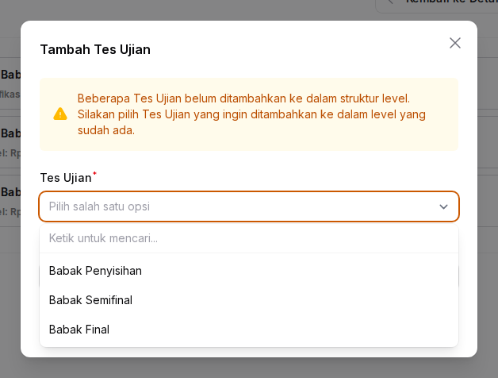
    </Frame>

    The **Level Ujian** field lists the levels you have created.

    <Frame>
      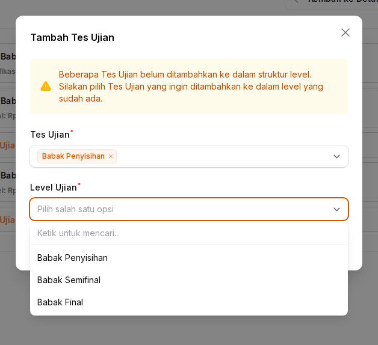
    </Frame>

    <Frame>
      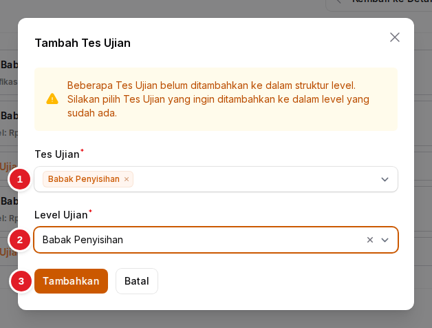
    </Frame>

    1. **Tes Ujian** (Exam Test): choose the test, for example **Babak Penyisihan**.
    2. **Level Ujian** (Exam Level): choose the target level, for example **Babak Penyisihan**.
    3. Click **Tambahkan** (Add).

    Repeat until every test is in its level. Once all tests are placed, this window shows the note **Semua Tes Ujian sudah ditambahkan ke dalam struktur level** (All exam tests have been added to the level structure).
  </Step>
  <Step title="Check the level structure">
    Each level is shown with the **[Level]** label and a summary of its settings, and the tests inside it are shown with the **[Tes Ujian]** label.

    <Frame>
      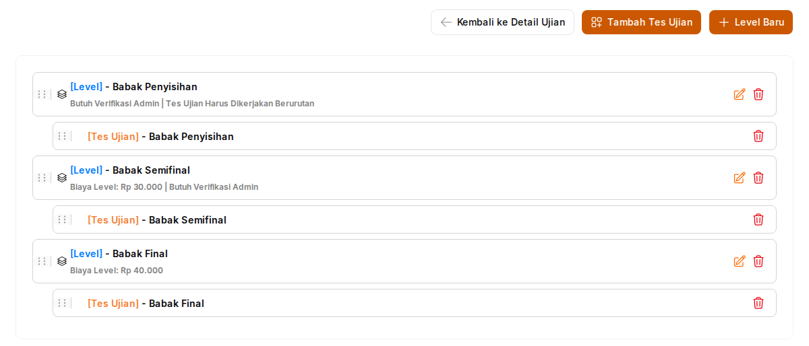
    </Frame>

    - Drag the dotted handle on the left to change the order of levels or of tests within a level.
    - Click the pencil icon to change a level's settings, or the trash icon to delete a level or remove a test from a level. Deleting a level does not delete the exam tests in it.
    - Click **Kembali ke Detail Ujian** (Back to Exam Detail) when you are done.
  </Step>
</Steps>

## 5. Add exam sessions and participants

Every test needs an exam session with a question package before it can be taken. Create a session for each round through the **Daftar Tes Ujian** tab → **Ubah** (Edit) on the test → **Tambah Sesi Ujian** (Add Exam Session), following [Create an Exam Session](/en/data-ujian/membuat-sesi-ujian). The session schedule must fall within the exam's date range.

Once the level structure is complete, add participants through the **Daftar Peserta Ujian** (Exam Participant List) tab (see [Add Exam Participants](/en/data-ujian/menambahkan-peserta-ujian)) or open self-registration with a registration form (see [Participant Registration Form](/en/data-ujian/membuat-formulir-pendaftaran)). New participants can only take the tests in the first level; tests in later levels stay locked.

## 6. Move participants on to the next round

For example, participant **Rico Sadewa** has finished **Babak Penyisihan**. Because this level requires admin verification, the next round is marked **Proses Verifikasi** (Verification in Progress) in the participant app, and its test is still locked.

<Frame>
  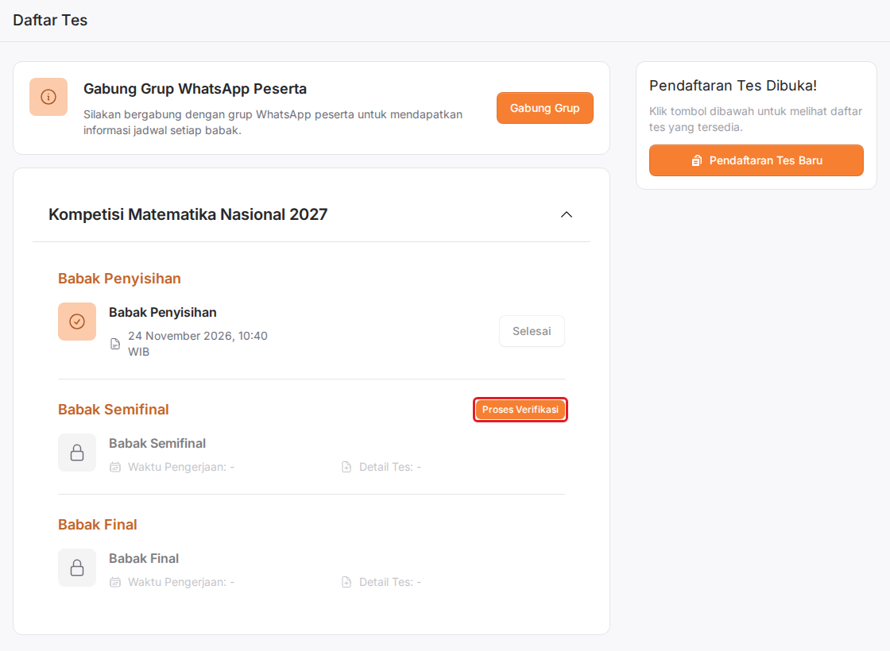
</Frame>

<Steps>
  <Step title="Open the exam detail">
    Open **Data Ujian**, find the exam, then click **Detail**.

    <Frame>
      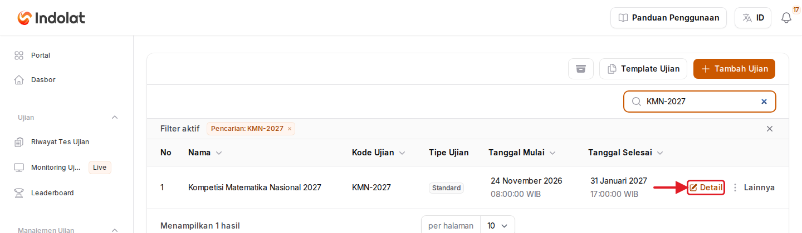
    </Frame>
  </Step>
  <Step title="Click Lihat on the participant who needs review">
    Scroll down, open the **Daftar Peserta Ujian** tab, find the participant with status **Aktif (Perlu Ditinjau)**, then click **Lihat** (View). You can use the **Status Peserta** filter → **Perlu Ditinjau** to show only those participants.

    <Frame>
      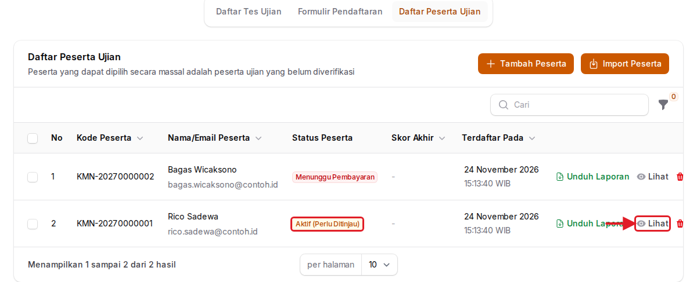
    </Frame>
  </Step>
  <Step title="Decide whether the participant passes">
    The **Detail Peserta** (Participant Detail) page shows **Tes Ujian Terakhir** (Last Test) and **Tes Ujian Berikutnya** (Next Test), and the box **Apakah Peserta Lanjut ke Tes Ujian Berikutnya?** (Does the participant continue to the next test?).

    <Frame>
      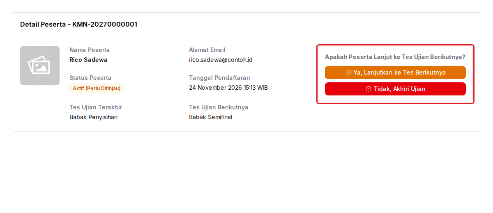
    </Frame>

    - Click **Ya, Lanjutkan ke Tes Berikutnya** (Yes, continue to the next test) if the participant passes. The tests in the next level are unlocked and the participant's status returns to **Aktif**.
    - Click **Tidak, Akhiri Ujian** (No, end the exam) if the participant does not pass. The participant's exam is ended, their status becomes **Selesai** (Finished), and the tests in the next level stay locked.

    Confirm your choice in the window that appears.
  </Step>
  <Step title="Set the payment deadline (paid level)">
    If the next level has a fee, the confirmation window shows the amount and asks for a payment deadline.

    <Frame>
      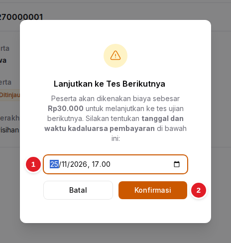
    </Frame>

    1. Enter the payment expiry date and time. The deadline cannot be in the past and can be at most 2 × 24 hours from now.
    2. Click **Konfirmasi** (Confirm).

    The system creates a QRIS bill for the participant. Until the bill is paid, the participant's status in the list is **Menunggu Pembayaran** (Awaiting Payment), and the **Detail Peserta** page shows the QR code, payment code, total, and deadline.
  </Step>
  <Step title="The participant completes the payment">
    In the participant app, the paid level shows a **Selesaikan Pembayaran** (Complete Payment) button. The participant pays by QRIS before the deadline; once the payment succeeds, the tests in that level are unlocked.

    <Frame>
      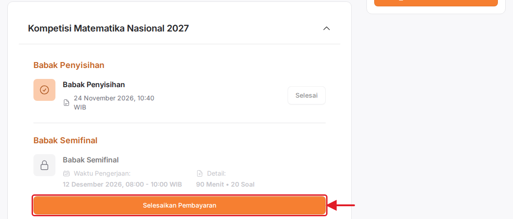
    </Frame>

    <Info>
      If the next level is free, the participant can continue right away without paying.
    </Info>
  </Step>
</Steps>

<Warning>
  Make sure participants you move on are already in an exam session for the next level's tests. A test stays locked for participants without a session, or when the session has no question package.
</Warning>
