This guide explains how to create an **exam** as the main container, together with all of its settings. In the exam you set the name and schedule, the exam type, how participants register, any fees, the test-taking rules and the information shown to participants. Tests, sessions and participants are added after the exam is created.

<Info>
  **Menu location:** **Portal** → **Platform Ujian (CBT)** (Exam Platform) → **Manajemen Ujian** (Exam Management) → **Data Ujian** (Exam Data).

  You need access to the **Data Ujian** menu. Admins with the **Guru** (Teacher) role can only see and manage the exams they created themselves.
</Info>

For example, you are an admin at **Bimbel Prestasi Nusantara** (a tutoring centre) and want to run **Tryout Akbar SNBT 2027 – Gelombang 2**, a practice exam for SNBT (Indonesia's national university entrance test), with these conditions:

- the exam is free,
- participants can register themselves,
- participants can see their final score after they finish.

## Open the Data Ujian menu

<Steps>
  <Step title="Open the Platform Ujian (CBT) module">
    After you sign in, you land on the **Portal** page. Click the **Platform Ujian (CBT)** tile in **Daftar Modul** (Module List).

    <Frame>
      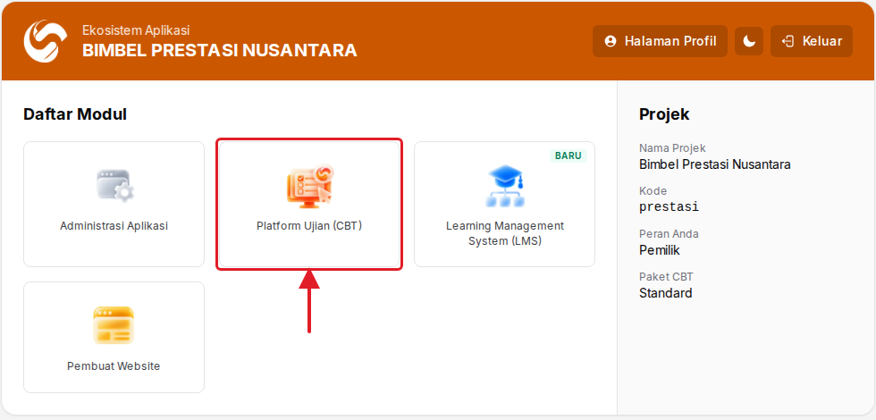
    </Frame>
  </Step>
  <Step title="Click Data Ujian">
    In the sidebar, click **Data Ujian** under **Manajemen Ujian**. This page lists your exams with their **Kode Ujian** (Exam Code), **Tipe Ujian** (Exam Type), **Tanggal Mulai** (Start Date) and **Tanggal Selesai** (End Date).

    <Frame>
      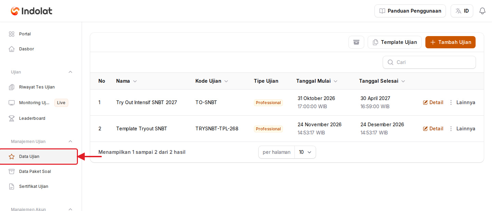
    </Frame>
  </Step>
</Steps>

## Choose how to create the exam

There are two ways to create an exam:

1. **Template Ujian** (Exam Template): the system sets up the exam with its tests and level structure.
2. **Tambah Ujian** (Add Exam): you define the whole structure and every setting yourself.

<AccordionGroup>
  <Accordion title="Use an exam template">
    An exam template is a ready-made exam structure. When you use one, the system creates the **exam, its tests and its level structure** in one go. You only need to complete the details.

    <Steps>
      <Step title="Click Template Ujian">
        On the **Data Ujian** page, click **Template Ujian**.

        <Frame>
          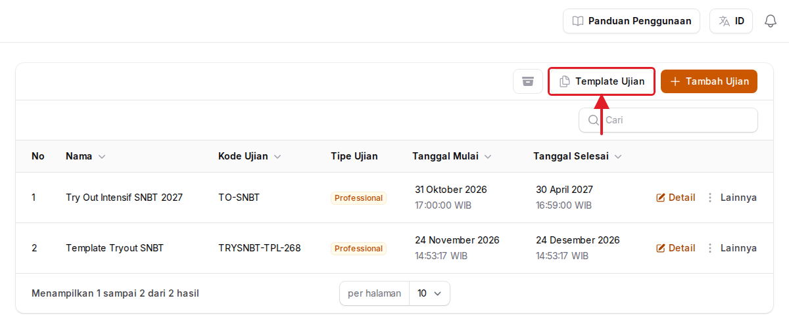
        </Frame>
      </Step>
      <Step title="Choose a template, then click Gunakan Template">
        The **Pilih Template Ujian** (Choose Exam Template) window shows each template's name, **Pembayaran** (payment type), number of **Tes Ujian** (tests) and level **Struktur** (structure).

        <Frame>
          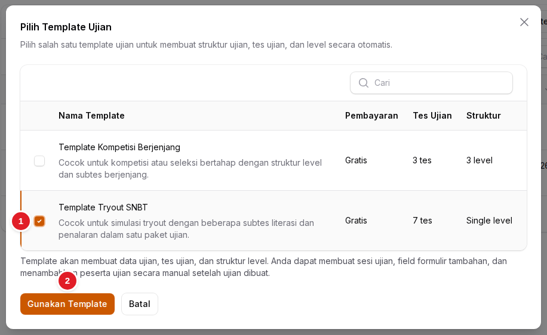
        </Frame>

        1. Tick the template you want. In this example, choose **Template Tryout SNBT** (free, 7 tests, single level).
        2. Click **Gunakan Template** (Use Template).

        Available templates:

        - **Template Tryout SNBT**: a tryout with several literacy and reasoning subtests in one exam.
        - **Template Kompetisi Berjenjang**: a staged competition or selection with 3 tests and 3 levels. Multi-level exams are explained in [Create a Multi-Level Exam](/en/data-ujian/membuat-ujian-berjenjang).
      </Step>
      <Step title="Check the new exam">
        The new exam appears in the **Data Ujian** list with the template's name and code.

        <Frame>
          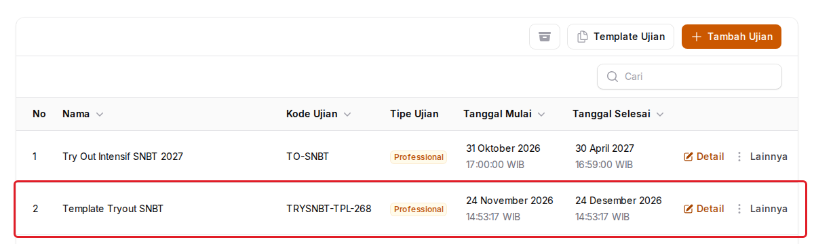
        </Frame>

        <Note>
          - An exam created from a template is a **Ujian Professional (Paket Berbayar)** (Professional exam) that starts when the template is used and ends one month later. Change its name, code, schedule and type through **Detail**.
          - A template does **not** create exam sessions, registration form fields or participants. You still need to [create exam sessions](/en/data-ujian/membuat-sesi-ujian), choose a question package for each session and [add participants](/en/data-ujian/menambahkan-peserta-ujian).
          - Templates that charge a fee can only be used when the registration form add-on is active.
          - Test settings that need a plan feature follow the project's plan. If the plan does not include **Proctoring Dual Monitor**, **Hanya Izinkan Satu Layar** (single screen only) is turned off on the template's tests; if it does not include **Computer Adaptive Test (CAT)**, the template's CAT tests are created as CBT tests.
        </Note>
      </Step>
    </Steps>
  </Accordion>

  <Accordion title="Create an exam from scratch (Tambah Ujian)">
    <Steps>
      <Step title="Click Tambah Ujian">
        On the **Data Ujian** page, click **Tambah Ujian**.

        <Frame>
          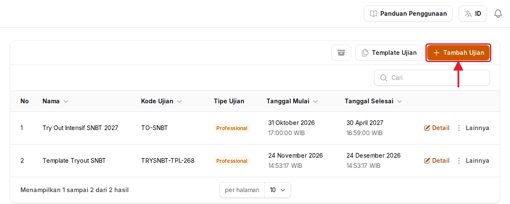
        </Frame>
      </Step>
      <Step title="Fill in the Informasi Umum form">
        <Frame>
          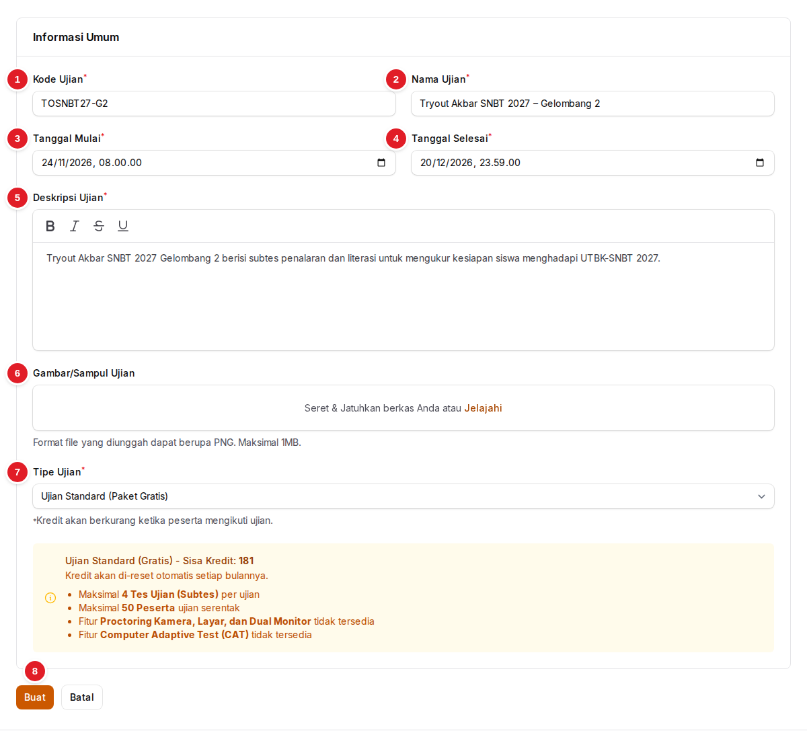
        </Frame>

        1. **Kode Ujian** (Exam Code) A short code that is unique within your project. It may contain only letters, numbers, `-` and `#`; letters are converted to capitals. The code is also the prefix of the default **Kode Peserta** (Participant Code), see [Participant Codes and Field Codes](/en/data-ujian/kode-peserta). Example: **TOSNBT27-G2**.
        2. **Nama Ujian** (Exam Name) The name admins and participants see. Example: **Tryout Akbar SNBT 2027 – Gelombang 2**.
        3. **Tanggal Mulai** (Start Date) The date and time the exam event starts.
        4. **Tanggal Selesai** (End Date) The date and time the exam event ends. It cannot be earlier than the start date and can be at most one year from today. Every exam session must fall within this range.
        5. **Deskripsi Ujian** (Exam Description) A short description of the exam, up to 1,000 characters. This field is required.
        6. **Gambar/Sampul Ujian** (Exam Image/Cover, optional) A PNG cover image of up to 1 MB.
        7. **Tipe Ujian** (Exam Type) Choose **Ujian Standard (Paket Gratis)** or **Ujian Professional (Paket Berbayar)**. The differences are explained in the **Tipe & Paket Ujian** section below.
        8. Click **Buat** (Create). The **Detail Ujian** (Exam Details) page opens straight away.
      </Step>
    </Steps>
  </Accordion>
</AccordionGroup>

## Set up the exam details

The **Detail Ujian** page opens after you create an exam. To open it again later, click **Detail** on the exam's row on the **Data Ujian** page.

<Frame>
  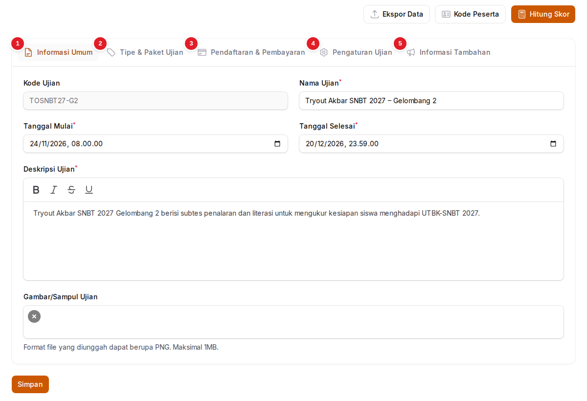
</Frame>

The exam settings are split into five tabs:

1. **Informasi Umum** (General Information)
2. **Tipe & Paket Ujian** (Exam Type & Plan)
3. **Pendaftaran & Pembayaran** (Registration & Payment)
4. **Pengaturan Ujian** (Exam Settings)
5. **Informasi Tambahan** (Additional Information)

After changing any tab, click **Simpan** (Save).

### Informasi Umum

This tab has the same fields as the **Tambah Ujian** form: **Kode Ujian**, **Nama Ujian**, **Tanggal Mulai**, **Tanggal Selesai**, **Deskripsi Ujian** and **Gambar/Sampul Ujian**.

<Note>
  - **Kode Ujian** can no longer be changed once the exam has participants.
  - **Tanggal Mulai** and **Tanggal Selesai** cannot be changed while any participant is taking a test.
</Note>

### Tipe & Paket Ujian

<Frame>
  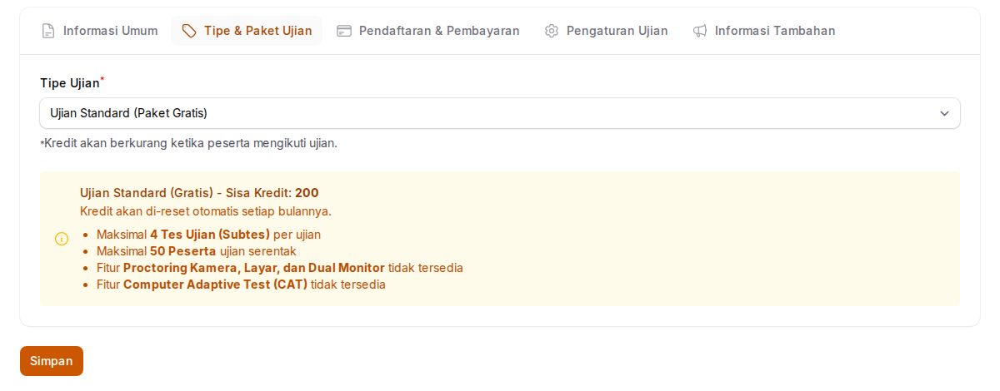
</Frame>

**Tipe Ujian** determines which credits the exam uses and which features are available. Credits are used when participants take the exam. The box below the field shows the remaining credits for that type.

| | **Ujian Standard (Paket Gratis)** | **Ujian Professional (Paket Berbayar)** |
| --- | --- | --- |
| Credit validity | Reset automatically every month | Subscription credits accumulate as long as the subscription is renewed without a gap; separately purchased exam credits are valid for 6 months from the purchase date |
| Tests per exam | Up to 4 | Up to 30 |
| Participants taking the exam at the same time | Up to 50 | Up to 1,000 |
| Camera and Screen proctoring | Not available | Available (uses add-on credits) |
| Dual Monitor proctoring (**Hanya Izinkan Satu Layar**) | Not available | Available if the project is on the **Esensial**, **Rutin** or **Intensif** plan |
| Computer Adaptive Test (CAT) | Not available | Available if the project is on the **Rutin** or **Intensif** plan |

With both types, CBT tests can use every scoring method (including IRT), and **Deteksi Pindah Tab** (Tab Switch Detection) is always available.

The **Ujian Professional** info box says proctoring and CAT are available, but **Hanya Izinkan Satu Layar** and CAT still need a subscription plan that includes them. Without it, the options are labelled **(Fitur tidak aktif)** (feature not active) on the test form. See [Create a Test](/en/data-ujian/membuat-tes-ujian#exam-type) and [Exam Credits, Standard and Professional Exams](/en/konsep/kredit-dan-tipe-ujian).

<Warning>
  If you choose **Ujian Professional (Paket Berbayar)** but the project has no professional exam credits, the system shows a warning and participants cannot start the exam until credits are available. Credits are managed in **Administrasi Aplikasi** → **Keuangan** → **Langganan & Tagihan** (Subscription & Billing).
</Warning>

<Tip>
  Choose **Ujian Standard** for simple exams with at most 4 tests and 50 participants at the same time. Choose **Ujian Professional** if you need more tests or concurrent participants, CAT, or camera, screen and dual monitor proctoring. For CAT and dual monitor, also make sure the project's subscription plan includes the feature.
</Tip>

### Pendaftaran & Pembayaran

<Frame>
  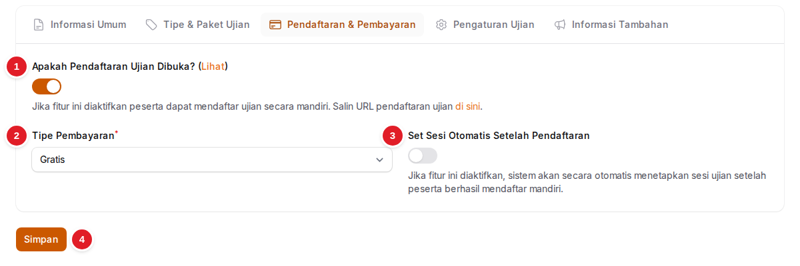
</Frame>

This tab decides whether participants can register themselves and whether the exam is free or paid. Registration and payment settings require the **Halaman Pendaftaran Ujian dan Pembayaran Otomatis** (Exam Registration Page and Automatic Payment) add-on. Without the add-on, the settings show **(Add-on Tidak Aktif)** (Add-on Inactive) and a paid exam cannot be saved.

1. **Apakah Pendaftaran Ujian Dibuka?** (Is Exam Registration Open?) Turn this on so participants can register for the exam themselves. Once it is on, click the **di sini** (here) link in the helper text to copy the exam registration URL, then share it with prospective participants. The **Lihat** (View) link shows an example registration page. Form fields, verification and the registration quota are set in [Participant Registration Form](/en/data-ujian/membuat-formulir-pendaftaran).
2. **Tipe Pembayaran** (Payment Type) Choose one of these types:

   - **Gratis** (Free): participants do not pay.
   - **Sekali Bayar** (One-Time Payment): participants pay once for every test in the exam. Example: Rp50,000 for all subtests of the tryout.
   - **Berbayar per Tes Ujian** (Paid per Test): participants pay for each test they want to take. The fee is set on each test (see [Create a Test](/en/data-ujian/membuat-tes-ujian)).
   - **Berbayar per Level (Multi-Level)** (Paid per Level): participants pay for each level or round they take. Choosing this type automatically sets **Apakah Ujian Multi-Level?** to **Ya (Multi-Level)**. Fees are set in the level structure, see [Create a Multi-Level Exam](/en/data-ujian/membuat-ujian-berjenjang).
3. **Set Sesi Otomatis Setelah Pendaftaran** (Assign Session Automatically After Registration) Turn this on so participants who register themselves are placed in an exam session straight away. With **Sekali Bayar** and **Berbayar per Tes Ujian**, the setting is called **Set Sesi Otomatis Setelah Pembayaran** (… After Payment) and runs once the participant has paid. It is not available with **Berbayar per Level (Multi-Level)**. If some tests still have no session, a warning asks you to add sessions first.
4. Click **Simpan**.

If you choose **Sekali Bayar**, the **Biaya Ujian Sekali Bayar (IDR)** (One-Time Exam Fee) field appears. Enter the fee participants must pay, at least Rp5,000. **Set Sesi Otomatis Setelah Pembayaran** can only be turned on after the fee is filled in.

<Frame>
  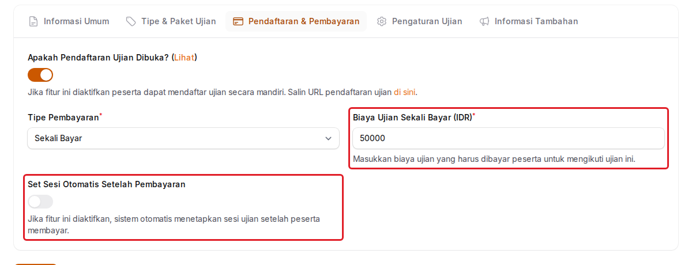
</Frame>

<Note>
  If you change the payment type from **Sekali Bayar** to another type, the **Metode Pembayaran** (Payment Method) field is automatically removed from the exam's registration form.
</Note>

<Tip>
  Turn on **Set Sesi Otomatis Setelah Pendaftaran** if you often forget to place registered participants in an exam session.
</Tip>

### Pengaturan Ujian

<Frame>
  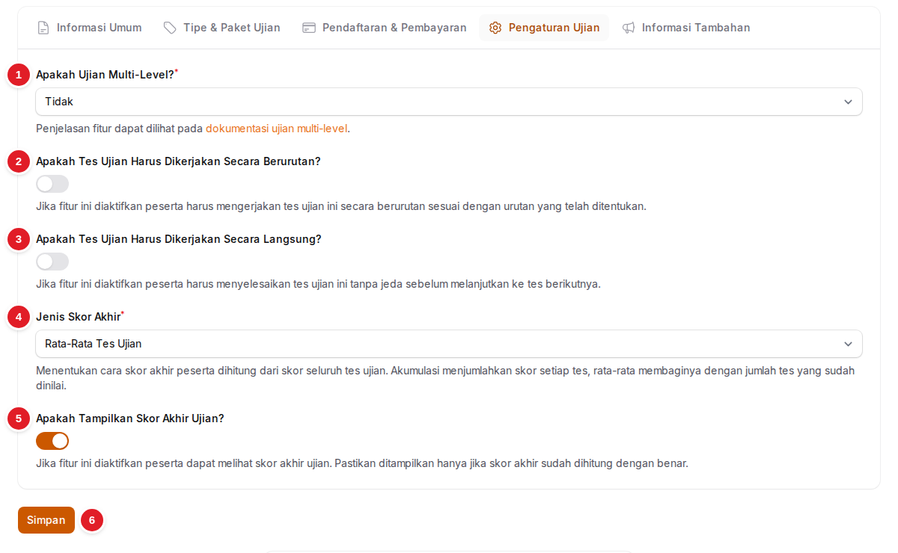
</Frame>

This tab sets the general test-taking rules and how the final score is calculated.

1. **Apakah Ujian Multi-Level?** (Is This a Multi-Level Exam?) Choose **Ya (Multi-Level)** if the exam runs in several rounds, such as Preliminary, Semifinal and Final. Choose **Tidak** (No) if the exam has a single stage, like the tryout in this example. This cannot be changed once the exam has participants. The full guide is in [Create a Multi-Level Exam](/en/data-ujian/membuat-ujian-berjenjang).
2. **Apakah Tes Ujian Harus Dikerjakan Secara Berurutan?** (Must Tests Be Taken in Order?) When on, participants must take the tests in the order you set. Set the order with the **Ubah Urutan Tes Ujian** (Reorder Tests) button in the **Daftar Tes Ujian** (Test List) section. When off, participants can choose which test to take first.
3. **Apakah Tes Ujian Harus Dikerjakan Secara Langsung?** (Must Tests Be Taken Without a Break?) When on, participants must finish a test without a break before moving to the next one. When off, participants may stop after one test and continue with another while its schedule is still open.
4. **Jenis Skor Akhir** (Final Score Type) How the final score is calculated from all test scores:
   - **Akumulasi Tes Ujian** (Sum of Tests): the scores of all tests are added together.
   - **Rata-Rata Tes Ujian** (Average of Tests, default): the total is divided by the number of tests that have been scored.

   Example: scores of 80 for Penalaran Matematika and 70 for Literasi Bahasa Indonesia give a final score of 150 with the sum, or 75 with the average. If the exam already has participants, every participant's final score is recalculated after you save the change. Tests scored with **Psikotes (Pengelompokan Jawaban)** are left out of both the sum and the average.
5. **Apakah Tampilkan Skor Akhir Ujian?** (Show the Final Exam Score?) Turn this on so participants can see their final exam score. Only turn it on once the final scores are correct. Leave it off if scores still need checking or will be announced later.
6. Click **Simpan**.

<Note>
  When the exam is set to **Ya (Multi-Level)**, settings 2 and 3 are hidden because the order and no-break rules are set on each level.
</Note>

### Informasi Tambahan

<Frame>
  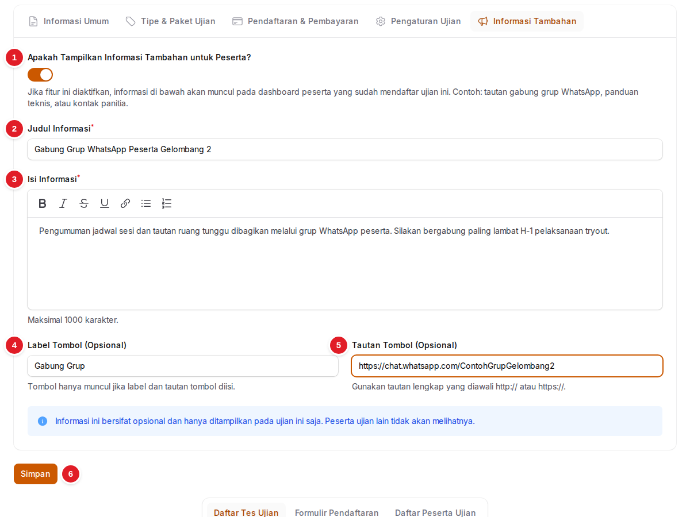
</Frame>

This optional tab shows extra information on the dashboard of participants registered for this exam, such as a WhatsApp group link, technical guidance or committee contacts. Participants of other exams do not see it.

1. **Apakah Tampilkan Informasi Tambahan untuk Peserta?** (Show Additional Information to Participants?) Turn this on to show the other fields.
2. **Judul Informasi** (Title) Up to 100 characters. Example: **Gabung Grup WhatsApp Peserta Gelombang 2**.
3. **Isi Informasi** (Content) Up to 1,000 characters. You can use bold, italics, links and lists.
4. **Label Tombol (Opsional)** (Button Label, optional) The button text, up to 50 characters. Example: **Gabung Grup**.
5. **Tautan Tombol (Opsional)** (Button Link, optional) A full link starting with `http://` or `https://`. The button only appears when both the label and the link are filled in.
6. Click **Simpan**.

Participants see the information at the top of their **Daftar Tes** (Test List) page:

<Frame>
  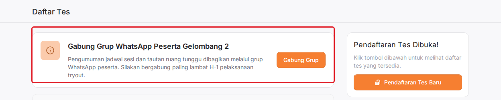
</Frame>

## Other sections of the Detail Ujian page

Below the settings tabs there are three sections for completing the exam:

<Frame>
  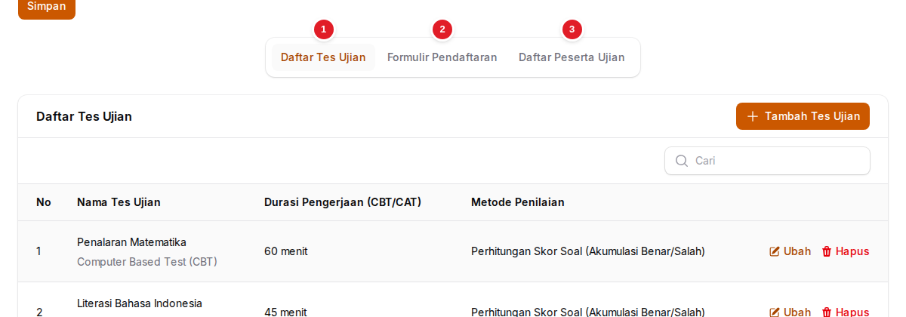
</Frame>

1. **Daftar Tes Ujian** (Test List): add and manage tests. See [Create a Test](/en/data-ujian/membuat-tes-ujian).
2. **Formulir Pendaftaran** (Registration Form): build the self-registration form. See [Participant Registration Form](/en/data-ujian/membuat-formulir-pendaftaran).
3. **Daftar Peserta Ujian** (Participant List): add and manage participants. See [Add Participants to an Exam](/en/data-ujian/menambahkan-peserta-ujian).

The top right of the page has three buttons:

<Frame>
  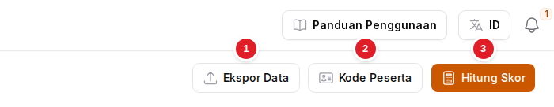
</Frame>

1. **Ekspor Data** (Export Data): exports test results, essay answer links, item analysis and the leaderboard template to Excel. See [Exam Results and Exports](/en/data-ujian/hasil-dan-ekspor-ujian).
2. **Kode Peserta** (Participant Code): sets the participant code format and per-session field codes. See [Participant Codes and Field Codes](/en/data-ujian/kode-peserta).
3. **Hitung Skor** (Calculate Score): recalculates participant scores, including IRT scores. See [Exam Results and Exports](/en/data-ujian/hasil-dan-ekspor-ujian#recalculate-scores).

On a multi-level exam, the **Atur Struktur Level Ujian** (Set Up Level Structure) button also appears here.

## Manage exams in the Data Ujian list

Click **Lainnya** (More) on an exam's row for more actions:

<Frame>
  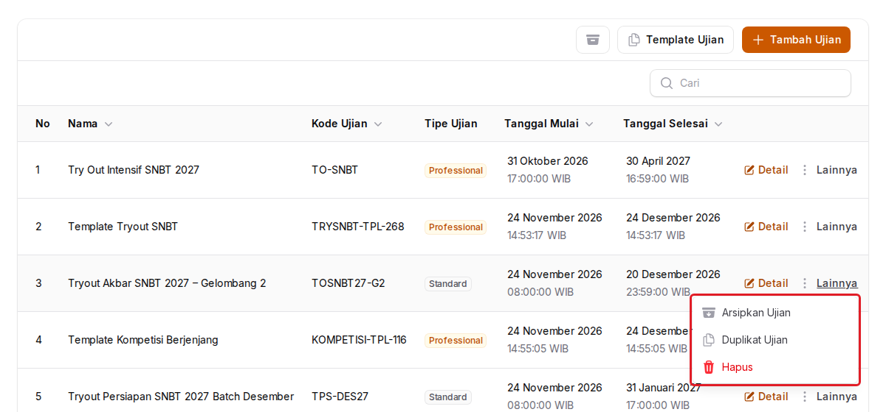
</Frame>

- **Arsipkan Ujian** (Archive Exam): hides the exam from the list and locks all of its data. Archived exams are shown on the **Arsip Ujian** (Exam Archive) page, opened with the archive icon button next to **Template Ujian**, and can be restored with **Keluarkan dari Arsip** (Remove from Archive), but their data stays locked and can no longer be changed.
- **Duplikat Ujian** (Duplicate Exam): copies the exam with its tests, level structure, registration form, coupons and media files. It runs in the background and you get a notification when it is done.
- **Hapus** (Delete): deletes the exam. An exam that participants have started cannot be deleted.

<Warning>
  Archiving an exam locks all of its data permanently, even if the exam is later removed from the archive. Make sure the exam is completely finished before you archive it.
</Warning>

## Check your exam

<Check>
  - The exam name, code and schedule are correct.
  - The exam type matches the number of tests, concurrent participants and features you need.
  - Self-registration and the payment type are set as intended.
  - The test-taking rules and final score type are correct.
  - The final score display setting has been checked.
</Check>

Once the settings are done, add tests to the exam:

<Card title="Create a Test" icon="arrow-right" horizontal href="/en/data-ujian/membuat-tes-ujian">
  Add tests to the exam you created.
</Card>
