Once the exam and its tests are ready, the next step is to add participants. This page explains how to add participants who already have an account and those who do not, and how to manage the exam's participant list.

<Info>
  **Menu location:** **Portal** → **Platform Ujian (CBT)** → **Manajemen Ujian** → **Data Ujian** → **Detail** on the exam → **Daftar Peserta Ujian** (Participant List) section.
</Info>

There are three ways to add participants to an exam:

| Method | When to use it |
| --- | --- |
| **Tambah Peserta** (Add Participants) | The participants' accounts already exist in **Data Akun** (Account Data), for example created with **Tambah Akun**, **Import Akun** or account self-registration. |
| **Import Peserta** (Import Participants) | You have a list of participants for this exam. Accounts are created and added to the exam in one step. |
| Self-registration | Participants register themselves through the exam registration link. |

For example, the admin of **Bimbel Prestasi Nusantara** adds participants to **Tryout Akbar SNBT 2027 – Gelombang 2**: five students labelled **Gelombang 2** whose accounts already exist in **Data Akun**, plus four **Kelas Intensif** (intensive class) students from an Excel file.

<Frame>
  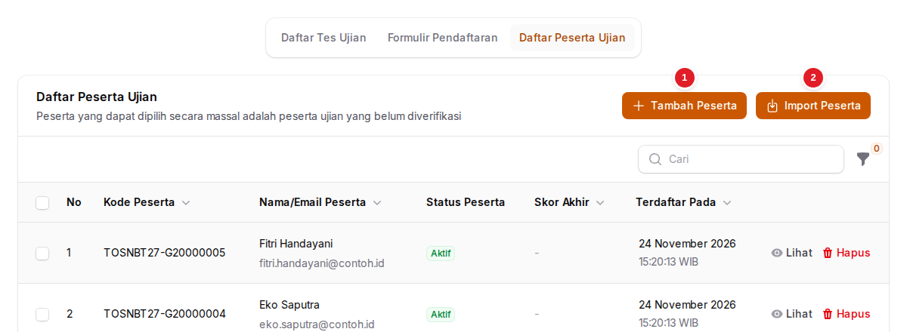
</Frame>

1. **Tambah Peserta**: choose existing accounts.
2. **Import Peserta**: import participants from an Excel file.

<Note>
  Participants can only be added once the exam has at least one test. On a multi-level exam, every test must already be mapped to the level structure.
</Note>

## Method 1: Choose accounts from Data Akun

Use this method when the participants' accounts already exist in **Platform Ujian (CBT)** → **Manajemen Akun** → **Data Akun** (the master data is in **Administrasi Aplikasi** → **Pengguna** → **Pengguna**). Creating accounts, one at a time or with **Import Akun**, is explained in [Add Participant Accounts](/en/data-akun/menambahkan-akun-peserta).

<Steps>
  <Step title="Click Tambah Peserta">
    In the **Daftar Peserta Ujian** section, click **Tambah Peserta**. The **Tambah Peserta** window lists every account in your project with its **Label**, **Status Ujian** (Exam Status) and **Status Akun** (Account Status).

    <Frame>
      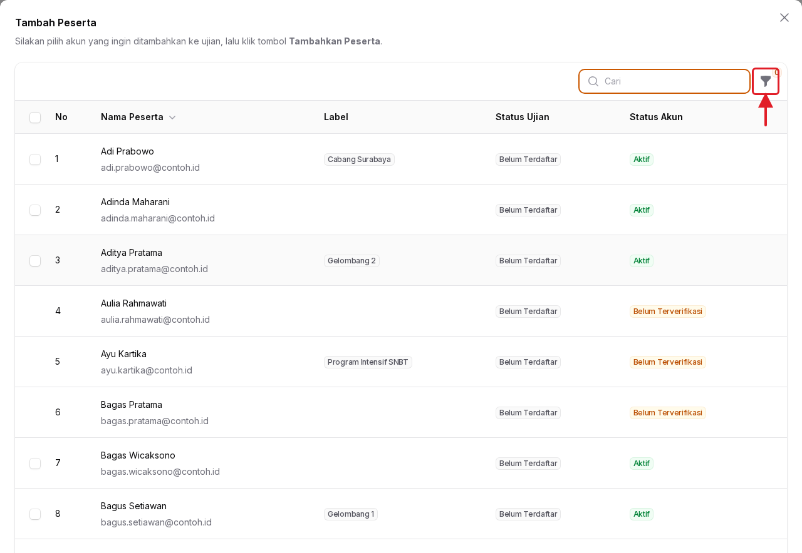
    </Frame>

    Only accounts whose **Status Akun** is **Aktif** (Active) and whose **Status Ujian** is **Belum Terdaftar** (Not Registered) have a checkbox. Accounts that are **Belum Terverifikasi** (Unverified, participants who have not verified their email) or **Tidak Aktif** (Inactive) cannot be selected.
  </Step>
  <Step title="Narrow the list with Filter">
    If there are many accounts, click the **Filter** icon and set:

    - **Label**: for example **Gelombang 2**. Choose **Tanpa Label** (No Label) for accounts without a label.
    - **Status Ujian**: choose **Belum Terdaftar** to show only accounts that are not in this exam yet.

    Click **Terapkan filter** (Apply filter). You can also search by name in the **Cari** (Search) field.

    <Frame>
      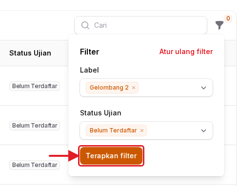
    </Frame>
  </Step>
  <Step title="Select participants, then click Tambahkan Peserta">
    <Frame>
      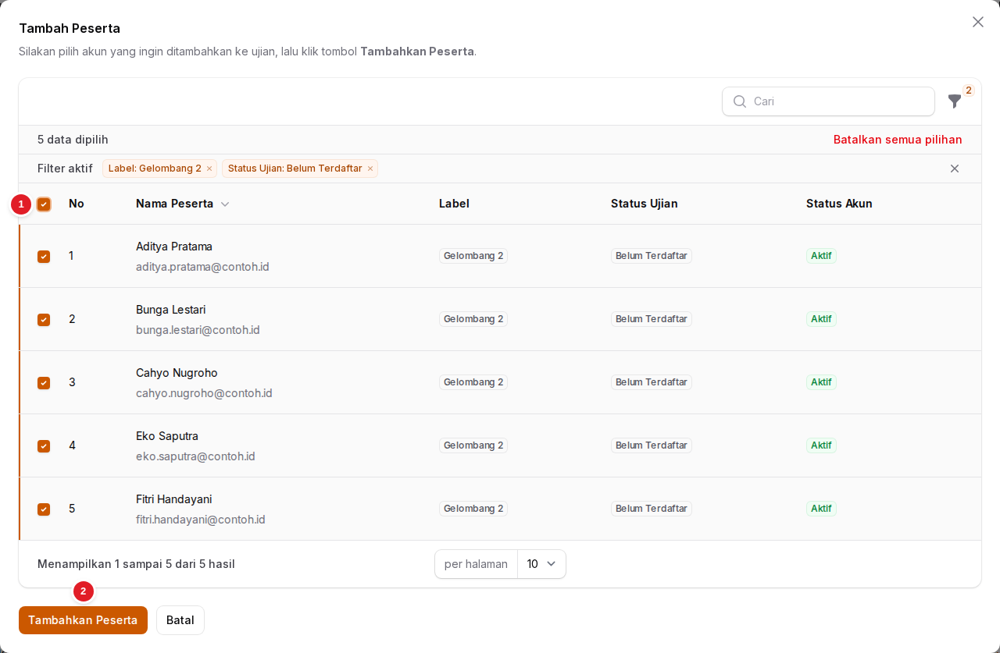
    </Frame>

    1. Tick the accounts to add. Tick the box in the column header to select every account shown, or click an account's row to select it.
    2. Click **Tambahkan Peserta** (Add Participants).

    Participants are added in the background. You get a notification when it is done.
  </Step>
  <Step title="Check Daftar Peserta Ujian">
    The new participants appear with the **Status Peserta** (Participant Status) **Aktif**. The system gives each one a **Kode Peserta** (Participant Code), by default the **Kode Ujian** followed by a 7-digit sequence number. The format can be changed, see [Participant Codes and Field Codes](/en/data-ujian/kode-peserta).

    <Frame>
      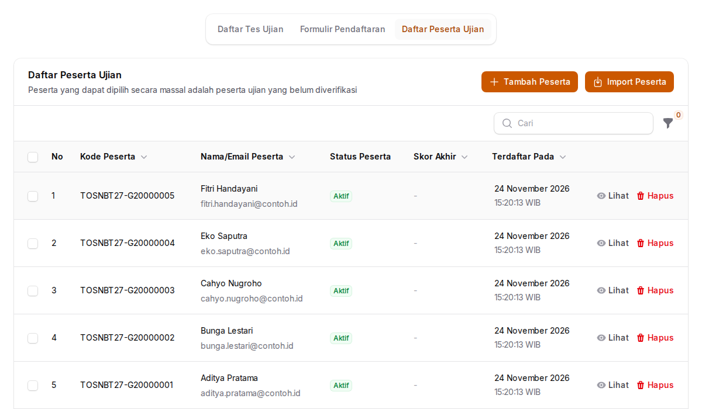
    </Frame>
  </Step>
</Steps>

## Method 2: Import participants from an Excel file

Use this method when you have a list of participants for this exam. The system creates their accounts in **Data Akun** and adds them to the exam straight away, so you do not need **Tambah Peserta** afterwards.

<Steps>
  <Step title="Click Import Peserta and download the template">
    In the **Daftar Peserta Ujian** section, click **Import Peserta**, then click **Unduh Template** (Download Template) to get the correct Excel format.

    <Frame>
      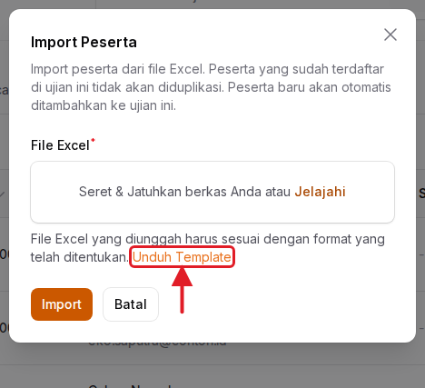
    </Frame>
  </Step>
  <Step title="Fill in the template">
    <Frame>
      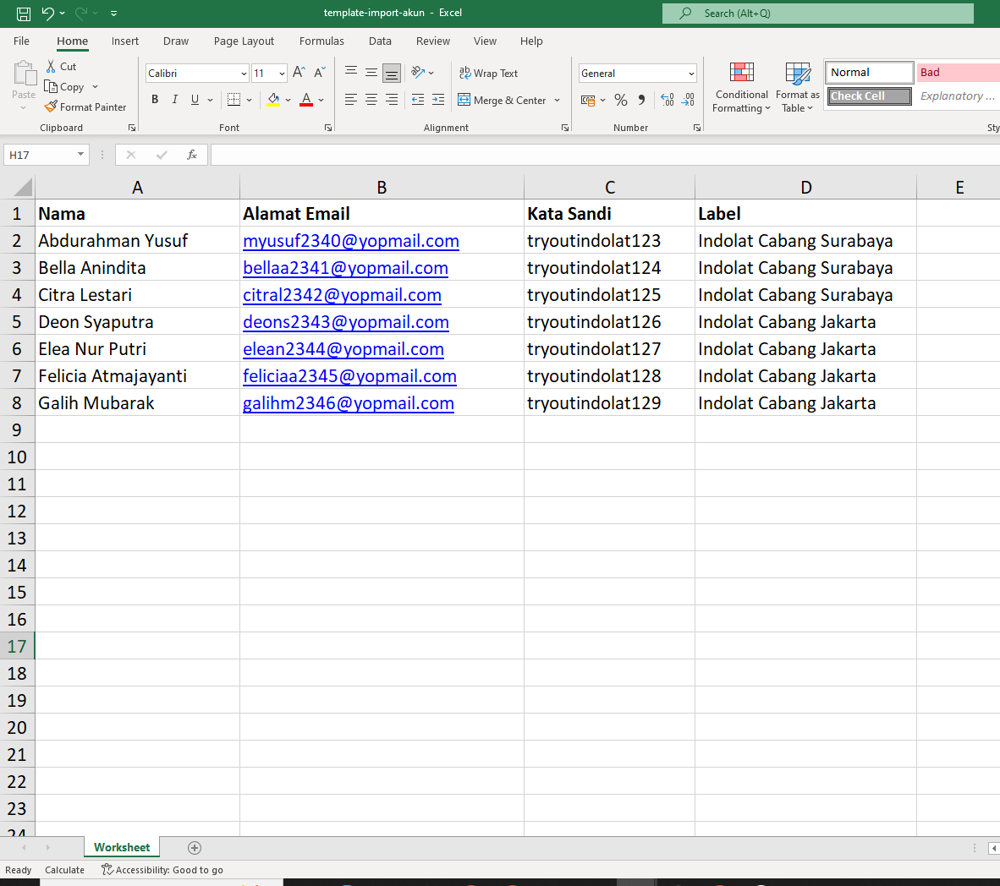
    </Frame>

    The template has four columns. Do not change the column headings in the first row.

    1. **Nama** (Name): the participant's name.
    2. **Alamat Email** (Email Address): the email the participant signs in with. Each participant needs a different email.
    3. **Kata Sandi** (Password): the password for signing in.
    4. **Label** (optional): a tag for grouping participants, such as **Kelas Intensif**, **Gelombang 2** or **Cabang Surabaya**. Labels that do not exist yet are created automatically.

    <Note>
      - The system does not check whether an email address actually exists, so you can use exam-only addresses. They must still be valid email addresses.
      - Incomplete rows and rows with an invalid email are skipped; the rest of the file is still imported.
      - Imported accounts are active and verified immediately.
    </Note>

    <Warning>
      If an email in the file already belongs to an account in your project, the account is **not duplicated**, but its **name, password and label are updated** from the file, and the account is added to the exam. Check your file so you do not change other participants' accounts by accident.
    </Warning>
  </Step>
  <Step title="Upload the file and click Import">
    <Frame>
      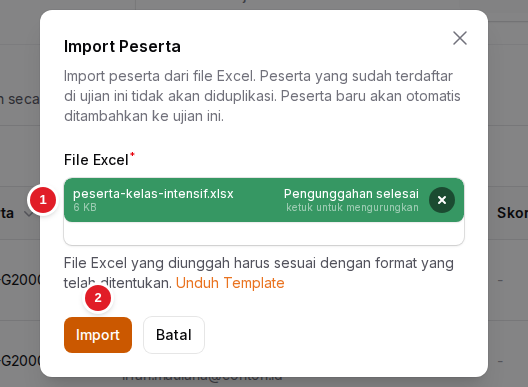
    </Frame>

    1. Upload the completed `.xlsx` file and wait for **Pengunggahan selesai** (Upload complete).
    2. Click **Import**.

    The import runs in the background. While it runs, a **Mengimpor Akun Peserta** (Importing Participant Accounts) box at the top of the page shows its progress. When it finishes, you get a notification with the number of new accounts and accounts that already existed.
  </Step>
  <Step title="Check the import result">
    Imported participants appear in **Daftar Peserta Ujian** with the **Aktif** status. Participants already registered for this exam are not added twice.

    <Frame>
      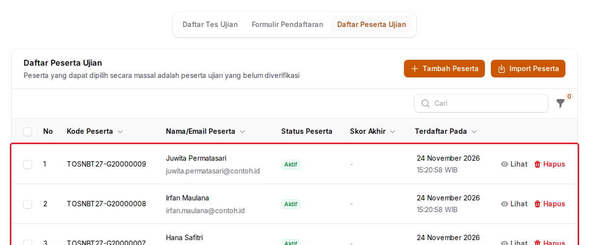
    </Frame>
  </Step>
</Steps>

## Method 3: Participant self-registration

Participants can also register themselves through the exam registration link:

1. Turn on **Apakah Pendaftaran Ujian Dibuka?** (Is Exam Registration Open?) on the **Pendaftaran & Pembayaran** tab of **Detail Ujian**, then copy the registration URL from its helper text. See [Create an Exam](/en/data-ujian/membuat-ujian).
2. Build the registration form and set up verification. See [Participant Registration Form](/en/data-ujian/membuat-formulir-pendaftaran).
3. Registrants who need verification appear in **Daftar Peserta Ujian** with the status **Menunggu Verifikasi** (Awaiting Verification), or **Menunggu Pembayaran** (Awaiting Payment) for unpaid registrations to a paid exam. Click **Verifikasi Peserta** (Verify Participant) on the row to review their form answers and approve them, or **Tolak & Hapus** (Reject & Delete) to reject them.

<Note>
  An exam created from a class in the **Learning Management System (LMS)** module is linked to that class automatically, and the class's students are registered for the exam straight away.
</Note>

## Manage the participant list

The **Daftar Peserta Ujian** table shows **Kode Peserta**, **Nama/Email Peserta** (Name/Email), **Status Peserta**, **Skor Akhir** (Final Score) and **Terdaftar Pada** (Registered At). Use **Filter** to narrow it by **Status Peserta** or to show participants who **Memiliki Skor Akhir** (Have a Final Score).

Buttons on each row:

- **Lihat** (View): opens the participant's account details and exam results.
- **Unduh Laporan** (Download Report): downloads the participant's result report as a PDF once they have finished a test. See [Exam Results and Exports](/en/data-ujian/hasil-dan-ekspor-ujian#download-participant-result-reports).
- **Verifikasi Peserta**: appears for participants with the **Menunggu Verifikasi** status.
- **Hapus** (Delete), or **Tolak & Hapus** for participants awaiting verification: removes the participant from the exam. Participants who have started cannot be deleted.

To manage several participants at once, tick them and click **Tindakan** (Actions):

<Frame>
  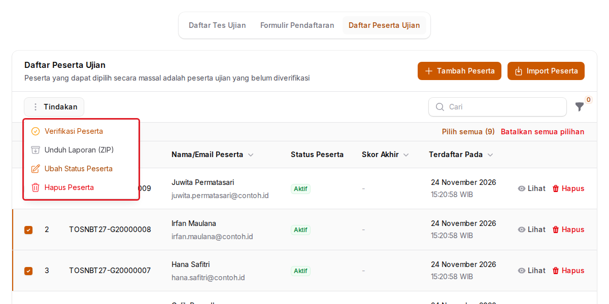
</Frame>

- **Verifikasi Peserta**: verifies every selected participant awaiting verification. Participants still awaiting payment are skipped.
- **Unduh Laporan (ZIP)** (Download Reports as ZIP): creates a ZIP archive with the selected participants' reports.
- **Ubah Status Peserta** (Change Participant Status): sets the status to **Aktif**, **Ditangguhkan** (Suspended), **Perlu Ditinjau** (Needs Review) or **Selesai** (Finished).
- **Hapus Peserta** (Delete Participants): removes the selected participants from the exam. Participants who have started are skipped.

<Warning>
  Removing a participant from an exam also removes their session assignments and cancels any pending payment transaction. This cannot be undone.
</Warning>

## Assign participants to exam sessions

Registered participants **must be assigned to an exam session** on every test before they can start. Follow [Create Exam Sessions](/en/data-ujian/membuat-sesi-ujian), or turn on **Set Sesi Otomatis Setelah Pendaftaran** for self-registered participants.

If a participant has no session for a test, that test shows as **Terkunci** (Locked) on the participant's **Daftar Tes** (Test List) page:

<Frame>
  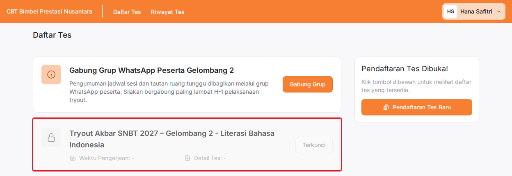
</Frame>
