This page shows CBT Indolat from the participant's side. Once you know every screen your participants will meet, you can explain to students, employees or tryout takers how to sit an exam, and answer their questions before and after it.

<Info>
  **Where participants sit the exam:** the participant app (often called the *CBT app*), a site separate from the admin panel at `https://<project-code>.indolat.web.id`. For a project with the code `prestasi`, the address is `https://prestasi.indolat.web.id`.

  **Where you set everything up:** the admin panel, **Platform Ujian (CBT)** (Exam Platform) module. Each section below links to the guide that explains the setting.
</Info>

The examples on this page use the participant **Laras Kusumawati** from **Bimbel Prestasi Nusantara**. Laras registers for the exam **Simulasi Ujian Peserta 2027**, which has one test, **Penalaran Umum**, with 10 multiple-choice questions and 20 minutes to answer them.

## The journey at a glance

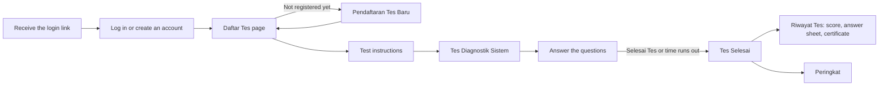

The participant app has only a few menus, so it is easy to explain:

| Menu | Contents |
| --- | --- |
| **Daftar Tes** (Test List) | Tests the participant is registered for and has not taken yet, and the **Pendaftaran Tes Baru** (Register for a New Test) button. |
| **Riwayat Tes** (Test History) | Finished tests, scores (if shown), the answer sheet and certificates. |
| **Peringkat** (Ranking) | Leaderboards. This menu only appears while a leaderboard is being shown to that participant. |
| Participant name menu (top right) | **Kartu Peserta** (Participant Card) and **Keluar** (Log Out). |

## 1. Receive the login link

Participants never open the admin panel. They open the **Tautan Login Peserta** (Participant Login Link), which you can copy from **Portal** → **Platform Ujian (CBT)** → **Lainnya** (Other) → **Pengaturan Aplikasi** (Application Settings), **Informasi Aplikasi** card.

<Frame>
  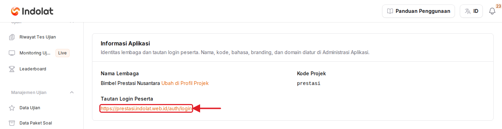
</Frame>

Share this link on WhatsApp, by email or in a class group. If you created the participants' accounts, also send their email address and initial password. The link follows the **Kode Projek** (project code); if you change the project code, the old link stops working. See [Participant Login](/en/lainnya/login-peserta) for details.

## 2. Log in or create an account

The login link opens the **Masuk ke CBT** (Log in to CBT) page with your institution's name.

<Frame>
  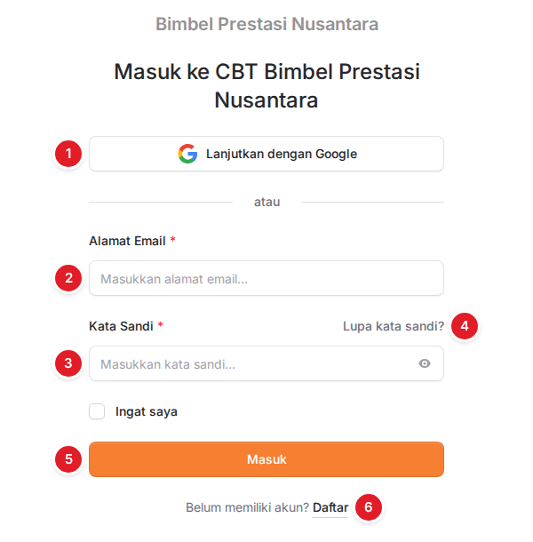
</Frame>

1. **Lanjutkan dengan Google** (Continue with Google): log in with a Google account. This button appears when the admin turns on **Autentikasi dengan Google**.
2. **Alamat Email** (Email Address): the account's email.
3. **Kata Sandi** (Password): the account's password.
4. **Lupa kata sandi?** (Forgot password?): request a password reset link by email.
5. **Masuk** (Log In): enter the app.
6. **Daftar** (Register): create an account. This link only appears when the admin turns on **Izinkan pendaftaran akun mandiri** (allow self-registration). Self-registered participants must enter a 6-digit verification code sent to their email.

Questions participants often ask at this point:

- **Forgot password.** The participant clicks **Lupa kata sandi?**, enters their email and clicks **Kirim Tautan Atur Ulang** (Send Reset Link). The reset link is valid for 60 minutes, and a new request can only be sent after one hour. You can also change the participant's password yourself (see [Frequently Asked Questions](/en/konsep/pertanyaan-umum#accounts-and-login)).

  <Frame>
    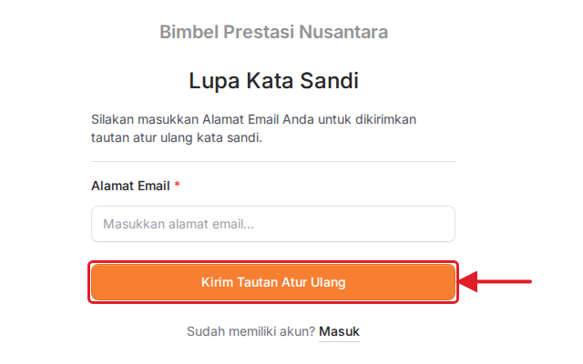
  </Frame>

- **Wrong password several times.** After 5 failed attempts within one minute, the participant has to wait briefly before trying again.
- **Accounts deactivated by the admin** cannot log in, and they see the same message as for a wrong password.
- **Opening an app page before logging in.** A participant who is not logged in, or whose session has ended, sometimes opens an app page directly, for example from a bookmark such as `https://prestasi.indolat.web.id/app/dashboard`. The app sends them to the project's login page with the message **Silakan masuk terlebih dahulu untuk melanjutkan.** (Please log in first to continue.) After logging in, the participant goes straight back to the page they asked for.

  <Frame>
    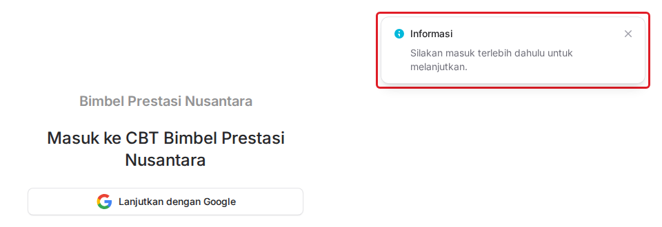
  </Frame>

  If the page is opened on the main CBT Indolat address (without a project code in the address), the app uses the project last opened in that browser. If the browser has never opened a project, the participant lands on the start page to enter the project code. So always share the login link that contains your project code.

The self-registration and email verification steps are described in [Participant Login](/en/lainnya/login-peserta#how-participants-register-and-log-in).

## 3. The Daftar Tes page

After logging in, participants land on **Daftar Tes**. A participant who is not registered for any exam sees **Tidak ada tes yang tersedia.** (No tests available.) and the **Pendaftaran Tes Baru** button (shown only when an exam has open registration).

<Frame>
  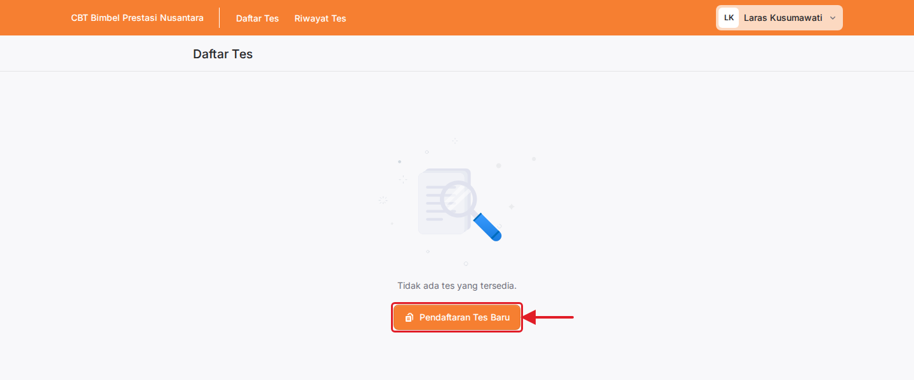
</Frame>

Participants you add to an exam directly, for example through [Add Participants to an Exam](/en/data-ujian/menambahkan-peserta-ujian), do not need to register again: their tests already appear on this page.

## 4. Register for an exam themselves

When **Apakah Pendaftaran Ujian Dibuka?** (is registration open?) is on for an exam, participants can register themselves.

<Steps>
  <Step title="Choose the exam, then click Selanjutnya">
    <Frame>
      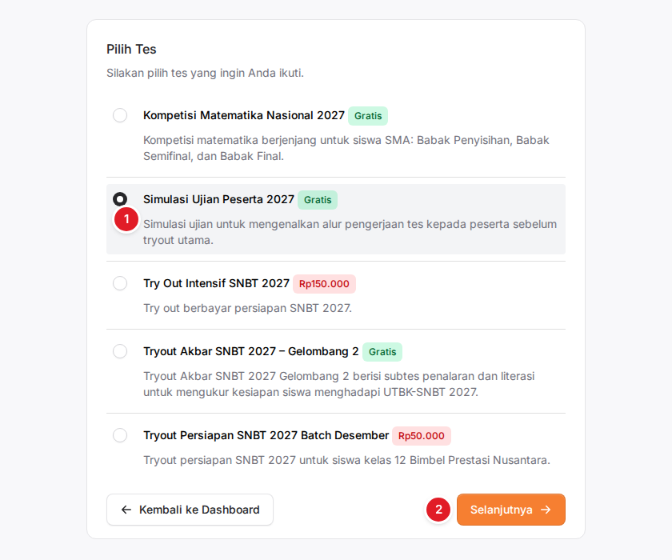
    </Frame>

    1. Choose the exam. The **Gratis** (Free) label or a price (for example **Rp50.000**) shows the exam fee.
    2. Click **Selanjutnya** (Next).
  </Step>
  <Step title="Fill in the form, then click Daftar Tes">
    If the exam has no form, the participant sees **Tidak ada formulir pendaftaran yang diperlukan.** (No registration form required.) Click **Daftar Tes** (Register), then **Ya, Daftar** (Yes, Register) in the confirmation window.

    <Frame>
      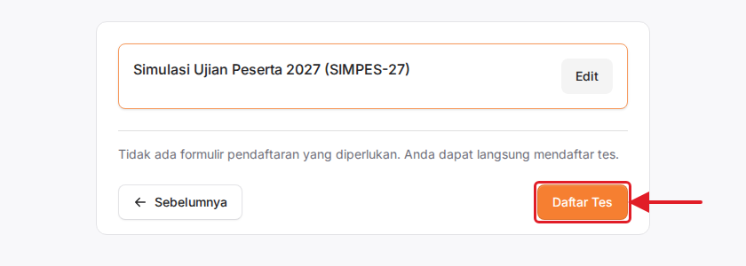
    </Frame>
  </Step>
</Steps>

For exams with a form, voucher codes or payment, participants fill in the form and pay with a QR code. The participant's side of that flow is in [Participant Registration Form](/en/data-ujian/membuat-formulir-pendaftaran#3-registration-from-the-participants-side); paid exams are explained in [Paid Exams: Participant Payment Flow and Balance](/en/konsep/ujian-berbayar-dan-saldo).

Once registered, the test appears as a card on **Daftar Tes**:

<Frame>
  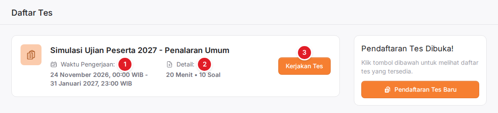
</Frame>

1. **Waktu Pengerjaan** (Working Time): the session window. The test can only be started within it.
2. **Detail**: duration and number of questions.
3. **Kerjakan Tes** (Take Test): opens the test instructions.

The card button changes with the participant's situation:

| Button | Meaning |
| --- | --- |
| **Kerjakan Tes** | The test is ready. Before the session starts or after it ends, the button cannot be clicked. |
| **Terkunci** (Locked) | The participant has not been assigned to an exam session, the session has no question package, an earlier test must be finished first (tests in order), or the test is waiting for payment. |
| **Proses Verifikasi** (Verification in Progress) | The registration is waiting for admin verification. |
| **Bayar Sekarang** (Pay Now) or a fee amount | The participant needs to complete payment. |

<Tip>
  When a participant reports a **Terkunci** button, first check whether they have been assigned to an exam session. See [Create Exam Sessions](/en/data-ujian/membuat-sesi-ujian#assign-participants-to-sessions).
</Tip>

## 5. Test instructions

Clicking **Kerjakan Tes** opens an instructions window with the test description you wrote, **Jenis Tes** (Test Type), **Jumlah Soal** (Number of Questions) and **Durasi Pengerjaan** (Duration). The participant clicks **Kerjakan Tes** again to continue, or **Tutup** (Close) to go back.

<Frame>
  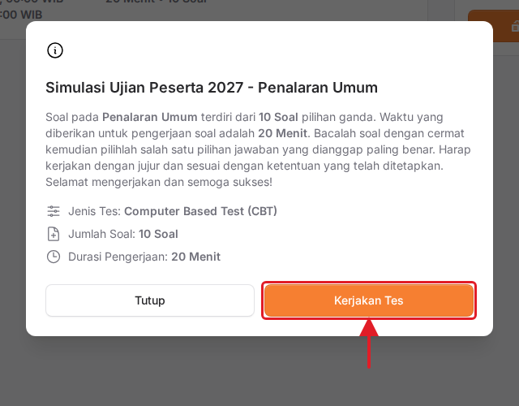
</Frame>

The instructions come from the test description. Placeholders such as `{{NAMA_TES}}`, `{{JUMLAH_SOAL}}` and `{{DURASI_TES}}` are replaced with the test name, number of questions and duration. See [Create a Test](/en/data-ujian/membuat-tes-ujian).

## 6. Tes Diagnostik Sistem (system check)

Before the questions appear, the system checks that the participant's device is ready. Each passed check gets a tick, and then the **Mulai Tes** (Start Test) button can be clicked.

<Frame>
  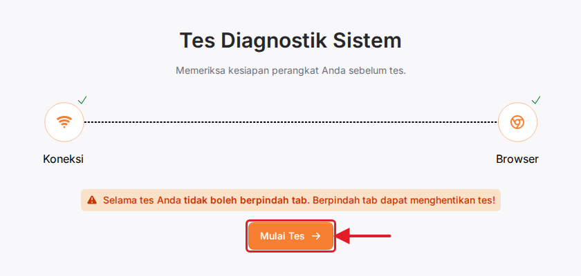
</Frame>

| Check | What is checked | When it appears |
| --- | --- | --- |
| **Koneksi** (Connection) | The server can be reached and the exam's concurrent-participant limit is not full. | Always |
| **Browser** | A supported browser: Google Chrome, Chromium, Microsoft Edge or Safari, or the CBT Indolat app. | Always |
| **Kamera** (Camera) | The participant allows camera access. | When **Pengawasan Kamera** (camera proctoring) is on |
| **Bagikan Layar** (Share Screen) | The participant shares the entire screen, not just a tab. | When **Pengawasan Layar (Share Screen)** is on |
| **Monitor Ganda** (Dual Monitor) | Only one screen is connected. | When **Hanya Izinkan Satu Layar** (single screen only) is on |

When **Deteksi Pindah Tab** (tab-switch detection) is on, this page also warns that the participant must not switch tabs. Each kind of proctoring is explained in [Exam Proctoring and Cheating Detection](/en/konsep/pengawasan-dan-kecurangan).

<Warning>
  The timer starts when the participant clicks **Mulai Tes**, and one exam credit is used at that moment. If the project has run out of credits, the participant sees **Kuota tes tidak mencukupi** (insufficient test quota) and cannot start. See [Exam Credits, Standard Exams, and Professional Exams](/en/konsep/kredit-dan-tipe-ujian).
</Warning>

## 7. Answering the questions

The question page has the question area on the left and the **Daftar Soal** (Question List) panel on the right.

<Frame>
  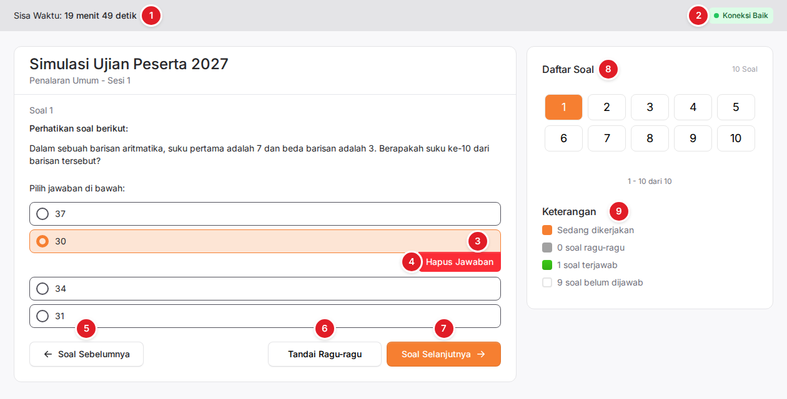
</Frame>

1. **Sisa Waktu** (Time Left): the countdown.
2. **Connection status**: **Koneksi Baik** (good), **Koneksi Lambat** (slow) or **Koneksi Buruk** (poor).
3. **Answer options**: the chosen answer is highlighted.
4. **Hapus Jawaban** (Clear Answer): clears the answer to this question.
5. **Soal Sebelumnya** (Previous Question).
6. **Tandai Ragu-ragu** (Mark as Unsure): flags a question to check again.
7. **Soal Selanjutnya** (Next Question). On the last question this button becomes **Selesai Tes** (Finish Test).
8. **Daftar Soal**: every question number. Click any number to jump straight to that question.
9. **Keterangan** (Legend): what each colour means and how many questions have each status.

The colours in **Daftar Soal** help participants review their work before finishing:

<Frame>
  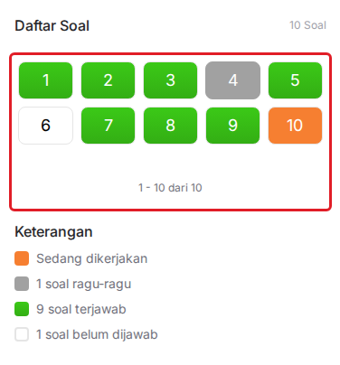
</Frame>

- **Orange**: the question currently open.
- **Grey**: flagged as unsure.
- **Green**: answered. A **Menjodohkan** (matching) question only turns green once every pair is placed; a partly matched question still counts as unanswered.
- **White**: not answered.

Behaviour worth knowing:

- **Answers are saved automatically.** Each time the participant picks or types an answer, it is sent to the server straight away (a short **Menyimpan jawaban...** (saving answer) notice appears). There is no save button.
- **The order of questions and answer options can be shuffled** when **Acak Soal** (shuffle questions) and **Acak Jawaban (Pilihan Ganda)** (shuffle answers) are on in the question package, so question 1 may differ between two participants.
- **Time is kept by the server**, not by the participant's device. It keeps running even if the browser is closed or the device switches off.
- **Time is capped by the end of the session.** A participant who starts close to the end of the session stops when the session ends, even if the test duration has not run out. Example: the session ends at 10:00 and the test lasts 60 minutes; a participant who starts at 09:30 only gets 30 minutes.
- **Unsure flags only help the participant.** A flagged question that has an answer is still scored. The flag is kept as long as the participant stays logged in on the same device.
- **One test at a time.** While a test is running, any other page of the app sends the participant back to the question page with **Silakan selesaikan tes yang sedang berlangsung.** (Please finish the test in progress.)
- **CAT tests** (*Computer Adaptive Test*) have no **Soal Sebelumnya** or **Tandai Ragu-ragu** buttons, because each next question depends on the previous answer. See [Differences Between CBT, CAT, and Essay/File Upload](/en/konsep/jenis-ujian-cbt-cat-esai).

### If the connection drops

The indicator changes to **Koneksi Buruk** when the device loses its internet connection, and returns to **Koneksi Baik** by itself once the connection is back.

<Frame>
  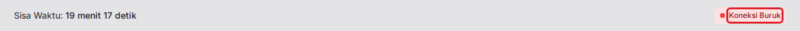
</Frame>

Answers already saved are not lost. If the page asks to be reloaded, the participant just reloads it or logs in again; the app opens the running test with the earlier answers. Participants should check **Daftar Soal** once the connection is back to make sure their last answer is green.

### If the browser closes or the participant switches devices

The participant simply opens the login link again and logs in. The app takes them straight to the running test, with the time left already reduced by however long the browser was closed.

<Frame>
  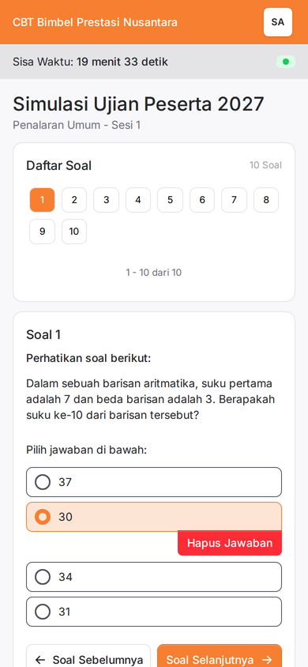
</Frame>

An account can only be active on one device. If the participant logs in on another device while the session on the old device is still active, the exam page on the old device shows **Sesi tidak valid. Akun Anda digunakan di perangkat lain.** (Invalid session. Your account is being used on another device.) If the page on the old device is reloaded, it goes to the login page with the same warning.

<Frame>
  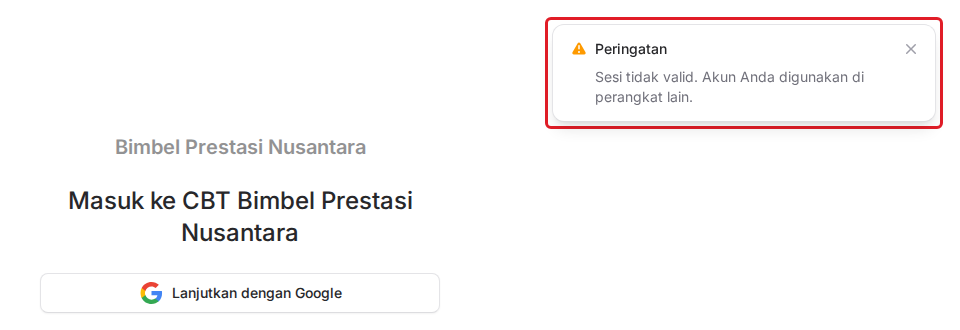
</Frame>

While the test is running, the system also records **Peserta mencoba login dengan device yang berbeda.** (participant tried to log in from a different device) in [Exam Monitoring](/en/cbt/monitoring-ujian). This entry is expected when a participant genuinely switched devices because of a problem. A participant who logs out (**Keluar**) and then logs in again, on the same device or another one, is not recorded.

## 8. Finishing the test

On the last question, the participant clicks **Selesai Tes**.

<Frame>
  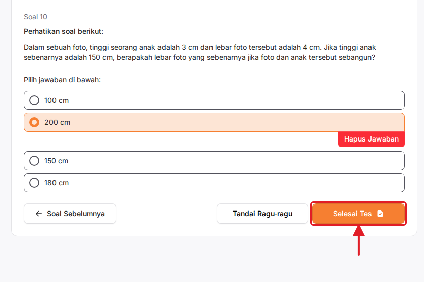
</Frame>

A confirmation window warns that after finishing, the participant cannot return to the exam page or change answers. The participant clicks **Ya, Selesai** (Yes, Finish) to finish, or **Tidak** (No) to keep reviewing.

<Frame>
  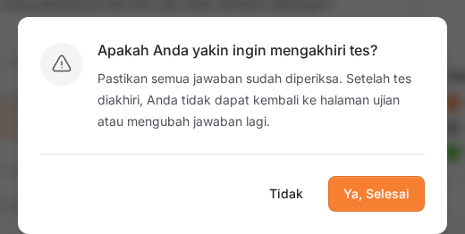
</Frame>

Then the **Tes Selesai** (Test Finished) page appears with a **Kembali ke Daftar Tes** (Back to Test List) button. A finished test can no longer be opened from **Daftar Tes** (in tiered exams it is marked **Selesai**), and its result moves to **Riwayat Tes**.

<Frame>
  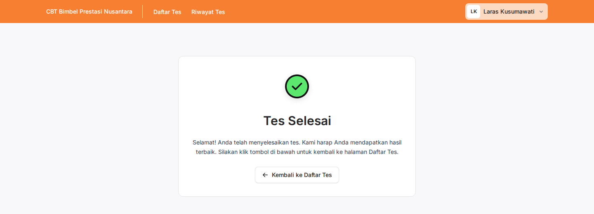
</Frame>

### When time runs out

When **Sisa Waktu** reaches zero, the test ends automatically. The participant sees a **Waktu Habis** (Time's Up) notice and is taken to the **Tes Selesai** page. Every saved answer is still scored; unanswered questions count as not answered.

<Frame>
  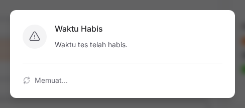
</Frame>

If the participant closes the browser and never returns, the system still ends the test by itself once the time is up, so the score is calculated and the next test (in tiered exams) opens on time.

A test can also end or pause because of admin actions in [Exam Monitoring](/en/cbt/monitoring-ujian): **Hentikan Ujian** (Stop Exam) ends the test, while **Suspend Ujian** pauses it. Time spent suspended does not reduce the participant's time left, unless the exam session ends first.

## 9. Riwayat Tes and scores

The **Riwayat Tes** menu has two parts: **Skor Akhir** (Final Score, the whole exam) and **Skor Tes Ujian** (Test Scores, each test).

<Frame>
  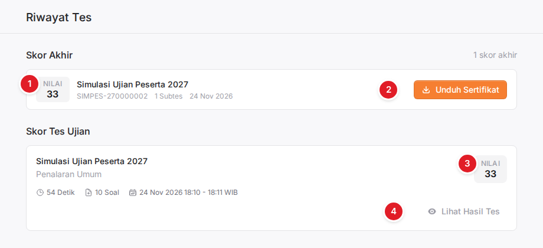
</Frame>

1. **NILAI** (Score) under **Skor Akhir**: the exam's final score, combining all tests.
2. **Unduh Sertifikat** (Download Certificate): shown when the exam has a certificate and the participant meets its conditions.
3. **NILAI** under **Skor Tes Ujian**: the score of one test.
4. **Lihat Hasil Tes** (View Test Result): opens the answer sheet.

What appears on this page is entirely up to your settings:

| What the participant sees | Setting | Where |
| --- | --- | --- |
| **NILAI** under **Skor Akhir** | **Apakah Tampilkan Skor Akhir Ujian?** (show the final exam score?) | **Pengaturan Ujian** tab, see [Create an Exam](/en/data-ujian/membuat-ujian#pengaturan-ujian) |
| **NILAI** under **Skor Tes Ujian** and on the answer sheet | **Tampilkan Skor** (Show Score) | The test's **Skor & Hasil** tab, see [Create a Test](/en/data-ujian/membuat-tes-ujian#set-score-and-result-display) |
| The **Lihat Hasil Tes** button (answer sheet and key) | **Tampilkan Ringkasan** (Show Summary) | **Skor & Hasil** tab |
| The **Pembahasan Soal** box on the answer sheet | **Tampilkan Pembahasan Per Soal** (per-question explanation) | **Skor & Hasil** tab |
| A PDF explanation on the answer sheet | **Tampilkan Pembahasan Tes (PDF)** | **Skor & Hasil** tab |

<Note>
  Explanations, per question or as a PDF, can only be opened from the answer sheet. So participants only see them when **Tampilkan Ringkasan** is also on. With all of the settings above turned off, participants only see that the test is finished, without a score.
</Note>

A score also stays hidden until it has been calculated, for example an essay test the admin has not marked yet, or an IRT test that has not been calculated through **Hitung Skor** → **Perhitungan IRT**. See [How Each Scoring Method Is Calculated](/en/konsep/metode-penilaian).

### The answer sheet

**Lihat Hasil Tes** opens the **Lembar Jawaban** (Answer Sheet). Participants can open each question and see their answer.

<Frame>
  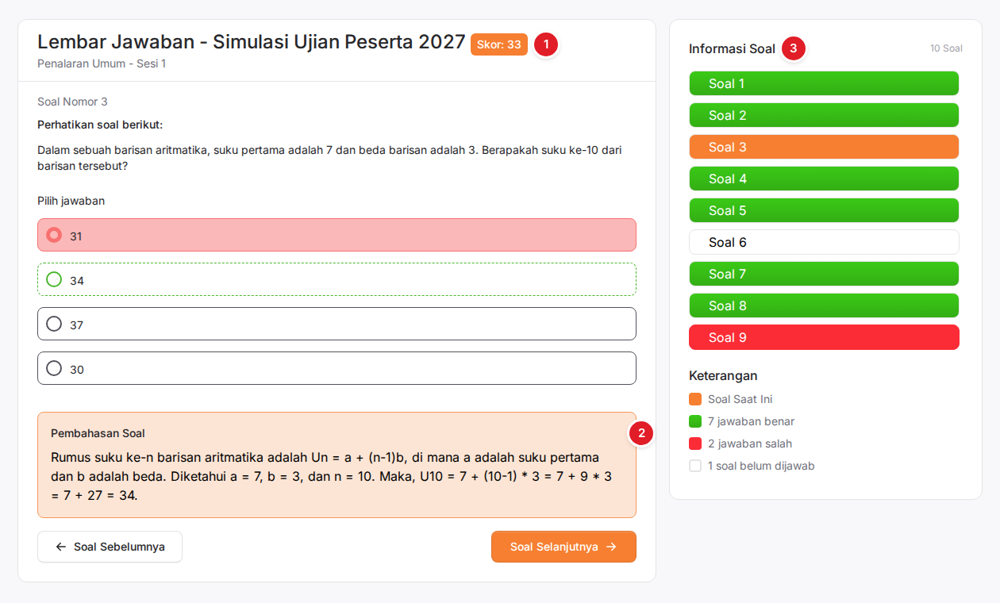
</Frame>

1. **Skor**: the test score (when **Tampilkan Skor** is on).
2. **Pembahasan Soal** (Explanation): shown when **Tampilkan Pembahasan Per Soal** is on.
3. **Informasi Soal** (Question Information): the question list in green (correct), red (wrong) or white (unanswered), with totals.

A wrong answer is marked red, and the answer key has a green dashed border.

<Warning>
  The answer sheet reveals the answer key. If the same question package is still to be taken by other participants in a later session, turn on **Tampilkan Ringkasan** only after every session has finished.
</Warning>

## 10. Certificate

When the exam has a published certificate template shown to participants, the **Unduh Sertifikat** button appears under **Skor Akhir** once the participant meets the conditions, for example finishing every test and reaching the minimum score. The certificate downloads as a PDF.

If the template needs admin approval, the participant sees **Ajukan Sertifikat** (Request Certificate), then **Menunggu Persetujuan** (Awaiting Approval), and can download it after you approve it. See [Exam Certificates](/en/lainnya/sertifikat-ujian#3-the-certificate-flow-in-the-participant-app).

## 11. Ranking

When you show a leaderboard to participants, the **Peringkat** menu appears in the top bar, and **Daftar Tes** shows a **Papan peringkat sedang tayang** (leaderboard now showing) card with the participant's position.

<Frame>
  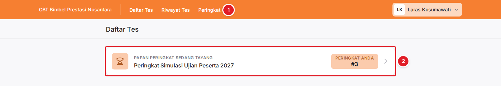
</Frame>

1. **Peringkat** menu: every leaderboard currently showing.
2. Leaderboard card: opens that leaderboard directly.

The leaderboard page shows the participant's own position, the top-three podium and the rest of the ranking.

<Frame>
  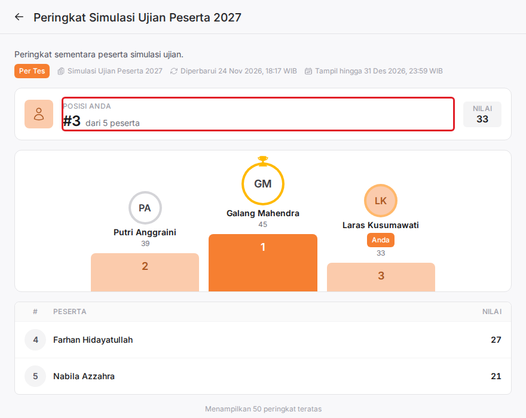
</Frame>

Rankings do not change the moment a participant finishes; the new order appears after the leaderboard is refreshed (**Generate Ulang**). You can also choose to show only the order without scores. See [Leaderboard](/en/cbt/leaderboard).

## 12. Participant card

The participant's name menu in the top right holds **Kartu Peserta** and **Keluar**.

<Frame>
  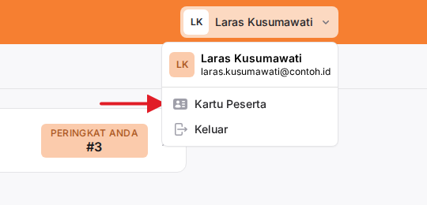
</Frame>

The **Kartu Peserta** shows the name, email, exam name, participant code with a QR code, and each test's schedule. Participants can print it with **Cetak** (Print), for example for an in-person exam with room supervisors. The card becomes available once the participant's registration is verified. The participant code format is set in [Participant Codes and Field Codes](/en/data-ujian/kode-peserta).

<Frame>
  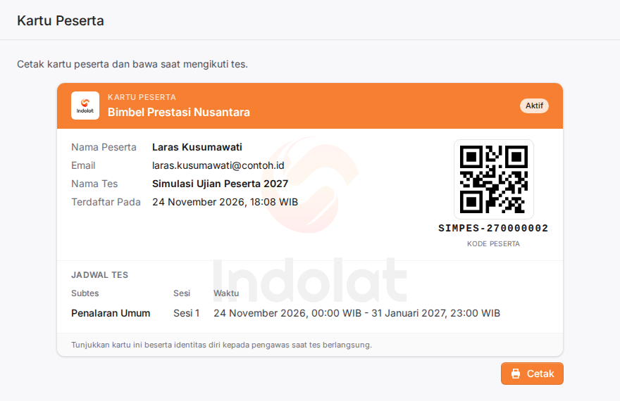
</Frame>

## 13. Using a phone

Participants can sit exams on a phone or tablet in a supported browser. The layout adapts to the screen: **Daftar Tes**, **Riwayat Tes** and **Peringkat** move to a bottom bar, and the **Daftar Soal** panel sits above the question.

<Frame>
  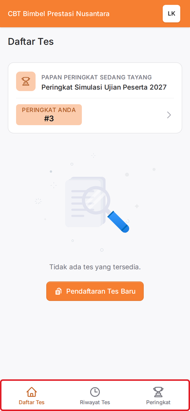
</Frame>

Things to keep in mind on phones:

- Exams with **Pengawasan Layar (Share Screen)** cannot be taken in a phone browser. Participants are asked to use the CBT Indolat app.
- The **Lanjutkan dengan Google** button does not appear in the CBT Indolat app; participants log in with email and password.
- Make sure the battery is charged and notifications from other apps are muted, especially when **Deteksi Pindah Tab** is on, because switching to another app is recorded as a tab switch.

## Next steps

<CardGroup cols={2}>
  <Card title="Preparing for Exam Day" icon="list-check" href="/en/konsep/persiapan-hari-ujian">
    An admin checklist from one week before the exam until after it ends.
  </Card>
  <Card title="Frequently Asked Questions" icon="circle-question" href="/en/konsep/pertanyaan-umum">
    Short answers to questions admins and participants often ask.
  </Card>
</CardGroup>
