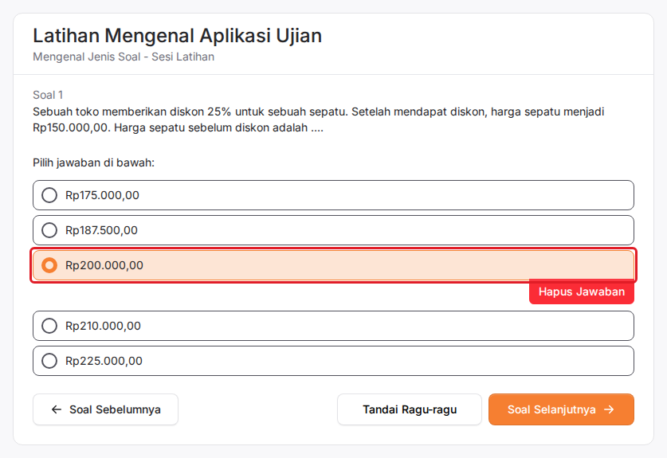
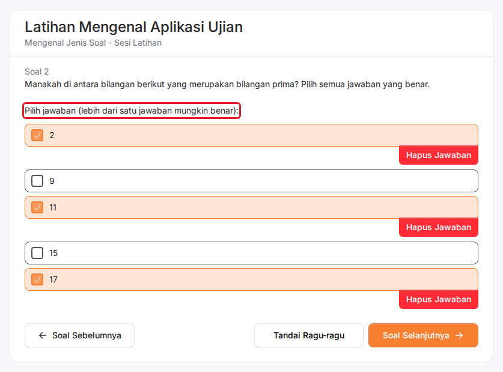
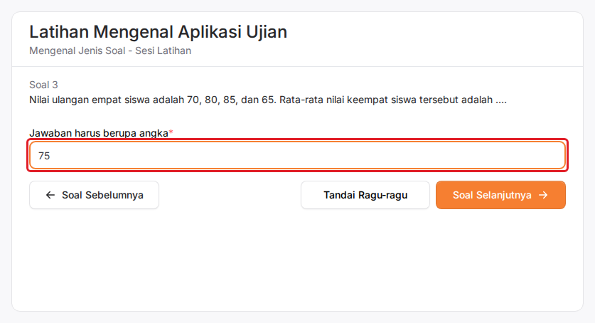
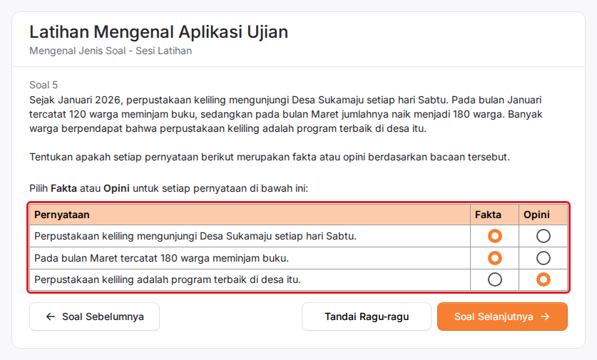
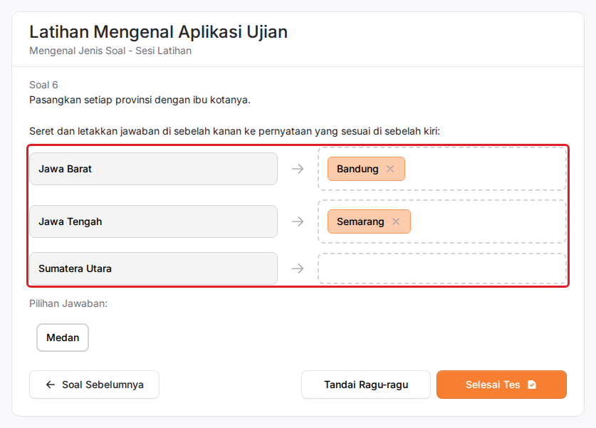
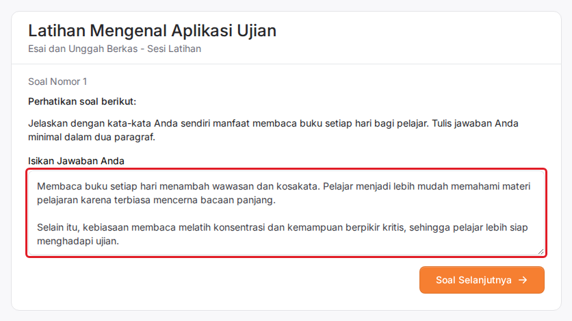
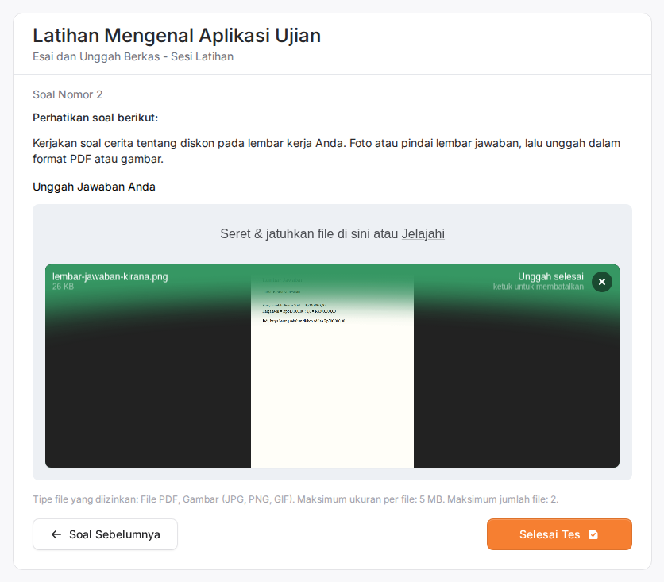
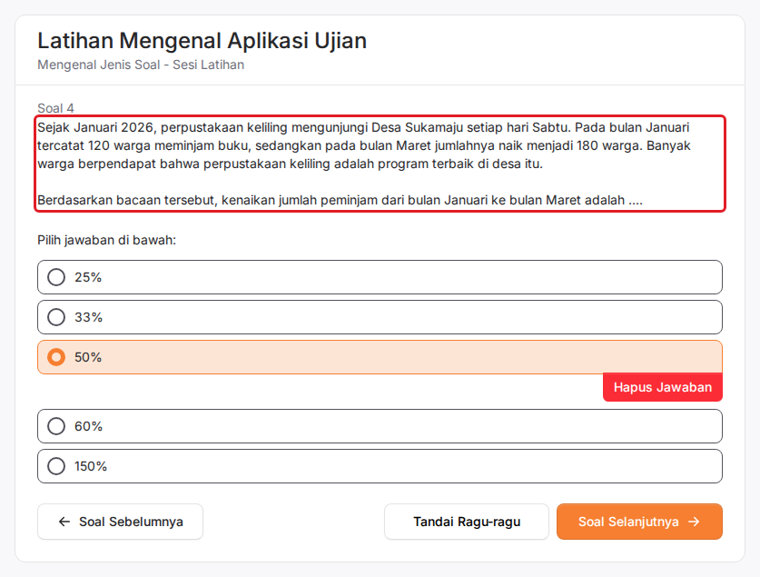

Every question in a question package has a **Jenis Soal** (question type) that decides how participants answer it. This page shows how each question type looks in the participant exam app, gives an example of its use, and explains when an answer counts as correct. How to create the questions is explained in [Create a Question Package](/en/paket-soal/membuat-paket-soal).

<Info>
  **Setting location:** **Portal** → **Platform Ujian (CBT)** → **Manajemen Ujian** → **Data Paket Soal** → **Ubah** on the package → **Tambah Soal** → **Soal** tab → **Jenis Soal**. The question type cannot be changed after the question is saved.
</Info>

All images on this page come from the practice test **Mengenal Jenis Soal**, taken by a participant named Kirana Maheswari.

## Question types at a glance

| Jenis Soal | How participants answer | Example use | Question package type |
| --- | --- | --- | --- |
| **Pilihan Ganda** (multiple choice) | Choose one answer, or several answers if the question has more than one key | Calculation or comprehension questions with options A–E | **CBT/CAT** |
| **Jawaban Singkat** (short answer) | Type a number or a short text | The result of a calculation, a city name, a single term | **CBT/CAT** |
| **Majemuk Kompleks (Benar/Salah, Fakta/Opini, dll.)** (complex multiple choice) | Choose one of two labels for each statement | True/False, Fact/Opinion, Matches/Does not match | **CBT/CAT** |
| **Menjodohkan (Drag & Drop)** (matching) | Drag each answer to the matching item | Provinces and capitals, terms and meanings | **CBT/CAT** |
| **Jawaban Uraian** (written answer) | Write a long answer in a text box | Essays, explanations of working steps | **Esai/Upload File (Jawaban Manual)** |
| **Unggah File** (file upload) | Upload an answer file | A photo of an answer sheet, a report in PDF | **Esai/Upload File (Jawaban Manual)** |

The first four question types are scored automatically and can be used in both CBT and CAT tests. The last two are scored manually by the admin and are only used in **Esai / Upload File (Jawaban Manual)** tests. The test types are compared in [Differences Between CBT, CAT, and Essay/File Upload](/en/konsep/jenis-ujian-cbt-cat-esai).

The complete rules for when each question type counts as correct are in [How Each Scoring Method Is Calculated](/en/konsep/metode-penilaian#when-a-question-counts-as-correct). The short summaries in each section below are only for convenience.

## Pilihan Ganda

The participant chooses one answer from several options. The chosen option turns orange, and a **Hapus Jawaban** (clear answer) button appears to undo the choice.

<Frame>
  
</Frame>

**Example:** _Sebuah toko memberikan diskon 25% untuk sebuah sepatu. Setelah mendapat diskon, harga sepatu menjadi Rp150.000,00. Harga sepatu sebelum diskon adalah ...._ (A shop gives a 25% discount on a pair of shoes. After the discount the price is Rp150,000. What was the price before the discount?) The key is **Rp200.000,00**.

**Counts as correct:** when the participant's choice matches the answer key.

### Pilihan Ganda with more than one key

When **Jawaban Lebih dari Satu** (more than one answer) is turned on for the question, the options become checkboxes and the participant sees the note **Pilih jawaban (lebih dari satu jawaban mungkin benar)** (choose answers, more than one may be correct). Participants are not told how many answers are correct.

<Frame>
  
</Frame>

**Example:** _Manakah di antara bilangan berikut yang merupakan bilangan prima? Pilih semua jawaban yang benar._ (Which of the following numbers are prime? Choose all correct answers.) The keys are **2**, **11**, and **17**.

**Counts as correct:** when the participant's choices match all the keys exactly. Choosing only 2 and 11 (a key is missing), or choosing 2, 11, 15, and 17 (an extra wrong option), counts as wrong.

## Jawaban Singkat

The participant types the answer in an input box. There are two answer formats set by the admin:

- **Angka** (number): the box is labelled **Jawaban harus berupa angka** (the answer must be a number) and only accepts digits, a leading minus sign, and one decimal separator (comma or dot).
- **Teks** (text): the box is labelled **Ketik jawaban singkat Anda** (type your short answer) and accepts free text.

<Frame>
  
</Frame>

**Example:** _Nilai ulangan empat siswa adalah 70, 80, 85, dan 65. Rata-rata nilai keempat siswa tersebut adalah ...._ (The test scores of four students are 70, 80, 85, and 65. What is their average?) The key is **75** in **Angka** format.

**Counts as correct:** when the answer matches the main key or one of the other correct answers entered by the admin. Numbers are compared by value (`75` equals `75,0`), and text ignores upper and lower case.

## Majemuk Kompleks

The question contains several statements in a table. For each statement the participant chooses one of two labels. The default labels are **Benar** (true) and **Salah** (false), but the admin can use another pair such as **Fakta** and **Opini** (fact and opinion), **Sesuai** and **Tidak Sesuai** (matches and does not match), or custom labels.

<Frame>
  
</Frame>

**Example:** based on a passage about a mobile library, decide whether each statement is a fact or an opinion:

| Statement | Key |
| --- | --- |
| Perpustakaan keliling mengunjungi Desa Sukamaju setiap hari Sabtu. (The mobile library visits Sukamaju village every Saturday.) | Fakta |
| Pada bulan Maret tercatat 180 warga meminjam buku. (In March, 180 residents borrowed books.) | Fakta |
| Perpustakaan keliling adalah program terbaik di desa itu. (The mobile library is the best programme in the village.) | Opini |

**Counts as correct:** when the chosen label is right for **every** statement. One wrong statement makes the whole question wrong under **Perhitungan Skor Soal (Akumulasi Benar/Salah)** and IRT.

## Menjodohkan

The items appear on the left, empty boxes on the right, and the answer options below them in random order. The participant drags each option into the box next to the matching item. A placed answer can be removed again with the cross icon.

<Frame>
  
</Frame>

**Example:** _Pasangkan setiap provinsi dengan ibu kotanya._ (Match each province with its capital.) The pairs are **Jawa Barat**–**Bandung**, **Jawa Tengah**–**Semarang**, and **Sumatera Utara**–**Medan**.

**Counts as correct:** when every pair is matched correctly. In the image above the question already counts as answered, but it will be scored as wrong if the participant does not place **Medan**.

## Essay: Jawaban Uraian and Unggah File

Questions in an **Esai/Upload File (Jawaban Manual)** package use one of two answer types.

**Jawaban Uraian** (written answer): the participant writes the answer in the **Isikan Jawaban Anda** (enter your answer) text box.

<Frame>
  
</Frame>

**Example:** _Jelaskan dengan kata-kata Anda sendiri manfaat membaca buku setiap hari bagi pelajar. Tulis jawaban Anda minimal dalam dua paragraf._ (Explain in your own words the benefits of reading books every day for students. Write at least two paragraphs.)

**Unggah File** (file upload): the participant drags a file onto the **Unggah Jawaban Anda** (upload your answer) area or clicks **Jelajahi** (browse). Below the upload area, the app shows the allowed file types, the maximum size per file, and the maximum number of files set by the admin.

<Frame>
  
</Frame>

**Example:** _Kerjakan soal cerita tentang diskon pada lembar kerja Anda. Foto atau pindai lembar jawaban, lalu unggah dalam format PDF atau gambar._ (Solve the discount word problem on your worksheet. Photograph or scan the answer sheet, then upload it as a PDF or image.) Allowed files: PDF and images, at most 5 MB per file and at most 2 files.

**Scoring:** these two answer types have no key and are not scored automatically. The admin reads the answer or opens the participant's file, then enters a score with **Beri Skor Manual** (give manual score) (see [Test History](/en/cbt/riwayat-tes-ujian#giving-a-manual-score-to-an-essay-test)).

## Wacana (reading passage)

A **wacana** is a reading text, table, image, or recording used by several questions at once. The admin writes the passage once and then selects it on every question that needs it. A passage can be attached to any automatically scored question type, for example a multiple-choice question and a complex multiple-choice question about the same text.

Participants do not see the passage in a separate box. The passage text appears directly above the question text, as if it were part of the question, and it is repeated on every question that uses it. Passage images appear first, together with the question images.

<Frame>
  
</Frame>

In the example above, question 4 (multiple choice) and question 5 (complex multiple choice, see the image in [Majemuk Kompleks](#majemuk-kompleks)) use the same passage. The passage title, **Perpustakaan Keliling Desa Sukamaju**, is only visible to the admin. When **Acak Soal** (shuffle questions) is on, questions that share a passage stay together in their order, so participants do not have to look for the text again.

How to create a passage is explained in [Create a Question Package](/en/paket-soal/membuat-paket-soal#managing-reading-passages).

## Kelompok soal (question group)

A **kelompok soal** is a label for grouping questions by topic or subtest within one package, for example **Penalaran Matematika**, **Literasi Bahasa Indonesia**, and **Pengetahuan Umum**. Question groups are **not visible to participants** and do not show any text.

Question groups are useful for two things:

- Keeping the question list tidy for the admin, because each question's group is shown in the **Kelompok Soal** column of the **Daftar Soal** (question list).
- Keeping questions on one topic together when **Acak Soal** is on. Questions in a group are shuffled within the group, and then the order of the groups is shuffled. For example, all questions in the **Penalaran Matematika** group stay together and are not scattered among the **Literasi Bahasa Indonesia** questions. A question that uses a passage follows its passage, not its group.

For text that participants must read, use a passage, not a question group. How to create a question group is explained in [Create a Question Package](/en/paket-soal/membuat-paket-soal#managing-question-groups).
