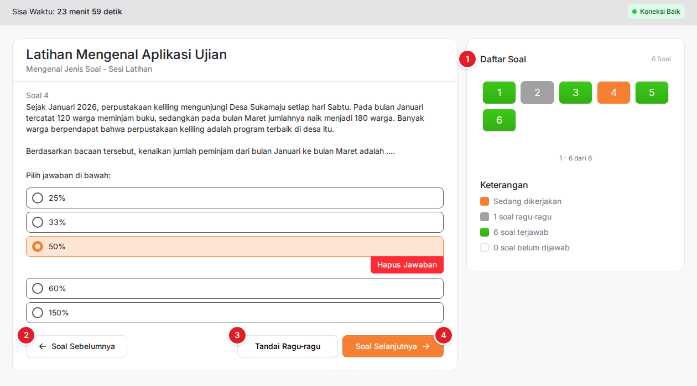
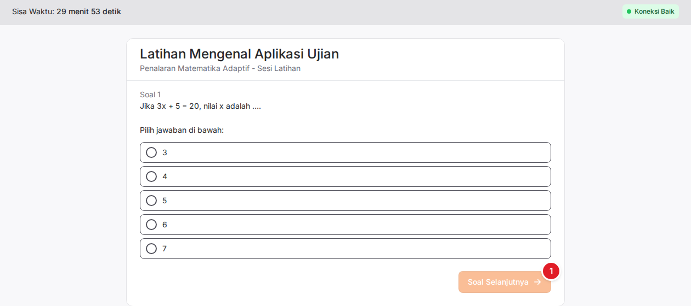
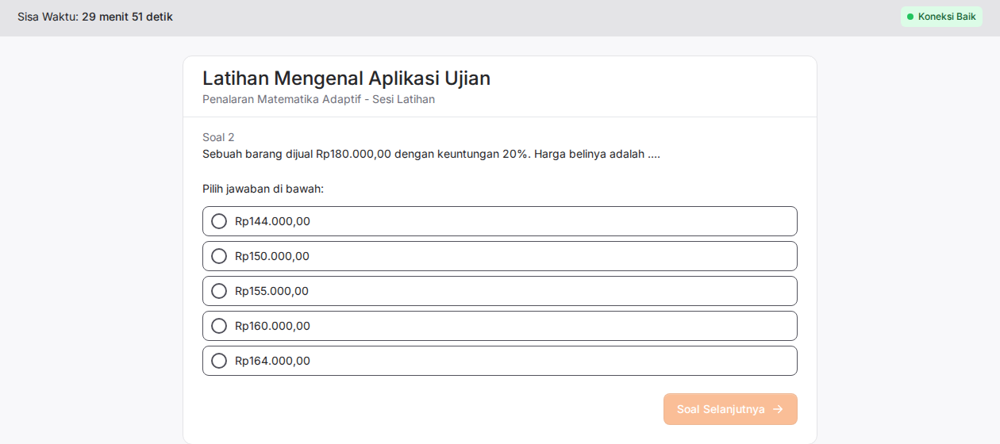
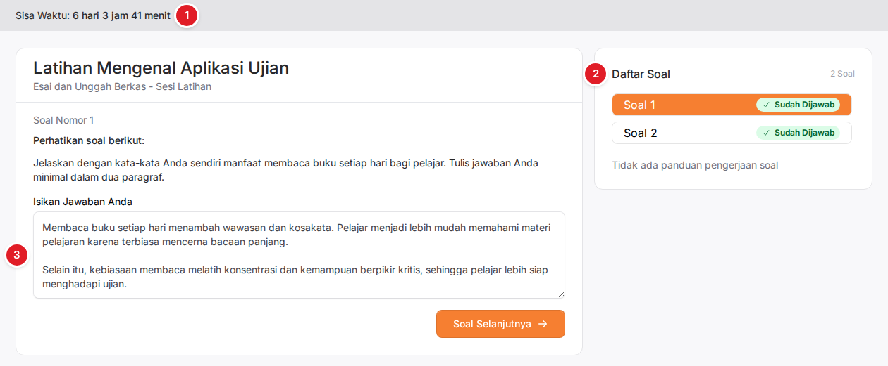

Every test has one **Jenis Ujian** (exam type). The exam type decides how questions are shown to participants, how participants answer, and how answers are scored. This page explains the differences between the three exam types in plain words so you can choose the right one.

<Info>
  **Setting location:** **Portal** → **Platform Ujian (CBT)** → **Manajemen Ujian** → **Data Ujian** → **Detail** on the exam → **Daftar Tes Ujian** → **Tambah Tes Ujian** → **Jenis Ujian**. The full steps are in [Create a Test](/en/data-ujian/membuat-tes-ujian).
</Info>

The three exam types are:

- **Computer Based Test (CBT)**: a regular computer-based exam. Every participant gets all the questions in the question package and can move freely between questions.
- **Computer Adaptive Test (CAT)**: an adaptive exam. Questions are shown one at a time, and the next question is chosen based on whether the previous answer was right or wrong.
- **Esai / Upload File (Jawaban Manual)** (Essay / File Upload, manual answers): participants write an essay answer or upload a file, and the admin scores it manually.

The exam type is chosen per test, not per exam. One exam can contain a CBT test and an essay test at the same time. How exams and tests relate is explained in [Exam Structure](/en/konsep/struktur-ujian).

## Comparison table

| | **CBT** | **CAT** | **Essay / File Upload** |
| --- | --- | --- | --- |
| How questions appear | All questions in the package, in a fixed order or shuffled per participant | One at a time; the next question depends on the previous answer | All questions in the package |
| Moving between questions | Free, including going back | Forward only; a question that has been passed cannot be reopened | Free |
| **Daftar Soal** (question list) and **Tandai Ragu-ragu** (mark as unsure) | Yes | No | **Daftar Soal** only, no "unsure" mark |
| Number of questions answered | All questions in the package | All questions in the package, in an order that adapts to the answers; the test ends early if time runs out | All questions in the package |
| Time limit | The test's **Durasi Pengerjaan (menit)**, at the latest until the session ends | Same as CBT | No duration; can be worked on until the session ends |
| Question package type | **CBT/CAT** | **CBT/CAT**, and every question must have a **Tingkat Kesulitan** (difficulty level) | **Esai/Upload File (Jawaban Manual)** |
| Question types | Pilihan Ganda, Jawaban Singkat, Majemuk Kompleks, Menjodohkan | Same as CBT | Jawaban Uraian, Unggah File |
| Scoring methods | Six automatic methods (see below) | Only **Perhitungan Skor Soal (Akumulasi Benar/Salah)**, using the **Skor CAT** weights | Only **Penilaian Manual** |
| When the score is available | When the participant finishes (IRT: after the admin runs the calculation) | When the participant finishes | After the admin enters a score |
| **Tipe Ujian** (exam edition) | **Ujian Standard** and **Ujian Professional** | Only **Ujian Professional (Paket Berbayar)** | **Ujian Standard** and **Ujian Professional** |

How each question type looks to participants is explained in [Question Types and How Participants See Them](/en/konsep/jenis-soal).

## Computer Based Test (CBT)

CBT is the most common computer-based exam, much like a paper question sheet moved onto a screen. All participants in the same session get questions from the same question package. If **Acak Soal** (shuffle questions) or **Acak Jawaban (Pilihan Ganda)** (shuffle answer options) is turned on in the package, the order of questions or answer options is shuffled for each participant, but the questions themselves stay the same.

### What participants see

<Frame>
  
</Frame>

1. **Daftar Soal** (question list): the numbers of all questions. Participants can jump to any number. The colour shows the status: orange for the question currently open, green for answered questions, grey for questions marked as unsure, and white for unanswered questions. The totals are shown under **Keterangan** (legend).
2. **Soal Sebelumnya** (previous question): go back to check or change an answer.
3. **Tandai Ragu-ragu** (mark as unsure): flag a question to review later. The flag is only a reminder for the participant and does not affect the score.
4. **Soal Selanjutnya** (next question): open the next question. On the last question this button becomes **Selesai Tes** (finish test).

The remaining time counts down in **Sisa Waktu** (time remaining) at the top of the screen.

### Scoring methods

A CBT test can use every automatic scoring method:

- **Perhitungan Skor Soal (Akumulasi Benar/Salah)**
- **Perhitungan Skor Jawaban (Akumulasi Skor Jawaban)**
- **Psikotes (Pengelompokan Jawaban)**
- **IRT (Referensi UTBK 0-1000)**, **IRT TKA SMA/SMK (200-800)**, and **IRT TKA SD/SMP (0-100)**

The formulas and examples for each method are in [How Each Scoring Method Is Calculated](/en/konsep/metode-penilaian).

## Computer Adaptive Test (CAT)

CAT is an exam that **adapts to the participant**. Picture a private tutor asking questions one at a time: if the student answers correctly, the tutor asks a harder question; if not, an easier one. CAT works the same way, so two participants taking the same test can see the questions in a different order.

### What participants see

<Frame>
  
</Frame>

Compared with CBT, the CAT screen is simpler:

- There is no **Daftar Soal**, no **Soal Sebelumnya** button, and no **Tandai Ragu-ragu**. A question that has been passed cannot be opened again.
- The **Soal Selanjutnya** button (number 1 in the image) only becomes active after the participant answers the current question. Participants cannot skip a question without answering it.
- The **Selesai Tes** button only appears on the last question. If time runs out first, the test ends automatically.

After the participant answers the first question (level **Sedang**, medium) correctly, the system gives a **Sulit** (hard) question:

<Frame>
  
</Frame>

### How the system picks the next question

Every question in a CAT package has a **Tingkat Kesulitan** (difficulty level), from easiest to hardest: **Sangat Mudah**, **Mudah**, **Sedang**, **Sulit**, and **Sangat Sulit**. The level is set on the **Penilaian** (Scoring) tab of the question form (see [Create a Question Package](/en/paket-soal/membuat-paket-soal)).

1. **The first question** comes from the difficulty level closest to the average level of all questions in the package. For a package spread evenly from Sangat Mudah to Sangat Sulit, the first question is **Sedang**.
2. **After a correct answer**, the system looks for an unseen question starting one level harder, then harder still. If there is none, it looks at easier levels, and finally at the same level.
3. **After a wrong answer**, the order is reversed: one level easier first, then easier still, then harder levels, and finally the same level.
4. If **Acak Soal** is turned on in the package, the question is picked at random among the questions of the target level. Otherwise it follows the order in the package.

An example of one participant's path through a 10-question package (two questions per level):

| Question | Difficulty | Participant's answer | Next question is searched from |
| --- | --- | --- | --- |
| 1 | Sedang | Correct | Sulit |
| 2 | Sulit | Wrong | Sedang |
| 3 | Sedang | Wrong | Mudah |
| 4 | Mudah | Wrong | Sangat Mudah |
| 5 | Sangat Mudah | Wrong | Mudah, because there is no level easier than Sangat Mudah |

### How many questions are answered

A CAT test in CBT Indolat shows **all the questions** in the package, one at a time. What adapts to the participant is the **order** of the questions, not their number. The participant dashboard shows the number of questions, for example **30 Menit • 10 Soal**. The test ends when the participant answers the last question and presses **Selesai Tes**, or when time runs out. If time runs out first, the questions that were never shown are not counted.

### Requirements and scoring

- CAT can only be chosen in exams with **Tipe Ujian** set to **Ujian Professional (Paket Berbayar)**. In **Ujian Standard (Paket Gratis)**, the CAT option is greyed out.
- **Every question** in the package used by a session must have a **Tingkat Kesulitan**. If a question has no difficulty level, the session cannot be created or changed (message **Gagal Membuat Sesi Ujian** or **Gagal Mengubah Sesi Ujian**), and a CBT test that already has sessions cannot be switched to CAT (message **Gagal Menyimpan Tes Ujian**).
- The only scoring method for CAT is **Perhitungan Skor Soal (Akumulasi Benar/Salah)**, using the **Skor Benar** and **Skor Salah** weights in the **Skor CAT** section of each question's **Penilaian** tab. The **Skor CBT** section is not used.
- The difficulty level only decides the order of the questions, not how many points they are worth. If hard questions should be worth more, give them a higher **Skor Benar**.

## Esai / Upload File (Jawaban Manual)

This type is for answers that cannot be scored automatically, such as essays, written working steps, or assignments submitted as files. Participants type the answer directly in the app or upload a file, for example a photo of an answer sheet or a PDF document.

### What participants see

<Frame>
  
</Frame>

1. **Sisa Waktu** (time remaining): essay tests have no duration. Time counts down to the end of the session, so it can be several days, for example **6 hari 3 jam 41 menit** (6 days 3 hours 41 minutes).
2. **Daftar Soal** (question list): every question with its status, **Sudah Dijawab** (answered) or **Belum Dijawab** (not answered). Instructions from the admin, if any, appear below it.
3. Answer area: a text box for **Jawaban Uraian** (written answer) questions, or an upload area for **Unggah File** (file upload) questions.

### Scoring

Essay tests only use **Penilaian Manual**. After the participant finishes, the admin reads the answers and enters a score in **Riwayat Tes Ujian** (Test History) (see [Test History](/en/cbt/riwayat-tes-ujian#giving-a-manual-score-to-an-essay-test)). Until it is scored, the test has no score and is not included in the exam's final score. The **Skor & Hasil** and **Pengawasan** tabs are also not available for essay tests.

## When to choose which

| Need | Suggested choice |
| --- | --- |
| UTBK-SNBT tryouts, daily quizzes, school exams, or olympiads with multiple-choice questions | **CBT** with **Perhitungan Skor Soal (Akumulasi Benar/Salah)**, or one of the **IRT** methods for a UTBK or TKA style scale |
| Questionnaires, satisfaction surveys, or personality tests without right or wrong answers | **CBT** with **Perhitungan Skor Jawaban (Akumulasi Skor Jawaban)** or **Psikotes (Pengelompokan Jawaban)** |
| Placement tests or selections that should adapt questions to each participant's ability, with a question bank that already has difficulty levels | **CAT** (requires **Ujian Professional**) |
| Participants need to go back to earlier questions and mark questions as unsure | **CBT** |
| Essays, written working steps, lab reports, or assignments submitted as files | **Esai / Upload File (Jawaban Manual)** |
| A tryout with both multiple-choice and essay questions | One exam with two tests: a **CBT** test and an **Esai / Upload File (Jawaban Manual)** test, each with its own question package |

<Tip>
  If in doubt, start with **CBT** and **Perhitungan Skor Soal (Akumulasi Benar/Salah)**. It is the easiest for participants to understand and is available in every **Tipe Ujian**.
</Tip>

<Note>
  Once a test is created, its **Jenis Ujian** cannot be changed from essay to CBT/CAT or the other way around. Switching between CBT and CAT is still possible while no participant has started the test. See [Create a Test](/en/data-ujian/membuat-tes-ujian#exam-type).
</Note>
