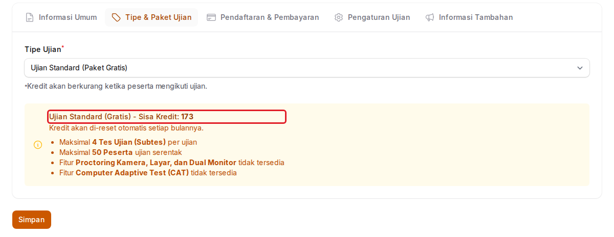
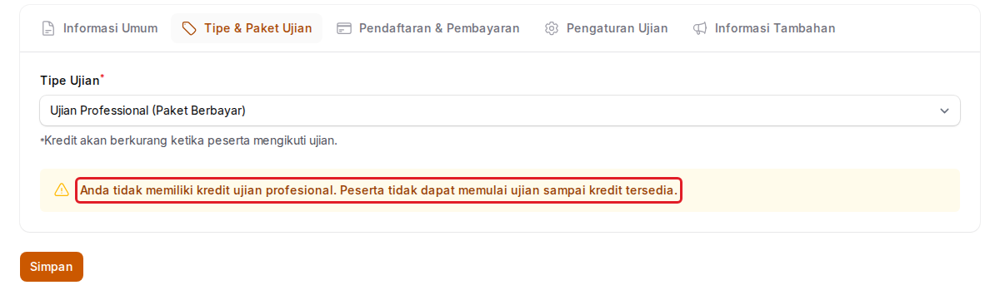
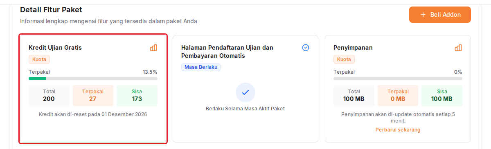

Every time a participant takes a test, your project uses **exam credits**. This page explains what a credit is, when credits are deducted, where they come from, and how choosing **Ujian Standard** (Standard Exam) or **Ujian Professional** (Professional Exam) decides which credits are used and which features are available. A worked example for a tryout closes the page.

<Info>
  **Where to see the remaining credit:**

  - Per exam: **Portal** → **Platform Ujian (CBT)** → **Manajemen Ujian** → **Data Ujian** → **Detail** on the exam → **Tipe & Paket Ujian** tab.
  - For the whole project: **Portal** → **Administrasi Aplikasi** → **Keuangan** → **Langganan & Tagihan** → **Detail Fitur Paket** section.

  The steps for buying plans, credits, and add-ons are in [Subscription & Billing](/en/administrasi/langganan-dan-tagihan).
</Info>

## What an exam credit is

Think of an exam credit as a **test admission ticket**. One ticket is used when one participant starts one test. If an exam has three tests, for example **Penalaran Matematika**, **Literasi Bahasa Indonesia**, and **Pengetahuan Kuantitatif**, a participant who takes all three uses three credits.

The formula:

```text
Credits used = participants × tests they actually start
```

### When a credit is used

The credit is deducted the moment the participant clicks **Mulai Tes** (Start Test) after the device check (or opens an essay test), not when the participant is registered.

| Event | Exam credit |
| --- | --- |
| The admin creates an exam, adds tests, or registers participants | Not used |
| A participant self-registers through the registration form | Not used |
| A participant clicks **Mulai Tes** on a CBT or CAT test, or opens an **Esai / Upload File** test | **1 credit** |
| A participant resumes a test already started, for example after reloading the page, losing the connection, or switching devices | Not used again |
| The admin runs **Reset Ujian** on the participant's test and the participant retakes it | **1 more credit** |
| A participant is registered but never starts the test | Not used |

<Note>
  If the test uses **Pengawasan Kamera** (camera proctoring) or **Pengawasan Layar (Share Screen)** (screen proctoring), each test start also uses one proctoring credit for each active type. Proctoring credits are bought separately as add-ons, see [Exam Proctoring and Cheating Detection](/en/konsep/pengawasan-dan-kecurangan).
</Note>

## Two kinds of credit

A project has two separate credit "wallets":

| | **Kredit Ujian Gratis** (free credits) | **Kredit Ujian Profesional** (professional credits) |
| --- | --- | --- |
| Source | Granted every month by every plan, including the free **Standard** plan | A subscription plan (**Esensial**, **Rutin**, **Intensif**) or a **Kredit Ujian** purchase |
| Amount | 200 credits a month (50 a month on the **Standard** plan until the profile is completed) | Depends on the plan or the amount bought |
| When it is added | Refilled on the 1st of every month | Plan credits are added every month, counted from the subscription start date; purchased credits arrive once the payment is verified |
| Last month's leftover | Lost; the balance goes back to the full allowance | Plan credits keep accumulating as long as the subscription is renewed without a break; purchased credits are valid for 6 months from purchase |
| Used by | **Ujian Standard** | **Ujian Professional**, and **Ujian Standard** once the free credits run out |

### Monthly free quota

A new project starts on the **Standard** plan with **50 free credits** a month. Once the project owner finishes the **Lengkapi Profil** (Complete Profile) wizard, the allowance rises to **200 credits** a month (see [Getting to Know the Portal and Modules](/en/memulai/mengenal-portal-dan-modul#completing-your-profile)). Paid plans always receive 200 free credits a month on top of their professional credits.

Free credits are refilled on the 1st of every month. Credits left unused last month are not carried over; the balance simply returns to the full allowance. The next refill date is shown on the **Kredit Ujian Gratis** card.

### Order of use

- **Ujian Standard** uses free credits first. When they run out and the project still has professional credits, the system switches to professional credits automatically.
- **Ujian Professional** uses professional credits only. Free credits cannot be used for it.
- Within professional credits, subscription credits are used first, then purchased credits, starting with those that expire soonest.

## Standard and Professional exams

The **Tipe Ujian** (Exam Type) is chosen per exam, in the **Tambah Ujian** form or the **Tipe & Paket Ujian** tab (see [Create an Exam](/en/data-ujian/membuat-ujian)). It decides which credit wallet is used and the feature limits of that exam. One project can have exams of both types.

| | **Ujian Standard (Paket Gratis)** | **Ujian Professional (Paket Berbayar)** |
| --- | --- | --- |
| Credits used | Free credits, then professional credits when the free ones run out | Professional credits |
| Tests (subtests) per exam | Up to 4 | Up to 30 |
| Participants taking a test at the same time | Up to 50 per exam | Up to 1,000 per exam |
| Computer Adaptive Test (CAT) | Not available | Available |
| **Pengawasan Kamera**, **Pengawasan Layar (Share Screen)**, **Hanya Izinkan Satu Layar** (single screen only) | Not available | Available |
| **Deteksi Pindah Tab** (tab switch detection) | Available | Available |
| Scoring methods, including IRT | All available for CBT tests | All available for CBT tests |

The info box under the **Tipe Ujian** field shows these limits together with the relevant remaining credit.

<Frame>
  
</Frame>

If you choose **Ujian Professional (Paket Berbayar)** while the project has no professional credits, the info box turns into a warning. The exam can still be saved, but participants cannot start a test until credits are available.

<Frame>
  
</Frame>

### What the concurrent participant limit means

The 50 or 1,000 limit counts participants who are **in the middle of a test** in the same exam, not registered participants. A Standard exam may have 120 registered participants; what is limited is how many are mid-test at the same moment. When the limit is reached, the next participant who clicks **Mulai Tes** sees a message that traffic is full and is asked to try again later, and the admin receives the notification **Peserta tidak dapat memulai tes.** (participant cannot start the test). As soon as someone finishes, the free seat can be used by another participant.

<Note>
  The limit applies per exam. For special needs, the CBT Indolat team can set a different limit for a specific exam.
</Note>

## Plans, credits, and add-ons

There are three ways to extend a project. All three are bought in **Langganan & Tagihan**:

| Option | What you get | Suits |
| --- | --- | --- |
| **Subscription plan** | Professional credits every month, 200 free credits a month, more storage, extra features, and a discount on extra credits | Institutions that run exams every month |
| **Kredit Ujian** (exam credits) | Professional credits at **Rp500 per credit**, 60 to 10,000 credits per purchase, valid for 6 months | Occasional exams without a subscription |
| **Add-on** | One specific feature, for example **Proctoring Kamera** credits, **Halaman Pendaftaran Ujian dan Pembayaran Otomatis** (registration page and automatic payment), or **Penyimpanan Ekstra** (extra storage) | Topping up any plan |

Plan comparison:

| Plan | Monthly price | Professional credits per month | Free credits per month | Storage |
| --- | --- | --- | --- | --- |
| **Standard** | Free | None | 200 (50 before the profile is completed) | 100 MB |
| **Esensial** | Rp149,000 | 500 | 200 | 1 GB |
| **Rutin** | Rp289,000 | 1,150 | 200 | 5 GB |
| **Intensif** | Rp699,000 | 2,800 | 200 | 20 GB |

While a paid subscription is active, extra credits cost Rp50 less, that is **Rp450 per credit**. Yearly prices, the other features of each plan, and the full add-on list are in [Subscription & Billing](/en/administrasi/langganan-dan-tagihan#plan-options).

<Tip>
  Subscription credits do not expire at the end of the month as long as the subscription is renewed without a break. If the subscription ends and is not renewed, its leftover credits are lost. Credits bought separately stay valid for 6 months from purchase.
</Tip>

The add-ons most related to exams:

- **Proctoring Kamera** and **Proctoring Layar**: Rp1,000 per credit. Needed for **Pengawasan Kamera** and **Pengawasan Layar (Share Screen)** on Professional exams.
- **Halaman Pendaftaran Ujian dan Pembayaran Otomatis**: needed for participants to self-register and pay for exams. See [Paid Exams: Participant Payment Flow and Balance](/en/konsep/ujian-berbayar-dan-saldo).
- **Penyimpanan Ekstra**: when the project storage is full, participants also cannot start tests.

## Checking the project's remaining credit

Open **Administrasi Aplikasi** → **Keuangan** → **Langganan & Tagihan**. The **Kredit Ujian Gratis** card in the **Detail Fitur Paket** section shows the **Total**, **Terpakai** (used), and **Sisa** (remaining) figures, plus the next refill date.

<Frame>
  
</Frame>

If the project has professional credits, a **Kredit Ujian Profesional** card appears with the same layout. For subscription credits, that card states when next month's quota is added and that the remaining quota accumulates while the subscription continues.

## Worked example: a tryout with 120 participants and 3 tests

**Bimbel Prestasi Nusantara** runs **Tryout Akbar SNBT 2027** for 120 participants. The exam has 3 tests: **Penalaran Matematika**, **Literasi Bahasa Indonesia**, and **Pengetahuan Kuantitatif**. All participants take all three tests on the same day.

**Credits needed**

```text
120 participants × 3 tests = 360 credits
```

A few things can change this figure:

- 5 participants skip the third test: credits used are 120 + 120 + 115 = **355 credits**.
- The admin resets the test of 2 participants after a power cut, and they retake it: **+2 credits**.
- The tests use **Pengawasan Kamera**: besides the 360 exam credits, **360 Proctoring Kamera credits** are used too (360 × Rp1,000 = Rp360,000).

**Choosing the exam type**

| Option | Result |
| --- | --- |
| **Ujian Standard**, all participants start together | Not suitable. Only 50 participants can be mid-test at the same time; participant 51 onwards must wait until someone finishes. Also, free credits are at most 200 a month, so the other 160 credits must come from professional credits. |
| **Ujian Standard**, participants split into sessions of at most 50 | Works, provided the project holds at least 160 professional credits as a reserve after the 200 free credits run out. |
| **Ujian Professional** | Suitable. The 1,000 concurrent participant limit is enough. 360 professional credits are needed. |

**Cost of professional credits for a Professional exam**

| Option | Calculation | Cost |
| --- | --- | --- |
| Buy **Kredit Ujian** without a subscription | 360 × Rp500 | **Rp180,000**, valid for 6 months |
| Subscribe to **Esensial** monthly | 500 credits a month is enough | **Rp149,000** a month; the 140 leftover credits carry over while the subscription is renewed |

<Tip>
  If you run a tryout like this every month, a subscription is usually cheaper. For a one-off event, buying **Kredit Ujian** is enough.
</Tip>

## When credits run out

Credits are checked every time a participant clicks **Mulai Tes**. If the required credits are used up:

- The participant cannot start the test and sees the message **Kuota tes tidak mencukupi. Silakan hubungi administrator untuk informasi lebih lanjut.** (test quota insufficient, contact the administrator).
- The project owner receives the Panel notification **Peserta tidak dapat memulai tes.** with the affected participant's email, plus an email titled **Kuota Tes Tidak Mencukupi - Peserta Tidak Dapat Memulai Tes**.
- Participants already in the middle of a test are not affected and can finish it.

Once you buy credits or a plan and the payment is verified, participants simply try **Mulai Tes** again. The same applies to **Proctoring Kamera** and **Proctoring Layar** credits: when they run out, participants cannot start tests that use that proctoring.

<Warning>
  Check the remaining credit a few days before a large exam. Payments by **Transfer Bank Manual** (manual bank transfer) are verified within 1 working day, so credits bought at the last minute on exam day may not be active yet when participants start.
</Warning>
