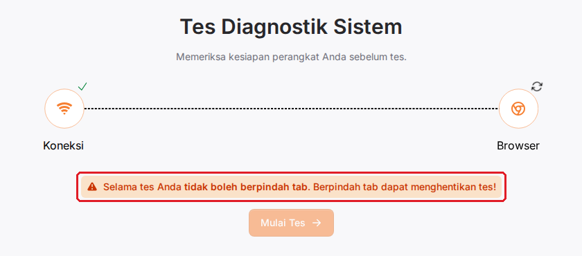
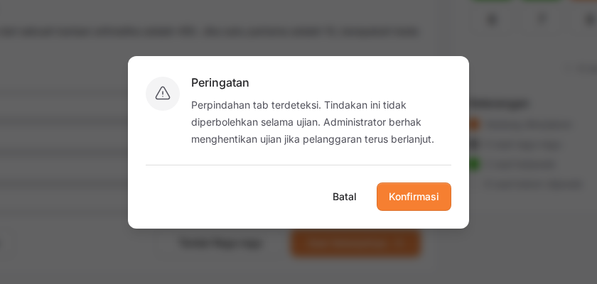
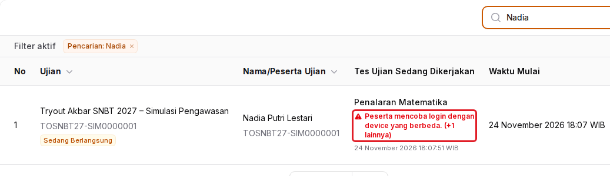
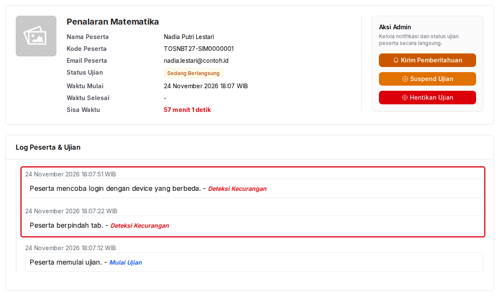
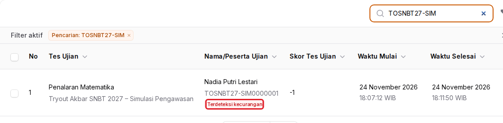
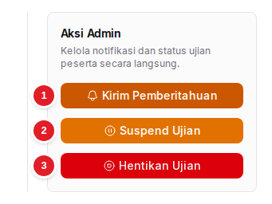

When an exam runs online, you cannot watch participants directly. CBT Indolat helps with **automatic proctoring**: the system checks the participant's device, records suspicious events, and shows them to the admin. This page explains the proctoring options, what is recorded as possible cheating, where those records appear, and what you can do about them.

<Info>
  **Related places:**

  - Per-test proctoring settings: **Platform Ujian (CBT)** → **Manajemen Ujian** → **Data Ujian** → **Detail** on the exam → **Ubah** on the test → **Pengawasan** (proctoring) tab. Steps in [Create a Test](/en/data-ujian/membuat-tes-ujian#set-up-proctoring).
  - Watching a running exam: **Platform Ujian (CBT)** → **Ujian** → **Monitoring Ujian** ([guide](/en/cbt/monitoring-ujian)).
  - Records after a test is finished: **Platform Ujian (CBT)** → **Ujian** → **Riwayat Tes Ujian** ([guide](/en/cbt/riwayat-tes-ujian)).
</Info>

<Note>
  The system only **records** and warns. A participant is never stopped or disqualified automatically because of a cheating record; the decision stays with the admin.
</Note>

## Proctoring options

Proctoring is set per test on the **Pengawasan** tab. Some options are only open on a **Ujian Professional (Paket Berbayar)**; on a **Ujian Standard (Paket Gratis)** they are labelled **(Fitur tidak aktif)** (feature inactive). **Hanya Izinkan Satu Layar** also needs a project subscription plan that includes the **Proctoring Dual Monitor** feature, which the **Esensial**, **Rutin** and **Intensif** plans do; without it, the option is also labelled **(Fitur tidak aktif)**. The difference between the two exam types and the plans is explained in [Exam Credits, Standard Exams, and Professional Exams](/en/konsep/kredit-dan-tipe-ujian).

| Setting | What the system does | Exam type | Extra cost |
| --- | --- | --- | --- |
| **Deteksi Pindah Tab** (tab switch detection) | Records every time the exam page becomes hidden, for example when the participant opens another tab, and shows the participant a warning | Standard and Professional | None |
| **Pengawasan Kamera** (camera proctoring) | The participant must allow the camera; the system takes a photo of the participant every few seconds | Professional | 1 **Proctoring Kamera** credit each time a participant starts the test |
| **Pengawasan Layar (Share Screen)** (screen proctoring) | The participant must share the **entire screen** (not one tab or window); the system takes a screenshot every few seconds | Professional | 1 **Proctoring Layar** credit each time a participant starts the test |
| **Hanya Izinkan Satu Layar** (single screen only) | Rejects participants using a second monitor, both before and during the test | Professional, on the **Esensial**, **Rutin** or **Intensif** plan | None |
| **Soal Audio Sekali Putar**, **Jawaban Audio Sekali Putar** (play audio once) | Audio in a question or answer option can be played only once. This is not cheating detection but a rule for listening questions. | Standard and Professional | None |

There are also protections that are **always on** and need no setting:

- **One account, one device.** If the participant's account signs in on another browser or device while a test is running and the session on the previous device is still active, the system records it and the old device can no longer be used. A participant who signs out (**Keluar**) and then signs in again is not recorded.
- **Supported browsers.** Tests can only be taken in Google Chrome, Chromium, Microsoft Edge, Safari, or the CBT Indolat app. Other browsers, such as Firefox, are refused before the test starts.

Before a test starts, the participant goes through the **Tes Diagnostik Sistem** (system diagnostic test) page, which checks the connection, the browser, and, when the related proctoring is on, the camera, screen sharing, and dual monitors. If **Deteksi Pindah Tab** is on, this page also reminds the participant not to switch tabs.

<Frame>
  
</Frame>

<Note>
  - CBT Indolat has no exam-browser mode that locks down the device. The CBT Indolat app is mainly needed for **Pengawasan Layar (Share Screen)** on phones: mobile browsers cannot share the screen, so participants are pointed to the **Unduh Aplikasi** (download app) button.
  - **Proctoring Kamera** and **Proctoring Layar** credits are bought as add-ons in [Subscription & Billing](/en/administrasi/langganan-dan-tagihan). When they run out, participants cannot start tests that use that proctoring.
  - Camera photos and screenshots can be viewed and downloaded from the participant detail page, and are deleted automatically once the exam ended more than three months ago.
</Note>

## What is recorded as possible cheating

Each event below is stored as a **Deteksi Kecurangan** (cheating detected) entry in the participant's test log.

| Log message | Trigger | Setting needed | Effect on the participant |
| --- | --- | --- | --- |
| **Peserta berpindah tab.** (participant switched tabs) | The exam page becomes hidden: another tab opened, the browser minimised, another app opened on a phone, or the phone screen locked | **Deteksi Pindah Tab** | A **Peringatan** (warning) dialog appears; the test can continue. Every occurrence is recorded. |
| **Peserta mencoba login dengan device yang berbeda.** (participant tried to sign in from a different device) | The participant's account signs in on another browser or device while the test is running and the previous session is still active. A participant who signs out (**Keluar**) and then signs in again is not recorded. | Always on | The exam page on the old device shows **Sesi tidak valid. Akun Anda digunakan di perangkat lain.** (session invalid, account used on another device); when reloaded, the old device is sent to the sign-in page with the same warning. The participant continues the test on the device where they last signed in. |
| **Peserta menggunakan dua monitor.** (participant used two monitors) | A second monitor is detected during the test | **Hanya Izinkan Satu Layar** | The exam screen locks with **Monitor ganda terdeteksi** (dual monitor detected) until the second monitor is removed and the page reloaded |
| **Peserta menonaktifkan atau mencabut izin kamera saat ujian berlangsung.** (participant turned off or revoked the camera) | Camera permission revoked or the camera stops | **Pengawasan Kamera** | The exam screen locks with **Akses kamera tidak tersedia** (camera access unavailable) until the camera is allowed again and the page reloaded |
| **Peserta menghentikan berbagi layar saat ujian berlangsung.** (participant stopped screen sharing) | Screen sharing stopped or refused, or something other than the entire screen was shared | **Pengawasan Layar (Share Screen)** | The participant is asked to share the entire screen again before continuing |

The warning a participant sees after switching tabs:

<Frame>
  
</Frame>

The test log can also contain entries that are **not** cheating, such as **Koneksi internet peserta lambat, menyebabkan keterlambatan proctoring.** (slow connection delayed proctoring) or a note that the participant could not start because the concurrent participant limit was reached. These entries are of type **Lainnya** (other) and do not trigger the cheating label.

<Tip>
  **Deteksi Pindah Tab** works when the browser considers the exam page hidden. Opening another window side by side with the exam window, without covering or minimising it, is not necessarily recorded. For important exams, combine it with **Pengawasan Kamera** or **Pengawasan Layar (Share Screen)**. The **Hanya Izinkan Satu Layar** check also depends on browser support and is most reliable in Google Chrome and Microsoft Edge.
</Tip>

## What the admin sees

The example below uses participant **Nadia Putri Lestari** in the exam **Tryout Akbar SNBT 2027 – Simulasi Pengawasan**, test **Penalaran Matematika**, with **Deteksi Pindah Tab** on. Nadia started the test at 18:07:12, switched tabs at 18:07:22, then signed in again from another browser at 18:07:51.

**While the exam is running**, the **Tes Ujian Sedang Dikerjakan** (test in progress) column in **Monitoring Ujian** shows the latest entry in red, the number of other entries, and the time. Use the **Terdeteksi Kecurangan** (cheating detected) filter set to **Ya** (yes) to list only participants with entries.

<Frame>
  
</Frame>

The **participant detail** page (**Lihat** button) shows the full sequence of events in **Log Peserta & Ujian** (participant and exam log), newest first. Cheating entries are marked **Deteksi Kecurangan** in red.

<Frame>
  
</Frame>

**After the test is finished**, the participant's row in **Riwayat Tes Ujian** gets a red **Terdeteksi kecurangan** label. The **Terdeteksi Kecurangan** filter is available on this page too.

<Frame>
  
</Frame>

<Note>
  The **Terdeteksi kecurangan** label appears when the test has at least one **Deteksi Kecurangan** entry, however many. Entries are not removed by **Reset Ujian**, so the label stays after the participant retakes the test.
</Note>

## Actions the admin can take

While a participant is taking a CBT or CAT test, the **Aksi Admin** (admin actions) box on the participant detail page offers three buttons:

<Frame>
  
</Frame>

1. **Kirim Pemberitahuan** (send notice): a message appears on the participant's screen at once, for example a reminder not to switch tabs.
2. **Suspend Ujian** (suspend exam): pauses the test for a set duration or until you click **Lanjutkan Ujian** (resume exam). Useful while you check the participant's situation.
3. **Hentikan Ujian** (stop exam): ends the participant's test immediately. Answers already saved are scored.

After the test is finished, you can still use **Reset Ujian** in **Riwayat Tes Ujian** so the participant can retake it, for example when an entry turns out to be caused by a technical problem. A reset deletes the answers and score, and the participant uses another exam credit when starting again.

| Situation | Suggested action |
| --- | --- |
| One or two tab switch entries | Send a notice as a warning, then keep watching |
| Tab switch entries keep growing | **Suspend Ujian**, contact the participant, then resume or stop |
| A sign-in-from-another-device entry although the participant says they did not switch devices | Check whether someone else is using the account; consider **Hentikan Ujian** |
| The entries were caused by a proven technical problem | Let the participant finish, or **Reset Ujian** afterwards |

The steps for each action are in [Exam Monitoring](/en/cbt/monitoring-ujian#admin-actions-during-an-exam) and [Test History](/en/cbt/riwayat-tes-ujian#resetting-a-test-reset-ujian).

## Avoiding false alarms

Many cheating entries are caused by unintentional habits. Share these tips with participants before the exam:

- **Do not sign in from another device in the middle of a test.** Signing in from another browser, a private window, or another device while the old session is still active is recorded as **Peserta mencoba login dengan device yang berbeda.** If the page is closed by accident, reopen it in the same browser; the test continues without signing in again while the session is still active. Signing out (**Keluar**) and signing in again is not recorded as cheating, so if a participant really has to switch devices, ask them to sign out on the old device first when they still can.
- **One tab, one device.** Close other tabs before starting, and do not open the same test in two tabs or on two devices.
- **Silence the phone.** An incoming call, switching to a chat app, or the screen locking automatically hides the exam page and is recorded as a tab switch. Turn on do-not-disturb and make sure the battery is charged.
- **Disconnect a second monitor before starting** when **Hanya Izinkan Satu Layar** is on, including projectors or mirrored displays.
- **Keep the camera allowed until the end** when **Pengawasan Kamera** is on, and do not close other apps that use the camera mid-test.
- **Share the entire screen**, not a tab or window, when **Pengawasan Layar (Share Screen)** is on.
- **Use a supported browser**: an up-to-date Google Chrome, Microsoft Edge, or Safari.

<Tip>
  For admins: turn on only the proctoring you really need, and try the test yourself with a trial participant account before exam day. Every entry carries the time of the event, so you can match it with the room supervisor's report or the participant's explanation.
</Tip>
