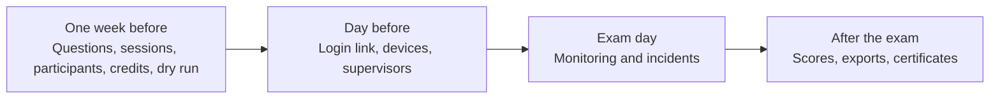
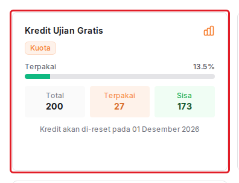
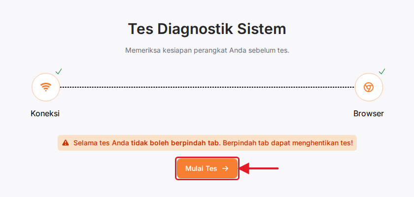

Computer-based exams rarely fail because of the app. What usually goes wrong is something small that was missed: score weights left empty, participants not assigned to a session, or credits running out just as participants start. This page sums up what to check and when. Each item gives a short reason and a link to the guide that shows how.

<Info>
  **Who this is for:** project owners and admins who prepare and run exams in **Portal** → **Platform Ujian (CBT)** (Exam Platform).

  If terms such as *exam*, *test*, *session* and *question package* are new to you, read [Exam Structure: Question Packages, Exams, Tests, and Sessions](/en/konsep/struktur-ujian) first. To see the exam from the participant's side, read [The Participant Experience from Registration to Results](/en/konsep/alur-peserta).
</Info>

## Checklist summary

| When | What to check |
| --- | --- |
| One week before | Questions and score weights, test settings, sessions and schedule, accounts and exam participants, credits, proctoring, result display, dry run with a test account |
| Day before | Login link and accounts, participants' devices and connection, supervisors, incident plan |
| Exam day | Watching **Monitoring Ujian**, handling incidents |
| After the exam | Marking essays, **Hitung Skor** or **Perhitungan IRT**, showing scores, exporting results, certificates and rankings |

## One week before the exam

Leave enough time to fix mistakes. Changes to questions and sessions are safest before any participant starts.

### 1. Questions and score weights are complete

Check the number of questions, the answer keys and the score weights in every question package. The **Skor Benar** (correct), **Skor Salah** (wrong) and **Skor Tidak Dijawab** (unanswered) weights of a new question are empty (worth 0), so if you leave them, a participant who answers everything correctly still scores **0**. Fill them in at once with **Tindakan** → **Ubah Skor Massal** (bulk edit scores); see [Create a Question Package](/en/paket-soal/membuat-paket-soal#bulk-actions) and [How Each Scoring Method Is Calculated](/en/konsep/metode-penilaian).

### 2. Test settings are right

Make sure each test has the right **Jenis Ujian** (CBT, CAT or essay), **Metode Penilaian** (scoring method) and **Durasi Pengerjaan (menit)** (duration), and that the **Tipe Ujian** (Standard or Professional) fits the number of simultaneous participants and the features you need. **Jenis Ujian** cannot be changed once the test has been taken, and the duration cannot be changed while a participant is working on the test. See [Create a Test](/en/data-ujian/membuat-tes-ujian), [Differences Between CBT, CAT, and Essay/File Upload](/en/konsep/jenis-ujian-cbt-cat-esai) and [Exam Credits, Standard Exams, and Professional Exams](/en/konsep/kredit-dan-tipe-ujian).

### 3. Sessions and schedule are set up

Each test needs at least one session with a question package and a time window. Participants can only start within the session window, and their time ends no later than the end of the session. Build in slack: make the session longer than the test, for example a 08:00–10:00 session for a 90-minute test, so participants who are a few minutes late still get the full time. See [Create Exam Sessions](/en/data-ujian/membuat-sesi-ujian).

### 4. Accounts and exam participants are ready

Create or import participant accounts, then add them to the exam, or open self-registration. See [Add Participant Accounts](/en/data-akun/menambahkan-akun-peserta) and [Add Participants to an Exam](/en/data-ujian/menambahkan-peserta-ujian).

### 5. Every participant is assigned to a session

Participants without a session see a **Terkunci** (Locked) button and cannot start. Assign everyone, or turn on **Set Sesi Otomatis Setelah Pendaftaran** (assign a session automatically after registration) for self-registered participants. See [Assign participants to sessions](/en/data-ujian/membuat-sesi-ujian#assign-participants-to-sessions).

### 6. There are enough exam credits

One credit is used each time a participant starts a test, including when they retake it after **Reset Ujian**. Work out what you need: participants × tests, plus a margin for dry runs and retakes. Camera and screen proctoring use separate proctoring credits. Check the remaining credits in **Administrasi Aplikasi** (Application Administration) → **Keuangan** (Finance) → **Langganan & Tagihan** (Subscription & Billing).

<Frame>
  
</Frame>

See [Exam Credits, Standard Exams, and Professional Exams](/en/konsep/kredit-dan-tipe-ujian) and [Subscription & Billing](/en/administrasi/langganan-dan-tagihan#1-check-the-active-plan-and-quota).

### 7. Proctoring is decided

Choose which proctoring to use: **Deteksi Pindah Tab** (tab-switch detection), **Pengawasan Kamera** (camera), **Pengawasan Layar (Share Screen)** or **Hanya Izinkan Satu Layar** (single screen only). Camera, screen and single-screen proctoring are only available on **Ujian Professional**, and screen proctoring on phones requires the CBT Indolat app. See [Exam Proctoring and Cheating Detection](/en/konsep/pengawasan-dan-kecurangan) and [Set up proctoring](/en/data-ujian/membuat-tes-ujian#set-up-proctoring).

### 8. Result display is decided

Decide what participants see when they finish: the score, the summary and answer key, explanations, or the final score. If the same question package is used in several sessions, hold back **Tampilkan Ringkasan** (Show Summary) until every session is over so the answer key does not spread. See [Set score and result display](/en/data-ujian/membuat-tes-ujian#set-score-and-result-display) and the scores section of [The Participant Experience](/en/konsep/alur-peserta#9-riwayat-tes-and-scores).

### 9. Dry run with a test account

Create one test account, for example **Panitia Uji Coba** with the email `panitia.ujicoba@contoh.id`, add it to the exam and a session, then take the test on a laptop and a phone as a real participant would. Check the instructions, the question layout, the resulting score and the certificate. Afterwards, clear the dry-run result with **Reset Ujian** or remove the test account from the exam so it does not appear in rankings and exports. The dry run uses credits like any participant. See [Test History](/en/cbt/riwayat-tes-ujian#resetting-a-test-reset-ujian).

<Tip>
  For a large exam, also create a short practice exam (for example 3 questions, 10 minutes) that every participant can try before exam day. Participants get used to the question page, and **Tes Diagnostik Sistem** checks their devices at the same time.
</Tip>

## The day before the exam

### 10. The login link and accounts are shared

Send each participant the **Tautan Login Peserta** (Participant Login Link), their email and password, and their session times. Ask them to try logging in the day before so forgotten passwords are sorted out before the exam. For in-person exams, ask participants to print their **Kartu Peserta** (Participant Card). See [Participant Login](/en/lainnya/login-peserta).

### 11. Participants' devices and connection are ready

Tell participants the device requirements: an up-to-date Google Chrome, Microsoft Edge or Safari (Mozilla Firefox on computers and Android is not supported), a stable internet connection, a charged battery, and one device per account. When a participant opens a test, **Tes Diagnostik Sistem** checks the connection, the browser and, when turned on, the camera, screen sharing and dual monitors.

<Frame>
  
</Frame>

See [Tes Diagnostik Sistem](/en/konsep/alur-peserta#6-tes-diagnostik-sistem-system-check).

### 12. Supervisors are assigned

Decide who watches each session and make sure their accounts can open **Monitoring Ujian**. Team members are invited from **Administrasi Aplikasi** → **Tim & Akses** (Team & Access) → **Tim Admin** (Admin Team) with a role that has access to that menu. See [Admin Access Management](/en/lainnya/manajemen-akses-admin) and [Exam Monitoring](/en/cbt/monitoring-ujian).

### 13. The incident plan is agreed

Agree on how participants contact you during the exam, for example a WhatsApp group, and show it on the participants' **Daftar Tes** through the **Informasi Tambahan** (Additional Information) tab (see [Create an Exam](/en/data-ujian/membuat-ujian#informasi-tambahan)). Share the incident table below with your supervisors.

## Exam day

### 14. Watch Monitoring Ujian

Open **Portal** → **Platform Ujian (CBT)** → **Ujian** → **Monitoring Ujian** (Exam Monitoring) before the session starts. The table refreshes every 10 seconds and shows who is working, how much time they have left and the latest cheating records. See [Exam Monitoring](/en/cbt/monitoring-ujian).

### 15. Handle incidents

| What happens | What to do |
| --- | --- |
| A participant cannot log in | Check the email address and the account's **Status Aktif** (Active). Change the password through **Ubah** (Edit) on the account. See [Add Participant Accounts](/en/data-akun/menambahkan-akun-peserta#edit-or-delete-an-account). |
| The test button says **Terkunci** | Assign the participant to a session, or check whether an earlier test must be finished first. See [Create Exam Sessions](/en/data-ujian/membuat-sesi-ujian#assign-participants-to-sessions). |
| **Kerjakan Tes** cannot be clicked | The session has not started yet or has already ended. Check the session times. |
| The participant's connection drops or the browser closes | Ask the participant to log in again; the test reopens with the saved answers. The time keeps running; use **Suspend Ujian** if the problem lasts and you want to pause the time. |
| The participant gets an insufficient test quota message | The credits have run out. Buy credits in **Langganan & Tagihan**, then ask the participant to try again. See [Buy exam credits](/en/administrasi/langganan-dan-tagihan#3-buy-exam-credits-and-add-ons). |
| The test cannot start because traffic is full | The exam's limit of simultaneous participants has been reached (50 for Ujian Standard, 1,000 for Ujian Professional). Ask some participants to wait, or split participants into several sessions. |
| A cheating record appears | Warn the participant with **Kirim Pemberitahuan** (Send Notice), pause with **Suspend Ujian**, or end with **Hentikan Ujian** (Stop Exam). See [Exam Proctoring and Cheating Detection](/en/konsep/pengawasan-dan-kecurangan). |
| A participant needs to start over after a technical problem | Use **Reset Ujian**. All answers are deleted and the participant retakes the test while the session is still open; another credit is used. See [Test History](/en/cbt/riwayat-tes-ujian#resetting-a-test-reset-ujian). |

<Warning>
  **Reset Ujian** and **Hentikan Ujian** cannot be undone. Make sure you picked the right participant before confirming.
</Warning>

## After the exam

### 16. Mark essay tests

**Esai / Upload File** tests are not scored automatically. Score each answer in **Riwayat Tes Ujian** (Test History). See [Giving a manual score](/en/cbt/riwayat-tes-ujian#giving-a-manual-score-to-an-essay-test).

### 17. Run Hitung Skor or Perhitungan IRT

If you corrected answer keys or weights after participants finished, run **Hitung Skor** → **Perhitungan Skor Ujian** (recalculate exam scores). For IRT tests, run **Hitung Skor** → **Perhitungan IRT** after every participant has finished, because IRT scores depend on all participants' answers. See [Recalculate scores](/en/data-ujian/hasil-dan-ekspor-ujian#recalculate-scores) and [How Each Scoring Method Is Calculated](/en/konsep/metode-penilaian).

### 18. Show the scores to participants

Once the scores are checked, turn on **Apakah Tampilkan Skor Akhir Ujian?** (show the final exam score?) and the **Skor & Hasil** settings you decided on. See [Create an Exam](/en/data-ujian/membuat-ujian#pengaturan-ujian).

### 19. Export the results

Download the score summary with **Ekspor Data** → **Hasil Tes Ujian** on the **Detail Ujian** page, PDF reports per participant, or the **Riwayat Tes Ujian** export to Excel. Most exports run in the background; download the file from **Unduh Hasil Ekspor** (Export Downloads) once the notification appears. See [Exam Results and Exports](/en/data-ujian/hasil-dan-ekspor-ujian) and [Export Downloads](/en/cbt/unduh-hasil-ekspor).

### 20. Certificates and rankings

Approve certificate requests if the template needs approval, and refresh leaderboards with **Generate Ulang** once all scores are final. See [Exam Certificates](/en/lainnya/sertifikat-ujian) and [Leaderboard](/en/cbt/leaderboard).

<Card title="Frequently Asked Questions" icon="circle-question" horizontal href="/en/konsep/pertanyaan-umum">
  Short answers to questions that come up before, during and after an exam.
</Card>
