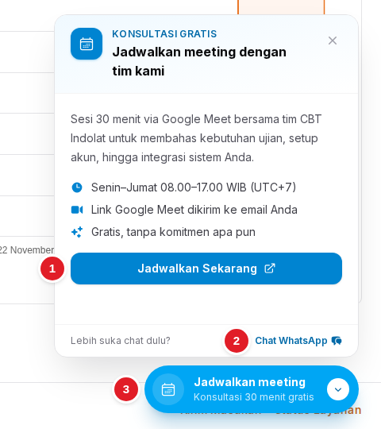
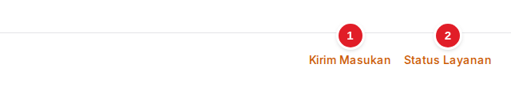

This page collects the questions teachers, tutoring centre owners and HR teams using CBT Indolat ask most often, along with the questions participants usually pass on to you. Each answer is short and links to the guide that explains how.

<Info>
  Look up unfamiliar terms in the [CBT Indolat Glossary](/en/glosarium-cbt-indolat). To see an exam from the participant's side, read [The Participant Experience from Registration to Results](/en/konsep/alur-peserta).
</Info>

## Accounts and login

<AccordionGroup>
  <Accordion title="A participant forgot their password. Can it be reset?">
    Yes, in two ways:

    - **By the participant:** click **Lupa kata sandi?** (Forgot password?) on the login page, enter the email and click **Kirim Tautan Atur Ulang** (Send Reset Link). The link is emailed to the participant and is valid for 60 minutes. A new request can only be sent after one hour, so ask the participant to check their spam folder first.
    - **By the admin:** open the participant's account in **Data Akun**, click **Ubah** (Edit), type a new password in **Kata Sandi** and save. See [Edit or delete an account](/en/data-akun/menambahkan-akun-peserta#edit-or-delete-an-account).

    Participants who signed up with **Lanjutkan dengan Google** (Continue with Google) just log in again with the same button.
  </Accordion>
  <Accordion title="A participant cannot log in. What should I check?">
    Check in this order:

    1. **The link is right.** The login address contains your project code, for example `https://prestasi.indolat.web.id/auth/login`. Accounts from another project cannot log in.
    2. **The email and password are right.** The message **Alamat email atau kata sandi tidak valid** (invalid email or password) also appears for accounts whose **Status Aktif** (Active) is off.
    3. **Not too many attempts.** After 5 failed attempts within one minute, the participant has to wait briefly.
    4. **The email is verified.** Self-registered participants must enter a verification code. If the code never arrives, click **Verifikasi Email** on the participant's account.

    See [Participant Login](/en/lainnya/login-peserta) and [Account status](/en/data-akun/menambahkan-akun-peserta#account-status).
  </Accordion>
  <Accordion title="How do I change the participant login address?">
    The default address follows the **Kode Projek** (project code): `https://<project-code>.indolat.web.id`. Change the code in **Administrasi Aplikasi** → **Pengaturan Projek** → **Profil Projek**; the old link stops working immediately, so tell participants the new address. To use your own domain, for example `ujian.bimbelprestasi.sch.id`, turn on the **Kustom Domain** (custom domain) add-on. See [Dashboard & Project Profile](/en/administrasi/profil-projek) and [Domain](/en/administrasi/domain).
  </Accordion>
  <Accordion title="Can a participant be logged in on two devices at once?">
    No. An account is active on one device only. If a participant logs in on a second device while a test is running, the first device shows **Sesi tidak valid** (invalid session) and the system records it in **Monitoring Ujian**. See [If the browser closes or the participant switches devices](/en/konsep/alur-peserta#if-the-browser-closes-or-the-participant-switches-devices).
  </Accordion>
</AccordionGroup>

## Exams and questions

<AccordionGroup>
  <Accordion title="What is the difference between an exam, a test, a session and a question package?">
    In short: an **exam** is the event (for example Tryout Akbar SNBT 2027), a **test** is a subject within it (for example Penalaran Matematika), a **session** is when the test can be taken, and a **question package** is the set of questions a session uses. See [Exam Structure: Question Packages, Exams, Tests, and Sessions](/en/konsep/struktur-ujian).
  </Accordion>
  <Accordion title="Can one account take several exams?">
    Yes. One participant account can be added to many exams in the same project, and all their tests appear on **Daftar Tes**. A participant can only work on one test at a time, and cannot register twice for the same exam. See [Add Participants to an Exam](/en/data-ujian/menambahkan-peserta-ujian).
  </Accordion>
  <Accordion title="How many participants can take an exam at the same time?">
    The limit counts participants working on the same exam at the same moment: **50** for **Ujian Standard** and **1,000** for **Ujian Professional**. You can register more participants than that, as long as they do not all work at once. When the limit is reached, the next participant is told that traffic is full and can try again shortly. See [Exam Credits, Standard Exams, and Professional Exams](/en/konsep/kredit-dan-tipe-ujian).
  </Accordion>
  <Accordion title="Can questions be shuffled for each participant?">
    Yes. Turn on **Acak Soal** (shuffle questions) and **Acak Jawaban (Pilihan Ganda)** (shuffle answers) in the question package. Questions that share a reading passage stay together. See [Create a Question Package](/en/paket-soal/membuat-paket-soal).
  </Accordion>
  <Accordion title="Which question types are available?">
    Multiple choice (one or several answers), short answer, complex multiple choice (for example True/False), matching, and essay and file upload. See [Question Types and How Participants See Them](/en/konsep/jenis-soal).
  </Accordion>
  <Accordion title="Can I edit questions while an exam is running?">
    Not in CBT/CAT packages: while any participant is working, questions cannot be edited, added or deleted. Fix them after everyone has finished, then run **Hitung Skor**. See [Changes while an exam is in progress](/en/paket-soal/membuat-paket-soal#changes-while-an-exam-is-in-progress).
  </Accordion>
</AccordionGroup>

## Running the exam

<AccordionGroup>
  <Accordion title="A participant's time ran out. What happens?">
    The test ends automatically, the participant sees a **Waktu Habis** (Time's Up) notice, and every saved answer is still scored. This also applies if the participant has already closed the browser. Time cannot be extended for one participant; if something goes wrong, use **Suspend Ujian** straight away so their time pauses. Remember that a participant's time also ends no later than the end of the session. See [When time runs out](/en/konsep/alur-peserta#when-time-runs-out).
  </Accordion>
  <Accordion title="A participant's connection dropped or the browser closed. Are the answers lost?">
    No. Each answer is saved to the server as soon as it is chosen. The participant just opens the login link and logs in again; the app opens the running test with the answers. The time keeps running while the participant is disconnected. See [If the connection drops](/en/konsep/alur-peserta#if-the-connection-drops).
  </Accordion>
  <Accordion title="How do I let a participant retake a test?">
    Use **Reset Ujian** in **Riwayat Tes Ujian** (Test History) or in the session's participant list. All answers and the score of that test are deleted, and the participant can take it again from **Daftar Tes** while the session is still open. Another credit is used when the participant starts again. See [Resetting a test (Reset Ujian)](/en/cbt/riwayat-tes-ujian#resetting-a-test-reset-ujian).
  </Accordion>
  <Accordion title="A participant cannot start the test. Why?">
    Look at the button on the test card and the message shown:

    - **Terkunci** (Locked): the participant has no session, the session has no question package, or an earlier test must be finished first.
    - **Kerjakan Tes** cannot be clicked: the session has not started yet or has ended.
    - An insufficient test quota message: the project has run out of credits.
    - A traffic full message: the exam's limit of simultaneous participants has been reached.
    - **Browser Tidak Didukung** (Browser Not Supported): the participant uses a browser other than Chrome, Edge or Safari.

    See [Preparing for Exam Day](/en/konsep/persiapan-hari-ujian#15-handle-incidents).
  </Accordion>
  <Accordion title="Why is a participant flagged for cheating?">
    Cheating records appear in **Monitoring Ujian** when the system detects, for example, a tab switch (when **Deteksi Pindah Tab** is on), two monitors, the camera being turned off, screen sharing being stopped, or a login from another device. These records are signals, not verdicts; check the context, for example a participant who switched devices because their laptop died. See [Exam Proctoring and Cheating Detection](/en/konsep/pengawasan-dan-kecurangan).
  </Accordion>
  <Accordion title="Can participants use a phone?">
    Yes, in Chrome or Safari on the phone, with a layout that fits the screen. The exception is exams with **Pengawasan Layar (Share Screen)**: participants must use the CBT Indolat app. See [Using a phone](/en/konsep/alur-peserta#13-using-a-phone).
  </Accordion>
  <Accordion title="Who monitors the exam, and where?">
    The project owner, or **Tim Admin** (Admin Team) members whose role has access to **Monitoring Ujian**. From that page, supervisors can send notices, suspend or stop a participant's exam. See [Exam Monitoring](/en/cbt/monitoring-ujian) and [Admin Access Management](/en/lainnya/manajemen-akses-admin).
  </Accordion>
</AccordionGroup>

## Scores and results

<AccordionGroup>
  <Accordion title="Why is a participant's score 0?">
    The most common cause is that the questions' **Skor Benar** (correct score) weights are still empty, because a new question is worth 0 until its weights are filled in. Fill them in with **Tindakan** → **Ubah Skor Massal** in the question package, then run **Hitung Skor** → **Perhitungan Skor Ujian** so finished participants' scores are updated too. See [How Each Scoring Method Is Calculated](/en/konsep/metode-penilaian) and [Recalculate scores](/en/data-ujian/hasil-dan-ekspor-ujian#recalculate-scores).
  </Accordion>
  <Accordion title="Why did a participant's IRT score change?">
    An IRT score depends not only on one participant's answers but also on each question's difficulty, which is worked out from all participants' answers. If **Perhitungan IRT** is run again after more participants finish, the question difficulties change, so everyone's scores change too. Run **Perhitungan IRT** once, after every participant has finished. See [How Each Scoring Method Is Calculated](/en/konsep/metode-penilaian).
  </Accordion>
  <Accordion title="Why can't participants see their score?">
    Scores only appear if you turn them on: **Tampilkan Skor** (Show Score) on the **Skor & Hasil** tab for test scores, and **Apakah Tampilkan Skor Akhir Ujian?** for the final score. There is also no score yet for an essay test that has not been marked or an IRT test that has not been calculated. See [Riwayat Tes and scores](/en/konsep/alur-peserta#9-riwayat-tes-and-scores).
  </Accordion>
  <Accordion title="How do participants get a certificate?">
    Turn on the **Sertifikat Ujian** (Exam Certificate) add-on, create a template for the exam, set its status to **Dipublikasikan** (Published) and turn on **Tampilkan ke peserta** (show to participants). Participants who meet the conditions, for example the **Skor Minimum**, see the **Unduh Sertifikat** (Download Certificate) button on **Riwayat Tes**. See [Exam Certificates](/en/lainnya/sertifikat-ujian).
  </Accordion>
  <Accordion title="The ranking in the Peringkat menu has not changed. Why?">
    Leaderboards are not refreshed every time a participant finishes. Click **Lainnya** → **Generate Ulang** on the leaderboard after everyone has finished or after essays are marked. See [Leaderboard](/en/cbt/leaderboard#refreshing-the-ranking-generate-ulang).
  </Accordion>
  <Accordion title="How do I download all exam results?">
    Click **Ekspor Data** → **Hasil Tes Ujian** on the **Detail Ujian** page, then download the file from **Unduh Hasil Ekspor** once the notification appears. PDF reports per participant are also available. See [Exam Results and Exports](/en/data-ujian/hasil-dan-ekspor-ujian).
  </Accordion>
</AccordionGroup>

## Payments

<AccordionGroup>
  <Accordion title="What happens when exam credits run out?">
    Participants who try to start a test see **Kuota tes tidak mencukupi** (insufficient test quota), and you get a panel notification and an email. Participants already working are not affected. Buy credits in **Administrasi Aplikasi** → **Keuangan** → **Langganan & Tagihan**, then ask participants to try again. The Standard plan's free credits are refilled at the start of every month. See [Exam Credits, Standard Exams, and Professional Exams](/en/konsep/kredit-dan-tipe-ujian) and [Buy exam credits](/en/administrasi/langganan-dan-tagihan#3-buy-exam-credits-and-add-ons).
  </Accordion>
  <Accordion title="Do participants pay for exam credits?">
    No. Exam credits are what you, as the organiser, pay CBT Indolat. The registration fee participants pay, if your exam is paid, is separate. See [Exam Credits, Standard Exams, and Professional Exams](/en/konsep/kredit-dan-tipe-ujian) and [Paid Exams: Participant Payment Flow and Balance](/en/konsep/ujian-berbayar-dan-saldo).
  </Accordion>
  <Accordion title="How do participants pay for a paid exam?">
    After registering, participants get a QR code to pay before a deadline, and their tests open once the payment is received. You can give discounts with voucher codes. See [Participant Registration Form](/en/data-ujian/membuat-formulir-pendaftaran) and [Paid Exams: Participant Payment Flow and Balance](/en/konsep/ujian-berbayar-dan-saldo).
  </Accordion>
  <Accordion title="Who pays the transaction fee on participants' payments?">
    You decide with **Bebankan Biaya Transaksi ke Admin** (charge the transaction fee to the admin) in **Pengaturan Aplikasi**: when on, the fee is deducted from the payment you receive; when off, it is added to the participant's bill. See [Participant Login](/en/lainnya/login-peserta#pengaturan-lainnya-other-settings).
  </Accordion>
  <Accordion title="When can I withdraw participants' registration fees?">
    Participant payments go into the project balance and can be withdrawn to your bank account through **Penarikan Saldo** (Balance Withdrawal). See [Transactions & Balance Withdrawal](/en/lainnya/transaksi-dan-penarikan-saldo) and [Paid Exams: Participant Payment Flow and Balance](/en/konsep/ujian-berbayar-dan-saldo).
  </Accordion>
</AccordionGroup>

## Participants

<AccordionGroup>
  <Accordion title="How do I add hundreds of participants at once?">
    Use **Import Peserta** (Import Participants) in the **Daftar Peserta Ujian** section of the exam page: the system creates accounts from an Excel file and adds them to the exam straight away. To prepare accounts without adding them to a particular exam, use **Import Akun** in **Data Akun**. See [Add Participants to an Exam](/en/data-ujian/menambahkan-peserta-ujian#method-2-import-participants-from-an-excel-file) and [Add Participant Accounts](/en/data-akun/menambahkan-akun-peserta#add-many-accounts-at-once-import-akun).
  </Accordion>
  <Accordion title="Can participants register themselves?">
    Yes. Turn on **Izinkan pendaftaran akun mandiri** (allow self-registration) so participants can create accounts, and **Apakah Pendaftaran Ujian Dibuka?** so they can register for the exam. See [Participant Login](/en/lainnya/login-peserta) and [Participant Registration Form](/en/data-ujian/membuat-formulir-pendaftaran).
  </Accordion>
  <Accordion title="A participant cannot make their session. Can I move them to another one?">
    Yes, as long as they have not started the test. Move them with **Set Sesi Ujian Kolektif** in the **Sesi Peserta Ujian** section. A participant who has already started must be reset with **Reset Ujian** first. See [Move participants to another session](/en/data-ujian/membuat-sesi-ujian#move-participants-to-another-session).
  </Accordion>
  <Accordion title="What is the Kartu Peserta?">
    A card with the participant's name, participant code with a QR code and test schedule, which participants can print from their name menu in the participant app. It is useful for in-person exams. See [Participant card](/en/konsep/alur-peserta#12-participant-card) and [Participant Codes and Field Codes](/en/data-ujian/kode-peserta).
  </Accordion>
</AccordionGroup>

## Help

<AccordionGroup>
  <Accordion title="How do I contact the CBT Indolat team?">
    In the admin panel, use the **Jadwalkan meeting** (Schedule a meeting) button in the bottom right corner.

    <Frame>
      
    </Frame>

    1. **Jadwalkan Sekarang** (Schedule Now): book a free 30-minute consultation on Google Meet (Monday–Friday, 08:00–17:00 WIB). The meeting link is sent to your email.
    2. **Chat WhatsApp**: chat with the team on WhatsApp.
    3. **Jadwalkan meeting**: opens or closes this panel.

    The bottom of every panel page also has two links:

    <Frame>
      
    </Frame>

    1. **Kirim Masukan** (Send Feedback): opens the CBT Indolat community site (`community.indolat.com`) to send feedback or report a problem.
    2. **Status Layanan** (Service Status): shows whether the service has an outage.

    You can also join the user community through the **Join the Community** link in this documentation.
  </Accordion>
  <Accordion title="Who should participants contact when they have a problem?">
    Participants contact you as the organiser, not the CBT Indolat team, because only you can change their accounts, sessions and tests. Show your committee's contact on the participants' **Daftar Tes** through the **Informasi Tambahan** (Additional Information) tab. See [Create an Exam](/en/data-ujian/membuat-ujian#informasi-tambahan).
  </Accordion>
</AccordionGroup>
