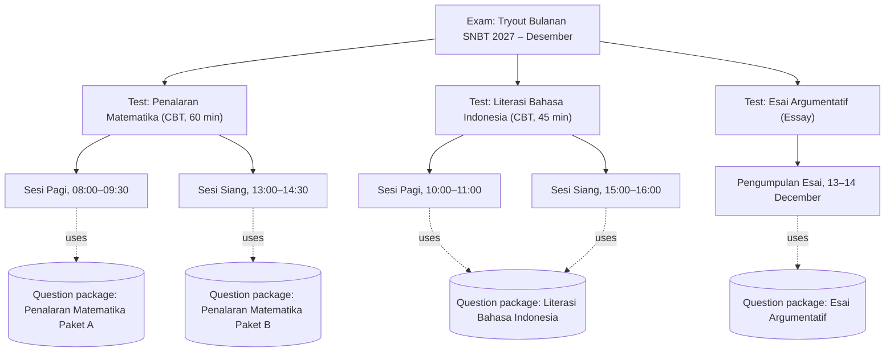
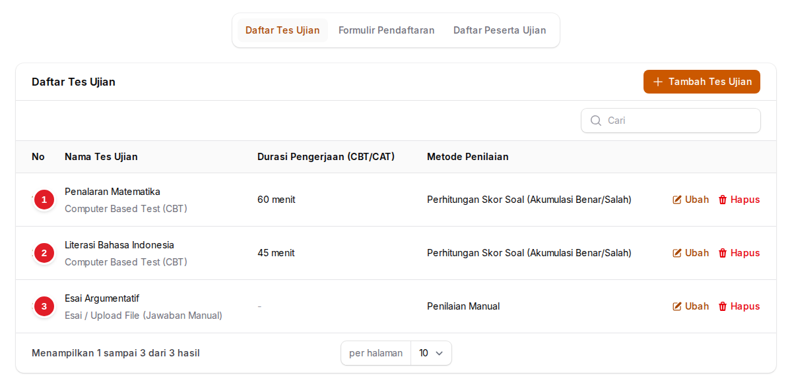
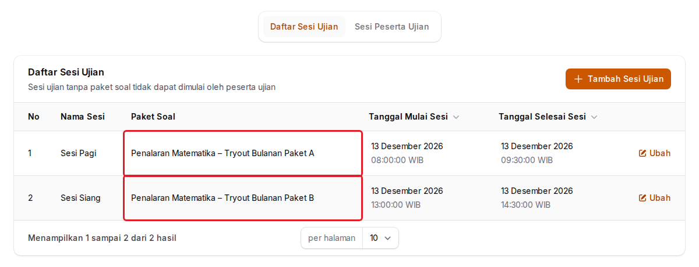
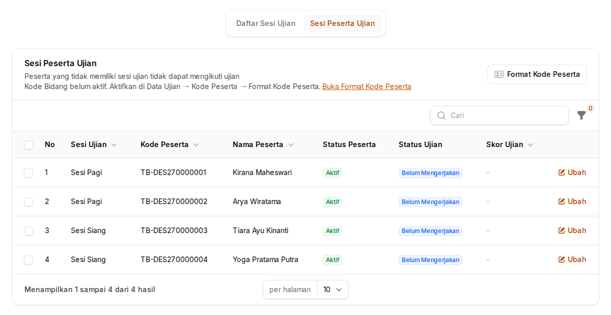

Before you build your first exam, it helps to understand the five building blocks of an exam in CBT Indolat: the **question package**, the **exam**, the **test**, the **session**, and the **participant**. This page explains what each one is, how they relate to each other, and the rules that follow from those relationships. The click-by-click steps for creating each part are in the guides linked at the end of this page.

<Info>
  **Menu location:**

  - Question packages: **Portal** → **Platform Ujian (CBT)** → **Manajemen Ujian** → **Data Paket Soal**.
  - Exams, tests, sessions, and exam participants: **Portal** → **Platform Ujian (CBT)** → **Manajemen Ujian** → **Data Ujian** → **Detail** on the exam.
</Info>

## The five building blocks

| Part | In plain words | Example |
| --- | --- | --- |
| **Question package** (paket soal, question bank) | A set of questions with their answer keys, explanations, and score weights. A package stands on its own and is not tied to any exam. | **Penalaran Matematika – Tryout Bulanan Paket A**, with 5 multiple-choice questions |
| **Exam** (ujian) | The event participants take part in. An exam has a name, a code, a date range, a **Tipe Ujian** (Standard or Professional), registration and payment settings, and a way of computing the final score. | **Tryout Bulanan SNBT 2027 – Desember**, code **TB-DES27**, 1–31 December 2026 |
| **Test** (tes ujian, subtest) | A part or subject inside the exam. Each test has its own **Jenis Ujian** (CBT, CAT, or essay), scoring method, and duration. | **Penalaran Matematika**, CBT, 60 minutes |
| **Session** (sesi ujian) | The schedule of one test, which also decides the question package used in that time slot. A test can have several sessions. | **Sesi Pagi**, 13 December 2026, 08:00–09:30, using Paket A |
| **Participant** (peserta) | An account registered for the exam. In every test, a participant is assigned to exactly one session. | **Kirana Maheswari**, taking **Sesi Pagi** |

The **Jenis Ujian** (CBT, CAT, or essay) applies to each test, while the **Tipe Ujian** (**Ujian Standard (Paket Gratis)** or **Ujian Professional (Paket Berbayar)**) applies to the whole exam. Both are sometimes translated as "exam type", so this page uses the Indonesian labels. The three **Jenis Ujian** are compared in [Differences Between CBT, CAT, and Essay/File Upload](/en/konsep/jenis-ujian-cbt-cat-esai).

## An analogy: a monthly tryout at a school

Imagine Bimbel Prestasi Nusantara holds a tryout on Sunday, 13 December 2026, in a school building:

- The **exam** is the event: "Tryout Bulanan SNBT 2027 – Desember". Announcements, registration, and the final report all refer to this event.
- The **tests** are the subjects taken at the event: Penalaran Matematika, Literasi Bahasa Indonesia, and Esai Argumentatif.
- The **sessions** are the room and time slots: Penalaran Matematika is taken in the morning wave or the afternoon wave.
- The **question packages** are the printed question booklets kept in the teachers' cupboard. The morning wave receives booklet A and the afternoon wave receives booklet B, so the morning questions cannot leak to the afternoon participants. The same booklet can be used again at next month's tryout.
- The **participants** are the registered students. Each student knows which wave they are in for each subject.

## Relationship diagram

Solid lines show ownership (an exam has tests, a test has sessions). Dashed lines show the question package a session **uses**. A package is not owned by the exam, so one package can be used by many sessions and many exams.

Participants are registered at exam level and then assigned to one session in every test. The schedule of two participants in the exam above:

| Participant | Penalaran Matematika | Literasi Bahasa Indonesia | Esai Argumentatif |
| --- | --- | --- | --- |
| Kirana Maheswari | Sesi Pagi (Paket A) | Sesi Pagi | Pengumpulan Esai |
| Tiara Ayu Kinanti | Sesi Siang (Paket B) | Sesi Siang | Pengumpulan Esai |

## How it looks in the app

The exam's **Detail** page lists all its tests in the **Daftar Tes Ujian** (Test List) section. In this example the exam has three tests with different **Jenis Ujian**:

<Frame>
  
</Frame>

1. **Penalaran Matematika**, **Computer Based Test (CBT)**, 60 minutes.
2. **Literasi Bahasa Indonesia**, **Computer Based Test (CBT)**, 45 minutes.
3. **Esai Argumentatif**, **Esai / Upload File (Jawaban Manual)**, with no duration and scored with **Penilaian Manual** (manual scoring).

Click **Ubah** (Edit) on a test to open its details. The **Daftar Sesi Ujian** (Session List) section shows the test's schedule and the question package of each session. The **Penalaran Matematika** test uses a different package in the morning and afternoon sessions:

<Frame>
  
</Frame>

The **Sesi Peserta Ujian** (Participant Sessions) section below it shows each participant's session for that test:

<Frame>
  
</Frame>

## Rules that follow from this structure

### Question packages

- **One question package can be used many times**: in several sessions, several tests, and several exams. You do not need to copy questions for each exam.
- **Packages are not copied into the exam.** A session only points to a package, so changes to a question apply to every exam that uses the package. If one exam needs a different version, use **Duplikat Paket Soal** (Duplicate Package) and edit the copy (see [Create a Question Package](/en/paket-soal/membuat-paket-soal)).
- While a participant is taking an exam that uses a CBT/CAT package, that package is locked and cannot be edited.
- A question package that is still used by an exam session cannot be deleted.
- **The package type must match the test type.** A **CBT/CAT** package can only be chosen for CBT and CAT tests, and an **Esai/Upload File (Jawaban Manual)** package only for essay tests. An exam with both multiple-choice and essay questions therefore needs two packages and two tests.

### Tests

- The **Jenis Ujian** and scoring method are chosen per test, so one exam can contain both a CBT test and an essay test, as in the example above.
- The number of tests in an exam is limited by the **Tipe Ujian**: at most **4 tests** for **Ujian Standard (Paket Gratis)** and **30 tests** for **Ujian Professional (Paket Berbayar)**.
- **CAT** tests are only available in **Ujian Professional (Paket Berbayar)**, and only when the project's subscription plan includes the **Computer Adaptive Test (CAT)** feature (the **Rutin** and **Intensif** plans). By default, participants in a CAT test answer every question in the package; the admin can limit this with **Jumlah Soal yang Dikerjakan (CAT)** (see [Differences Between CBT, CAT, and Essay/File Upload](/en/konsep/jenis-ujian-cbt-cat-esai#how-many-questions-are-answered)).
- By default participants may take the tests in any order. If the order matters, turn on **Apakah Tes Ujian Harus Dikerjakan Secara Berurutan?** (Must tests be taken in order?) in the exam settings (see [Create an Exam](/en/data-ujian/membuat-ujian)).

### Sessions

- **One test can use a different question package in each session.** For example, Paket A for the morning session and Paket B for the afternoon session, so the morning questions cannot leak to the afternoon participants. A session's package cannot be changed once a participant has started the test in that session.
- A session's schedule must fall within the exam's date range.
- For CBT and CAT tests, a session cannot be shorter than the test's **Durasi Pengerjaan (menit)** (duration). A participant's working time ends at the end of the duration or the end of the session, whichever comes first. A participant who starts 20 minutes before the session ends only gets 20 minutes.
- Essay tests have no duration. Participants can work on them until the session ends.
- A session without a question package cannot be started by participants.

### Participants

- Participants are registered for the exam, not for a test. After registering, each participant must be assigned to one session in **every** test. A participant without a session cannot start that test.
- A participant's session may differ between tests, for example the morning session for Penalaran Matematika and the afternoon session for Literasi Bahasa Indonesia.
- One exam credit is used each time a participant starts one test. An exam with three tests taken by 100 participants can use up to 300 credits.

### Scores

- Each test produces its own test score according to its scoring method. The test scores are then combined into the exam's final score according to **Jenis Skor Akhir** (summed or averaged). The formulas are in [How Each Scoring Method Is Calculated](/en/konsep/metode-penilaian#the-exams-final-score).
- IRT scores are calculated from the participants who finished the same test with the same question package. If one test uses Paket A and Paket B, the participants of each package are calculated as separate groups.

## Multi-level exams

For competitions or staged selections, such as preliminary, semifinal, and final rounds, an exam can be set to **Ya (Multi-Level)**. The basic structure stays the same (exam, tests, sessions, question packages, and participants), but the tests are grouped into levels. Participants can only take the tests of the next level after the admin passes them from the previous level, and each level can have its own fee. The full guide is in [Create a Multi-Level Exam](/en/data-ujian/membuat-ujian-berjenjang).

## The order for building an exam

The easiest order follows the structure above: prepare the question packages, create the exam, add the tests, create the sessions, and then add the participants.

<CardGroup cols={2}>
  <Card title="1. Create a Question Package" icon="book-open" href="/en/paket-soal/membuat-paket-soal">
    Write the questions, answer keys, and score weights.
  </Card>
  <Card title="2. Create an Exam" icon="file-pen" href="/en/data-ujian/membuat-ujian">
    Set the name, schedule, **Tipe Ujian**, and registration.
  </Card>
  <Card title="3. Create a Test" icon="list-check" href="/en/data-ujian/membuat-tes-ujian">
    Choose the **Jenis Ujian**, scoring method, and duration.
  </Card>
  <Card title="4. Create Exam Sessions" icon="calendar" href="/en/data-ujian/membuat-sesi-ujian">
    Set the schedule and question package of each session.
  </Card>
  <Card title="5. Add Participants to an Exam" icon="users" href="/en/data-ujian/menambahkan-peserta-ujian">
    Register participants and assign them to sessions.
  </Card>
  <Card title="In a hurry?" icon="bolt" href="/en/membuat-ujian-pertama-anda-dalam-5-menit">
    Create your first exam in 5 minutes.
  </Card>
</CardGroup>
