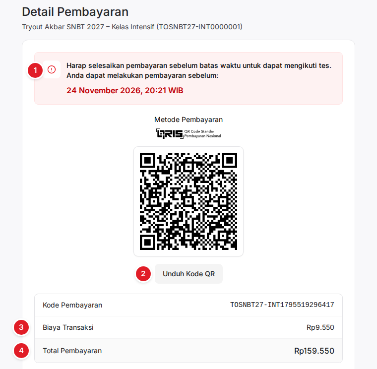
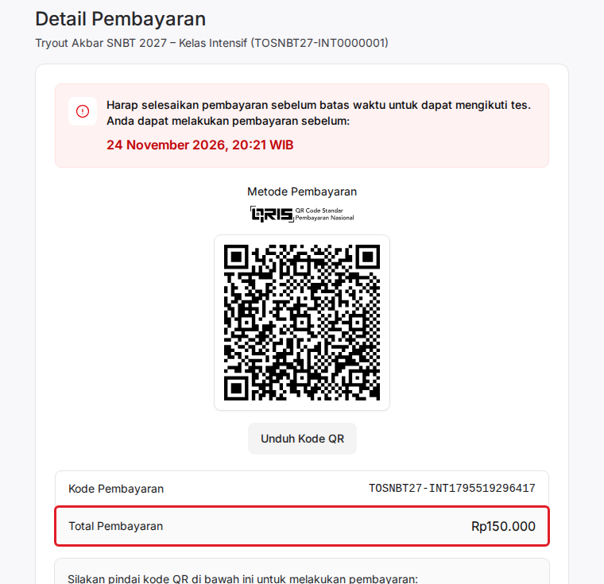
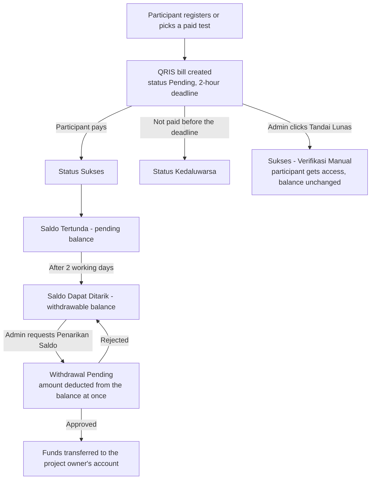
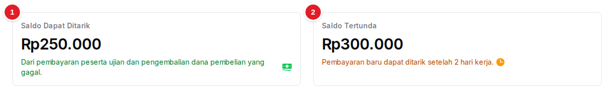

CBT Indolat can charge participants for exams directly. Participants pay by QRIS, the money goes into your **project balance**, and you withdraw it to the project owner's bank account. This page walks through that flow from start to finish with numeric examples, without repeating the click steps already covered in the guides.

<Info>
  **Related settings:**

  - Exam payment type and fee: **Portal** → **Platform Ujian (CBT)** → **Manajemen Ujian** → **Data Ujian** → **Detail** on the exam → **Pendaftaran & Pembayaran** tab.
  - Who bears the transaction fee: **Platform Ujian (CBT)** → **Lainnya** → **Pengaturan Aplikasi** → **Bebankan Biaya Transaksi ke Admin** (charge transaction fee to admin).
  - Participant payments: **Platform Ujian (CBT)** → **Keuangan** → **Riwayat Transaksi** (transaction history).
  - Balance and withdrawals: **Administrasi Aplikasi** → **Keuangan** → **Penarikan Saldo** (balance withdrawal).
</Info>

## Requirements for paid exams

Paid exams need the **Halaman Pendaftaran Ujian dan Pembayaran Otomatis** add-on (Rp70,000 a year, or a bonus with yearly subscription plans). Without it, payment types other than **Gratis** (free) cannot be saved and the setting labels show **(Add-on Tidak Aktif)** (add-on inactive). The add-on is bought in [Subscription & Billing](/en/administrasi/langganan-dan-tagihan).

The minimum exam fee is **Rp5,000**. The only payment method for participants is **QRIS**, so participants can pay with any banking or e-wallet app that supports QRIS.

<Note>
  The fee participants pay is separate from the **exam credits** your project uses. Paid exams still use a credit every time a participant starts a test. See [Exam Credits, Standard Exams, and Professional Exams](/en/konsep/kredit-dan-tipe-ujian).
</Note>

## Four payment types

The **Tipe Pembayaran** (payment type) is chosen on each exam's **Pendaftaran & Pembayaran** tab (steps in [Create an Exam](/en/data-ujian/membuat-ujian)).

| Tipe Pembayaran | When the participant pays | Where the fee is set | Example |
| --- | --- | --- | --- |
| **Gratis** (free) | Never | Nowhere | A promotional tryout open to everyone |
| **Sekali Bayar** (one-time payment) | Once, when self-registering through the registration form, for all tests | **Biaya Ujian Sekali Bayar (IDR)** on the **Pendaftaran & Pembayaran** tab | A Rp150,000 tryout covering three subtests |
| **Berbayar per Tes Ujian** (paid per test) | Per test, from the participant's **Daftar Tes** (test list) page, before taking that test | **Biaya Tes Ujian** on each test | A practice package where participants pick which subtests to buy, Rp25,000 each |
| **Berbayar per Level (Multi-Level)** (paid per level) | The first level's fee at self-registration; later levels when you move the participant on to that level | The exam level structure | A competition: free preliminary round, Rp30,000 semifinal |

Points to note:

- With **Sekali Bayar**, the bill is created by the **Metode Pembayaran** (payment method) question in the registration form. Participants you add directly from **Daftar Peserta Ujian** are not charged. See [Participant Registration Form](/en/data-ujian/membuat-formulir-pendaftaran).
- With **Berbayar per Tes Ujian**, every test that has a fee must be paid by registered participants first, including participants you add yourself.
- With **Berbayar per Level (Multi-Level)**, you set the payment deadline for the next level yourself when moving participants on, up to 2 × 24 hours. See [Create a Multi-Level Exam](/en/data-ujian/membuat-ujian-berjenjang).
- **Voucher codes** can reduce the registration fee for selected participants. If the discount brings the fee to Rp0, no bill is created.

## What the participant goes through to pay

1. The participant registers or picks a paid test. The system creates a bill with status **Pending** and shows the **Detail Pembayaran** (payment details) page.
2. The participant scans the QR code (or saves it with **Unduh Kode QR**) before the deadline, which is **2 hours** after the bill is created.
3. After paying, the participant reloads the page. The status changes to **Sudah Dibayar** (paid) and the tests open according to the session settings.

<Frame>
  
</Frame>

1. Payment deadline.
2. Button to save the QRIS code.
3. **Biaya Transaksi** (transaction fee), shown only when the participant bears the fee (see the next section).
4. **Total Pembayaran** (total payment) the participant must pay.

What the transaction statuses mean:

| Status in **Riwayat Transaksi** (admin) | What the participant sees | Meaning |
| --- | --- | --- |
| **Pending** | **Menunggu Pembayaran** (awaiting payment) and the QR code | The bill exists; the participant has not paid. |
| **Sukses** (success) | **Sudah Dibayar** | The QRIS payment was received. The project balance increases. |
| **Sukses (Verifikasi Manual)** (success, manual verification) | **Sudah Dibayar** | The admin marked it paid with **Tandai Lunas**. The participant gets access; the balance does not increase. |
| **Kedaluwarsa** (expired) | **Waktu pembayaran telah habis.** (payment time is over) | The 2-hour deadline passed without payment. |
| **Gagal** (failed) | - | The payment was rejected. |

When a bill expires:

- With **Sekali Bayar**, the participant's registration is cancelled automatically, so the participant can register again and get a new bill.
- With **Berbayar per Tes Ujian**, the test goes back to unpaid and the participant can create a new bill from the **Daftar Tes** page.

## Who bears the transaction fee

Every QRIS payment carries a **transaction fee** of:

```text
Transaction fee = 3.7% × exam fee (rounded) + Rp4,000
```

The **Bebankan Biaya Transaksi ke Admin** setting decides who bears it. It is on by default for new projects. How to change it is described in [Participant Login](/en/lainnya/login-peserta#pengaturan-lainnya-other-settings).

| | **On** (default) | **Off** |
| --- | --- | --- |
| What the participant pays | The exam fee only | Exam fee + transaction fee |
| What reaches the project balance | Exam fee − transaction fee | The full exam fee |
| **Biaya Transaksi** row on the participant page | Hidden | Shown |

**Example:** an exam fee of **Rp150,000**.

```text
Transaction fee = 3.7% × 150,000 + 4,000 = 5,550 + 4,000 = Rp9,550
```

| | Participant pays | Project balance increases by |
| --- | --- | --- |
| **On** (admin bears the fee) | Rp150,000 | Rp150,000 − Rp9,550 = **Rp140,450** |
| **Off** (participant bears the fee) | Rp150,000 + Rp9,550 = **Rp159,550** | **Rp150,000** |

The image in the previous section shows the page when the participant bears the fee. When the admin bears it, the participant only sees a **Total Pembayaran** equal to the exam fee:

<Frame>
  
</Frame>

<Note>
  The setting is read when the bill is created. Changing it does not affect bills that are already **Pending**. The **Total Pembayaran** column in **Riwayat Transaksi** always shows the exam fee (after any voucher discount), not the amount that reaches the balance.
</Note>

## How money reaches your bank account



### Saldo Tertunda and Saldo Dapat Ditarik

Every successful payment first enters the **Saldo Tertunda** (pending balance). After **2 working days** (Monday to Friday) from the time the payment was received, the system moves it automatically to the **Saldo Dapat Ditarik** (withdrawable balance). The system checks every few minutes, so you do not need to do anything.

| Payment received | Withdrawable from |
| --- | --- |
| Monday 10:00 | Wednesday around 10:00 |
| Thursday 15:00 | Monday around 15:00 |
| Friday 10:00 | Tuesday around 10:00 |

Both figures are shown above the **Penarikan Saldo** table:

<Frame>
  
</Frame>

1. **Saldo Dapat Ditarik**: the amount you can withdraw now.
2. **Saldo Tertunda**: new payments still waiting out the 2 working days.

### Withdrawal rules

| Rule | Details |
| --- | --- |
| Destination account | Always the **project owner's** account, entered under **Informasi Rekening** (bank account information) in the owner's profile |
| Minimum amount | **Rp10,000** |
| Maximum amount | The **Saldo Dapat Ditarik** |
| Fee | **Rp3,000** per withdrawal to banks other than **BNI**; free to BNI |
| Processing hours | Working days **09:00–16:00 WIB**; requests outside those hours are processed on the next working day |
| Concurrent withdrawals | Only one **Pending** withdrawal at a time |
| If rejected | The amount returns to the balance, with the reason in **Catatan** (note) |

The steps for entering the bank account and requesting a withdrawal are in [Transactions & Balance Withdrawal](/en/lainnya/transaksi-dan-penarikan-saldo).

## Tandai Lunas: payments outside the system

If a participant pays another way, for example in cash at the tutoring office or by transferring directly to the institution's account, you can grant access with **Tandai Lunas** (mark as paid) on a **Pending** transaction in **Riwayat Transaksi**. The status becomes **Sukses (Verifikasi Manual)**.

<Warning>
  **Tandai Lunas** does not add to the project balance, because the money never passed through the CBT Indolat payment system. You have already received it directly, and it cannot be withdrawn through **Penarikan Saldo**. This action cannot be undone.
</Warning>

## Full example

**Bimbel Prestasi Nusantara** sells **Tryout Akbar SNBT 2027 – Kelas Intensif** as **Sekali Bayar** for **Rp150,000**. **Bebankan Biaya Transaksi ke Admin** is on. Over one week:

- 40 participants pay by QRIS.
- 5 participants pay cash at the office, and the admin uses **Tandai Lunas**.
- 3 participants do not pay before the deadline.

| Group | Status | Project balance increases by |
| --- | --- | --- |
| 40 QRIS participants | **Sukses** | 40 × Rp140,450 = **Rp5,618,000** |
| 5 cash participants | **Sukses (Verifikasi Manual)** | Rp0 (the Rp750,000 was received in cash) |
| 3 non-paying participants | **Kedaluwarsa** | Rp0 |

If the last payment arrives on Friday at 10:00, the whole Rp5,618,000 becomes **Saldo Dapat Ditarik** from Tuesday around 10:00. Rina, the project owner, then requests a withdrawal of **Rp5,600,000**:

- to a **BCA** account: Rp5,597,000 is received (Rp3,000 deducted);
- to a **BNI** account: Rp5,600,000 is received.

The remaining Rp18,000 stays in the balance and can be withdrawn later.

If **Bebankan Biaya Transaksi ke Admin** is turned off, each participant pays Rp159,550 and the balance grows by 40 × Rp150,000 = **Rp6,000,000**.
