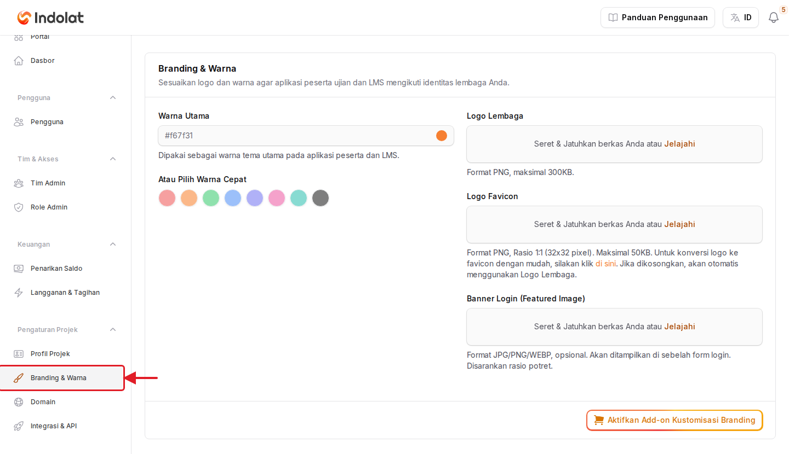
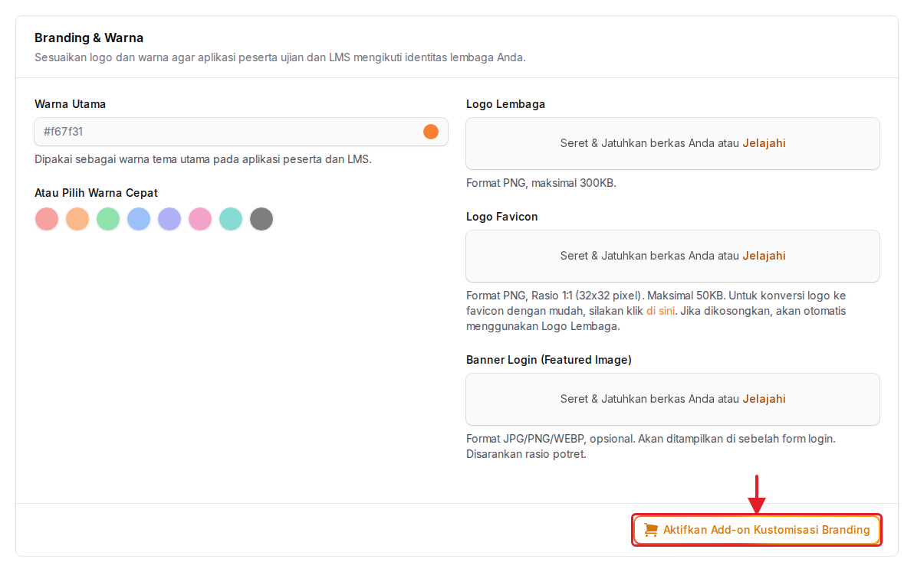
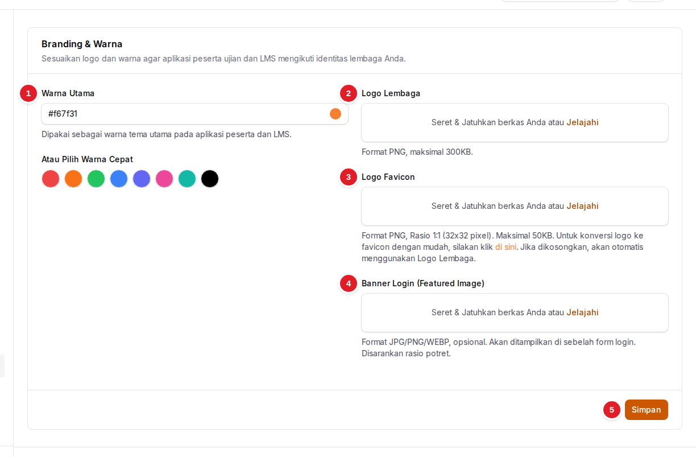
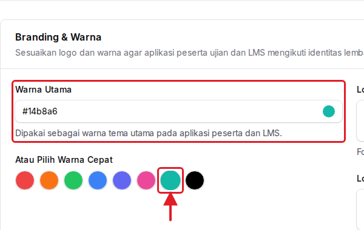
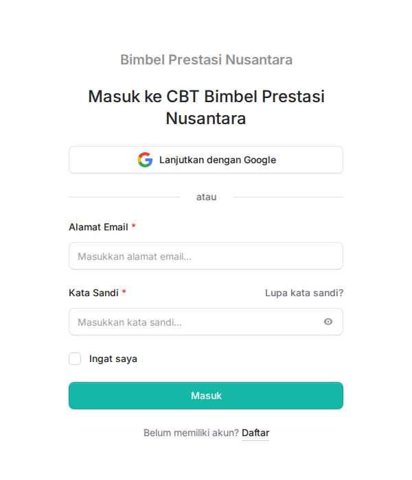
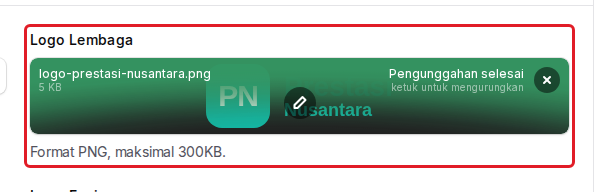
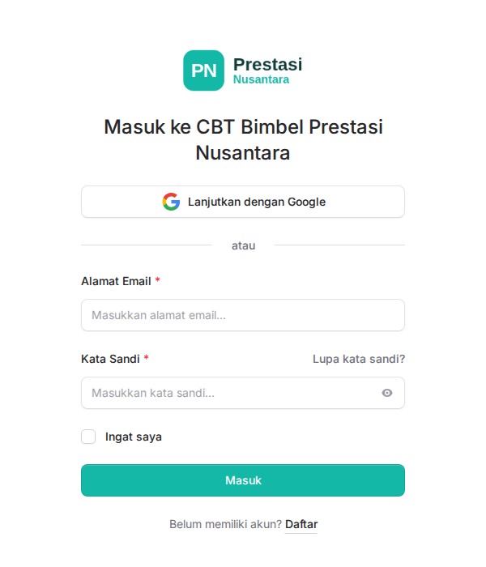
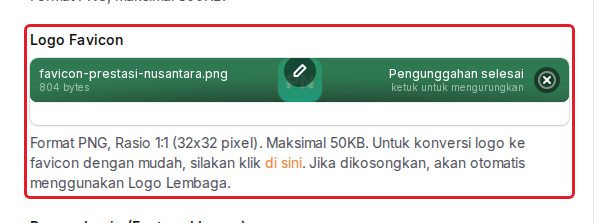
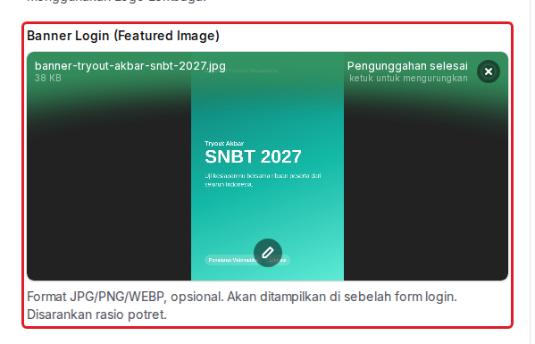
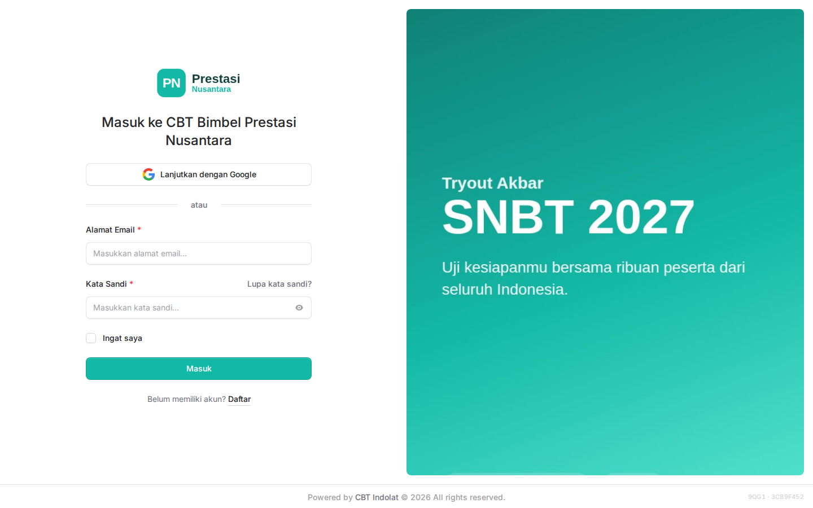

You can adjust the participant app to match your institution's identity, so participants can be sure they have opened the right exam system. This covers the primary colour, the institution logo, the favicon and the banner next to the login form. The participant exam app (CBT) and the LMS use the same appearance.

<Info>
  **Menu location:** **Portal** → **Administrasi Aplikasi** (Application Administration) → **Pengaturan Projek** (Project Settings) → **Branding & Warna** (Branding & Colours)

  **Required role:** project owner, or an admin whose role has access to the **Branding & Warna** module.

  **Requirement:** the **Kustomisasi Branding** (Branding Customisation) add-on is active.
</Info>

How participants log in (the Google button and self-registration) is covered in [Participant Login](/en/lainnya/login-peserta), while the institution name and project code are set in [Project Profile](/en/administrasi/profil-projek).

<Frame>
  
</Frame>

## Activate the Kustomisasi Branding add-on

**Kustomisasi Branding** is an add-on. Until it is active, the fields on the **Branding & Warna** page cannot be changed, the **Simpan** (Save) button is hidden, and the participant app uses the default Indolat appearance.

<Frame>
  
</Frame>

Click **Aktifkan Add-on Kustomisasi Branding** (Activate the Branding Customisation add-on) to open the add-on purchase confirmation in **Administrasi Aplikasi** → **Keuangan** (Finance) → **Langganan & Tagihan** (Subscription & Billing). Once the add-on is active, return to the **Branding & Warna** page.

## Set up your branding

<Steps>
  <Step title="Open the Branding & Warna page">
    With the add-on active, every field can be filled in and the **Simpan** button appears at the bottom.

    <Frame>
      
    </Frame>

    1. **Warna Utama** (Primary Colour)
    2. **Logo Lembaga** (Institution Logo)
    3. **Logo Favicon**
    4. **Banner Login (Featured Image)**
    5. **Simpan**
  </Step>
  <Step title="Choose the Warna Utama">
    The primary colour is the theme colour of the participant app and LMS, for example on the **Masuk** (Log in) button and the participant page header. Enter a colour code (for example `#14b8a6`), pick one with the colour picker, or click one of the colours under **Atau Pilih Warna Cepat** (Or Pick a Quick Colour).

    For example, Bimbel Prestasi Nusantara uses a teal colour.

    <Frame>
      
    </Frame>

    This is the participant login page after the primary colour is saved:

    <Frame>
      
    </Frame>
  </Step>
  <Step title="Upload the Logo Lembaga">
    Click **Jelajahi** (Browse) in the **Logo Lembaga** field and choose the logo file. Once it is uploaded, you can click the pencil icon on the preview to crop or adjust the image.

    <Frame>
      
    </Frame>

    The logo appears above the participant login form, replacing the institution name text.

    <Frame>
      
    </Frame>

    <Note>
      Use a **PNG** image of at most **300 KB**. A logo with a transparent background looks best.
    </Note>
  </Step>
  <Step title="Upload the Logo Favicon (optional)">
    The favicon is the small icon shown on the browser tab, next to the page title.

    <Frame>
      
    </Frame>

    <Note>
      Use a **PNG** image with a **1:1** ratio (32 × 32 pixels) of at most **50 KB**. If you leave this field empty, the system creates the favicon from the **Logo Lembaga** automatically. You can also use the **di sini** (here) link in the field's help text to convert a logo into a favicon.
    </Note>
  </Step>
  <Step title="Upload the Banner Login (optional)">
    The login banner is the image shown next to the participant login form. You can use it to show tryout information, promotions, exam schedules or your institution's imagery.

    <Frame>
      
    </Frame>

    This is the participant login page with the primary colour, logo and banner saved:

    <Frame>
      
    </Frame>

    <Note>
      Use a **JPG**, **PNG** or **WEBP** image of at most **2 MB**, preferably in portrait orientation. The banner is scaled to fill the area next to the form, so its edges may be cropped; keep important text in the middle of the image. The banner only appears on wide screens such as laptops and desktops, not on phones.
    </Note>
  </Step>
  <Step title="Click Simpan">
    When everything looks right, click **Simpan** at the bottom of the page (number 5 in the form image above). The change applies to the participant app and LMS straight away.
  </Step>
</Steps>

<Info>
  **Branding & Warna** only changes the appearance. The participant login link follows the project code in [Project Profile](/en/administrasi/profil-projek), while the login options are set in **Platform Ujian (CBT)** → **Lainnya** → **Pengaturan Aplikasi** (see [Participant Login](/en/lainnya/login-peserta)).
</Info>
