This page covers the settings that decide how participants enter the exam app: the login link you share with participants, the Google login button, and self-registration. The last section shows the registration and email verification steps from the participant's side.

<Info>
  **Menu location:** **Portal** → **Platform Ujian (CBT)** (Exam Platform) → **Lainnya** (Other) → **Pengaturan Aplikasi** (Application Settings)

  **Required role:** project owner, or an admin whose role has access to the **Pengaturan Aplikasi** module.
</Info>

For example, you are the admin of **Bimbel Prestasi Nusantara** and want to share the **Tryout Akbar SNBT 2027** link with participants on WhatsApp or social media. Participants open the link, then log in with an account you prepared or create their own account.

<Note>
  The institution name, project code and participant app language are now set in **Administrasi Aplikasi** (Application Administration) → **Pengaturan Projek** (Project Settings) → **Profil Projek** (Project Profile). See [Project Profile](/en/administrasi/profil-projek). The logo, colour and login banner are set in **Branding & Warna**; see [Customise the Website Appearance](/en/lainnya/kustomisasi-tampilan-website).
</Note>

<Frame>
  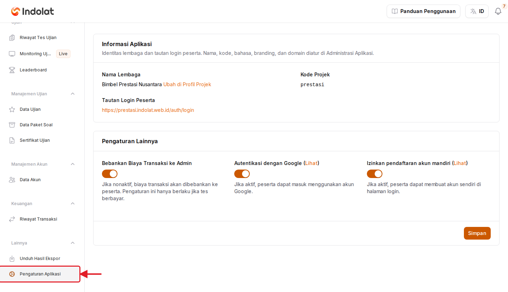
</Frame>

## Informasi Aplikasi (Application Information)

The **Informasi Aplikasi** card is read-only on this page.

<Frame>
  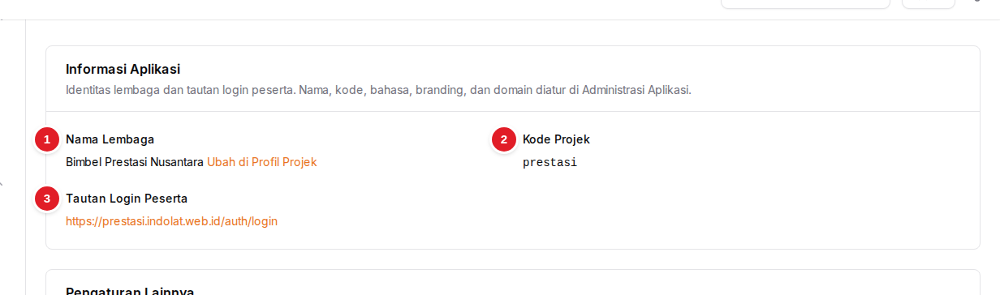
</Frame>

1. **Nama Lembaga** (Institution Name): the name shown on the participant login page, for example **Bimbel Prestasi Nusantara**. The system adds the word **CBT** automatically, so the login page heading becomes **Masuk ke CBT Bimbel Prestasi Nusantara**.
2. **Kode Projek** (Project Code): your project's short code, for example `prestasi`. It is part of the participant app address.
3. **Tautan Login Peserta** (Participant Login Link): the login page address you share with participants, in the format `https://<project-code>.indolat.web.id/auth/login`. For example, `https://prestasi.indolat.web.id/auth/login`. Click the link to open it in a new tab.

To change the institution name, project code or participant app language, click **Ubah di Profil Projek** (Change in Project Profile). You are taken to the [Project Profile](/en/administrasi/profil-projek) page in **Administrasi Aplikasi**.

<Frame>
  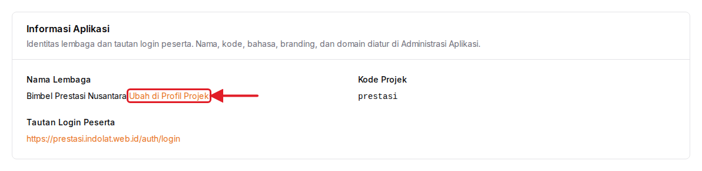
</Frame>

<Warning>
  Changing the project code also changes the participant login link. Links you have already shared no longer point to your project, so you need to share the new link.
</Warning>

## Pengaturan Lainnya (Other Settings)

The **Pengaturan Lainnya** card has three switches, saved with the **Simpan** (Save) button.

<Frame>
  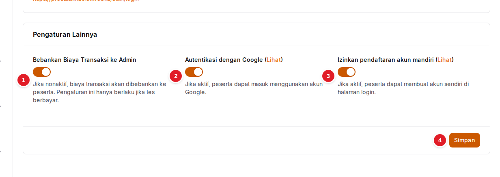
</Frame>

1. **Bebankan Biaya Transaksi ke Admin** (Charge Transaction Fee to Admin)
2. **Autentikasi dengan Google** (Google Authentication)
3. **Izinkan pendaftaran akun mandiri** (Allow self-registration)
4. **Simpan**

<Steps>
  <Step title="Decide who pays the transaction fee (optional)">
    <Frame>
      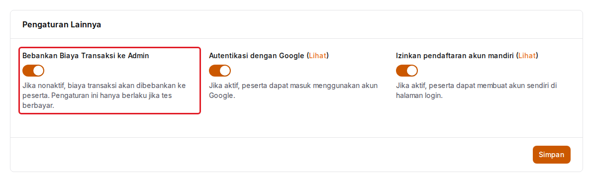
    </Frame>

    **Bebankan Biaya Transaksi ke Admin** only applies to paid exams.

    - When it is on, you as the organiser pay the payment transaction fee, and it is deducted from the participant's payment.
    - When it is off, the transaction fee is added to the participant's bill.

    For example, with an exam fee of **Rp50,000** and a transaction fee of **Rp2,000**:

    | Setting | Participant pays | Admin receives |
    | --- | --- | --- |
    | On | Rp50,000 | Rp48,000 |
    | Off | Rp52,000 | Rp50,000 |
  </Step>
  <Step title="Set Autentikasi dengan Google (optional)">
    <Frame>
      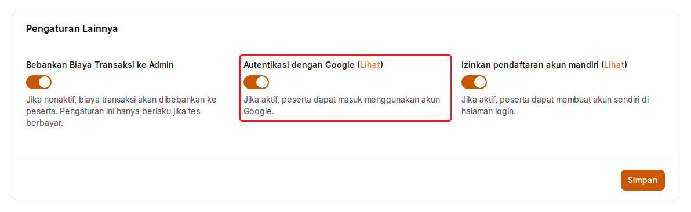
    </Frame>

    - When it is on, the **Lanjutkan dengan Google** (Continue with Google) button appears on the participant login page, and **Daftar dengan Google** (Register with Google) appears on the registration page. Participants can log in with their Google account without remembering a new password.

      <Frame>
        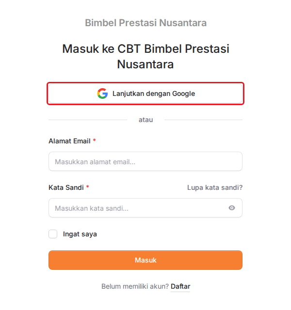
      </Frame>

    - When it is off, the button is hidden and participants log in with their email address and password.

      <Frame>
        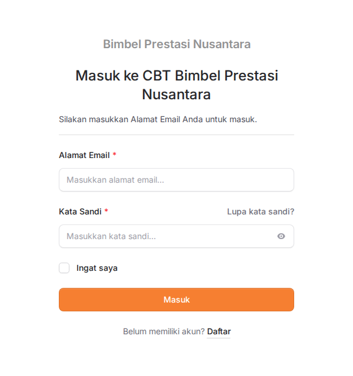
      </Frame>

    <Note>
      The Google login button is not shown when the login page is opened in the Indolat native mobile app, even when this setting is on.
    </Note>
  </Step>
  <Step title="Set Izinkan pendaftaran akun mandiri (optional)">
    <Frame>
      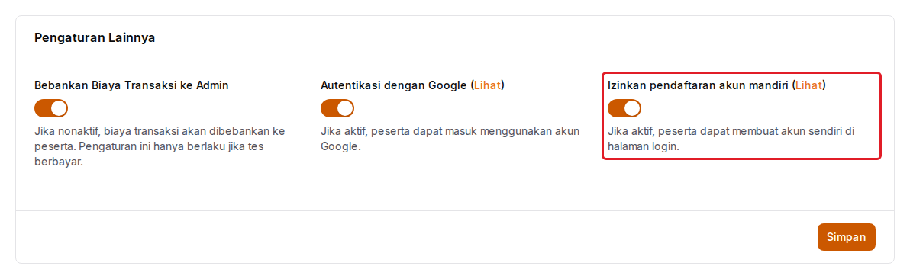
    </Frame>

    - When it is on, a **Daftar** (Register) link appears below the **Masuk** (Log in) button on the participant login page, so participants can create their own account.

      <Frame>
        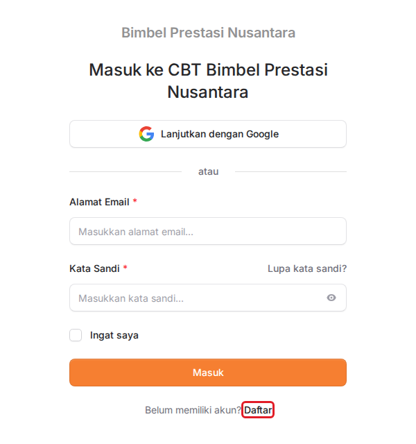
      </Frame>

    - When it is off, the **Daftar** link is hidden. Participants can only log in with accounts an admin prepared with **Tambah Akun** or **Import Akun** (see [Add Participant Accounts](/en/data-akun/menambahkan-akun-peserta)).

      <Frame>
        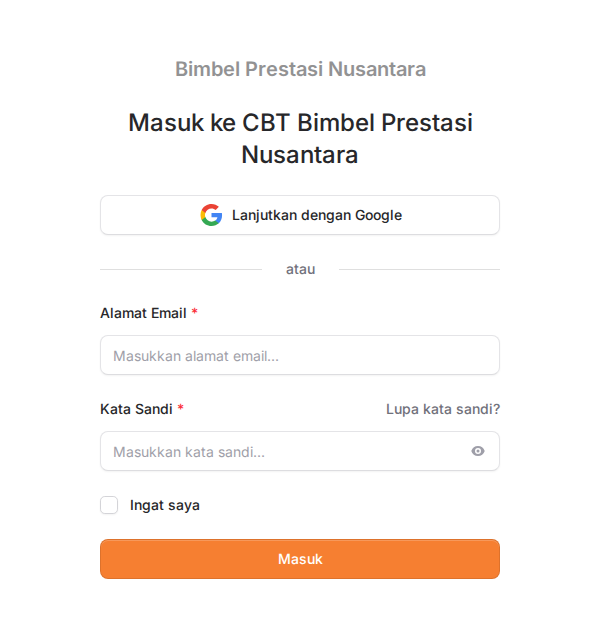
      </Frame>
  </Step>
  <Step title="Click Simpan">
    <Frame>
      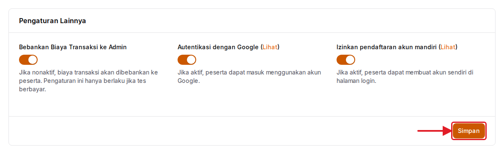
    </Frame>

    After saving, the **Berhasil Menyimpan Pengaturan** (Settings saved) notification appears. The change applies to the participant login page straight away.
  </Step>
</Steps>

## How participants register and log in

The following steps apply when **Izinkan pendaftaran akun mandiri** is on. Participants who already have an account just fill in **Alamat Email** (Email Address) and **Kata Sandi** (Password) on the login page and click **Masuk**.

<Steps>
  <Step title="The participant opens the login link and clicks Daftar">
    <Frame>
      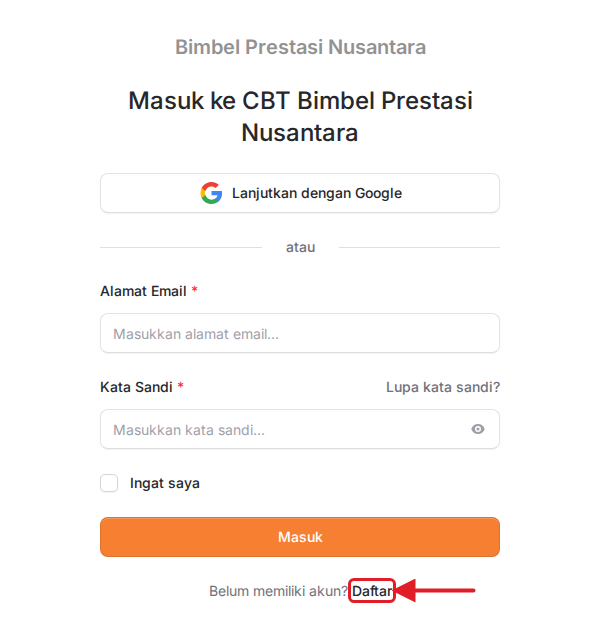
    </Frame>
  </Step>
  <Step title="The participant fills in the registration form">
    <Frame>
      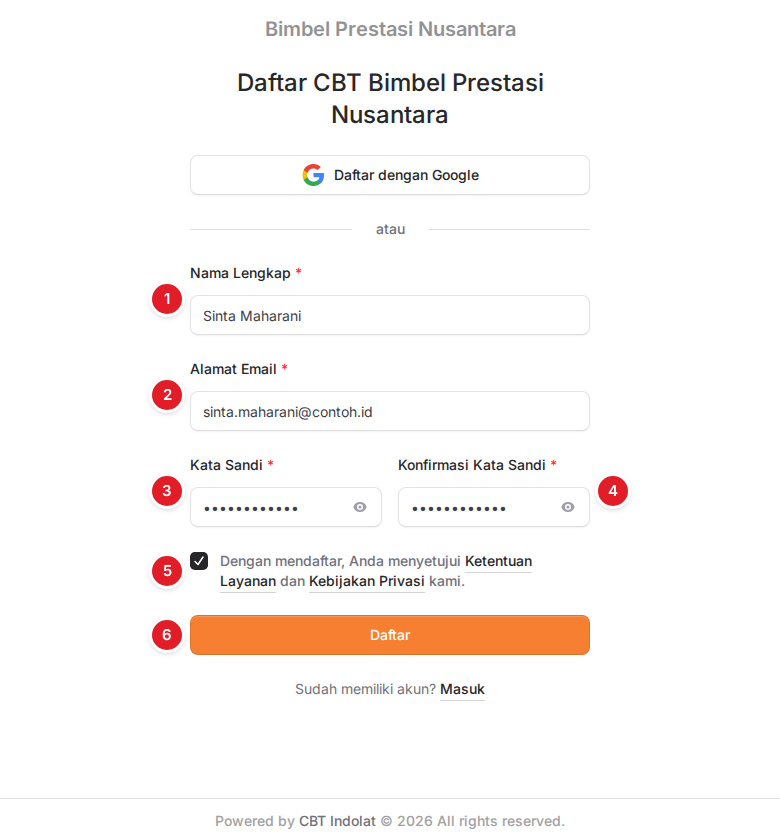
    </Frame>

    1. **Nama Lengkap** (Full Name): the name used in the system, for example **Sinta Maharani**.
    2. **Alamat Email**: an active email address owned by the participant, for example `sinta.maharani@contoh.id`. The verification code is sent here.
    3. **Kata Sandi**: at least 8 characters.
    4. **Konfirmasi Kata Sandi** (Confirm Password): the same password as the previous field.
    5. **Agreement**: tick the statement that the participant agrees to the **Ketentuan Layanan** (Terms of Service) and **Kebijakan Privasi** (Privacy Policy).
    6. **Daftar**: click to create the account.

    <Note>
      Registration is refused if the email address is already registered in the same project, or if it belongs to a temporary (_disposable_) or anonymous email service.
    </Note>
  </Step>
  <Step title="The participant opens the verification email">
    After registering, the participant is taken to the **Verifikasi Email Anda** (Verify Your Email) page.

    <Frame>
      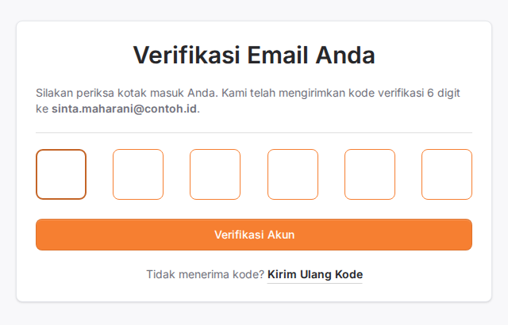
    </Frame>

    The system sends an email from **CBT Indolat** with the subject **Kode OTP Anda: [code]** (Your OTP code). The email contains a 6-digit verification code.

    <Frame>
      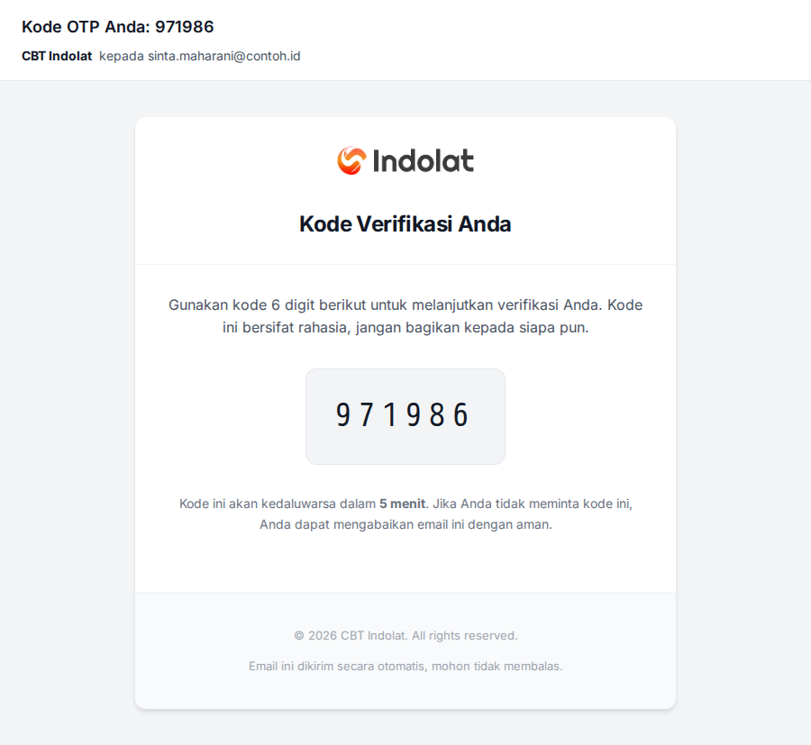
    </Frame>
  </Step>
  <Step title="The participant enters the code and clicks Verifikasi Akun">
    <Frame>
      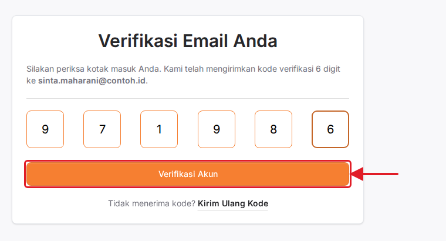
    </Frame>

    <Note>
      The verification code is only valid for **5 minutes**. If the code has not arrived or has expired, click **Kirim Ulang Kode** (Resend Code) to get a new one. Check the spam folder too.

      <Frame>
        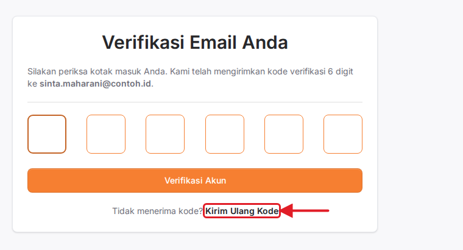
      </Frame>
    </Note>
  </Step>
  <Step title="The participant lands on the Daftar Tes page">
    <Frame>
      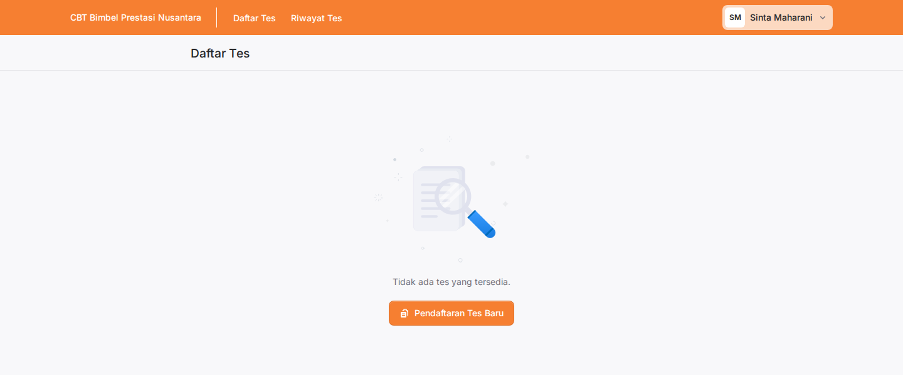
    </Frame>

    Once verification succeeds, the participant lands on the **Daftar Tes** (Test List) page. The **Pendaftaran Tes Baru** (New Test Registration) button appears when an active exam is currently running, so the participant can find and register for an exam.

    <Info>
      Email verification is only needed for participants who register themselves. Accounts added by an admin with **Tambah Akun** or **Import Akun** are verified immediately. If a participant does not receive the code, an admin can verify the account manually with the **Verifikasi Email** button in the participant account list.
    </Info>
  </Step>
</Steps>
