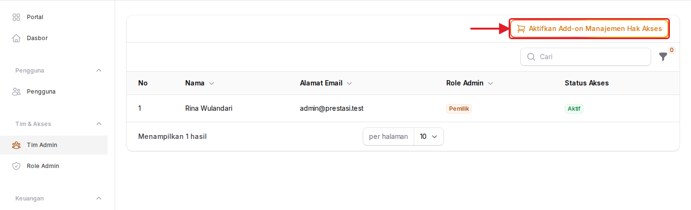
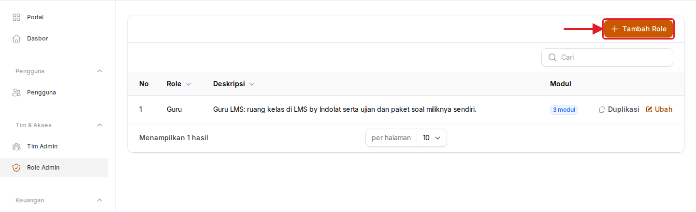
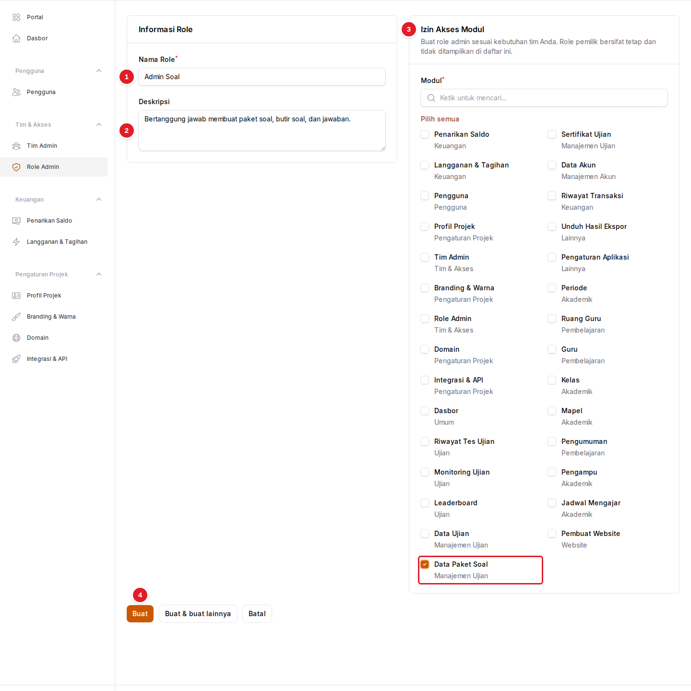
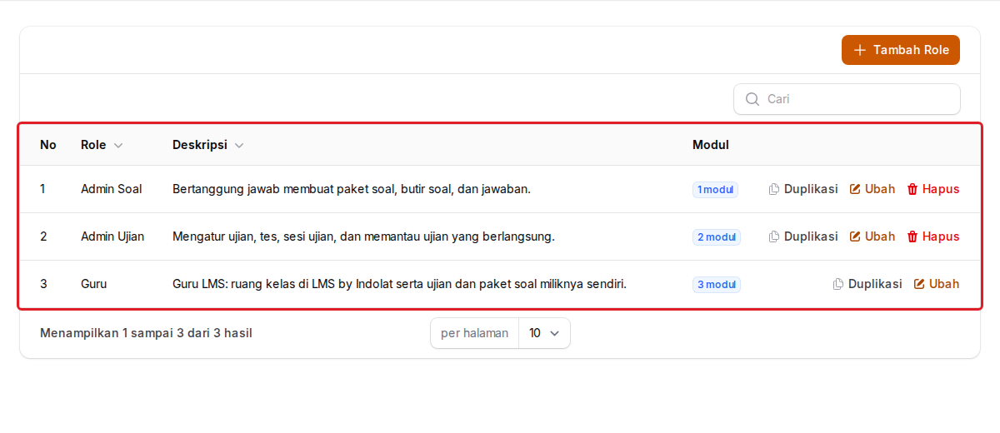
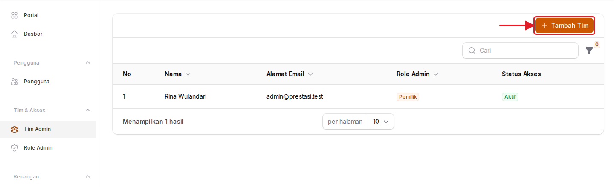
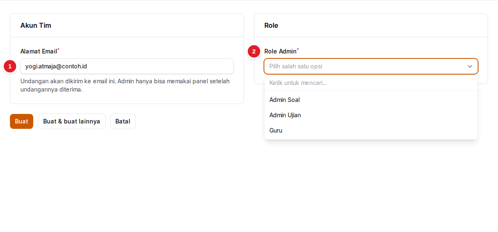
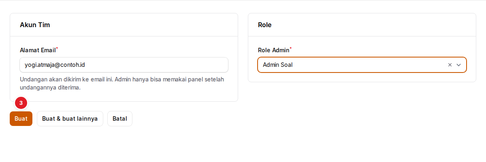
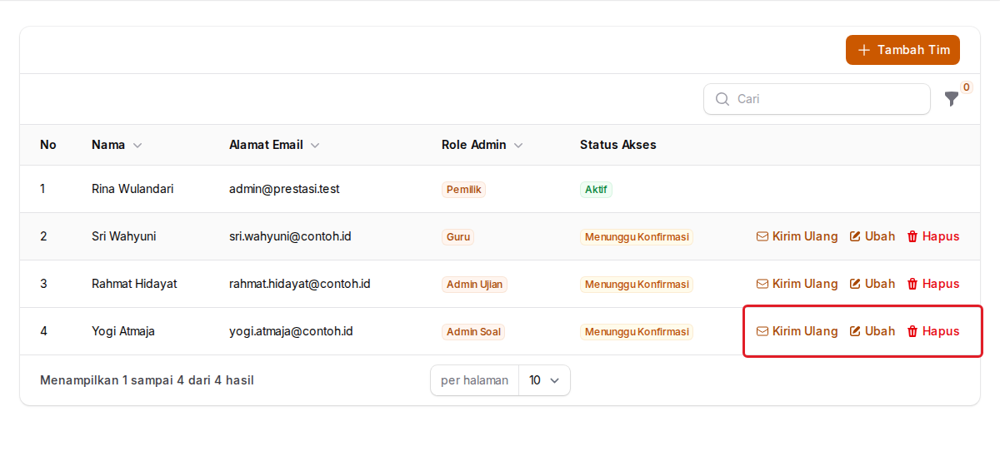
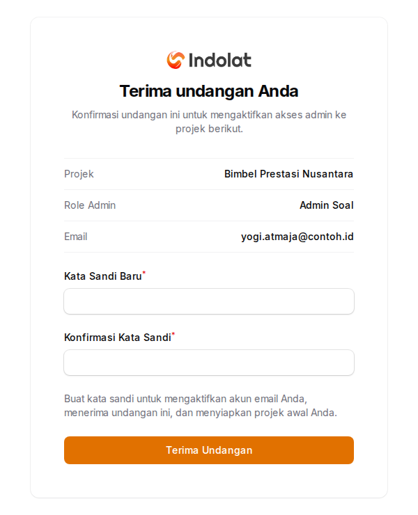

So that a project doesn't rest on one person, you can invite team members and decide which modules they may open. This takes two stages: create a **Role Admin** (Admin Role) for each job, then invite members through **Tim Admin** (Admin Team) with that role.

<Info>
  **Menu location:** **Portal** → **Administrasi Aplikasi** → **Tim & Akses** → **Tim Admin** or **Role Admin**.

  **Required role:** the project owner, or a team member whose role includes the **Tim Admin** and **Role Admin** modules.
</Info>

For example, **Bimbel Prestasi Nusantara** has two extra staff members and one teacher:

- **Yogi Atmaja** as **Admin Soal** (question admin), who prepares question packages, questions and answers.
- **Rahmat Hidayat** as **Admin Ujian** (exam admin), who sets up exams, tests and exam sessions and monitors running exams.
- **Sri Wahyuni** as **Guru** (teacher), who teaches in the LMS.

Rina Wulandari, the **Pemilik** (owner), can still open every module.

## The Manajemen Hak Akses add-on

Inviting team members requires the **Manajemen Hak Akses** (Access Management) add-on to be active on the project. The add-on is included in the **Rutin** and **Intensif** plans, or can be bought separately through [Subscription & Billing](/en/administrasi/langganan-dan-tagihan).

While the add-on is inactive:

- the project owner can still prepare **Role Admin** entries;
- the **Tambah Tim** (Add Team) button is hidden, and the page shows an **Aktifkan Add-on Manajemen Hak Akses** button that opens the add-on purchase page;
- team members other than the owner can't open the project, except members with the **Guru** role.

<Frame>
  
</Frame>

## 1. Create an Admin Role

A **Role Admin** decides which modules a team member may open and manage. One role can be used by many members.

<Steps>
  <Step title="Click Tambah Role">
    Open **Administrasi Aplikasi** → **Tim & Akses** → **Role Admin**, then click **Tambah Role** (Add Role).

    <Frame>
      
    </Frame>
  </Step>
  <Step title="Fill in the role and pick modules">
    <Frame>
      
    </Frame>

    1. **Nama Role** (role name): an easy-to-recognise name, for example `Admin Soal`.
    2. **Deskripsi** (description, optional): what the role is responsible for, for example `Bertanggung jawab membuat paket soal, butir soal, dan jawaban.`
    3. **Izin Akses Modul** (module access permissions): tick the modules the role may open. For **Admin Soal**, tick **Data Paket Soal**.
    4. Click **Buat** (Create) to save, or **Buat & buat lainnya** to create another role straight away.

    Modules are listed per product in the order of the **Portal**: **Administrasi Aplikasi** modules first, then **Platform Ujian (CBT)**, **Learning Management System (LMS)** and **Pembuat Website**. The small text under each module shows its sidebar group, for example **Data Paket Soal** belongs to the **Manajemen Ujian** group.

    | Product | Modules you can pick |
    | --- | --- |
    | Administrasi Aplikasi | Penarikan Saldo, Langganan & Tagihan, Pengguna, Profil Projek, Tim Admin, Branding & Warna, Role Admin, Domain, Integrasi & API |
    | Platform Ujian (CBT) | Dasbor, Riwayat Tes Ujian, Monitoring Ujian, Leaderboard, Data Ujian, Data Paket Soal, Sertifikat Ujian, Data Akun, Riwayat Transaksi, Unduh Hasil Ekspor, Pengaturan Aplikasi |
    | Learning Management System (LMS) | Periode, Ruang Guru, Guru, Kelas, Mapel, Pengumuman, Pengampu, Jadwal Mengajar |
    | Pembuat Website | Pembuat Website |

    <Tip>
      Use the search box above the list to find a module quickly, or **Pilih semua** (select all) to tick every module. At least one module is required.
    </Tip>

    <Note>
      You can only grant modules you hold yourself. If a role contains modules outside your access, saving is refused with the message *Anda tidak dapat memberikan akses modul yang tidak Anda miliki.*
    </Note>
  </Step>
  <Step title="Check the role list">
    New roles appear in the **Role Admin** list with their module count.

    <Frame>
      
    </Frame>

    - **Duplikasi** (Duplicate): copies the role with the same modules. You're asked for a **Nama Role Baru** (new role name), which defaults to the role name plus `Copy`.
    - **Ubah** (Edit): changes the name, description or modules. Changes apply immediately to every member using the role.
    - **Hapus** (Delete): deletes the role. The button only appears for roles no team member uses; move or remove those members first.
  </Step>
</Steps>

### Built-in roles

- **Pemilik** (owner): the fixed role of the project owner with access to every module. It isn't listed and can't be changed.
- **Guru** (teacher): a system role for LMS teachers with the **Ruang Guru**, **Data Ujian** and **Data Paket Soal** modules. Teachers only see their own exams and question packages. The role can be edited and duplicated but not deleted. Members with the **Guru** role can sign in even when the **Manajemen Hak Akses** add-on is inactive.

## 2. Invite Admin Team members

<Steps>
  <Step title="Click Tambah Tim">
    Open **Administrasi Aplikasi** → **Tim & Akses** → **Tim Admin**, then click **Tambah Tim**.

    <Frame>
      
    </Frame>
  </Step>
  <Step title="Enter the email and pick a role">
    <Frame>
      
    </Frame>

    1. **Alamat Email** (email address): the invitee's email, for example `yogi.atmaja@contoh.id`. The invitation is sent here, so make sure it's correct and active. If the email already belongs to another admin account, the form shows **Akun Terdeteksi** (account detected) with the owner's name.
    2. **Role Admin**: pick the role for the member's job. The options come from the **Role Admin** list, including **Guru**.

    <Frame>
      
    </Frame>

    3. Click **Buat**. The invitation is sent and the notification *Undangan admin berhasil dikirim.* appears.

    <Note>
      An email can only be invited once per project. If an earlier invitation hasn't been accepted yet, you'll see a message that it's still waiting; use **Kirim Ulang** in the team list instead.
    </Note>
  </Step>
  <Step title="Track the invitation">
    The invitee appears in the **Tim Admin** list with **Status Akses** set to **Menunggu Konfirmasi** (awaiting confirmation) until the invitation is accepted, then **Aktif**. The member's name is temporarily taken from the first part of their email address.

    <Frame>
      
    </Frame>

    - **Kirim Ulang** (Resend): sends the invitation email again. It's only shown while the status is **Menunggu Konfirmasi**. The previous link stops working after a resend.
    - **Ubah** (Edit): changes the member's **Role Admin**. The email address can't be changed.
    - **Hapus** (Delete): removes the member's access to the project.

    Use the **Role** filter to list members with a specific role. The **Pemilik** row has no action buttons.
  </Step>
</Steps>

## 3. Accept the invitation

The member receives an **Undangan Admin Projek** email (or **Undangan Mengajar di LMS** for the **Guru** role). The link is valid for 7 days and opens the **Terima undangan Anda** (accept your invitation) page showing the project, role and email.

<Frame>
  
</Frame>

- If the email has no account yet, the member fills in **Kata Sandi Baru** (new password) and **Konfirmasi Kata Sandi**, then clicks **Terima Undangan** (Accept Invitation). The new account also gets a starter project of its own, so the member can switch projects with **Ganti Projek** on the Portal.
- If the email already has an account, the member just clicks **Terima Undangan**; the existing password stays unchanged.

<Tip>
  If the status stays **Menunggu Konfirmasi**, ask the member to check their inbox and spam folder, or click **Kirim Ulang**.
</Tip>

Once accepted, the member signs in on the panel login page and picks **Bimbel Prestasi Nusantara** on the Portal. Each module's sidebar only shows the menus included in their role.
