The **Sertifikat Ujian** (Exam Certificate) feature lets you create certificates that participants can download after finishing an exam. Each certificate template is linked to one exam. You decide the issuing requirements (such as a minimum score), how the certificate looks, who signs it, and whether an admin has to approve it before it can be downloaded.

<Info>
  **Menu location:** **Portal** → **Platform Ujian (CBT)** → **Manajemen Ujian** → **Sertifikat Ujian**.
</Info>

The examples on this page use the template **Sertifikat Tryout Mingguan Penalaran – Pekan 3** for the exam **Tryout Mingguan Penalaran – Pekan 3** (code **TMP-P3**). The certificate is given to participants who finish every test with a final score of at least 12.

## The Exam Certificate add-on

**Sertifikat Ujian** is an add-on. While the add-on is inactive, the **Aktifkan Add-on Sertifikat Ujian** (activate the add-on) button is shown on the **Sertifikat Ujian** page. Click it to buy the add-on through **Langganan & Tagihan**; see [Langganan dan Tagihan](/en/administrasi/langganan-dan-tagihan).

<Frame>
  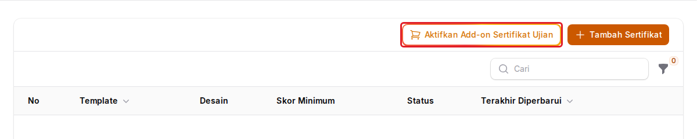
</Frame>

While the add-on is inactive you can still prepare templates. The form shows the **Add-on Sertifikat Ujian belum aktif** warning, **Status** can only be **Draft**, and **Tampilkan ke peserta** (show to participants) cannot be turned on. As a result, participants cannot request or download certificates yet.

<Frame>
  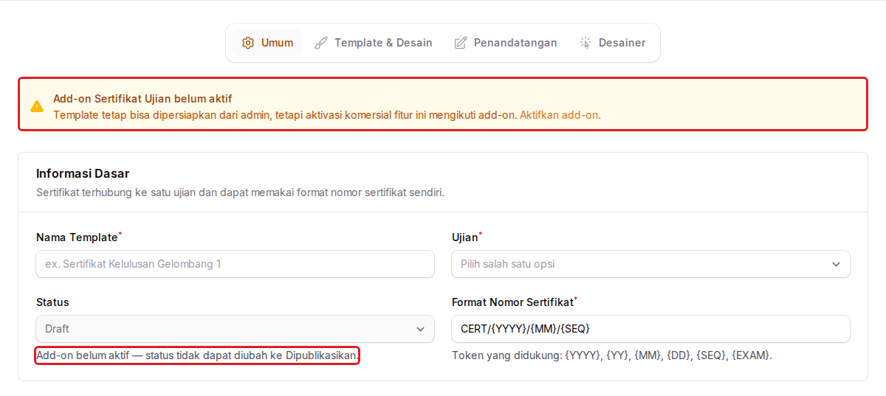
</Frame>

<Note>
  If the add-on expires, participants whose certificates were already approved can still download them. New certificates cannot be issued until the add-on is active again.
</Note>

## 1. Creating a certificate template

<Steps>
  <Step title="Click Tambah Sertifikat">
    Open the **Sertifikat Ujian** menu and click **Tambah Sertifikat** (add certificate).

    <Frame>
      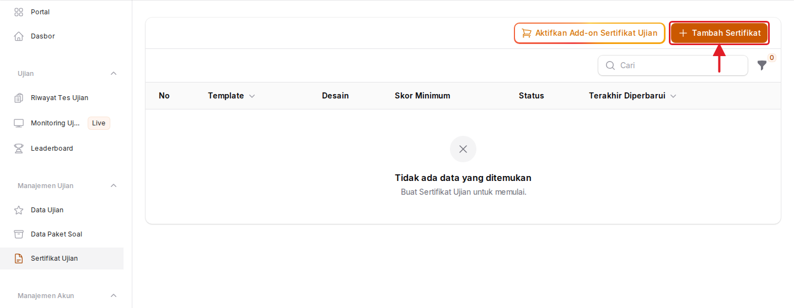
    </Frame>
  </Step>
  <Step title="Get to know the form tabs">
    The certificate form has four tabs:

    <Frame>
      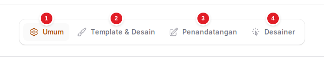
    </Frame>

    1. **Umum** (general): name, exam, status, certificate number, and issuing rules.
    2. **Template & Desain**: layout, page size, design, logo, and colours.
    3. **Penandatangan** (signatories): the people who sign the certificate.
    4. **Desainer**: the position and content of each certificate element.

    After the template is saved, a **Sertifikat Terbit** (issued certificates) tab also appears for managing participants' certificates.
  </Step>
</Steps>

### A. The Umum tab

**Informasi Dasar** (basic information)

<Frame>
  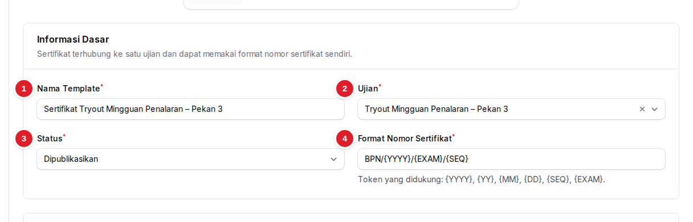
</Frame>

1. **Nama Template**: a name to tell templates apart in the admin list. Example: **Sertifikat Tryout Mingguan Penalaran – Pekan 3**.
2. **Ujian**: the exam that uses this certificate. One template is linked to one exam. Click the field, type part of the exam name to search, then click the exam.

   <Frame>
     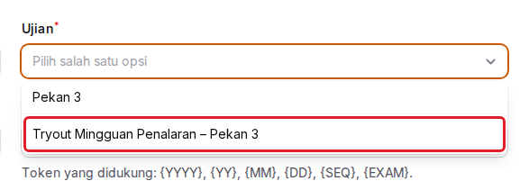
   </Frame>
3. **Status**:
   - **Draft**: the template is still being prepared and does not apply to participants.
   - **Dipublikasikan** (published): the template applies. Only available while the add-on is active.
4. **Format Nomor Sertifikat** (certificate number format): the pattern of the number generated automatically when a certificate is issued. The default is `CERT/{YYYY}/{MM}/{SEQ}`.

   <Info>
     **Supported tokens:**

     - `{YYYY}`: four-digit year, for example 2026
     - `{YY}`: two-digit year, for example 26
     - `{MM}`: two-digit month
     - `{DD}`: two-digit day
     - `{SEQ}`: certificate sequence number for this template, six digits, for example 000001
     - `{EXAM}`: exam code, letters and digits only, at most six characters
   </Info>

   Example: the format `BPN/{YYYY}/{EXAM}/{SEQ}` on an exam with the code `TMP-P3` produces `BPN/2026/TMPP3/000001`.

**Aturan Penerbitan** (issuing rules) and **Catatan** (notes)

<Frame>
  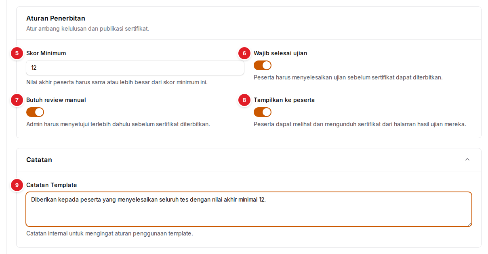
</Frame>

5. **Skor Minimum**: the minimum final score a participant needs to receive the certificate. The participant's final score must be equal to or higher than this number. Leave it empty if every participant who finishes is eligible.
6. **Wajib selesai ujian** (must finish the exam): when on (the default), the certificate is only available after the participant has finished every test in the exam.
7. **Butuh review manual** (needs manual review): when on, participants must request the certificate first and an admin must approve it before it can be downloaded. When off, eligible participants can download the certificate straight away.
8. **Tampilkan ke peserta** (show to participants): turn on so the certificate button appears on the participant's **Riwayat Tes** page. When off, the certificate is not shown to participants. Can only be turned on while the add-on is active.
9. **Catatan Template**: open the **Catatan** section to write an internal note, for example the template's usage rules. Only admins see this note.

<Tip>
  Choose **Draft** and keep **Tampilkan ke peserta** off while the design is being prepared. Switch to **Dipublikasikan** and turn on **Tampilkan ke peserta** once the certificate is ready.
</Tip>

### B. The Template & Desain tab

<Frame>
  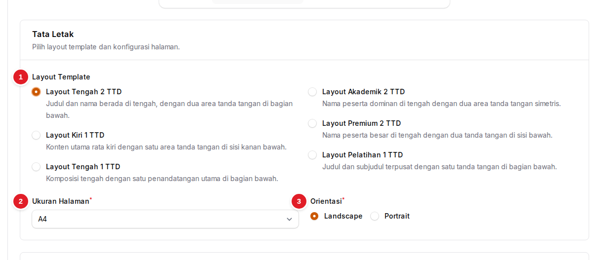
</Frame>

1. **Layout Template**: the starting arrangement of the certificate elements. The options are **Layout Tengah 2 TTD**, **Layout Kiri 1 TTD**, **Layout Tengah 1 TTD**, **Layout Akademik 2 TTD**, **Layout Premium 2 TTD**, and **Layout Pelatihan 1 TTD**. Pick a layout whose number of signatures (TTD) matches your number of signatories.
2. **Ukuran Halaman** (page size): **A4** or **Letter**.
3. **Orientasi**: **Landscape** or **Portrait**.

<Note>
  Changing **Layout Template** resets every element to that layout's default positions. Choose the layout before arranging elements in the **Desainer** tab.
</Note>

<Frame>
  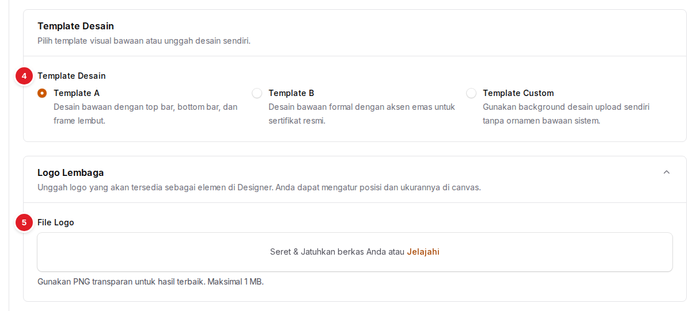
</Frame>

4. **Template Desain** (design template):
   - **Template A**: built-in design with a top bar, bottom bar, and soft frame.
   - **Template B**: built-in formal design with gold accents.
   - **Template Custom**: your own design. Upload a background image in **Background Template Custom** (PNG, JPG, or WEBP). The recommended resolution is 3508 × 2480 px for landscape or 2480 × 3508 px for portrait (A4, 300 DPI).
5. **Logo Lembaga** (institution logo, optional): upload the logo in **File Logo**. Use a transparent PNG, at most 1 MB. The logo becomes available as the **Logo Lembaga** element in the **Desainer** tab.

<Frame>
  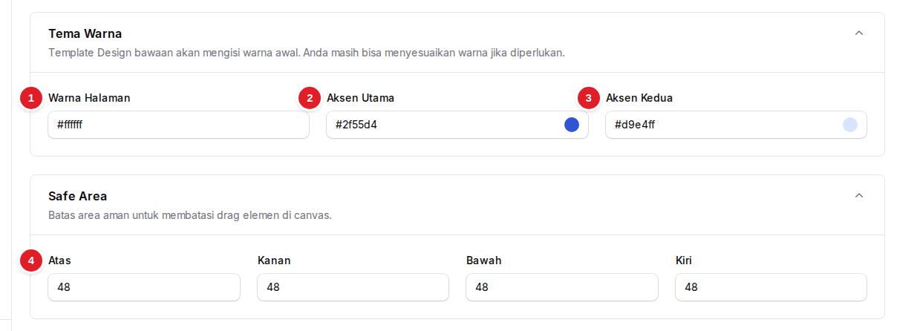
</Frame>

**Tema Warna** (colour theme) is filled in from the design template, but you can change it:

1. **Warna Halaman**: the page background colour.
2. **Aksen Utama**: the colour of the main bars and ornaments.
3. **Aksen Kedua**: the colour of the supporting ornaments.

**Safe Area** (4) is the safe margin in pixels on the **Atas** (top), **Kanan** (right), **Bawah** (bottom), and **Kiri** (left). Elements in the **Desainer** tab cannot be dragged beyond it. Keep the default values unless you have a specific need.

### C. The Penandatangan tab

A new form already has two signatories. Fill in each signatory:

<Frame>
  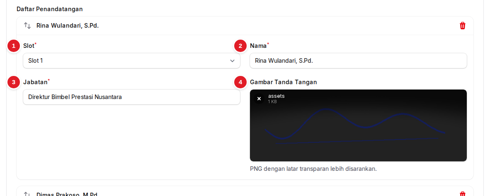
</Frame>

1. **Slot**: the signature position on the certificate, **Slot 1**, **Slot 2**, or **Slot 3**. The slot is used by the **Area Tanda Tangan**, **Nama Penandatangan**, and **Jabatan Penandatangan** elements in the **Desainer** tab.
2. **Nama**: the signatory's full name. Example: **Rina Wulandari, S.Pd.**
3. **Jabatan** (position): the signatory's title. Example: **Direktur Bimbel Prestasi Nusantara**.
4. **Gambar Tanda Tangan** (signature image): upload the signature. A PNG with a transparent background gives the cleanest result.

Click **+ Tambah Penandatangan** to add a signatory, or the bin icon to remove one. The arrow icon left of the signatory title changes the order.

<Frame>
  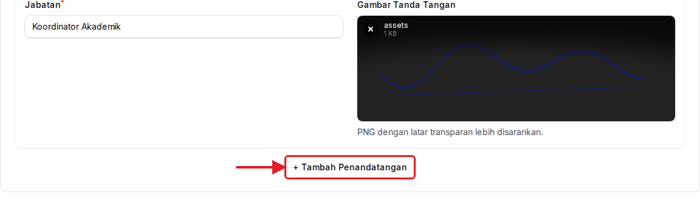
</Frame>

### D. The Desainer tab

The **Desainer** tab is where you arrange the position and content of each certificate element.

<Frame>
  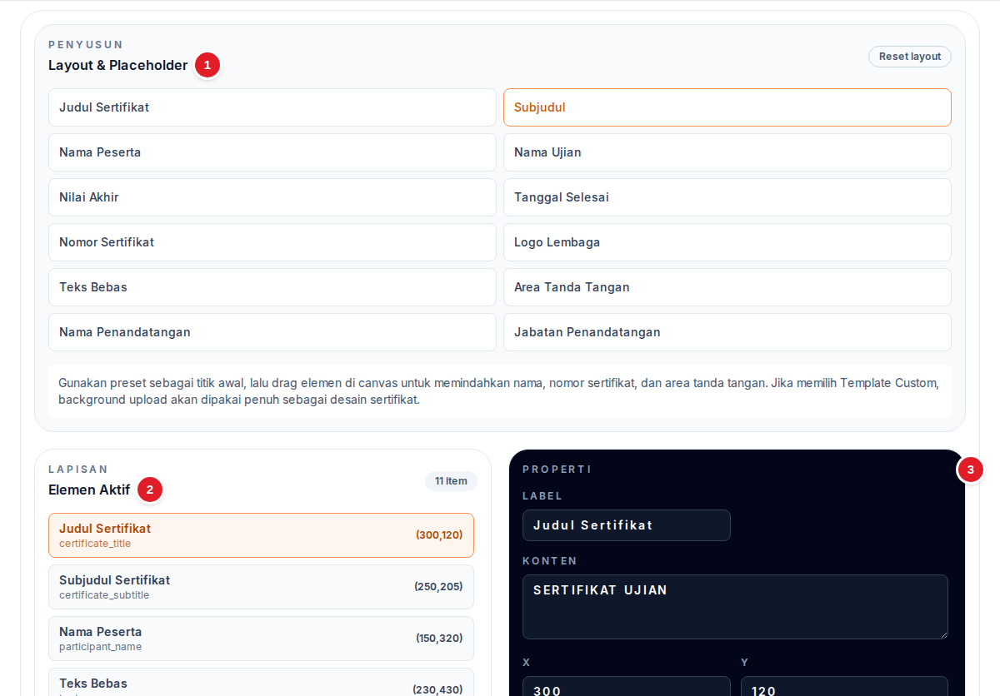
</Frame>

1. **Layout & Placeholder**: click an element name to add it to the certificate. Available elements: **Judul Sertifikat** (title), **Subjudul** (subtitle), **Nama Peserta**, **Nama Ujian**, **Nilai Akhir** (final score), **Tanggal Selesai** (completion date), **Nomor Sertifikat**, **Logo Lembaga**, **Teks Bebas** (free text), **Area Tanda Tangan** (signature area), **Nama Penandatangan**, and **Jabatan Penandatangan**. Click **Reset layout** to return to the layout's default arrangement.
2. **Elemen Aktif** (active elements): the elements on the certificate and their positions. Click an element to select it.
3. **Properti** (Properties): settings of the selected element: **Label**, **Konten** (text content), **X** and **Y** position, **Lebar** (width), **Tinggi** (height), **Font** (font size), **Tebal** (weight), **Align**, and **Warna** (colour). Click **Duplikat** to copy the element or **Hapus** to delete it. For signature elements, also choose the signatory **Slot**.

In the **Konten** of text elements you can use placeholders that are replaced with the participant's data, for example `{{exam_name}}`, `{{final_score}}`, `{{completion_date}}`, and `{{certificate_number}}`.

The **Preview Interaktif** (interactive preview) shows the certificate with a sample participant name. Drag elements directly in the preview to move them.

<Frame>
  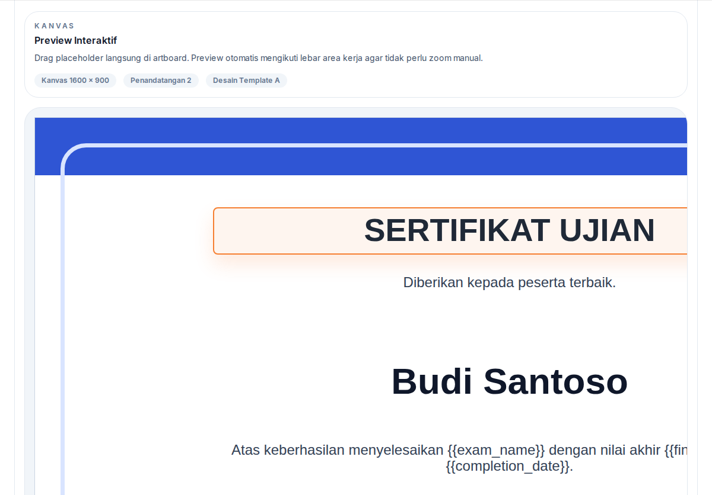
</Frame>

Check the position of the title, participant name, score, certificate number, and signatures. Make sure no text overlaps, is cut off, or sits too close to the edge. When everything looks right, click **Buat** to save the template.

## 2. Managing certificate templates

Saved templates are listed on **Sertifikat Ujian** with the columns **Template** (with the exam name), **Desain**, **Skor Minimum**, **Status**, and **Terakhir Diperbarui** (last updated).

<Frame>
  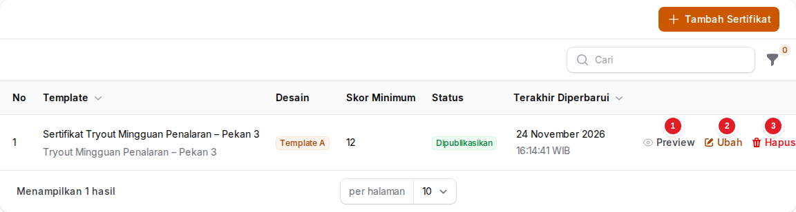
</Frame>

1. **Preview**: opens a preview of the certificate with sample data in a new tab.
2. **Ubah** (edit): opens **Ubah Sertifikat Ujian**. This page also has **Preview** and **Unduh PDF** (sample certificate as PDF) at the top right, and the **Sertifikat Terbit** tab.
3. **Hapus**: deletes the template.

Use the **Ujian** and **Status** filters to narrow the list.

## 3. The certificate flow in the participant app

The certificate appears on the participant's **Riwayat Tes** (test history) page, in the **Skor Akhir** (final score) section, when:

- the template is **Dipublikasikan** and **Tampilkan ke peserta** is on,
- the participant has finished every test (if **Wajib selesai ujian** is on), and
- the participant's final score meets the **Skor Minimum**.

Participants who do not meet the requirements do not see a certificate button. In the example, Clarissa Anindya (final score 11) sees no button, while Galih Prasetyo Utomo (final score 12) and Adinda Maharani (final score 15) do.

<Steps>
  <Step title="The participant opens Riwayat Tes">
    After signing in to the participant app, the participant clicks **Riwayat Tes** in the top menu. Participant sign-in is explained in [Login Peserta](/en/lainnya/login-peserta).

    <Frame>
      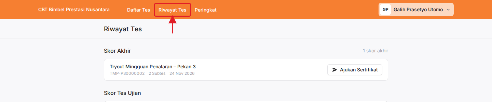
    </Frame>
  </Step>
</Steps>

### A. Without admin approval

When **Butuh review manual** is off, the **Unduh Sertifikat** (download certificate) button appears straight away in the **Skor Akhir** section.

<Frame>
  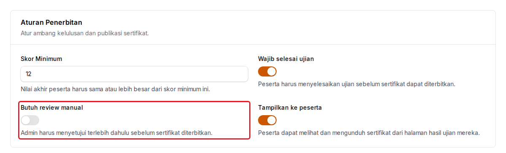
</Frame>

<Frame>
  
</Frame>

When the participant clicks **Unduh Sertifikat**, the system issues the certificate with the next number and downloads it as a PDF.

### B. With admin approval

When **Butuh review manual** is on, the flow is:

<Steps>
  <Step title="The participant clicks Ajukan Sertifikat">
    <Frame>
      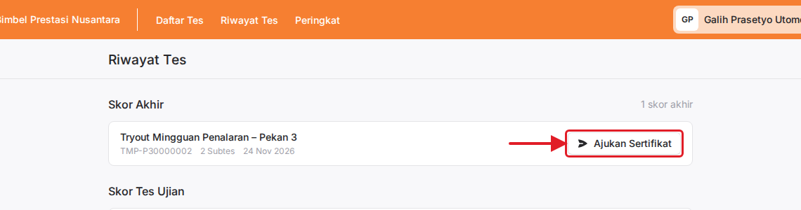
    </Frame>
  </Step>
  <Step title="The request waits for approval">
    The button changes to **Menunggu Persetujuan** (waiting for approval). The certificate and its number have been created, but it cannot be downloaded yet.

    <Frame>
      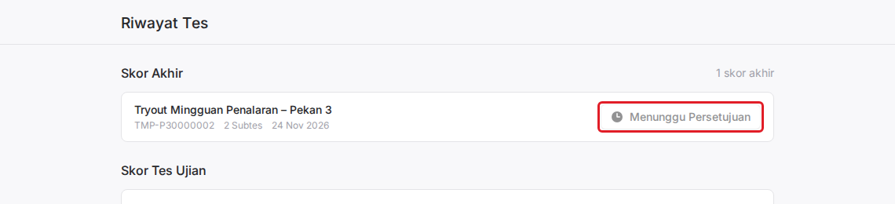
    </Frame>
  </Step>
  <Step title="An admin approves the request">
    See [4. Approving certificate requests](#4-approving-certificate-requests).
  </Step>
  <Step title="The participant downloads the certificate">
    After approval and a page reload, the button changes to **Unduh Sertifikat**. The participant clicks it to download the PDF.

    <Frame>
      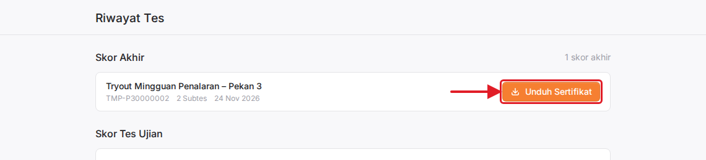
    </Frame>
  </Step>
</Steps>

<Info>
  Button summary on the participant page:

  - **Ajukan Sertifikat** (request certificate): the participant is eligible and has not requested yet.
  - **Menunggu Persetujuan**: the request is waiting for admin approval.
  - **Unduh Sertifikat**: the certificate is ready to download.
</Info>

Example of the PDF certificate the participant receives:

<Frame>
  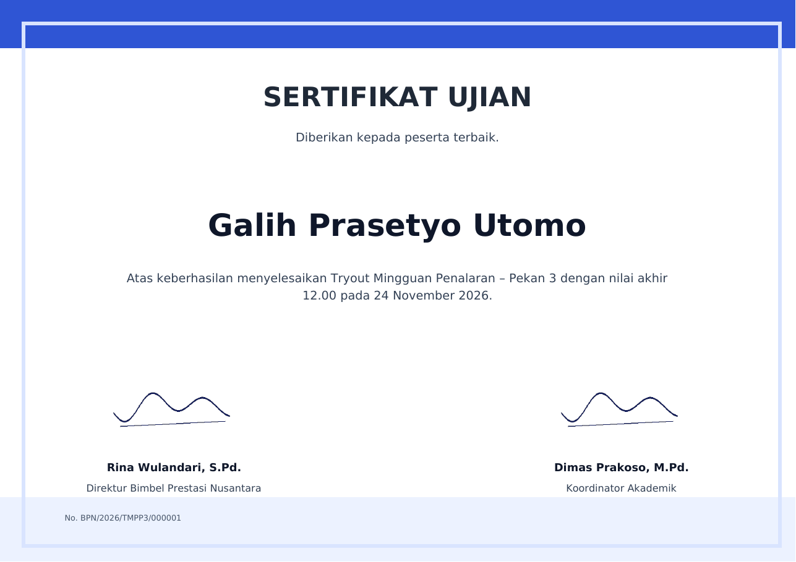
</Frame>

## 4. Approving certificate requests

<Steps>
  <Step title="Open the Sertifikat Terbit tab">
    Open the **Sertifikat Ujian** menu, click **Ubah** on the template, then click the **Sertifikat Terbit** tab. The table lists every requested or issued certificate with the columns **Nomor Sertifikat**, **Nama Peserta**, **Nilai**, and **Tanggal Terbit**. The **Tgl. Persetujuan** (approval date) column can be shown with the column icon at the top right of the table.

    <Frame>
      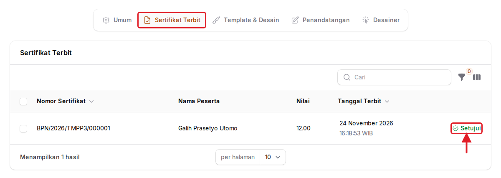
    </Frame>

    Use the **Status Persetujuan** filter (**Sudah Disetujui** or **Belum Disetujui**) to show requests that have not been handled yet.
  </Step>
  <Step title="Click Setujui">
    Click **Setujui** (approve) on the participant's row. Check the certificate number and participant name in the confirmation window, then click **Konfirmasi**.

    <Frame>
      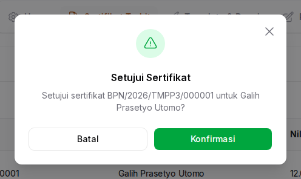
    </Frame>
  </Step>
  <Step title="The certificate is approved">
    **Setujui** is replaced by **Unduh** (download) and **Cabut** (revoke). Click **Unduh** to download that participant's certificate from the admin panel.

    <Frame>
      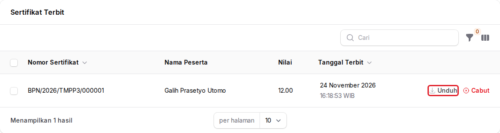
    </Frame>
  </Step>
</Steps>

To approve many requests at once, tick the rows and choose **Setujui Semua** in the bulk actions menu.

<Warning>
  **Cabut** (or **Cabut Semua** for several rows) withdraws the approval. While **Butuh review manual** is on, the participant sees **Menunggu Persetujuan** again and cannot download the certificate until it is approved again.
</Warning>
